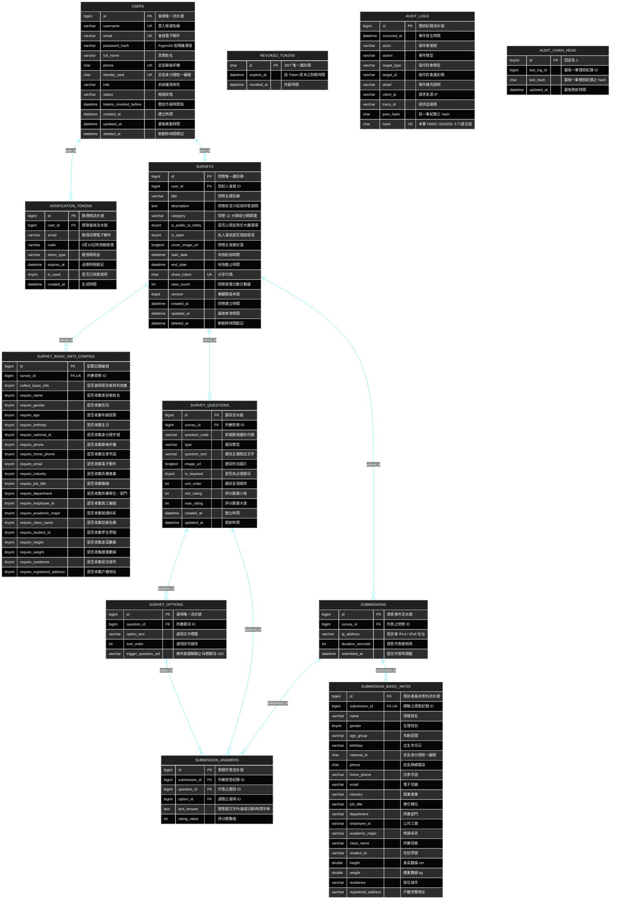

# SurveyFlow | 線上問卷設計與數據分析系統

<div align="center">

[](https://github.com/EricXJason/survey-flow/actions/workflows/ci.yml)
[](https://angular.dev/)
[](https://spring.io/projects/spring-boot)
[](https://openjdk.org/projects/jdk/21/)
[](https://tidbcloud.com/)
[](https://pages.cloudflare.com/)
[](https://render.com/)
[](docs/11-local-testing.md)

**作者**：許哲誠 (HSU, CHE-CHENG)

</div>

前後端分離的線上問卷平臺：會員可以設計 7 種題型與條件跳題的問卷、設定開放時間、以專屬連結或公開大廳收集填答，並在統計頁查看圖表與匯出 CSV / Excel / SPSS / JSON。系統包含雙 Token 認證、樂觀鎖、速率限制、個資遮罩、不可竄改的稽核日誌與結構化日誌，以 GitHub Actions 執行 CI 測試，master 推送後由 Render 與 Cloudflare Pages 自動部署。

**線上體驗**

| 服務 | 網址 | 說明 |
| :--- | :--- | :--- |
| 前端 | [https://survey-flow.pages.dev](https://survey-flow.pages.dev) | Angular 19 單頁應用，Cloudflare Pages 託管 |
| 後端 API | [https://survey-flow-9gt6.onrender.com](https://survey-flow-9gt6.onrender.com) | Spring Boot 4.1.1，Render Docker 容器 |
| 健康檢查 | [/actuator/health](https://survey-flow-9gt6.onrender.com/actuator/health) | 回傳 `{"status":"UP"}`；免費方案閒置會休眠，第一次開啟約需 50 秒喚醒 |

**示範帳號** (完整清單見 [11-local-testing.md](docs/11-local-testing.md) §5)

| 帳號 | 密碼 | 身分 | 可以體驗 |
| :--- | :--- | :--- | :--- |
| `testuser` | `User1234!` | 一般會員 | 問卷設計、管理 (開放中 / 排程中 / 已截止 / 僅限連結各一份)、統計分析與匯出 |
| `admin` | `Admin123!` | 管理員 | 會員管理 (個資遮罩、凍結 / 恢復)、稽核日誌查詢與完整性驗證 |

**規格文件** ([`docs/`](docs/))：[01 總覽](docs/01-overview.md)・[02 身分權限](docs/02-role-type.md)・[03 技術選型與 ADR](docs/03-tech-stack.md)・[04 架構與檔案字典](docs/04-architecture.md)・[05 流程圖](docs/05-flowcharts.md)・[06 API](docs/06-specs-api.md)・[07 資料庫](docs/07-specs-database.md)・[08 UI/UX](docs/08-ui-ux-standards.md)・[09 資安](docs/09-security.md)・[10 部署](docs/10-deployment.md)・[11 本機測試](docs/11-local-testing.md)

---

## 1. 系統架構

```mermaid
%%{init: {
  'theme': 'dark',
  'themeVariables': {
    'darkMode': true,
    'background': '#030712',
    'primaryColor': '#0b0f19',
    'primaryTextColor': '#f8fafc',
    'primaryBorderColor': '#00f0ff',
    'lineColor': '#00f0ff',
    'textColor': '#f8fafc',
    'edgeLabelBackground': '#0b0f19',
    'tertiaryColor': '#0b0f19'
  },
  'themeCSS': '.edgeLabel, .edgeLabel rect, .edgeLabel span, .labelBkg { background: #0b0f19 !important; background-color: #0b0f19 !important; fill: #0b0f19 !important; border: 1px solid #1e293b !important; } .edgeLabel, .edgeLabel span { color: #38bdf8 !important; fill: #38bdf8 !important; font-weight: 600 !important; font-size: 11px !important; } .cluster rect { stroke: #00f0ff !important; stroke-width: 1.5px !important; stroke-dasharray: 4 2 !important; fill: #060a14 !important; rx: 4px !important; ry: 4px !important; } .cluster text, .cluster span.nodeLabel { fill: #00f0ff !important; color: #00f0ff !important; font-weight: 700 !important; font-size: 13px !important; } rect, .node rect, rect.actor { rx: 2px !important; ry: 2px !important; }',
  'flowchart': { 'curve': 'linear' }
}}%%
flowchart LR
    classDef hudCard fill:#0b0f19,stroke:#00f0ff,stroke-width:1.5px,color:#f8fafc,rx:2px,ry:2px;

    subgraph FE ["前端"]
        direction TB
        FE_UI["頁面元件<br/>大廳 / 設計器 / 填答 / 管理 / 統計"]:::hudCard
        FE_SVC["Signals 與服務<br/>狀態、API 呼叫、Token 自動換發"]:::hudCard
        FE_UI --> FE_SVC
    end

    subgraph BE ["後端"]
        direction TB
        BE_FILTER["過濾鏈<br/>追蹤碼 / CORS / 限流 / JWT"]:::hudCard
        BE_CTRL["Controller<br/>參數驗證與回應"]:::hudCard
        BE_SVC["Service<br/>業務規則與交易"]:::hudCard
        BE_REPO["Repository<br/>100% 原生 SQL"]:::hudCard
        BE_FILTER --> BE_CTRL --> BE_SVC --> BE_REPO
    end

    subgraph EXT ["雲端服務"]
        direction TB
        DB["TiDB Cloud<br/>12 張資料表"]:::hudCard
        MAIL["Brevo<br/>HTTPS 寄送驗證信"]:::hudCard
    end

    FE_SVC -->|"HTTPS / JSON"| BE_FILTER
    BE_REPO -->|"HikariCP"| DB
    BE_SVC -->|"REST API"| MAIL
```



| 層 | 做什麼 | 重點 |
| :--- | :--- | :--- |
| 前端 | Angular 19 Standalone 元件 + Signals | 純原生 SCSS，不用 Bootstrap / Tailwind；401 時自動以 HttpOnly Cookie 換發 Token 並重送 |
| 過濾鏈 | `RequestTraceFilter` → CORS → `RateLimitFilter` → `JwtAuthenticationFilter` | 每個請求一個 traceId；依 IP 分級限流；Token 黑名單存資料庫，重啟不遺失 |
| Controller → Service → Repository | 一個 Controller 只呼叫一個入口 Service；交易只在 Service | Repository 全部 `nativeQuery = true`，不使用 JPA 衍生查詢 |
| 錯誤回應 | 全部錯誤由 `GlobalExceptionHandler` 產生 | RFC 9457 Problem Details (`application/problem+json`)，含 `code` 與 `traceId` |
| CI / 部署 | `.github/workflows/ci.yml` + 平臺自動部署 | CI 跑後端、前端、E2E 測試；master 推送後 Render 與 Pages 自動部署 |

---

## 2. 技術選型與架構決策

| 領域 | 技術 | 版本 | 為什麼 |
| :--- | :--- | :--- | :--- |
| 前端框架 | Angular (Standalone + Signals) | 19 | 強型別、內建 DI 與 Reactive Forms，適合大量動態表單 |
| UI 元件 | Angular Material / CDK | 19.2 | 表格、分頁、排序與題目拖曳排序 |
| 樣式 | 原生 SCSS + CSS 變數 | — | 不引入外部樣式庫，色彩全部集中在 CSS 變數 |
| 套件管理 | pnpm | 11 | 嚴格鎖檔，CI 以 `--frozen-lockfile` 安裝 |
| 後端 | Java / Spring Boot | 21 / 4.1.1 | Spring Security、Spring Data JPA、內建結構化日誌 |
| 認證 | JJWT + Argon2id (Bouncy Castle) | 0.12.6 / 1.78.1 | Access Token 15 分鐘 + Refresh Token 7 天 (HttpOnly Cookie、輪替、重放偵測) |
| 資料庫 | TiDB Cloud (MySQL 8.0 協定) | — | Serverless、免維運；結構 100% 由 `schema.sql` 主導 (`ddl-auto=none`) |
| 部署 | Render (Docker) + Cloudflare Pages | — | master 推送即自動部署；後端多階段建置、非 root 執行 |
| 測試 | JUnit 5 / Mockito / Testcontainers / Karma / Playwright | — | 單元、真實 MySQL 整合、瀏覽器 E2E 三層 (見第 7 節) |

**架構決策紀錄 (ADR)** — 完整背景、方案與取捨見 [03-tech-stack.md](docs/03-tech-stack.md)

| 編號 | 決策 |
| :--- | :--- |
| ADR-01 | 採用 Standalone Components 與 Signals |
| ADR-02 | 雙軌狀態儲存 (記憶體 + SessionStorage) |
| ADR-03 | 題目以 UUID 綁定條件跳題 |
| ADR-04 | 不用 Bootstrap 等外部樣式庫，全部原生 SCSS |
| ADR-05 | Spring Boot + TiDB 之 RESTful 架構 |
| ADR-06 | 禁止 Hibernate 自動建表 (`ddl-auto=none`) |
| ADR-07 | Entity 與 DTO 以顯式轉換，不用反射映射 |
| ADR-08 | 單元 + 真實資料庫整合測試兩層，並設覆蓋率門檻 |
| ADR-09 | 併發控制依情境選鎖 (樂觀鎖 / 悲觀鎖 / 原子更新 / 唯一索引) |
| ADR-10 | 前端測試採 Karma + Jasmine |
| ADR-11 | E2E 採 Playwright，以容器建立一次性完整環境 |
| ADR-12 | CI 由 GitHub Actions 負責測試，部署交給平臺推送即部署 |
| ADR-13 | 錯誤回應採 RFC 9457 Problem Details |
| ADR-14 | 稽核日誌以 HMAC 雜湊鏈防竄改 |
| ADR-15 | 結構化 JSON 日誌採 Spring Boot 內建格式 |
| ADR-16 | 速率限制以過濾器 + 記憶體固定時間窗實作 |

---

## 3. 資料庫 ERD

結構唯一來源：[`backend/src/main/resources/database/schema.sql`](backend/src/main/resources/database/schema.sql)。共 12 張資料表，下圖列出全部欄位與 PK / FK / UK；各欄位的型別、必填、預設值與完整說明展開於圖下方。



<details>
<summary><code>users</code>：系統會員核心資料表（13 欄）</summary>

| 欄位 | 型別 | 鍵 | 必填 | 預設值 | 說明 |
| :--- | :--- | :---: | :---: | :--- | :--- |
| `id` | `BIGINT` | PK | ✅ |  | 會員唯一流水號 |
| `username` | `VARCHAR(50)` | UK | ✅ |  | 登入帳號名稱 |
| `email` | `VARCHAR(100)` | UK | ✅ |  | 會員電子郵件 |
| `password_hash` | `VARCHAR(255)` |  | ✅ |  | Argon2id 密碼雜湊值 |
| `full_name` | `VARCHAR(50)` |  | ✅ |  | 真實姓名 |
| `phone` | `CHAR(10)` | UK |  | `NULL` | 定長聯絡手機 (10碼純數字) |
| `identity_card` | `CHAR(10)` | UK |  | `NULL` | 定長身分證統一編號 (10碼) |
| `role` | `VARCHAR(20)` |  | ✅ | `'ROLE_USER'` | 系統權限角色: ROLE_ADMIN, ROLE_USER, ROLE_GUEST |
| `status` | `VARCHAR(20)` |  | ✅ | `'ACTIVE'` | 帳號狀態 (UserStatus): PENDING_VERIFICATION, ACTIVE, SUSPENDED, DELETED |
| `tokens_revoked_before` | `DATETIME` |  |  | `NULL` | 整批作廢時間點：簽發時間 (iat) 早於此時間之 Access / Refresh Token 一律拒絕；Refresh Token 重放或重設密碼時寫入，NULL 代表從未整批作廢 |
| `created_at` | `DATETIME` |  | ✅ | `CURRENT_TIMESTAMP` | 建立時間 |
| `updated_at` | `DATETIME` |  | ✅ | `CURRENT_TIMESTAMP ON UPDATE CURRENT_TIMESTAMP` | 最後異動時間 |
| `deleted_at` | `DATETIME` |  |  | `NULL` | 軟刪除時間標記 (NULL 代表有效) |

</details>

<details>
<summary><code>verification_tokens</code>：時效性 OTP 驗證碼記錄表（8 欄）</summary>

| 欄位 | 型別 | 鍵 | 必填 | 預設值 | 說明 |
| :--- | :--- | :---: | :---: | :--- | :--- |
| `id` | `BIGINT` | PK | ✅ |  | 驗證碼流水號 |
| `user_id` | `BIGINT` | FK→users |  | `NULL` | 關聯會員流水號 (未註冊前為 NULL) |
| `email` | `VARCHAR(100)` |  | ✅ |  | 驗證目標電子郵件 |
| `code` | `VARCHAR(10)` |  | ✅ |  | 6至10位時效驗證碼 |
| `token_type` | `VARCHAR(30)` |  | ✅ |  | 驗證碼用途 (VerificationTokenType): REGISTRATION, FORGOT_PASSWORD |
| `expires_at` | `DATETIME` |  | ✅ |  | 過期時限戳記 |
| `is_used` | `TINYINT(1)` |  | ✅ | `0` | 是否已核銷使用 (0:未使用, 1:已使用) |
| `created_at` | `DATETIME` |  | ✅ | `CURRENT_TIMESTAMP` | 生成時間 |

</details>

<details>
<summary><code>surveys</code>：問卷專案主檔資料表（16 欄）</summary>

| 欄位 | 型別 | 鍵 | 必填 | 預設值 | 說明 |
| :--- | :--- | :---: | :---: | :--- | :--- |
| `id` | `BIGINT` | PK | ✅ |  | 問卷唯一識別碼 |
| `user_id` | `BIGINT` | FK→users | ✅ |  | 發起人會員 ID (關聯 users.id) |
| `title` | `VARCHAR(150)` |  | ✅ |  | 問卷主題名稱 |
| `description` | `TEXT` |  |  | `NULL` | 問卷前言介紹與作答說明 |
| `category` | `VARCHAR(50)` |  | ✅ | `'綜合調查'` | 問卷 12 大領域分類標籤 |
| `is_public_to_lobby` | `TINYINT(1)` |  | ✅ | `1` | 是否公開呈現於大廳廣場 (0:私有, 1:公開) |
| `is_open` | `TINYINT(1)` |  | ✅ | `1` | 私人連結是否開放填寫 (0:關閉, 1:開放) |
| `cover_image_url` | `LONGTEXT` |  |  | `NULL` | 問卷主視覺封面 (支援 Unsplash URL 或 Base64) |
| `start_date` | `DATETIME` |  |  | `NULL` | 有效起始時間 (NULL 代表常態開放無時限) |
| `end_date` | `DATETIME` |  |  | `NULL` | 有效截止時間 (NULL 代表常態開放無時限) |
| `share_token` | `CHAR(22)` | UK | ✅ |  | 分享代碼：128 bits 隨機值之 Base64URL，專屬填答連結以此取代流水號 id，未公開於大廳之問卷只能憑此存取 |
| `view_count` | `INT` |  | ✅ | `0` | 問卷瀏覽次數計數器 (以原子 UPDATE 遞增，不經過樂觀鎖) |
| `version` | `BIGINT` |  | ✅ | `0` | 樂觀鎖版本號 (JPA @Version)：每次修改問卷內容或設定 +1，版本不符即拒絕寫入 |
| `created_at` | `DATETIME` |  | ✅ | `CURRENT_TIMESTAMP` | 問卷建立時間 |
| `updated_at` | `DATETIME` |  | ✅ | `CURRENT_TIMESTAMP ON UPDATE CURRENT_TIMESTAMP` | 最後修改時間 |
| `deleted_at` | `DATETIME` |  |  | `NULL` | 軟刪除時間戳記 |

</details>

<details>
<summary><code>survey_basic_info_configs</code>：問卷受訪者個人輪廓收集欄位配置表（22 欄）</summary>

| 欄位 | 型別 | 鍵 | 必填 | 預設值 | 說明 |
| :--- | :--- | :---: | :---: | :--- | :--- |
| `id` | `BIGINT` | PK | ✅ |  | 配置記錄編號 |
| `survey_id` | `BIGINT` | FK→surveys UK | ✅ |  | 所屬問卷 ID (一對一強制唯一) |
| `collect_basic_info` | `TINYINT(1)` |  | ✅ | `1` | 是否啟用受訪者資料收集 (0:關閉, 1:啟用) |
| `require_name` | `TINYINT(1)` |  | ✅ | `1` | 是否收集受訪者姓名 |
| `require_gender` | `TINYINT(1)` |  | ✅ | `1` | 是否收集性別 |
| `require_age` | `TINYINT(1)` |  | ✅ | `1` | 是否收集年齡區間 |
| `require_birthday` | `TINYINT(1)` |  | ✅ | `0` | 是否收集生日 |
| `require_national_id` | `TINYINT(1)` |  | ✅ | `0` | 是否收集身分證字號 |
| `require_phone` | `TINYINT(1)` |  | ✅ | `0` | 是否收集聯絡手機 |
| `require_home_phone` | `TINYINT(1)` |  | ✅ | `0` | 是否收集住家市話 |
| `require_email` | `TINYINT(1)` |  | ✅ | `0` | 是否收集電子郵件 |
| `require_industry` | `TINYINT(1)` |  | ✅ | `0` | 是否收集所屬產業 |
| `require_job_title` | `TINYINT(1)` |  | ✅ | `0` | 是否收集職稱 |
| `require_department` | `TINYINT(1)` |  | ✅ | `0` | 是否收集所屬單位／部門 |
| `require_employee_id` | `TINYINT(1)` |  | ✅ | `0` | 是否收集員工編號 |
| `require_academic_major` | `TINYINT(1)` |  | ✅ | `0` | 是否收集就讀科系 |
| `require_class_name` | `TINYINT(1)` |  | ✅ | `0` | 是否收集班級名稱 |
| `require_student_id` | `TINYINT(1)` |  | ✅ | `0` | 是否收集學生學號 |
| `require_height` | `TINYINT(1)` |  | ✅ | `0` | 是否收集身高數據 |
| `require_weight` | `TINYINT(1)` |  | ✅ | `0` | 是否收集體重數據 |
| `require_residence` | `TINYINT(1)` |  | ✅ | `0` | 是否收集居住城市 |
| `require_registered_address` | `TINYINT(1)` |  | ✅ | `0` | 是否收集戶籍地址 |

</details>

<details>
<summary><code>survey_questions</code>：問卷題目清單資料表（12 欄）</summary>

| 欄位 | 型別 | 鍵 | 必填 | 預設值 | 說明 |
| :--- | :--- | :---: | :---: | :--- | :--- |
| `id` | `BIGINT` | PK | ✅ |  | 題目流水號 |
| `survey_id` | `BIGINT` | FK→surveys | ✅ |  | 所屬問卷 ID |
| `question_code` | `VARCHAR(50)` |  |  | `NULL` | 前端題號識別代碼 (如 Q1, Q2) |
| `type` | `VARCHAR(20)` |  | ✅ |  | 題目類型 (SINGLE, MULTI, BOOLEAN, RATING, TEXT, TIME, DATE) |
| `question_text` | `VARCHAR(500)` |  | ✅ |  | 題目主體敘述文字 |
| `image_url` | `LONGTEXT` |  |  | `NULL` | 題目附加圖片 |
| `is_required` | `TINYINT(1)` |  | ✅ | `1` | 是否為必填題目 (0:非必填, 1:必填) |
| `sort_order` | `INT` |  | ✅ | `1` | 題目呈現順序 |
| `min_rating` | `INT` |  |  | `1` | 評分題最小值 (預設 1 或 0) |
| `max_rating` | `INT` |  |  | `5` | 評分題最大值 (預設 5 或 10) |
| `created_at` | `DATETIME` |  | ✅ | `CURRENT_TIMESTAMP` | 建立時間 |
| `updated_at` | `DATETIME` |  | ✅ | `CURRENT_TIMESTAMP ON UPDATE CURRENT_TIMESTAMP` | 更新時間 |

</details>

<details>
<summary><code>survey_options</code>：題目選項資料表（5 欄）</summary>

| 欄位 | 型別 | 鍵 | 必填 | 預設值 | 說明 |
| :--- | :--- | :---: | :---: | :--- | :--- |
| `id` | `BIGINT` | PK | ✅ |  | 選項唯一流水號 |
| `question_id` | `BIGINT` | FK→survey_questions | ✅ |  | 所屬題目 ID |
| `option_text` | `VARCHAR(255)` |  | ✅ |  | 選項文字標籤 |
| `sort_order` | `INT` |  | ✅ | `1` | 選項排列順序 |
| `trigger_question_uid` | `VARCHAR(50)` |  |  | `NULL` | 條件跳題解鎖之目標題目 UID |

</details>

<details>
<summary><code>submissions</code>：問卷填答主檔紀錄表（5 欄）</summary>

| 欄位 | 型別 | 鍵 | 必填 | 預設值 | 說明 |
| :--- | :--- | :---: | :---: | :--- | :--- |
| `id` | `BIGINT` | PK | ✅ |  | 填答事件流水號 |
| `survey_id` | `BIGINT` | FK→surveys | ✅ |  | 作答之問卷 ID |
| `ip_address` | `VARCHAR(45)` |  |  | `NULL` | 受訪者 IPv4 / IPv6 位址 |
| `duration_seconds` | `INT` |  |  | `NULL` | 填答作答總耗時 (秒) |
| `submitted_at` | `DATETIME` |  | ✅ | `CURRENT_TIMESTAMP` | 提交作答時間戳 |

</details>

<details>
<summary><code>submission_basic_infos</code>：受訪者個資輪廓真實填報明細表（21 欄）</summary>

| 欄位 | 型別 | 鍵 | 必填 | 預設值 | 說明 |
| :--- | :--- | :---: | :---: | :--- | :--- |
| `id` | `BIGINT` | PK | ✅ |  | 受訪者基本資料流水號 |
| `submission_id` | `BIGINT` | FK→submissions UK | ✅ |  | 關聯之填答紀錄 ID (一對一唯一定位) |
| `name` | `VARCHAR(50)` |  |  | `NULL` | 填報姓名 |
| `gender` | `TINYINT` |  | ✅ | `0` | 生理性別 (0:未指定, 1:男性, 2:女性, 3:其他) |
| `age_group` | `VARCHAR(30)` |  |  | `NULL` | 年齡區間 |
| `birthday` | `VARCHAR(20)` |  |  | `NULL` | 出生年月日 |
| `national_id` | `CHAR(10)` |  |  | `NULL` | 定長身分證統一編號 (10碼) |
| `phone` | `CHAR(10)` |  |  | `NULL` | 定長聯絡電話 (10碼純數字) |
| `home_phone` | `VARCHAR(20)` |  |  | `NULL` | 住家市話 |
| `email` | `VARCHAR(100)` |  |  | `NULL` | 電子信箱 |
| `industry` | `VARCHAR(50)` |  |  | `NULL` | 就業產業 |
| `job_title` | `VARCHAR(50)` |  |  | `NULL` | 擔任職位 |
| `department` | `VARCHAR(50)` |  |  | `NULL` | 所屬部門 |
| `employee_id` | `VARCHAR(50)` |  |  | `NULL` | 公司工號 |
| `academic_major` | `VARCHAR(50)` |  |  | `NULL` | 修讀系所 |
| `class_name` | `VARCHAR(50)` |  |  | `NULL` | 所屬班級 |
| `student_id` | `VARCHAR(50)` |  |  | `NULL` | 在校學號 |
| `height` | `DOUBLE` |  |  | `NULL` | 身高數據 cm |
| `weight` | `DOUBLE` |  |  | `NULL` | 體重數據 kg |
| `residence` | `VARCHAR(50)` |  |  | `NULL` | 居住城市 |
| `registered_address` | `VARCHAR(200)` |  |  | `NULL` | 戶籍完整地址 |

</details>

<details>
<summary><code>submission_answers</code>：受訪者各題詳細作答答案表（6 欄）</summary>

| 欄位 | 型別 | 鍵 | 必填 | 預設值 | 說明 |
| :--- | :--- | :---: | :---: | :--- | :--- |
| `id` | `BIGINT` | PK | ✅ |  | 單題作答流水號 |
| `submission_id` | `BIGINT` | FK→submissions | ✅ |  | 所屬填答紀錄 ID |
| `question_id` | `BIGINT` | FK→survey_questions | ✅ |  | 作答之題目 ID |
| `option_id` | `BIGINT` | FK→survey_options |  | `NULL` | 選取之選項 ID (單選、多選、是非題填入，文字與量表為 NULL) |
| `text_answer` | `TEXT` |  |  | `NULL` | 簡答題文字內容或日期/時間字串 |
| `rating_value` | `INT` |  |  | `NULL` | 評分題數值 (1 至 10) |

</details>

<details>
<summary><code>revoked_tokens</code>：已作廢 JWT 黑名單 (登出、Refresh Token 輪替)（3 欄）</summary>

| 欄位 | 型別 | 鍵 | 必填 | 預設值 | 說明 |
| :--- | :--- | :---: | :---: | :--- | :--- |
| `jti` | `CHAR(36)` | PK | ✅ |  | JWT 唯一識別碼 (UUID，jti 宣告) |
| `expires_at` | `DATETIME` |  | ✅ |  | 該 Token 原本之到期時間；過期後 Token 本身已無效，此列即可刪除 |
| `revoked_at` | `DATETIME` |  | ✅ | `CURRENT_TIMESTAMP` | 作廢時間 |

</details>

<details>
<summary><code>audit_logs</code>：不可竄改之稽核日誌 (HMAC 雜湊鏈)（11 欄）</summary>

| 欄位 | 型別 | 鍵 | 必填 | 預設值 | 說明 |
| :--- | :--- | :---: | :---: | :--- | :--- |
| `id` | `BIGINT` | PK | ✅ |  | 稽核紀錄流水號 (鏈的順序) |
| `occurred_at` | `DATETIME(3)` |  | ✅ |  | 事件發生時間 (精確到毫秒) |
| `actor` | `VARCHAR(50)` |  |  | `NULL` | 操作者帳號；登入失敗時為嘗試登入之帳號；匿名操作為 NULL |
| `action` | `VARCHAR(40)` |  | ✅ |  | 事件類型 (AuditAction)，如 LOGIN_SUCCEEDED、USER_STATUS_CHANGED、SURVEY_DELETED |
| `target_type` | `VARCHAR(30)` |  |  | `NULL` | 操作對象類型：USER、SURVEY；無對象時為 NULL |
| `target_id` | `VARCHAR(64)` |  |  | `NULL` | 操作對象識別碼 (會員 ID、問卷 ID) |
| `detail` | `VARCHAR(500)` |  |  | `NULL` | 事件補充說明 (不含密碼、Token、驗證碼等機敏值) |
| `client_ip` | `VARCHAR(45)` |  |  | `NULL` | 請求來源 IP (ClientIpResolver 解析) |
| `trace_id` | `VARCHAR(64)` |  |  | `NULL` | 請求追蹤碼，可對應結構化日誌中同一請求之所有紀錄 |
| `prev_hash` | `CHAR(64)` |  | ✅ |  | 前一筆紀錄之 hash；第一筆為 64 個 0 |
| `hash` | `CHAR(64)` | UK | ✅ |  | 本筆 HMAC-SHA256 十六進位值 |

</details>

<details>
<summary><code>audit_chain_head</code>：稽核雜湊鏈頂端 (單列)（4 欄）</summary>

| 欄位 | 型別 | 鍵 | 必填 | 預設值 | 說明 |
| :--- | :--- | :---: | :---: | :--- | :--- |
| `id` | `TINYINT` | PK | ✅ |  | 固定為 1 |
| `last_log_id` | `BIGINT` |  | ✅ | `0` | 最後一筆稽核紀錄 ID；尚無紀錄時為 0 |
| `last_hash` | `CHAR(64)` |  | ✅ |  | 最後一筆稽核紀錄之 hash；尚無紀錄時為 64 個 0 |
| `updated_at` | `DATETIME(3)` |  | ✅ |  | 最後更新時間 |

</details>


---

## 4. RESTful API 路由

授權規則：`/api/public/**` 免登入；`/api/user/**`、`/api/analytics/**` 需登入；`/api/admin/**` 需管理員。成功回應為 `ApiResponse`，錯誤一律為 RFC 9457 Problem Details。請求與回應欄位詳見 [06-specs-api.md](docs/06-specs-api.md)。

| 動詞 | 路徑 | 授權 | 說明 |
| :--- | :--- | :--- | :--- |
| `POST` | `/api/public/auth/register` | 公開 | 註冊並寄出 6 碼開通碼 |
| `POST` | `/api/public/auth/verify-email` | 公開 | 以開通碼啟用帳號並直接登入 |
| `POST` | `/api/public/auth/resend-verification` | 公開 | 重寄開通碼 |
| `POST` | `/api/public/auth/login` | 公開 | 帳密登入，回傳 Access Token、Refresh Token 寫入 HttpOnly Cookie |
| `POST` | `/api/public/auth/refresh` | 公開 (Cookie) | 輪替換發雙 Token；舊 Token 重放時作廢該會員全部 Token |
| `POST` | `/api/public/auth/forget-password` | 公開 | 寄出重設密碼驗證碼 |
| `POST` | `/api/public/auth/reset-password` | 公開 | 以驗證碼重設密碼並作廢既有 Token |
| `POST` | `/api/user/auth/logout` | 會員 | 登出並吊銷雙 Token |
| `GET` | `/api/user/profile` | 會員 | 查詢個人資料 |
| `PUT` | `/api/user/profile` | 會員 | 更新個人資料 |
| `PUT` | `/api/user/password` | 會員 | 驗證舊密碼後變更密碼 |
| `GET` | `/api/public/surveys/lobby` | 公開 | 大廳分頁 (開放中、公開、時間內)，可依分類與關鍵字篩選 |
| `GET` | `/api/public/surveys/{id}` | 公開 | 由大廳進入之填答結構；`?preview=true` 僅限建立者或管理員 |
| `GET` | `/api/public/surveys/shared/{shareToken}` | 公開 | 由專屬連結 (`?share=`) 進入之填答結構 |
| `POST` | `/api/public/submissions` | 公開 | 送出填答；未公開於大廳之問卷需帶分享代碼 |
| `POST` | `/api/user/surveys` | 會員 | 建立問卷 |
| `GET` | `/api/user/surveys` | 會員 | 自己的問卷分頁 |
| `GET` | `/api/user/surveys/{id}` | 擁有者 / 管理員 | 問卷完整結構 |
| `PUT` | `/api/user/surveys/{id}` | 擁有者 / 管理員 | 更新問卷內容 (樂觀鎖 `version`) |
| `PUT` | `/api/user/surveys/{id}/settings` | 擁有者 / 管理員 | 整體覆蓋開放設定 |
| `PATCH` | `/api/user/surveys/{id}/settings` | 擁有者 / 管理員 | 局部修改開放設定 |
| `DELETE` | `/api/user/surveys/{id}` | 擁有者 / 管理員 | 軟刪除問卷 |
| `GET` | `/api/analytics/surveys/{surveyId}` | 擁有者 / 管理員 | 單一問卷統計報表 |
| `GET` | `/api/admin/users` | 管理員 | 全站會員分頁 (手機、身分證為遮罩值) |
| `PATCH` | `/api/admin/users/{userId}/status` | 管理員 | 凍結 / 恢復會員 |
| `DELETE` | `/api/admin/users/{userId}` | 管理員 | 軟刪除會員 (管理員帳號受保護) |
| `GET` | `/api/admin/surveys` | 管理員 | 全站問卷分頁 |
| `DELETE` | `/api/admin/surveys/{surveyId}` | 管理員 | 強制軟刪除問卷 |
| `GET` | `/api/admin/analytics/overview` | 管理員 | 全站營運指標 |
| `GET` | `/api/admin/analytics/surveys/{surveyId}` | 管理員 | 調閱任一問卷統計報表 |
| `GET` | `/api/admin/audit-logs` | 管理員 | 稽核日誌分頁，可依操作者與事件篩選 |
| `GET` | `/api/admin/audit-logs/actions` | 管理員 | 稽核事件類型清單 |
| `GET` | `/api/admin/audit-logs/verification` | 管理員 | 重算 HMAC 雜湊鏈，驗證稽核日誌是否遭竄改 |

---

## 5. 目錄結構

```text
survey-flow/
├── Dockerfile                    # 後端多階段建置 (Render 以 repo 根目錄為 Build Context)
├── .github/workflows/ci.yml      # CI：後端 / 前端 / E2E 測試 (部署由平臺自動執行)
├── docs/                         # 規格文件 01 ~ 11
├── backend/                      # Java 21 / Spring Boot 4.1.1
│   ├── .env.example              # 環境變數鍵名與說明 (不含真實值)
│   └── src/
│       ├── main/java/org/jasonproduction/surveyflow/
│       │   ├── controller/       # 7 個 Controller，只做接收、驗證與回應
│       │   ├── service/          # 業務規則與交易邊界 (含稽核、寄信)
│       │   ├── repository/       # 100% 原生 SQL
│       │   ├── entity/           # 領域實體 (無 Setter，以業務方法改狀態)
│       │   ├── dto/              # 請求 / 回應物件
│       │   ├── security/         # SecurityConfig、JWT、Token 吊銷、限流、登入鎖定
│       │   ├── common/           # 錯誤處理 (Problem Details)、請求追蹤、稽核事件、個資遮罩
│       │   └── config/           # HttpClient 等共用設定
│       ├── main/resources/
│       │   ├── application.properties
│       │   └── database/
│       │       ├── schema.sql    # 結構唯一來源 (會先刪除再重建 survey_flow)
│       │       └── seed/         # 示範資料 01 ~ 05，依編號順序執行
│       └── test/                 # 單元測試與 *IT 整合測試 (Testcontainers)
└── frontend/                     # Angular 19
    ├── e2e/                      # Playwright E2E 與一次性測試環境腳本
    └── src/
        ├── app/
        │   ├── @interfaces/      # 前端型別
        │   ├── @services/        # API 呼叫、狀態、匯出、驗證
        │   └── components/       # 頁面與共用元件
        ├── common.scss           # 共用元件樣式
        ├── variables.scss        # 色彩與間距變數
        └── styles.scss           # 全域樣式
```

---

## 6. 環境變數

本機開發的完整鍵名清單見 [`backend/.env.example`](backend/.env.example)；全部變數與預設值見 [10-deployment.md](docs/10-deployment.md) §5。

**後端必設 (Render → Environment)**

| 變數 | 說明 |
| :--- | :--- |
| `SPRING_DATASOURCE_URL` / `SPRING_DATASOURCE_USERNAME` / `SPRING_DATASOURCE_PASSWORD` | TiDB 連線；無預設值，缺少時啟動失敗 |
| `JWT_SECRET` | JWT 簽章金鑰，至少 32 字元 |
| `AUDIT_HMAC_SECRET` | 稽核雜湊鏈金鑰，至少 32 bytes、與 `JWT_SECRET` 不同；設定後不可更換 |
| `FRONTEND_BASE_URL` | 前端網址 (信件連結與 CORS 允許來源) |
| `BREVO_API_KEY` / `MAIL_FROM` | 寄信金鑰與寄件者 |

**常用選填**

| 變數 | 預設值 | 說明 |
| :--- | :--- | :--- |
| `TRUSTED_PROXY_COUNT` | `1` | 可信任反向代理層數，決定從 `X-Forwarded-For` 取哪一筆為用戶端 IP |
| `RATE_LIMIT_AUTH_MAX_REQUESTS` / `RATE_LIMIT_SUBMISSION_MAX_REQUESTS` / `RATE_LIMIT_GENERAL_MAX_REQUESTS` | `20` / `60` / `300` | 每 60 秒、每個 IP 之上限 |
| `JWT_ACCESS_EXPIRATION_MS` / `JWT_REFRESH_EXPIRATION_MS` | 15 分鐘 / 7 天 | Token 效期 |
| `REFRESH_COOKIE_SECURE` / `REFRESH_COOKIE_SAME_SITE` | `true` / `None` | 本機 HTTP 開發改為 `false` / `Lax` |

---

## 7. 本機建置與測試

**需要**：Node.js 22.13 以上、pnpm 11、JDK 21、Docker (整合測試與 E2E 用)。

**1. 建立資料庫**：依序執行 `schema.sql` → `seed/01` ~ `seed/05`。`schema.sql` 會先刪除並重建 `survey_flow` 資料庫；種子檔全部為一句一筆的 INSERT，可直接貼到 TiDB / MySQL 執行，某一份失敗時只需重跑那一份。

**2. 啟動後端**

```bash
cd backend
cp .env.example .env          # 填入資料庫帳密、JWT_SECRET、AUDIT_HMAC_SECRET
set -a && source .env && set +a
./mvnw spring-boot:run        # http://localhost:8080
```

**3. 啟動前端**

```bash
cd frontend
pnpm install
pnpm start                    # http://localhost:4200，自動連線本機 8080 後端
```

**4. 測試**

| 指令 | 內容 | 結果 |
| :--- | :--- | :--- |
| `cd backend && ./mvnw test` | 後端單元測試 (JaCoCo 行 ≥ 95%、分支 ≥ 90%) | 360 項 |
| `cd backend && ./mvnw verify` | 單元 + Testcontainers 真實 MySQL 整合測試 | 360 + 57 項，合併覆蓋率行 99.8% / 分支 95.1% |
| `cd frontend && pnpm exec ng test --watch=false --browsers=ChromeHeadless --code-coverage` | Karma + Jasmine 單元測試 (敘述 / 函式 / 行 ≥ 95%、分支 ≥ 85%)；`pnpm test` 為開發時監看模式 | 291 項 |
| `cd frontend && pnpm e2e` | Playwright：自動啟動 MySQL、Mailpit、後端與前端，以真實瀏覽器跑完整流程 | 20 項 |

測試分層、撰寫慣例與冒煙測試步驟見 [11-local-testing.md](docs/11-local-testing.md)。
