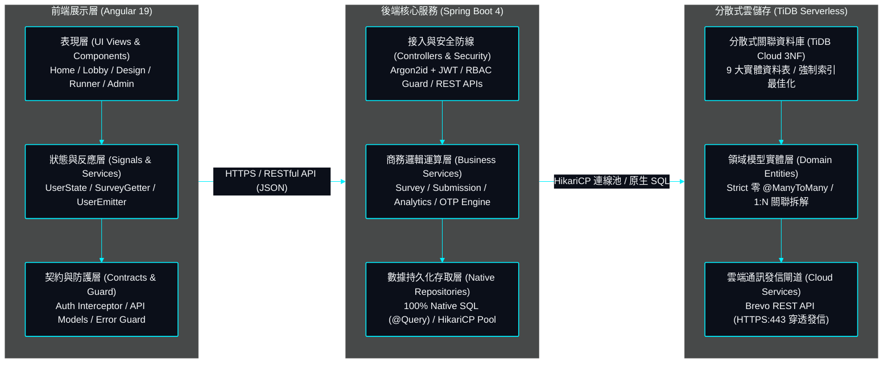

# SurveyFlow | 現代實證調研與學術結構化數據採集系統

<div align="center">

[](https://angular.dev/)
[](https://spring.io/projects/spring-boot)
[](https://openjdk.org/projects/jdk/21/)
[](https://tidbcloud.com/)
[](https://pages.cloudflare.com/)
[](https://render.com/)
[](https://junit.org/)
[](LICENSE)

**專案作者**: 許哲誠 (HSU, CHE-CHENG)  
**系統定位**: 專業級全端動態線上問卷調研與多維數據分析平台。支援 7 大型態動態題目編排、條件跳題動態解鎖、預覽審查全卷結構檢視與來源標記、原生 DOM 雙向防誤判、即時統計圖表聚合、4 大專業格式匯出 (CSV / SPSS / JSON / PDF) 與三層身分授權治理。

</div>

---

## 01. 線上公開體驗環境 (Live Deployment)

本系統已於雙軌雲端平台完成自動化部署，可直接點擊以下公開超連結存取體驗：

| 服務項目 | 託管平台 | 存取超連結 (可點擊跳轉) | 服務功能說明 |
| :--- | :--- | :--- | :--- |
| **前端 SPA 展示前台** | Cloudflare Pages | [https://survey-flow.pages.dev](https://survey-flow.pages.dev) | Angular 19 單頁應用，全球 Edge CDN 加速分發，純原生 SCSS/CSS 樣式。 |
| **後端 Web API 伺服器** | Render Web Service | [https://survey-flow-9gt6.onrender.com](https://survey-flow-9gt6.onrender.com) | Docker 容器化 Java 21 / Spring Boot 服務，無狀態 JWT 雙權杖安全架構。 |
| **健康檢查保活探針** | Render Actuator | [https://survey-flow-9gt6.onrender.com/actuator/health](https://survey-flow-9gt6.onrender.com/actuator/health) | 暴露 `{"status":"UP"}` 輕量探針，由外部 UptimeRobot 執行 24/7 保活監控。 |

> 💡 **本地開發離線模式**: 在未配置雲端環境或離線開發時，預設本機前端存取點為 `http://localhost:4200`，後端 API 為 `http://localhost:8080`。

## 02. 使用者身分型別與功能權限矩陣 (RoleType & RBAC Matrix)

依據最小特權原則 (Principle of Least Privilege) 與責任隔離，系統嚴格劃分三種核心使用者身分：
- **訪客 (`GUEST`)**: 免登入之匿名受訪者與大廳瀏覽者，僅具備填答與公開大廳檢索權限。
- **一般會員 (`MEMBER`)**: 完成 Email 啟用碼驗證之問卷發起人，具備個人名下問卷之設計、預覽、時限控制、多維統計與匯出管轄權。
- **最高管理員 (`ADMIN`)**: 平台運維管理者，具備全站會員名冊治理、即時凍結啟用與安全帳號刪除權。

### 16 大真實業務功能權限比較矩陣 (100% 依據後端實體端點逆向生成)

| 業務功能項目 | 訪客 (`GUEST`) | 一般會員 (`MEMBER`) | 系統管理員 (`ADMIN`) | 實體控制端點 / 業務防線規範 |
| :--- | :---: | :---: | :---: | :--- |
| **瀏覽大廳公開問卷清單** | ✅ | ✅ | ✅ | `GET /api/public/surveys/lobby` (分頁檢索與分類過濾) |
| **填寫大廳公開問卷** | ✅ | ✅ | ✅ | `POST /api/public/submissions` (免登入匿名提交) |
| **填寫私有連結問卷** | ✅ | ✅ | ✅ | `GET /api/public/surveys/{id}` 持專屬連結直達作答 |
| **建立新問卷專案** | ❌ | ✅ | ✅ | `POST /api/user/surveys` 進入視覺化設計器發布 |
| **預覽名下問卷專案** | ❌ | ✅ | ✅ | 預覽模式作答不計入正式資料庫統計 |
| **複製問卷專屬作答連結** | ❌ | ✅ | ✅ | 複製唯一分享 URL 直達問卷填答頁面 |
| **調整名下問卷開放狀態與時限** | ❌ | ✅ | ✅ | `PUT /api/user/surveys/{id}/settings` (雙狀態開關與時限) |
| **即時關閉名下問卷填答通道** | ❌ | ✅ | ✅ | 即時停止填答，阻斷新受訪者存取 |
| **調閱名下問卷數據分析報表** | ❌ | ✅ | ✅ | `GET /api/analytics/surveys/{id}` (非擁有者 403 阻斷) |
| **4 大格式匯出名下問卷數據** | ❌ | ✅ | ✅ | 支援 CSV、SPSS 語法檔 (.sps)、JSON 與列印 PDF 匯出 |
| **刪除名下問卷專案** | ❌ | ✅ | ✅ | `DELETE /api/user/surveys/{id}` 安全軟刪除 |
| **維護個人基本資料** | ❌ | ✅ | ✅ | `PUT /api/user/profile` (身分證號唯讀安全保護) |
| **修改個人登入密碼** | ❌ | ✅ | ✅ | `PUT /api/user/password` 驗證舊密碼並以 Argon2id 重新雜湊 |
| **檢視全站會員名冊** | ❌ | ❌ | ✅ | `GET /api/admin/users` 僅限 ROLE_ADMIN 管理員存取 |
| **調整會員帳號狀態 (啟用/凍結)** | ❌ | ❌ | ✅ | `PUT /api/admin/users/{id}/status` 即時凍結異常帳號 |
| **刪除會員帳號資料** | ❌ | ❌ | ✅ | `DELETE /api/admin/users/{id}` (內建 admin 保護機制) |

---

## 03. 系統全景架構拓撲 (System Architecture)

系統採用前後端完全分離之現代化雲端拓撲，全面落實 Controller-Service-Repository 三層防線與單一真實來源 (SSOT)：



---

## 04. 技術選型矩陣與架構決策 (Tech Stack & ADR)

| 維度分層 | 技術選型 | 版本規格 | 關鍵架構決策理由 (ADR 摘要) |
| :--- | :--- | :--- | :--- |
| **前端框架** | Angular | `v19.0.0` | 官方 Signals 反應式原生狀態、強型別依賴注入體系，適合複雜企業級表單。 |
| **介面樣式** | 純原生 SCSS/CSS | 原生 CSS 自訂變數 | **100% 自研純原生樣式，零外部樣式表 (Strict No Bootstrap/Tailwind)**，極限打包體積。 |
| **後端核心** | Spring Boot | `v4.1.1` (Java 21) | 虛擬執行緒 (Virtual Threads) 高併發非同步處理、強型別依賴注入、企業級 API 平台。 |
| **安全防護** | Argon2id + JJWT | JJWT `v0.12.6` | 國際標準 Argon2id 密碼雜湊，無狀態 Access Token (15m) + Refresh Token (7d) 輪替。 |
| **物件映射** | ModelMapper | `v3.2.2` (STRICT) | 嚴格策略雙向轉換 DTO 與 Entity，消滅手動搬運代碼，維持分層純淨。 |
| **持久化資料庫** | TiDB Cloud | MySQL 8.0 協定 | Serverless 分散式關聯式資料庫，支援 ACID 交易與高併發寫入，免維運硬體成本。 |
| **資料庫映射** | Spring Data JPA | Hibernate (`ddl-auto=none`) | 實體生命週期管理；強制 `ddl-auto=none` 嚴禁自動 DDL，結構 100% 由 `schema.sql` 主導。 |
| **查詢核心方針** | 100% 原生 SQL | `nativeQuery = true` | **嚴格禁止 JPA 內建/衍生方法**；全檢索與統計強制顯式原生 SQL，徹底消滅 ORM 黑箱與 N+1。 |
| **通訊動詞規範** | RESTful HTTP | 5 大標準動詞 | **遵循 RFC 7231 / RFC 5789**；`POST` 建立、`GET` 讀取、`PUT` 完整替換、`PATCH` 局部狀態更新、`DELETE` 刪除。 |

---

## 05. 完整資料庫實體關聯模型 (Complete Database ERD)

本系統關聯模型嚴格遵循第三正規化 (3NF)，由 [`backend/src/main/resources/database/schema.sql`](file:///Users/hsuche-cheng/Documents/project/survey-flow/backend/src/main/resources/database/schema.sql) 唯一真實來源 (SSOT) 主導。以下展開全系統 9 大實體資料表之全部欄位、型別、鍵值約束與關聯：

```mermaid
%%{init: {
  'theme': 'dark',
  'themeVariables': {
    'darkMode': true,
    'background': '#030712',
    'primaryColor': '#0b0f19',
    'primaryTextColor': '#f8fafc',
    'primaryBorderColor': '#00f0ff',
    'lineColor': '#00f0ff',
    'textColor': '#f8fafc',
    'attributeBackgroundColorOdd': '#060a14',
    'attributeBackgroundColorEven': '#0b0f19'
  },
  'themeCSS': '.er.relationshipLabelBox { fill: none !important; stroke: none !important; display: none !important; } .er.relationshipLabel { fill: #ffffff !important; color: #ffffff !important; font-weight: 500 !important; } rect, .node rect, rect.actor { rx: 0px !important; ry: 0px !important; }'
}}%%
erDiagram
    USERS ||--o{ SURVEYS : "1對多發起問卷"
    USERS |o--o{ VERIFICATION_TOKENS : "1對多驗證權杖"
    SURVEYS ||--|| SURVEY_BASIC_INFO_CONFIGS : "1對1輪廓收集配置"
    SURVEYS ||--o{ SURVEY_QUESTIONS : "1對多問卷題目"
    SURVEY_QUESTIONS ||--o{ SURVEY_OPTIONS : "1對多題目選項"
    SURVEYS ||--o{ SUBMISSIONS : "1對多填答主記錄"
    SUBMISSIONS ||--|| SUBMISSION_BASIC_INFOS : "1對1受訪者輪廓明細"
    SUBMISSIONS ||--o{ SUBMISSION_ANSWERS : "1對多答案明細"
    SURVEY_QUESTIONS ||--o{ SUBMISSION_ANSWERS : "題目作答關聯"
    SURVEY_OPTIONS |o--o{ SUBMISSION_ANSWERS : "選項選取關聯"

    USERS {
        bigint id PK "會員唯一流水號"
        varchar username UK "帳號名稱(50)"
        varchar email UK "電子郵件(100)"
        varchar password_hash "Argon2id密碼雜湊(255)"
        varchar full_name "真實姓名(50)"
        char phone UK "定長聯絡手機(10)"
        char identity_card UK "定長身分證統一編號(10)"
        varchar role "系統權限角色(ROLE_USER, ROLE_ADMIN)"
        varchar status "帳號狀態(ACTIVE, SUSPENDED, DELETED)"
        datetime created_at "建立時間"
        datetime updated_at "最後異動時間"
        datetime deleted_at "軟刪除時間戳記(NULL代表有效)"
    }

    VERIFICATION_TOKENS {
        bigint id PK "驗證碼流水號"
        bigint user_id FK "關聯會員流水號(未註冊為NULL)"
        varchar email "驗證目標電子郵件(100)"
        varchar code "6至10位時效驗證碼(10)"
        varchar token_type "業務類型(REGISTER, FORGOT_PASSWORD)"
        datetime expires_at "過期時限戳記"
        tinyint is_used "是否已核銷(0:未使用, 1:已使用)"
        datetime created_at "生成時間"
    }

    SURVEYS {
        bigint id PK "問卷唯一識別碼"
        bigint user_id FK "發起人會員ID(關聯users.id)"
        varchar title "問卷主題名稱(150)"
        text description "問卷前言介紹與作答說明"
        varchar category "12大主題分類標籤(50)"
        tinyint is_public_to_lobby "是否公開於大廳(0:私有, 1:公開)"
        tinyint is_open "是否開放填寫(0:關閉, 1:開放)"
        longtext cover_image_url "主視覺封面URL或Base64"
        datetime start_date "開放填答起始日期(NULL為無時限)"
        datetime end_date "填答截止日期(NULL為無時限)"
        int view_count "瀏覽閱覽次數計數器"
        datetime created_at "建立時間"
        datetime updated_at "最後更新時間"
        datetime deleted_at "軟刪除時間戳記"
    }

    SURVEY_BASIC_INFO_CONFIGS {
        bigint id PK "配置設定流水號"
        bigint survey_id FK "所屬問卷ID(1對1唯一)"
        tinyint collect_basic_info "啟用受訪者資料收集(0:關, 1:開)"
        tinyint require_name "收集姓名(0:非必填, 1:必填)"
        tinyint require_gender "收集生理性別(0:關, 1:開)"
        tinyint require_age "收集年齡區間(0:關, 1:開)"
        tinyint require_birthday "收集生日(0:關, 1:開)"
        tinyint require_national_id "收集身分證字號(0:關, 1:開)"
        tinyint require_phone "收集聯絡手機(0:關, 1:開)"
        tinyint require_home_phone "收集住家市話(0:關, 1:開)"
        tinyint require_email "收集電子信箱(0:關, 1:開)"
        tinyint require_industry "收集所屬產業(0:關, 1:開)"
        tinyint require_job_title "收集擔任職稱(0:關, 1:開)"
        tinyint require_department "收集服務部門(0:關, 1:開)"
        tinyint require_employee_id "收集員工工號(0:關, 1:開)"
        tinyint require_academic_major "收集修讀科系(0:關, 1:開)"
        tinyint require_class_name "收集就讀班級(0:關, 1:開)"
        tinyint require_student_id "收集在校學號(0:關, 1:開)"
        tinyint require_height "收集身高數據(0:關, 1:開)"
        tinyint require_weight "收集體重數據(0:關, 1:開)"
        tinyint require_residence "收集居住縣市(0:關, 1:開)"
        tinyint require_registered_address "收集戶籍地址(0:關, 1:開)"
    }

    SURVEY_QUESTIONS {
        bigint id PK "題目唯一流水號"
        bigint survey_id FK "所屬問卷ID"
        varchar question_code "前端題號標識代碼(Q1/UUID)"
        varchar type "題型(SINGLE, MULTI, BOOLEAN, RATING, TEXT, TIME, DATE)"
        varchar question_text "題目主體敘述文字(500)"
        longtext image_url "題目附加附圖"
        tinyint is_required "是否為必填題目(0:非必填, 1:必填)"
        int sort_order "題目呈現排序"
        int min_rating "評分題最小值(預設1或0)"
        int max_rating "評分題最大值(預設5或10)"
        datetime created_at "建立時間"
        datetime updated_at "最後更新時間"
    }

    SURVEY_OPTIONS {
        bigint id PK "選項唯一流水號"
        bigint question_id FK "所屬題目ID"
        varchar option_text "選項文字標籤(255)"
        int sort_order "選項排列順序"
        varchar trigger_question_uid "條件跳題解鎖目標題目UID"
    }

    SUBMISSIONS {
        bigint id PK "填答事件流水號"
        bigint survey_id FK "作答之問卷ID"
        varchar ip_address "受訪者IP位址(45)"
        int duration_seconds "填答總耗時秒數"
        datetime submitted_at "提交作答時間戳記"
    }

    SUBMISSION_BASIC_INFOS {
        bigint id PK "受訪者個資流水號"
        bigint submission_id FK "關聯填答記錄ID(1對1唯一)"
        varchar name "受訪者姓名(50)"
        tinyint gender "生理性別(0:未指定, 1:男, 2:女, 3:其他)"
        varchar age_group "年齡區間(30)"
        varchar birthday "出生年月日(20)"
        char national_id "身分證統一編號(10)"
        char phone "聯絡電話(10)"
        varchar home_phone "住家市話(20)"
        varchar email "電子郵件(100)"
        varchar industry "所屬產業(50)"
        varchar job_title "職位職稱(50)"
        varchar department "部門單位(50)"
        varchar employee_id "公司工號(50)"
        varchar academic_major "就讀系所(50)"
        varchar class_name "班級名稱(50)"
        varchar student_id "學生學號(50)"
        double height "身高數據(cm)"
        double weight "體重數據(kg)"
        varchar residence "居住城市(50)"
        varchar registered_address "戶籍完整地址(200)"
    }

    SUBMISSION_ANSWERS {
        bigint id PK "單題作答明細流水號"
        bigint submission_id FK "所屬填答記錄ID"
        bigint question_id FK "作答題目ID"
        bigint option_id FK "選取之選項ID(選擇題適用)"
        text text_answer "簡答文字內容或日期時間"
        int rating_value "評分量表數值(1至10)"
    }
```



---

## 06. 核心業務 RESTful API 路由矩陣

全系統嚴格依循 RFC 7231 與 RFC 5789 標準 RESTful 語意，以業務意圖為導向精準劃分端點防線，100% 對齊後端 Controller 實體路由 (SSOT)：

| 模組分類 | 請求方法 | 路由端點 | 權限需求 | 業務功能規格說明 |
| :--- | :---: | :--- | :---: | :--- |
| **帳號認證** | `POST` | `/api/public/auth/register` | 公開 | 新會員註冊並寄發 6 碼信箱啟用驗證碼。 |
| **帳號認證** | `POST` | `/api/public/auth/verify-email` | 公開 | 輸入信箱 6 碼驗證碼開通帳號並簽發雙 Token。 |
| **帳號認證** | `POST` | `/api/public/auth/resend-verification` | 公開 | 重新寄發信箱開通 6 碼驗證碼。 |
| **帳號認證** | `POST` | `/api/public/auth/login` | 公開 | 帳號密碼登入驗證，簽發短效 Access + 長效 Refresh Token。 |
| **帳號認證** | `POST` | `/api/public/auth/refresh` | 公開 | 以 Refresh Token 換發短效 Access Token。 |
| **帳號認證** | `POST` | `/api/user/auth/logout` | 會員 | 註銷當前連線 Session 與權杖狀態。 |
| **帳號認證** | `POST` | `/api/public/auth/forget-password` | 公開 | 發送忘記密碼 15 分鐘時效 6 碼重設碼至信箱。 |
| **帳號認證** | `POST` | `/api/public/auth/reset-password` | 公開 | 憑 6 碼驗證碼重設帳號登入新密碼。 |
| **問卷公開** | `GET` | `/api/public/surveys/lobby` | 公開 | 分頁模糊搜尋公開大廳開放中之問卷列表 (支援分類過濾)。 |
| **問卷公開** | `GET` | `/api/public/surveys/{id}` | 公開 | 取得特定問卷完整結構並累加瀏覽計數 (viewCount)。 |
| **問卷填答** | `POST` | `/api/public/submissions` | 公開 | 受訪者提交問卷填答資料與個資輪廓（支援訪客與會員）。 |
| **問卷管理** | `GET` | `/api/user/surveys` | 會員 | 查詢當前會員名下建立之所有問卷清單 (相容 `/api/surveys/my`)。 |
| **問卷管理** | `POST` | `/api/user/surveys` | 會員 | 建立全新問卷專案（支援 7 大型態題型與跳題配置）。 |
| **問卷管理** | `GET` | `/api/user/surveys/{id}` | 擁有者 | 讀取名下指定問卷之完整題目結構以進行編輯。 |
| **問卷管理** | `PUT` | `/api/user/surveys/{id}` | 擁有者 | 覆蓋更新問卷題目與選項結構。 |
| **問卷管理** | `PATCH` | `/api/user/surveys/{id}/settings` | 擁有者 | 更新問卷開放時限與大廳展示狀態。 |
| **問卷管理** | `DELETE` | `/api/user/surveys/{id}` | 擁有者 | 軟刪除名下指定問卷專案。 |
| **數據分析** | `GET` | `/api/analytics/surveys/{id}` | 擁有者 | 調閱問卷多維度統計分析報表 (KPI、走勢圖、題目分佈)。 |
| **會員管理** | `GET` | `/api/user/profile` | 會員 | 查詢當前登入會員之個人基本檔案。 |
| **會員管理** | `PUT` | `/api/user/profile` | 會員 | 更新個人真實姓名、手機號碼等基本資料。 |
| **會員管理** | `PUT` | `/api/user/password` | 會員 | 提供舊密碼驗證通過後以 Argon2id 更換新密碼。 |
| **營運後台** | `GET` | `/api/admin/users` | 管理員 | 分頁檢視全站註冊會員名冊與即時狀態。 |
| **營運後台** | `PATCH` | `/api/admin/users/{id}/status` | 管理員 | 即時凍結 (SUSPENDED) 或啟用 (ACTIVE) 指定會員狀態。 |
| **營運後台** | `DELETE` | `/api/admin/users/{id}` | 管理員 | 安全軟刪除指定會員帳號（受保護管理員除外）。 |
| **營運後台** | `GET` | `/api/admin/surveys` | 管理員 | 分頁檢視全站所有問卷清單與即時數據。 |
| **營運後台** | `DELETE` | `/api/admin/surveys/{id}` | 管理員 | 運維強制下架違規或違法問卷專案。 |
| **營運後台** | `GET` | `/api/admin/analytics/overview` | 管理員 | 平台整體營運 KPI、填答總量與活耀度總覽。 |

---

## 07. 系統實體檔案目錄拓撲樹 (Directory Structure)

```text
survey-flow/
├── Dockerfile                         # 後端多階段 Alpine 容器映像檔建置規格
├── .dockerignore                      # Docker 排除建置資產清單
├── README.md                          # 專案全域規格總覽 (純臺灣繁體中文)
├── docs/                              # 專案架構文檔庫
│   ├── development-plan.md            # 【前期】專案前期開發計劃書 (Why/What、痛點探索、起步藍圖)
│   ├── change-log.md                  # 【常駐】修訂歷程庫 (最新異動置頂)
│   ├── check-list.md                  # 【常駐】業務功能點收清單
│   └── system-design/                 # 【後期】系統架構規格書 (01-11 循序合理編號、分則明確)
│       ├── 01-overview.md             # 系統願景、核心定位與模組總覽 (含線上體驗超連結)
│       ├── 02-role-type.md            # 使用者身分型別與功能權限矩陣 (18項功能對照)
│       ├── 03-tech-stack.md           # 技術選型矩陣與 ADR 架構決策
│       ├── 04-architecture.md         # 分層架構與檔案物理索引字典
│       ├── 05-flowcharts.md           # 核心業務流程圖與狀態機
│       ├── 06-specs-api.md            # RESTful API 通訊協定規格書 (嚴格四種動詞)
│       ├── 07-specs-database.md       # TiDB / MySQL 資料庫模型與 ERD (100% 原生 SQL)
│       ├── 08-ui-ux-standards.md      # 前端視覺設計風格與介面美學標準書
│       ├── 09-security.md             # 全端資安防護、認證授權、加密與資料脫敏規格書
│       ├── 10-deployment.md           # 雲端雙軌部署拓撲、環境變數 OCP 與維運保活
│       └── 11-local-testing.md        # 本地測試指南、資料庫初始化與 38/38 測試驗證
├── frontend/                          # Angular 19 前端 SPA 專案 (純原生 SCSS)
│   ├── public/                        # 靜態公開資產 (_headers, robots.txt, sitemap.xml, llms.txt)
│   ├── src/app/
│   │   ├── @interfaces/               # 強型別資料契約 DTO
│   │   ├── @services/                 # 單一職責業務服務 (ApiClient, Getter, Emitter...)
│   │   └── components/                # 獨立 Standalone 視圖組件 (Hero, Lobby, Design...)
│   ├── styles.scss                    # 全域原生樣式
│   └── variables.scss                 # 品牌色票與中性 Token (統整圖表調色盤)
└── backend/                           # Java 21 / Spring Boot 4.1.1 後端專案
    ├── src/main/java/com/surveyflow/
    │   ├── controller/                # 輕量 HTTP API 控制器 (Thin Controllers)
    │   ├── service/                   # 業務意圖業務服務 (Use Case Services, 事務邊界)
    │   ├── repository/                # 持久化資料存取 (100% 原生 SQL nativeQuery=true)
    │   ├── entity/                    # 資料庫實體模型 (嚴禁 @ManyToMany)
    │   ├── dto/                       # 傳輸資料物件 (Req / Res DTO)
    │   └── security/                  # Spring Security 認證授權與 JWT 雙權杖過濾器
    └── src/main/resources/database/
        ├── schema.sql                 # 【SSOT】TiDB / MySQL 資料庫完整結構腳本 (9 大實體表)
        └── data.sql                   # 測試種子資料腳本 (含 Argon2id 預設帳號與示範問卷)
```

---

## 08. 環境變數外部化對照表 (OCP Externalized Configurations)

本系統恪守 OCP 開放封閉原則，所有系統參數與機敏金鑰 100% 透過環境變數外部化注入，嚴禁於代碼中寫死業務預設值：

### 1. 雲端生產環境 (Render Web Service) 7 大核心環境變數 (極致 SSOT 唯一真實來源)

經架構優化，系統已全面落實 **SSOT 單一真實來源**：後端自動將 `FRONTEND_BASE_URL` 納入 CORS 跨來源白名單，**徹底消滅重複宣告**！在 Render 控制台**僅需設定以下 7 個核心變數**（`CORS_ALLOWED_ORIGINS` 可直接省略或安全刪除）：

| 環境變數 KEY | 範例 / 推薦設定值 | 生產環境用途與安全性說明 |
| :--- | :--- | :--- |
| **`SPRING_DATASOURCE_URL`** | `jdbc:mysql://<TiDB_HOST>:4000/survey_flow...` | TiDB Cloud 雲端分散式資料庫 JDBC 連線字串 (含 TLS 證書與時區設定)。 |
| **`SPRING_DATASOURCE_USERNAME`** | `<TIDB_USER>.root` | TiDB Cloud 分散式資料庫連線帳號。 |
| **`SPRING_DATASOURCE_PASSWORD`** | `********` | TiDB Cloud 分散式資料庫連線密碼。 |
| **`JWT_SECRET`** | `SurveyFlowSecretKey...2026!` (>=256 bits) | HMAC-SHA256 簽署短效 Token 與雙權杖之防偽金鑰。 |
| **`FRONTEND_BASE_URL`** | `https://survey-flow.pages.dev` | **前端唯一真實網址 (SSOT)**：一方面用於組裝信件中之開通與密碼重設直達連結，另一方面**後端自動直接將其作為 CORS 跨來源允許白名單**，達成單一資料來源治理！ |
| **`BREVO_API_KEY`** | `xkeysib-********` | **主力郵件服務商**：Brevo HTTP REST API 金鑰 (走 HTTPS Port 443 穿透 Render 防火牆，每日免費 300 封，**全面取代傳統 Gmail SMTP**)。 |
| **`MAIL_FROM`** | `service@surveyflow.tw` | 系統外發信件之寄件者顯示信箱 (需於 Brevo 驗證為合規寄件人)。 |

### 2. 本地開發與可選進階參數 (Local & Optional Fallback)

| 環境變數名稱 | 預設降級值 (本地開發) | 說明 |
| :--- | :--- | :--- |
| `PORT` / `SERVER_PORT` | `8080` | 後端 Web 容器動態監聽之 HTTP 通訊埠號 (Render 部署時由平台自動動態注入)。 |
| `CORS_ALLOWED_ORIGINS` | *(留空自動繼承)* | 僅在同時擁有多個獨立前端網域時，始得於此以逗號分隔追加。 |
| `RESEND_API_KEY` | *(選填/備用)* | Resend HTTP API 金鑰 (備用 HTTP 443 外寄管道)。 |
| `MAIL_PROVIDER` | `AUTO` | 郵件提供商調度模式 (`AUTO`: 自動優先偵測 Brevo -> Resend -> SMTP)。 |
| `JWT_ACCESS_EXPIRATION_MS` | `900000` (15 分鐘) | 短效無狀態 Access Token 存活毫秒數。 |
| `JWT_REFRESH_EXPIRATION_MS`| `604800000` (7 天) | 長效 Refresh Token 存活毫秒數。 |
| `MAIL_HOST` / `MAIL_PORT` | `smtp.gmail.com` / `587` | 本地離線開發用 Gmail SMTP 主機與通訊埠 (生產環境已全面由 Brevo 取代)。 |
| `MAIL_USERNAME` / `MAIL_PASSWORD`| *(無預設值)* | 本地離線開發用 Gmail 寄信帳號與 16 碼應用程式密碼。 |

---

## 09. 本機建置、測試與快速啟動指南 (Quick Start)

依據 [`docs/11-local-testing.md`](file:///Users/hsuche-cheng/Documents/project/survey-flow/docs/11-local-testing.md) 規範，可在本機快速完成端對端啟動與測試：

### 1. 前置依賴需求
- **Node.js**: `v20.x` 或以上 (推薦 Node.js 24.x LTS)
- **套件管理工具**: `pnpm` (`v9.x` 或以上，**專案全域統一採用 pnpm 嚴格鎖定相依版本**)
- **Java JDK**: `21` (推薦 Eclipse Temurin 21)
- **MySQL / TiDB**: `8.0+` (本地 3306 埠或 TiDB Serverless)

### 2. 資料庫初始化 (SSOT)
```sql
CREATE DATABASE IF NOT EXISTS survey_flow CHARACTER SET utf8mb4 COLLATE utf8mb4_unicode_ci;
USE survey_flow;
-- 依序執行 backend/src/main/resources/database/schema.sql 重建 9 大實體資料表
-- (可選) 執行 backend/src/main/resources/database/data.sql 載入測試種子資料
```

### 3. 後端單元測試與 API 伺服器啟動
```bash
cd backend

# 執行全套單元與整合測試 (38/38 PASS 驗證)
./mvnw clean test

# 啟動後端 Spring Boot 服務 (預設監聽: 8080)
./mvnw spring-boot:run
```
- API 根端點: `http://localhost:8080/api`
- Actuator 健康探針: `http://localhost:8080/actuator/health`

### 4. 前端 Angular 啟動與建置
```bash
cd frontend

# 安裝相依套件 (全域統一使用 pnpm)
pnpm install

# 啟動本機開發伺服器 (支援熱重載)
pnpm start
```
- 瀏覽器開啟存取：`http://localhost:4200`
- 驗證生產打包：`pnpm build` (產物輸出於 `dist/survey-flow-frontend/browser`)
- 執行前端單元測試：`pnpm test`

### 5. 預設測試種子帳號
- **系統最高管理員**: `admin` / `Admin123!` (權限: `ROLE_ADMIN`)
- **一般測試會員**: `testuser` / `User1234!` (權限: `ROLE_USER`)

---

<div align="center">

**SurveyFlow** | 現代實證調研與學術結構化數據採集系統  
版權所有 © 2026 [許哲誠 (HSU, CHE-CHENG)](https://github.com/EricXJason). All Rights Reserved.

</div>
