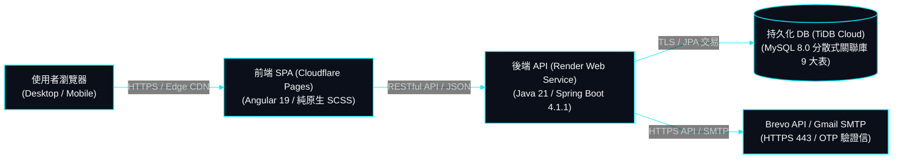
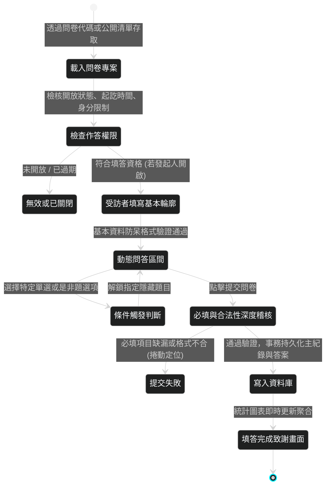

# SurveyFlow | 現代實證調研與學術結構化數據採集系統

> **專案作者**: 許哲誠 (HSU, CHE-CHENG)  
> **專案定位**: 專業級全端動態線上問卷調研與多維數據分析平台。支援 7 大型態動態題目編排、條件跳題動態解鎖、原生 DOM 雙向防誤判、即時統計圖表聚合、4 大專業格式匯出與三層身分授權治理。  
> **語言與執行環境版本**:
> - **前端 SPA**: Node.js 24.18.0 / Angular 19.0.0 / TypeScript 5.6.2 / Angular CDK 19.2.19 (Cloudflare Pages 託管，100% 純原生 SCSS/CSS，無外部樣式表，TS 零硬編碼色票)
> - **後端 Web API**: Java 21 / Spring Boot 4.1.1 / Spring Data JPA / ModelMapper 3.2.2 / Spring Security / JJWT 0.12.6 / Argon2id (Render Docker 容器化)
> - **持久化資料庫**: TiDB Cloud Serverless (MySQL 8.0.36 協定相容分散式關聯式資料庫，9 大實體資料表完整關聯)

---

## 1. 架構設計思路 (Architecture Mindset)

SurveyFlow 採**前後端完全解耦之現代雲端雙軌架構**，前端與後端分別專注於極致的互動體驗與嚴謹的資料安全：

- **最少實體檔案原則 (Minimal Physical Files Principle under SOLID)**:
  - 專案在符合 SOLID 規範下，以最精簡的實體檔案數量達成架構責任。
  - 前端徹底移除多餘的 `environments/` 目錄與多餘攔截器，改以純原生主機名動態解析後端網址（本地開發自動連線 `http://localhost:8080`，雲端生產環境自動對接 Render 雲端後端）。
- **前端 100% 純原生 SCSS/CSS 樣式規範 (Strict No External Stylesheets & Zero Color Hex in TS)**:
  - 全站樣式 100% 自研採用純原生 SCSS/CSS 與 CSS 自訂變數，**嚴格禁止引用 Bootstrap、Tailwind CSS 等任何第三方外部樣式表**，確保零樣式污染與極致載入效能。
  - **全站 TS 零色票原則**：嚴格禁止在 Angular TypeScript 檔案內直接硬編碼十六進位色票，色彩一律由 SCSS 變數庫（如 `--c-chart-0`~`--c-chart-11`）統籌，全題型卡片與徽章外觀保持統一中性優雅層次。
- **多分支映射條件規範 (Multi-Branch Switch / Lookup Map Invariant)**:
  - 超過 3 個分支之多條件題型與枚舉解析，嚴格禁止編寫長鏈 `if - else if - else` 結構，全面採用**常數字典映射表 (Lookup Map)** 或 **`switch-case`**，大幅提升執行效率與代碼可讀性。
- **後端 ModelMapper 統一映射標準 (Unified ModelMapper Invariant)**:
  - Service 層中 DTO 與 JPA Entity 之間的雙向轉換，一律統一注入並調用 `org.modelmapper.ModelMapper`（採 STRICT 嚴格比對策略），消除手工冗餘搬運，落實乾淨分層。
- **全域環境變數外部化與 OCP (Zero-Hardcoding via Environment Variables)**:
  - 系統所有連線字串、金鑰、發信帳號（Email / SMTP 密碼）、外部端點 100% 外部化為環境變數管理，落實開放封閉原則，代碼與設定檔中嚴格杜絕硬編碼。
- **單一真實資料源 (SSOT) 與分層隔離**:
  - 後端嚴格貫徹 `Controller ➔ Service ➔ Repository ➔ Entity` 三層架構單向調用，Controller 絕對嚴禁直接存取 Repository。
  - 前端基於 Angular Signals 反應式狀態流，搭配依賴注入 (DI) 與模組化 Service 負責資料檢索與防呆檢核。
- **零信任資安架構 (Zero-Trust Security)**:
  - 短效 15 分鐘 Access Token + 長效 7 天 Refresh Token 輪替 (RTR) 吊銷機制。
  - 密碼採用國際資安標準 **Argon2id** 雜湊演算法加密。
- **雲端生產雙軌部署**:
  - 前端部署於 **Cloudflare Pages** (`https://survey-flow.pages.dev`)，享有 Edge CDN 全球邊緣加速。
  - 後端以 Docker 容器化部署於 **Render Web Service** (`https://survey-flow-9gt6.onrender.com`)，配置 `/actuator/health` 探針維持常駐熱機，消除冷啟動延遲。
  - 持久化儲存於 **TiDB Cloud Serverless** 分散式資料庫，保證 ACID 交易隔離與外鍵約束。

---

## 2. 核心功能規格 (Specifications)

| 模組分類 | 核心功能特點 | 規格邊界與實作說明 |
| :--- | :--- | :--- |
| **視覺化問卷設計** | 7 大型態動態編排與條件跳題 | 支援是非、單選、多選、評分量表 (1-5/1-10/NPS)、簡答、時間、日期題型；支援拖曳排序、單選與是非動態跳題解鎖、封面附圖/前言圖文彈性編輯（支援純圖或純文）與即時擬真預覽。發布後鎖定結構以確保作答真實性。 |
| **問卷填答運行器** | 雙軌填答與原生 DOM 雙向防誤判 | 支援大廳公開或專屬直達連結填寫；全題型原生 DOM 狀態深度掃描同步，徹底根除誤判；條件跳題隱藏題自動豁免必填驗證；整合受訪者 20 項基本輪廓資料收集、身分證 Modulo 10 與手機 10 碼防呆。 |
| **問卷專案管理** | 生命週期與開放時效管控 | 問卷列表關鍵字搜尋、預覽問卷、複製專屬直達連結、動態切換大廳公開狀態與連結填答狀態、設定有效起訖時限及專案軟刪除。 |
| **深度數據分析** | 多維聚合圖表與專業報表匯出 | 5 大營運 KPI 指標、近 30 日填答趨勢走勢圖、受訪者人口輪廓金字塔、題型深度聚合 (單複選百分比/最高票皇冠微徽章/評分量表情感分析)、真實最新回覆時間 (非虛假時間) 及 4 大專業格式 (CSV/SPSS/JSON/PDF) 數據匯出。 |
| **會員帳號認證** | 實名信箱啟用與密碼安全 | 支援 Brevo HTTPS API 與真實 Gmail SMTP 寄送 6 碼註冊啟用信與 15 分鐘時效密碼重設信；個人資料維護 (身分證字號唯讀保護)；舊密碼驗證與 Argon2id 安全重設。 |
| **系統營運治理** | 管理員全站會員名冊治理 | 系統管理員 (`ROLE_ADMIN`) 專屬全站會員清單審查、會員狀態即時啟用/凍結、違規帳號安全刪除 (內建 admin 保護機制)。 |

---

## 3. 系統業務架構與資料流圖 (Mermaid Tech HUD)



### 核心業務作答與條件解鎖流程 (Mermaid 狀態機)



---

## 4. 資料庫實體關聯圖 (Database ERD - 9 大實體資料表完整關聯)

```mermaid
%%{init: {'theme': 'dark', 'themeVariables': { 'darkMode': true, 'background': '#030712', 'primaryColor': '#0b0f19', 'primaryTextColor': '#f8fafc', 'primaryBorderColor': '#00f0ff', 'lineColor': '#00f0ff', 'textColor': '#f8fafc', 'attributeBackgroundColorOdd': '#060a14', 'attributeBackgroundColorEven': '#0b0f19' }, 'themeCSS': '.er.relationshipLabelBox { fill: none !important; stroke: none !important; display: none !important; } rect, .node rect, rect.actor { rx: 0px !important; ry: 0px !important; }' }}%%
erDiagram
    USERS ||--o{ SURVEYS : "建立者與問卷"
    USERS ||--o{ SURVEYS : "1對多發起問卷"
    USERS |o--o{ VERIFICATION_TOKENS : "1對多OTP權杖(選填關聯)"
    SURVEYS ||--|| SURVEY_BASIC_INFO_CONFIGS : "1對1收集配置"
    SURVEYS ||--o{ SURVEY_QUESTIONS : "1對多問卷題目"
    SURVEY_QUESTIONS ||--o{ SURVEY_OPTIONS : "1對多題目選項"
    SURVEYS ||--o{ SUBMISSIONS : "1對多填答主紀錄"
    SUBMISSIONS ||--|| SUBMISSION_BASIC_INFOS : "1對1受訪者輪廓"
    SUBMISSIONS ||--o{ SUBMISSION_ANSWERS : "1對多答案明細"
    SURVEY_QUESTIONS ||--o{ SUBMISSION_ANSWERS : "題目作答關聯"
    SURVEY_OPTIONS |o--o{ SUBMISSION_ANSWERS : "選項選取關聯(選擇題可選)"

    USERS {
        bigint id PK "會員唯一流水號"
        varchar username UK "帳號名稱(50)"
        varchar email UK "電子郵件(100)"
        varchar password_hash "Argon2id密碼雜湊(255)"
        varchar full_name "真實姓名(50)"
        char phone UK "定長聯絡手機(10)"
        char identity_card UK "定長身分證統一編號(10)"
        varchar role "預設ROLE_USER 權限(20)"
        varchar status "預設ACTIVE 狀態(20)"
        datetime created_at "建立時間"
        datetime updated_at "最後異動時間"
        datetime deleted_at "軟刪除時間"
    }

    VERIFICATION_TOKENS {
        bigint id PK "驗證碼流水號"
        bigint user_id FK "關聯會員流水號(可為NULL)"
        varchar email "驗證信箱(100)"
        varchar code "6至10位時效驗證碼(10)"
        varchar token_type "驗證類型(REGISTER/FORGOT_PASSWORD)"
        datetime expires_at "過期時效"
        tinyint is_used "預設0 TINYINT(1) 是否已核銷"
        datetime created_at "生成時間"
    }

    SURVEYS {
        bigint id PK "問卷專案流水號"
        bigint user_id FK "發起人會員編號"
        varchar title "問卷標題(150)"
        text description "問卷前言說明"
        varchar category "預設綜合調查 12大主題分類(50)"
        tinyint is_public_to_lobby "預設1 TINYINT(1) 是否公開大廳"
        tinyint is_open "預設1 TINYINT(1) 是否開放填答"
        longtext cover_image_url "封面宣傳圖URL或Base64"
        datetime start_date "開放填答起始日期"
        datetime end_date "填答截止日期"
        int view_count "預設0 瀏覽閱覽次數"
        datetime created_at "建立時間"
        datetime updated_at "最後更新時間"
        datetime deleted_at "軟刪除時間"
    }

    SURVEY_BASIC_INFO_CONFIGS {
        bigint id PK "配置設定流水號"
        bigint survey_id FK "所屬問卷編號(1對1唯一)"
        tinyint collect_basic_info "預設1 TINYINT(1) 啟用輪廓收集"
        tinyint require_name "預設1 TINYINT(1) 收集姓名"
        tinyint require_gender "預設1 TINYINT(1) 收集生理性別"
        tinyint require_age "預設1 TINYINT(1) 收集年齡層"
        tinyint require_birthday "預設0 TINYINT(1) 收集生日"
        tinyint require_national_id "預設0 TINYINT(1) 收集身分證號"
        tinyint require_phone "預設0 TINYINT(1) 收集行動電話"
        tinyint require_home_phone "預設0 TINYINT(1) 收集住家市話"
        tinyint require_email "預設0 TINYINT(1) 收集電子信箱"
        tinyint require_industry "預設0 TINYINT(1) 收集所屬產業"
        tinyint require_job_title "預設0 TINYINT(1) 收集職位職稱"
        tinyint require_department "預設0 TINYINT(1) 收集服務部門"
        tinyint require_employee_id "預設0 TINYINT(1) 收集員工工號"
        tinyint require_academic_major "預設0 TINYINT(1) 收集就讀科系"
        tinyint require_class_name "預設0 TINYINT(1) 收集就讀班級"
        tinyint require_student_id "預設0 TINYINT(1) 收集學生學號"
        tinyint require_height "預設0 TINYINT(1) 收集受訪者身高"
        tinyint require_weight "預設0 TINYINT(1) 收集受訪者體重"
        tinyint require_residence "預設0 TINYINT(1) 收集居住縣市"
        tinyint require_registered_address "預設0 TINYINT(1) 收集戶籍地址"
    }

    SURVEY_QUESTIONS {
        bigint id PK "題目唯一流水號"
        bigint survey_id FK "所屬問卷編號"
        varchar question_code "題目標識代碼(Q1/UUID)"
        varchar type "題型(SINGLE/MULTI/BOOLEAN/RATING/TEXT/TIME/DATE)"
        varchar question_text "題目主體敘述(500)"
        longtext image_url "題目附加附圖"
        tinyint is_required "預設1 TINYINT(1) 是否必填"
        int sort_order "預設1 題目排列順序"
        int min_rating "預設1 評分量表最小值(0或1)"
        int max_rating "預設5 評分量表最大值(5或10)"
        datetime created_at "建立時間"
        datetime updated_at "最後更新時間"
    }

    SURVEY_OPTIONS {
        bigint id PK "選項唯一流水號"
        bigint question_id FK "所屬題目編號"
        varchar option_text "選項文字內容(255)"
        int sort_order "預設1 選項排列順序"
        varchar trigger_question_uid "條件跳題解鎖目標題目UID(50)"
    }

    SUBMISSIONS {
        bigint id PK "填答主紀錄流水號"
        bigint survey_id FK "作答之問卷編號"
        varchar ip_address "受訪者IP位址(45)"
        int duration_seconds "作答耗時秒數"
        datetime submitted_at "提交作答時間戳"
    }

    SUBMISSION_BASIC_INFOS {
        bigint id PK "基本輪廓流水號"
        bigint submission_id FK "關聯填答主紀錄(1對1唯一)"
        varchar name "填報真實姓名(50)"
        tinyint gender "預設0 生理性別(0:未指定,1:男,2:女,3:其他)"
        varchar age_group "年齡級距(30)"
        varchar birthday "出生年月日(20)"
        char national_id "定長身分證統一編號(10)"
        char phone "定長聯絡手機(10)"
        varchar home_phone "住家市話(20)"
        varchar email "聯絡電子信箱(100)"
        varchar industry "所屬產業(50)"
        varchar job_title "擔任職稱(50)"
        varchar department "任職部門(50)"
        varchar employee_id "公司員工代號(50)"
        varchar academic_major "修讀系所(50)"
        varchar class_name "班別班級(50)"
        varchar student_id "在校學號(50)"
        double height "身高數據cm"
        double weight "體重數據kg"
        varchar residence "居住縣市(50)"
        varchar registered_address "戶籍地址(200)"
    }

    SUBMISSION_ANSWERS {
        bigint id PK "作答明細流水號"
        bigint submission_id FK "所屬填答主紀錄"
        bigint question_id FK "作答之題目編號"
        bigint option_id FK "選取之選項編號(可選0..1)"
        text text_answer "簡答題文字或日期時間字串"
        int rating_value "量表評分分值(1至10)"
    }
```



---

## 5. 檔案目錄結構拓撲

```text
survey-flow/
├── Dockerfile                         # 後端多階段 Alpine 容器映像檔建置規格
├── .dockerignore                      # Docker 排除建置資產清單
├── README.md                          # 專案生產發布全量規格書 (純臺灣繁體中文)
├── docs/                              # 專案文檔庫
│   ├── change-log.md                  # 【常駐】修訂歷程庫 (最新異動置頂)
│   ├── check-list.md                  # 【常駐】業務功能點收清單
│   └── system-design/                 # 系統架構規格書 (01-10 循序合理編號、分則明確)
│       ├── 01-overview.md             # 系統願景、核心定位與模組總覽
│       ├── 02-role-type.md            # 使用者身分型別與功能權限矩陣 (18項純符號)
│       ├── 03-tech-stack.md           # 技術選型矩陣與 ADR 架構決策
│       ├── 04-architecture.md         # 分層架構與檔案物理索引字典
│       ├── 05-flowcharts.md           # 核心業務流程圖與狀態機
│       ├── 06-specs-api.md            # RESTful API 通訊協定規格書
│       ├── 07-specs-database.md       # TiDB / MySQL 資料庫模型與 ERD
│       ├── 08-ui-ux-standards.md      # 前端 UI/UX 美學、純原生 SCSS/CSS 規範
│       ├── 09-security.md             # 全端資安防護、認證授權與資料脫敏
│       └── 10-deployment.md           # 雲端雙軌部署拓撲與維運規範書
├── frontend/                          # Angular 19 前端 SPA 專案 (純原生 SCSS)
│   ├── angular.json                   # Angular 建置配置 (無 fileReplacements)
│   ├── package.json                   # 前端依賴清單 (Node.js 24.18.0)
│   ├── tsconfig.json                  # TypeScript 嚴格編譯設定 (具繁中註解)
│   └── src/
│       ├── main.ts                    # 應用程式啟動引導 (無 Bootstrap 依賴)
│       ├── app/                       # 核心組件與服務模組
│       │   ├── @interfaces/           # 強型別資料契約 DTO
│       │   ├── @services/             # 單一職責業務服務 (ApiClient, Getter, Emitter...)
│       │   └── components/            # 獨立 Standalone 視圖組件 (Hero, Lobby, Design...)
│       ├── styles.scss                # 全域原生樣式
│       └── variables.scss             # 品牌色票與中性 Token (統整圖表調色盤)
└── backend/                           # Java 21 / Spring Boot 4.1.1 後端專案
    ├── pom.xml                        # Maven 依賴中樞 (具繁中結構化註解)
    └── src/
        ├── main/
        │   ├── java/com/surveyflow/   # Clean Architecture 乾淨分層
        │   │   ├── config/            # ModelMapper (STRICT) 與 Web 設定
        │   │   ├── controller/        # RESTful API 端點控制器 (6 個 Controller)
        │   │   ├── service/           # 核心商務邏輯層 (6 個 Service，注入 ModelMapper)
        │   │   ├── repository/        # 原生 SQL 與 JPA 資料存取 (5 個 Repository)
        │   │   ├── entity/            # 9 大實體資料表映射實體
        │   │   ├── security/          # Argon2id + 雙 Token 認證過濾器
        │   │   └── dto/               # 嚴格分層對外資料傳輸物件
        │   └── resources/
        │       ├── application.properties # 系統組態 (100% 繁中註解、環境變數 OCP)
        │       └── database/          # schema.sql (9大表 DDL) 與 data.sql (種子資料)
        └── test/                      # 28/28 全套 JUnit 5 + Mockito 單元與整合測試套件
```

---

## 6. 本機建置與快速啟動指南

### 前置需求
- **Node.js**: `24.x` (或相容之 LTS 版本)
- **Java JDK**: `21` (建議 Eclipse Temurin 21)
- **MySQL 資料庫**: `8.0+` 或可存取之 TiDB Cloud 執行個體（唯一結構與種子腳本永遠位於 `backend/src/main/resources/database/`）

### 步驟 1: 資料庫初始化與後端 Spring Boot 啟動
- **資料庫初始化 (SSOT)**: 直接在 TiDB Cloud 或 MySQL 執行 [`backend/src/main/resources/database/schema.sql`](file:///Users/hsuche-cheng/Documents/project/survey-flow/backend/src/main/resources/database/schema.sql)（內含全量方案 A 與增量方案 B）與可選的 [`data.sql`](file:///Users/hsuche-cheng/Documents/project/survey-flow/backend/src/main/resources/database/data.sql)。
```bash
cd backend
# 執行全套單元測試驗證 (28/28 PASS，包含 Controller 與 Service)
./mvnw test

# 啟動後端 Web API (預設監聽 http://localhost:8080)
./mvnw spring-boot:run
```

### 步驟 2: 前端 Angular 啟動
```bash
cd frontend
# 安裝依賴
npm install

# 啟動本機開發伺服器 (自動連線 http://localhost:8080，支援熱重載)
npm start
# 瀏覽器開啟 http://localhost:4200 即可進入 SurveyFlow
```

---

## 7. 雲端生產部署與環境變數設定指南

本專案部署於 **Cloudflare Pages** (前端) 與 **Render** (後端)，在 Render 儀表板的 **Environment Variables** 需填入以下環境變數以保證完整運作：

| 環境變數名稱 | 範例 / 設定說明 | 必要性 |
| :--- | :--- | :---: |
| `SPRING_DATASOURCE_URL` | TiDB Cloud 之 JDBC 連線字串 (含 TLS 參數) | **必填** |
| `SPRING_DATASOURCE_USERNAME` | TiDB Cloud 分配之使用者帳號 | **必填** |
| `SPRING_DATASOURCE_PASSWORD` | TiDB Cloud 資料庫密碼 | **必填** |
| `JWT_SECRET` | 至少 256 位元之安全密碼簽章字串 | **必填** |
| `CORS_ALLOWED_ORIGINS` | `https://survey-flow.pages.dev` | **必填** |
| `FRONTEND_BASE_URL` | `https://survey-flow.pages.dev` | **必填** |
| `MAIL_HOST` | `smtp.gmail.com` | 選填 (預設 gmail) |
| `MAIL_PORT` | `587` | 選填 (預設 587) |
| `MAIL_USERNAME` | 用於發送驗證信之 Gmail 信箱地址 (SMTP 模式) | 選填 |
| `MAIL_PASSWORD` | Google 帳戶之 16 碼「應用程式密碼」 (SMTP 模式) | 選填 |
| `MAIL_FROM` | 寄件人顯示信箱 (如 `user46972@gmail.com`) | **必填 (發信來源)** |
| `BREVO_API_KEY` | Brevo (原 Sendinblue) API 金鑰 (走 HTTPS 443 埠，推薦 Render 免費容器使用) | **推薦 (免費發信)** |

---

## 8. 版權與開源宣告

Copyright © 2026 許哲誠 (HSU, CHE-CHENG). All Rights Reserved.

