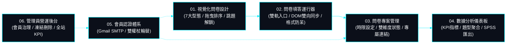
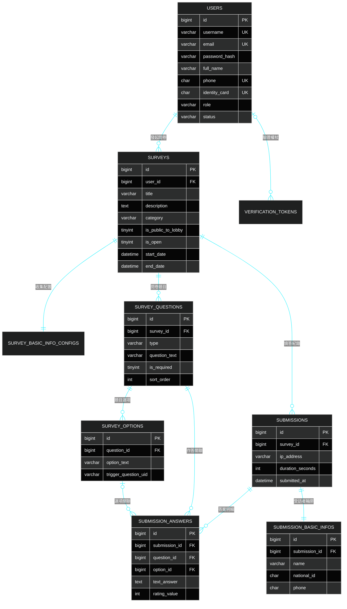

# SurveyFlow | 現代實證調研與學術結構化數據採集系統

> **專案作者**: 許哲誠 (HSU, CHE-CHENG)  
> **專案定位**: 專業級全端動態線上問卷調研與多維數據分析平台。支援 7 大型態動態題目編排、條件跳題動態解鎖、原生 DOM 雙向防誤判、即時統計圖表聚合、4 大專業格式匯出與三層身分授權治理。  
> **語言與執行環境版本**:
> - **前端 SPA**: Node.js 24.18.0 / Angular 19.0.0 / TypeScript 5.6.2 / Angular CDK 19.2.19 (Cloudflare Pages 託管，100% 純原生 SCSS/CSS，無外部樣式表，TS 零硬編碼色票)
> - **後端 Web API**: Java 21 / Spring Boot 4.1.1 / Spring Data JPA / ModelMapper 3.2.2 / Spring Security / JJWT 0.12.6 / Argon2id (Render Docker 容器化)
> - **持久化資料庫**: TiDB Cloud Serverless (MySQL 8.0.36 協定相容分散式關聯式資料庫，9 大實體資料表完整關聯)

---

## 01. 系統願景、核心定位與模組總覽 (System Vision & Overview)

**SurveyFlow** 是一套專為個人研究者、學術系所與企業組織量身打造之**現代化動態線上問卷調研與多維數據採集系統**。系統旨在解決傳統問卷表單在複雜邏輯跳題、資料格式驗證失誤、高擬真數據分析及多格式統計匯出等面向的痛點，建立高可靠、零誤判、深層在地化且具備學術嚴謹度之調查平台。

### 線上公開部署網址 (具備雲端生產環境前提)
本系統已完成全自動化雲端雙軌部署；若具備正式線上部署環境，可透過以下公開網址直接存取體驗：
- **前端 SPA 展示站點 (Cloudflare Pages)**: `https://survey-flow.pages.dev`
- **後端 Web API 伺服器 (Render Web Service)**: `https://survey-flow-9gt6.onrender.com`
- **健康檢查保活探針 (Actuator)**: `https://survey-flow-9gt6.onrender.com/actuator/health`

### 系統六大核心實體模組



---

## 02. 使用者身分型別與功能權限矩陣 (Role & Permissions)

系統嚴格劃分三大身分：**訪客 (`GUEST`)**、**一般會員 (`MEMBER`)** 與 **系統管理員 (`ADMIN`)**，18 項真實功能權限對照如下：

| 功能項目與業務邊界 | 訪客 (`GUEST`) | 會員 (`MEMBER`) | 管理員 (`ADMIN`) |
| :--- | :---: | :---: | :---: |
| 瀏覽公開問卷大廳列表 | ✅ | ✅ | ✅ |
| 搜尋與篩選 9 大領域分類問卷 | ✅ | ✅ | ✅ |
| 透過公開大廳填寫開放中問卷 | ✅ | ✅ | ✅ |
| 透過專屬直達連結參與填答 | ✅ | ✅ | ✅ |
| 填寫受訪者個人輪廓資料 | ✅ | ✅ | ✅ |
| 註冊會員帳號與郵件驗證開通 | ✅ | ❌ | ❌ |
| 會員身分登入與換發雙 Token | ✅ | ✅ | ✅ |
| 建立與編排全新問卷 (7 大型態) | ❌ | ✅ | ✅ |
| 設定條件邏輯跳題規則 (選 A 開 B) | ❌ | ✅ | ✅ |
| 編輯與修改名下既有問卷 | ❌ | ✅ | ✅ |
| 複製專屬作答直達分享連結 | ❌ | ✅ | ✅ |
| 動態切換問卷公開狀態與開放狀態 | ❌ | ✅ | ✅ |
| 設定問卷開放填答起訖時效限制 | ❌ | ✅ | ✅ |
| 查看個人名下問卷數據分析儀表板 | ❌ | ✅ | ✅ |
| 匯出 4 大格式報表 (CSV / SPSS / JSON / PDF) | ❌ | ✅ | ✅ |
| 維護個人基本資料與重設安全密碼 | ❌ | ✅ | ✅ |
| 審查全站會員名冊與即時狀態管理 | ❌ | ❌ | ✅ |
| 執行會員帳號凍結、啟用與安全刪除 | ❌ | ❌ | ✅ |

---

## 03. 技術選型矩陣與架構決策 (Tech Stack & ADR)

| 維度分層 | 技術選型 | 版本規格 | 選型核心理由與工程權衡 |
| :--- | :--- | :--- | :--- |
| **前端框架** | Angular | `v19.0.0` | 完整 Signals 反應式原生狀態、強型別 DI 體系，適合複雜企業表單 |
| **前端樣式** | 純原生 SCSS | 原生 CSS3 變數 | **100% 自研純原生樣式，零外部樣式表 (No Bootstrap/Tailwind)** |
| **後端核心** | Spring Boot | `v4.1.1` (Java 21) | 虛擬執行緒支援、強型別依賴注入、高效能企業級 API 平台 |
| **資料持久化** | TiDB Cloud | MySQL 8.0 協定 | Serverless 分散式關聯式資料庫，支援 ACID 交易與高併發寫入 |
| **資料庫映射** | Spring Data JPA | 搭配 Hibernate | 實體生命週期管理、型別安全查詢、支援複雜多表關聯與聚合 |
| **物件映射** | ModelMapper | `v3.2.2` (STRICT) | 嚴格策略雙向轉換 DTO 與 Entity，消除手工搬運雜訊 |
| **密碼安全** | Argon2id | 國際標準參數 | 抵禦 GPU/ASIC 暴力破解之頂級密碼雜湊標準 |
| **身分權杖** | JJWT | `v0.12.6` | 無狀態短效 Access Token (15m) + 長效 Refresh Token (7d) 輪替 |

---

## 04. 系統分層架構與實體目錄拓撲 (System Architecture & Directory)

```text
survey-flow/
├── Dockerfile                         # 後端多階段 Alpine 容器映像檔建置規格
├── .dockerignore                      # Docker 排除建置資產清單
├── README.md                          # 專案全域規格總覽 (純臺灣繁體中文)
├── docs/                              # 專案架構文檔庫
│   ├── change-log.md                  # 【常駐】修訂歷程庫 (最新異動置頂)
│   ├── check-list.md                  # 【常駐】業務功能點收清單
│   └── system-design/                 # 系統架構規格書 (01-11 循序合理編號、分則明確)
│       ├── 01-overview.md             # 系統願景、核心定位與模組總覽
│       ├── 02-role-type.md            # 使用者身分型別與功能權限矩陣
│       ├── 03-tech-stack.md           # 技術選型矩陣與 ADR 架構決策
│       ├── 04-architecture.md         # 分層架構與檔案物理索引字典
│       ├── 05-flowcharts.md           # 核心業務流程圖與狀態機
│       ├── 06-specs-api.md            # RESTful API 通訊協定規格書
│       ├── 07-specs-database.md       # TiDB / MySQL 資料庫模型與 ERD
│       ├── 08-ui-ux-standards.md      # 前端視覺設計風格與介面美學標準書
│       ├── 09-security.md             # 全端資安防護、認證授權與資料脫敏
│       ├── 10-deployment.md           # 雲端雙軌部署拓撲與維運規範書
│       └── 11-local-testing.md        # 本地測試、建置與快速啟動指南
├── frontend/                          # Angular 19 前端 SPA 專案 (純原生 SCSS)
│   ├── src/app/
│   │   ├── @interfaces/               # 強型別資料契約 DTO
│   │   ├── @services/                 # 單一職責業務服務 (ApiClient, Getter, Emitter...)
│   │   └── components/                # 獨立 Standalone 視圖組件 (Hero, Lobby, Design...)
│   ├── styles.scss                    # 全域原生樣式
│   └── variables.scss                 # 品牌色票與中性 Token (統整圖表調色盤)
└── backend/                           # Java 21 / Spring Boot 4.1.1 後端專案
    └── src/
        ├── main/java/com/surveyflow/  # Clean Architecture 乾淨分層 (Controller/Service/Repo/Entity)
        ├── main/resources/database/   # schema.sql (9大表 DDL) 與 data.sql (測試種子)
        └── test/                      # 29/29 全套 JUnit 5 + Mockito 單元與整合測試套件
```

---

## 05. 核心業務流程與狀態流轉 (Business Flowcharts & State Machine)


---

## 06. RESTful API 通訊協定規格 (API Specifications)

全系統通訊嚴格遵循 RESTful 標準，**永遠僅使用 `GET`, `POST`, `PUT`, `DELETE` 四種動詞**，主要端點分群如下：

| 端點路由 | HTTP 動詞 | 授權層級 | 業務職責說明 |
| :--- | :---: | :---: | :--- |
| `/api/surveys/lobby` | `GET` | 訪客公開 | 取得公開大廳問卷清單 (支援分類篩選與關鍵字搜尋) |
| `/api/surveys/code/{code}` | `GET` | 訪客公開 | 依問卷專屬代碼載入題目與作答設定 |
| `/api/surveys/{id}/submit` | `POST` | 訪客公開 | 提交受訪者作答資料與基本輪廓 |
| `/api/auth/register` | `POST` | 訪客公開 | 會員帳號註冊 (發送 6 碼驗證信) |
| `/api/auth/login` | `POST` | 訪客公開 | 會員登入 (驗證密碼，簽發雙 Token) |
| `/api/auth/refresh` | `POST` | 訪客公開 | 傳入 Refresh Token 換發全新 Access Token |
| `/api/surveys` | `GET` | 會員認證 | 查詢個人名下所有發起之問卷專案 |
| `/api/surveys` | `POST` | 會員認證 | 建立全新問卷專案與題目結構 |
| `/api/surveys/{id}` | `PUT` | 會員認證 | 更新問卷資訊、題目、跳題邏輯與開放時限 |
| `/api/surveys/{id}` | `DELETE` | 會員認證 | 軟刪除指定問卷專案 |
| `/api/surveys/{id}/statistics` | `GET` | 會員認證 | 取得多維聚合統計數據與 12 色圖表指標 |
| `/api/admin/users` | `GET` | 管理員 | 審查全站會員清單與即時狀態 |
| `/api/admin/users/{id}/status` | `PUT` | 管理員 | 切換會員狀態 (凍結 / 啟用) |
| `/api/admin/users/{id}` | `DELETE` | 管理員 | 刪除指定會員帳號 |

---

## 07. 資料庫實體模型與 ERD 關聯 (Database ERD - 9 大資料表)



---

## 08. 前端視覺設計風格與介面美學 (Visual Aesthetics & Standards)

SurveyFlow 的介面視覺體系回歸現代實證研究與頂級學術期刊之專業質感，核心美學元素包含：

1. **極簡純淨紙張白底色 (`#fbfbfa` / `#ffffff`)**: 模擬高階學術印刷紙質，帶來沉著專業且長時間閱讀舒適之體驗。
2. **100% 自研純原生 SCSS/CSS 系統**: 全站零引入第三方外部樣式表（嚴格禁止 Bootstrap / Tailwind），確保極致載入效能與樣式自主掌控。
3. **12 色鮮明高對比數據圖表調色盤**: 告別死灰濁色，採用寶藍 (`#2563eb`)、翠綠 (`#059669`)、金橙 (`#d97706`)、亮紫 (`#7c3aed`) 等 12 組純淨高對比色彩，搭配淺灰藍槽底（`#f1f5f9`），層次清晰明亮。
4. **冠軍最高票 👑 皇冠立體微徽章風格**: 是非題、單選、多選排行榜與評分量表中，最高票項目即時渲染暖金微徽章（`#f59e0b` 描邊、微光陰影與 👑 膠囊），第一視覺直觀捕捉民意共識。
5. **9 大主題領域分類膠囊標籤語意調色**: 沉穩靛藍 (學術教育)、琥珀金橙 (商業行銷)、翡翠翠綠 (滿意度)、科技天藍 (產品體驗)、洋紅紫粉 (社群生活)、珊瑚玫瑰 (娛樂日常)、薄荷青綠 (醫療健康)、典雅紫 (人資行政)，語意辨識度極高。
6. **自適應無橫向捲動垂直卡片流**: 行動端自動轉譯為乾淨垂直卡片流，防破版容器設計，手指滑動順暢自如。
7. **深黑 HUD 直角線條架構圖**: 文檔架構圖均以深黑背景 `#030712`、霓虹青邊框 `#00f0ff` 與直角 HUD 儀表板風格繪製。

---

## 09. 全端資安防護與認證規範 (Security & Privacy)

1. **密碼雜湊標準**: 全面採用 **Argon2id**（$m=4096, t=3, p=1$），完全杜絕暴力破解風險。
2. **無狀態雙權杖輪替 (RTR)**: 短效 15 分鐘 Access Token + 長效 7 天 Refresh Token，兼顧體驗與安全吊銷。
3. **在地化格式雙向防呆**: 深度整合身分證字號雙向權重校驗（Modulo 10 演算法）與臺灣手機 09 開頭 10 碼檢核。
4. **防禦性程式設計**: 全站防範 SQL 注入（JPA 參數化綁定）、XSS 攻擊（Angular 內建 Sanitization 消毒）與 CSRF 防護。

---

## 10. 雲端雙軌部署拓撲與維運規範 (Cloud Deployment)

系統採極致解耦之雲端現代架構：
- **前端 SPA**: 部署於 **Cloudflare Pages** (`https://survey-flow.pages.dev`)，享有 Edge CDN 全球邊緣加速。
- **後端 Web API**: 部署於 **Render Web Service** (`https://survey-flow-9gt6.onrender.com`)，以 Docker 多階段容器化運作，配置 `/actuator/health` 探針維持熱機保活。
- **持久化資料庫**: 託管於 **TiDB Cloud Serverless** 分散式叢集，具備 TLS 加密傳輸與自動容錯擴展。
- **環境變數 OCP 外部化**: 連線資訊、JWT 金鑰、郵件發信金鑰 100% 外部化管理，嚴禁硬編碼。

---

## 11. 本地測試、建置與快速啟動指南 (Local Testing & Build)

### 11.1 前置需求
- **Node.js**: `24.x` (或相容之 LTS)
- **Java JDK**: `21` (推薦 Eclipse Temurin 21)
- **MySQL / TiDB**: `8.0+`（資料庫初始化腳本位於 `backend/src/main/resources/database/`）

### 11.2 資料庫初始化 (SSOT)
在 MySQL 或 TiDB 執行 `schema.sql` 與 `data.sql`：
```sql
CREATE DATABASE IF NOT EXISTS surveyflow CHARACTER SET utf8mb4 COLLATE utf8mb4_unicode_ci;
USE surveyflow;
-- 執行 backend/src/main/resources/database/schema.sql
-- 執行 backend/src/main/resources/database/data.sql
```

### 11.3 後端測試驗證與本地啟動
```bash
cd backend
# 執行全套單元與整合測試 (31/31 全數 PASS)
./mvnw clean test

# 啟動後端 Spring Boot 服務 (預設監聽 http://localhost:8080)
./mvnw spring-boot:run
```

### 11.4 前端安裝與本機啟動
```bash
cd frontend
# 安裝相依套件
npm install

# 啟動前端開發伺服器 (瀏覽器存取 http://localhost:4200，自動代理至 localhost:8080)
npm start

# 生產環境編譯打包驗證
npm run build
```

### 11.5 本地預設測試帳號清單
- **系統最高管理員**: `admin` / `Admin123!` (`ROLE_ADMIN`，具備會員凍結/解凍/刪除權限)
- **測試一般會員**: `testuser` / `User1234!` (`ROLE_USER`，具備問卷建立/編輯/管理/報表權限)

---

## 12. 版權與開源宣告

Copyright © 2026 許哲誠 (HSU, CHE-CHENG). All Rights Reserved.
