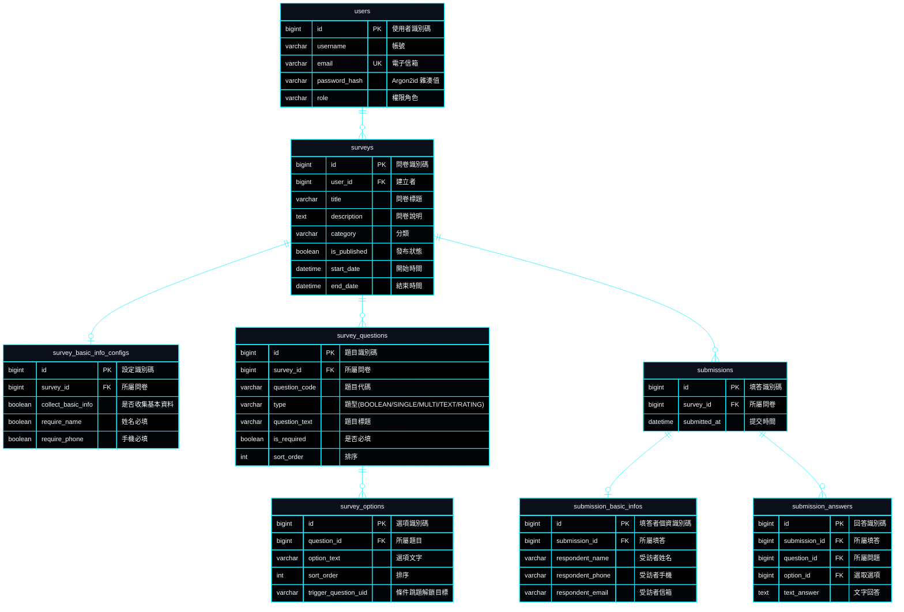

# SurveyFlow | 企業級問卷調查與智慧數據分析系統

> **專案作者**: 許哲誠 (HSU, CHE-CHENG)  
> **專案定位**: 企業級全端問卷引擎與數據視覺化分析平台。支援動態題目編排、條件跳題解鎖、多層級作答防護、統計圖表即時聚合與權限控管。  
> **語言與執行環境版本**:
> - **前端 (Frontend)**: Node.js 24.18.0 / Angular 19.0.0 / TypeScript 5.6.2 / Angular CDK 19.2.19
> - **後端 (Backend)**: Java 21.0.12 / Spring Boot 4.1.1 / Spring Security 6.x / JJWT 0.12.6
> - **持久化資料庫 (Database)**: MySQL 8.0.36

---

## 1. 架構設計思路 (Architecture Mindset)

SurveyFlow 採**前後端完全解耦架構**，前端與後端分別專注於極致的互動體驗與嚴謹的資料安全：

- **單一真實資料源 (SSOT)**: 全系統資料模型、狀態定義、常數列舉（如 `CAREER_OPTIONS`）、業務設定與驗證規則，具備唯一真實來源，跨端透過標準 RESTful API 與強型別 DTO 傳輸。
- **領域驅動與分層隔離 (DDD & Layered Architecture)**:
  - **後端**: 嚴格遵守 `Controller ➔ Service ➔ Repository ➔ Entity` 物理隔離，DTO 作為外部資料傳輸介質，防止資料庫實體洩漏。
  - **前端**: 採用 Angular 核心 Signals 反應式狀態流，搭配依賴注入 (DI) 與模組化 Service 負責資料與防呆檢核。
- **無狀態認證與企業級資安 (Stateless Security)**:
  - 雙 Token 認證（Access Token 15 分鐘 + Refresh Token 7 天旋轉機制）。
  - 密碼採用國際資安標準 **Argon2id** 雜湊演算法加密。
  - API 統一回傳格式與全域例外攔截機制（`GlobalExceptionHandler`）。
- **零橫向拖曳 RWD 與 WCAG 2.2 無障礙相容**:
  - 表格卡片化流體適應，在各式行動裝置螢幕下保證零破版、免橫向滾動。

---

## 2. 核心功能規格 (Specifications)

| 模組分類 | 功能特色 | 規格說明 |
| :--- | :--- | :--- |
| **問卷大廳** | 公開問卷瀏覽與快速作答 | 支援類別篩選、關鍵字全文搜尋、分頁控制（預設每頁 5 筆）與真實全域編號標註。 |
| **問卷設計器** | 視覺化動態題目編排 | 支援是非題、簡答題、單選題、複選題、評分題（5點/10點/NPS）、日期與時間題；支援條件跳題解鎖、拖曳重排。 |
| **受訪者作答引擎** | 響應式表單與防呆檢驗 | 支援受訪者多維度基本資料收集（姓名、年齡、手機、身分證字號雙向演算法）、時效倒數限制與即時作答進度。 |
| **統計與數據分析** | 多維度聚合圖表與數據洞察 | 提供 KPI 總覽指標卡、題目統計分佈（長條圖/百分比）、受訪者人口統計學分析與作答明細總表。 |
| **會員與後台管理** | 角色授權與多租戶隔離 | 一般會員（`ROLE_USER`）專屬問卷管理與數據查看；系統管理員（`ROLE_ADMIN`）全站會員帳號審查與封鎖狀態管控。 |

---

## 3. 系統業務流程圖 (Flowchart)


---

## 4. 資料庫模型 (ERD)



---

## 5. 檔案目錄結構拓撲

```text
survey-flow/
├── README.md                  # 專案總覽與全端整合指南
├── .gitignore                 # 統整全端忽略檔
├── docs/                      # 規格與文檔庫
│   ├── change-log.md          # 輕量修訂歷程 (常駐置頂)
│   ├── check-list.md          # 功能驗收清單
│   └── system-design/         # 系統架構規格書 (01-10)
├── frontend/                  # Angular 19 前端工程
│   ├── src/app/               # 頁面與核心元件
│   │   ├── @interfaces/       # 領域模型與型別契約 (SSOT)
│   │   ├── @services/         # API 服務與響應式資料流
│   │   └── components/        # 功能視圖與版面配置組件
│   │       ├── header/        # 全域頂部導航
│   │       ├── footer/        # 全域頁尾
│   │       └── main/          # 主業務視圖 (首頁、大廳、設計器、填答器、分析管理)
│   ├── package.json           # 前端依賴配置
│   └── angular.json           # Angular CLI 設定
└── backend/                   # Spring Boot 4.1.1 後端工程
    ├── src/main/java/         # Java 原始碼 (Controller, Service, Repository, Entity, Security)
    ├── src/main/resources/    # 設定檔與 DDL/DML 腳本 (application.properties, schema.sql, data.sql)
    └── pom.xml                # Maven 依賴配置
```

---

## 6. 本機建置與運行指南

### 6.1 前端啟動

1. 進入前端目錄：
   ```bash
   cd frontend
   ```
2. 安裝依賴：
   ```bash
   npm install
   ```
3. 啟動本機開發伺服器：
   ```bash
   npm start
   # 或執行 ng serve，預設運行於 http://localhost:4200
   ```

### 6.2 後端啟動

1. 確認本機 MySQL 8.0 伺服器啟動於 `localhost:3306`（資料庫名稱 `survey_flow`）。
2. 匯入基礎資料庫 Schema 與預設種子資料（`backend/src/main/resources/database/schema.sql` 與 `data.sql`）。
3. 進入後端目錄並編譯啟動：
   ```bash
   cd backend
   ./mvnw spring-boot:run
   # 預設運行於 http://localhost:8080
   ```
