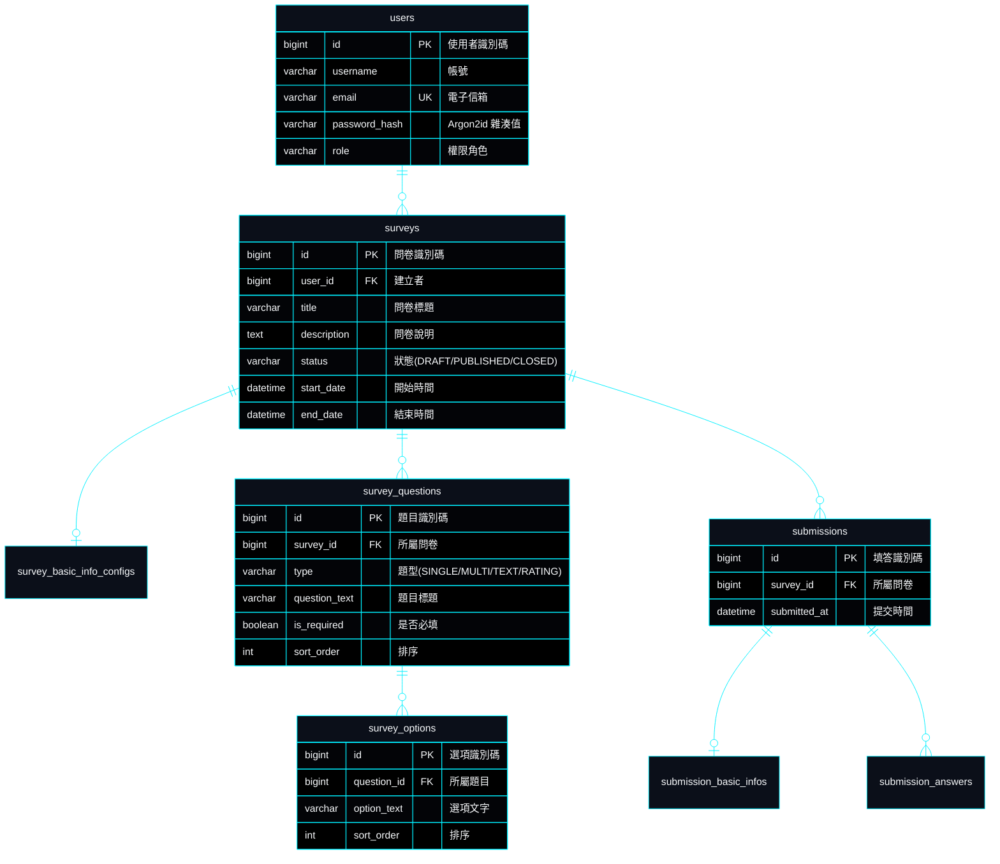

# SurveyFlow | 企業級問卷調查與智慧數據分析系統

> **專案作者**: 許哲誠 (HSU, CHE-CHENG)  
> **專案定位**: 企業級全端問卷引擎與數據視覺化分析平台。支援動態題目編排、多層級作答防護、統計圖表即時聚合與權限控管。  
> **語言與執行環境版本**:
> - **前端 (Frontend)**: Node.js 20.x / Angular 19.x / TypeScript 5.6
> - **後端 (Backend)**: Java 21 / Spring Boot 3.4.x / Spring Security 6.x
> - **持久化資料庫 (Database)**: MySQL 8.0+

---

## 1. 架構設計思路 (Architecture Mindset)

SurveyFlow 採**前後端完全解耦架構**，前端與後端分別專注於極致的互動體驗與嚴謹的資料安全：

- **單一真實資料源 (SSOT)**: 前後端資料契約以標準 RESTful API 與 JSON Schema 保持一致，狀態流轉單向可追溯。
- **領域驅動與分層架構 (DDD & Layered Architecture)**:
  - **後端**: 嚴格遵守 `Controller ➔ Service ➔ Repository ➔ Entity` 物理隔離，DTO 作為外部資料傳輸介質，防止實體洩漏。
  - **前端**: 採用 Angular 核心 Signals 反應式狀態流，搭配依賴注入 (DI) 與模組化 Service 負責資料與檢驗。
- **無狀態認證與防護 (Stateless Security)**:
  - 雙 Token 認證（Access Token 15 分鐘 + Refresh Token 7 天旋轉機制）。
  - 密碼採用國際資安標準 **Argon2id** 雜湊加密。
  - API 統一回傳格式與全域例外攔截機制（`GlobalExceptionHandler`）。

---

## 2. 核心功能規格 (Specifications)

| 模組分類 | 功能特色 | 規格說明 |
| :--- | :--- | :--- |
| **問卷設計器** | 視覺化動態題目編排 | 支援單選題、多選題、簡答題、評分題；支援拖曳排序、即時預覽與驗證規則設定。 |
| **受訪者作答引擎** | 響應式表單與防呆檢驗 | 支援前置基本資料收集、必填驗證、時間限制倒數、作答進度即時反饋。 |
| **統計與數據分析** | 多維度聚合圖表 | 即時題型統計分佈（長條圖、圓餅圖、平均評分）、作答者趨勢與名冊匯出。 |
| **會員與權限控管** | 角色與多租戶隔離 | 問卷建立者僅能存取其所屬問卷與作答紀錄；提供密碼重設與個人設定管理。 |

---

## 3. 系統業務流程圖 (Flowchart)


---

## 4. 資料庫模型 (ERD)



---

## 5. 檔案目錄結構拓撲

```text
survey-flow/
├── AGENTS.md                  # 全域 AI Agent 核心中樞協定
├── AGENTS-GIT.md              # 全域 Git 版本控制協定
├── AGENTS-FRONT.md            # 前端工程與 Angular 規範
├── AGENTS-BACK.md             # 後端工程與 Spring Boot 規範
├── README.md                  # 專案總覽與全端整合指南
├── .gitignore                 # 統整全端忽略檔
├── docs/                      # 規格與文檔庫
│   ├── change-log.md          # 輕量修訂歷程
│   ├── check-list.md          # 功能驗收清單
│   └── system-design/         # 系統架構規格書 (01-08)
├── frontend/                  # Angular 19 前端工程
│   ├── src/app/               # 頁面與核心元件
│   │   ├── @components/       # 通用共用元件
│   │   ├── @pages/            # 路由頁面 (首頁、問卷設計、作答、統計)
│   │   ├── @services/         # API 服務與資料流
│   │   └── datas/             # 本地靜態結構契約 (Mock Data)
│   ├── package.json           # 前端依賴配置
│   └── angular.json           # Angular CLI 設定
└── backend/                   # Spring Boot 3.4 後端工程 (規劃與建置中)
    ├── src/main/java/         # Java 原始碼 (Controller, Service, Repository, Entity)
    ├── src/main/resources/    # 設定檔與 DDL 腳本 (application.yml, schema.sql)
    └── pom.xml                # Maven 依賴配置
```

---

## 6. 本機建置與運行指南

### 6.1 前端啟動

1. 進入前端目錄：
   ```bash
   cd frontend
   ```
2. 安裝依賴：
   ```bash
   npm install
   ```
3. 啟動本機開發伺服器：
   ```bash
   npm start
   # 或執行 ng serve，預設運行於 http://localhost:4200
   ```

### 6.2 後端啟動 (即將上線)

1. 確認本機 MySQL 8.0 伺服器啟動於 `localhost:3306`。
2. 匯入基礎資料庫 Schema（參見 `docs/system-design/05-specs-database.md`）。
3. 進入後端目錄並啟動：
   ```bash
   cd backend
   mvn spring-boot:run
   # 預設運行於 http://localhost:8080
   ```
