# 01. 系統願景、核心定位與模組總覽 (System Vision & Overview)

> **系統名稱**: SurveyFlow 線上問卷設計系統  
> **文檔定位**: 專案全域第一級入門總覽。負責闡述系統願景、核心業務責任與六大功能模組，作為循序理解專案之總入口。

---

## 1. 系統是做什麼的 (System Purpose & Core Value)

**SurveyFlow** 是一套專為個人研究者、學術系所與企業組織量身打造之**現代化動態線上問卷調研與多維數據採集系統**。系統旨在解決傳統問卷表單在複雜邏輯跳題、資料格式驗證失誤、高擬真數據分析及多格式統計匯出等面向的痛點，建立高可靠、零誤判、深層在地化且具備學術嚴謹度之調查平臺。

### 核心業務價值主張
1. **零誤判填答體驗**: 全題型（單選、複選、是非、量表、簡答、日期、時間）送出前同時檢查表單狀態與畫面上的實際輸入，避免作答被誤判為未填。
2. **條件邏輯跳題 (選 A 開 B)**: 支援選項動態解鎖題目，未展開之題目自動豁免必填驗證，展開後嚴格檢核。
3. **臺灣在地化格式防呆**: 深度整合身分證字號雙向權重校驗（Modulo 10）、臺灣手機 09 開頭 10 碼檢核與繁體中文姓名防呆。
4. **真實數據與學術級分析**: 報表真實取自資料庫最新作答時間戳（絕無虛假時間），支援 CSV (UTF-8 BOM)、SPSS 語法檔 (`.sps`)、JSON 與原生列印。
5. **雲端現代雙軌部署**: 前端 SPA（Cloudflare Pages，純原生 SCSS/CSS）與後端 Web API（Render Web Service + TiDB Cloud Serverless）完全解耦，靜態資源由 CDN 全球分發。

### 線上公開部署網址 (正式雲端生產環境)
可透過以下公開網址直接體驗：
- **前端 SPA 展示站點 (Cloudflare Pages)**: [https://survey-flow.pages.dev](https://survey-flow.pages.dev)
- **後端 Web API 伺服器 (Render Web Service)**: [https://survey-flow-9gt6.onrender.com](https://survey-flow-9gt6.onrender.com)
- **健康檢查保活探針 (Actuator)**: [https://survey-flow-9gt6.onrender.com/actuator/health](https://survey-flow-9gt6.onrender.com/actuator/health)

> 註：在未配置雲端環境或本機離線開發情境下，系統則回歸本機服務（預設前端為 `http://localhost:4200`，後端為 `http://localhost:8080`）。

---

## 2. 系統六大核心實體模組 (Functional Modules)

系統在職責單一 (SRP) 原則下，劃分為六大核心實體業務模組：

```mermaid
%%{init: {'theme': 'dark', 'themeVariables': { 'darkMode': true, 'background': '#030712', 'primaryColor': '#0b0f19', 'primaryTextColor': '#f8fafc', 'primaryBorderColor': '#00f0ff', 'lineColor': '#00f0ff', 'textColor': '#f8fafc', 'edgeLabelBackground': 'transparent' }, 'themeCSS': '.edgeLabel, .edgeLabel rect, .edgeLabel span, .labelBkg { background: transparent !important; background-color: transparent !important; fill: transparent !important; border: none !important; } .edgeLabel, .edgeLabel span { color: #ffffff !important; fill: #ffffff !important; font-weight: 500 !important; } rect, .node rect, polygon { rx: 0px !important; ry: 0px !important; }', 'flowchart': { 'curve': 'linear' } }}%%
flowchart LR
    classDef hudCard fill:#0b0f19,stroke:#00f0ff,stroke-width:1.5px,color:#f8fafc,rx:0px,ry:0px;

    M1["01. 視覺化問卷設計<br/>(7大型態 / 拖曳排序 / 跳題解鎖)"]:::hudCard
    M2["02. 問卷填答運行器<br/>(雙軌入口 / DOM雙向同步 / 格式防呆)"]:::hudCard
    M3["03. 問卷專案管理<br/>(時限設定 / 雙維度狀態 / 專屬連結)"]:::hudCard
    M4["04. 數據分析儀表板<br/>(KPI指標 / 題型聚合 / SPSS匯出)"]:::hudCard
    M5["05. 會員認證體系<br/>(Gmail SMTP / 雙權杖輪替)"]:::hudCard
    M6["06. 管理員營運後臺<br/>(會員治理 / 凍結刪除 / 全站KPI)"]:::hudCard

    M1 --> M2 --> M3 --> M4
    M5 -.-> M1
    M5 -.-> M3
    M6 -.-> M5
```

### 模組職責摘要
1. **視覺化問卷設計模組 (`/survey-design`)**: 支援 7 大題型配置、拖曳即時排序、單選動態跳題關聯配置、受訪者身分欄位自訂、封面附圖 Base64 上傳與即時擬真預覽。
2. **問卷填答運行模組 (`/survey-runner`)**: 支援公開大廳與專屬連結雙軌作答、原生 DOM 狀態深度掃描同步、條件跳題可見度豁免判斷與臺灣在地格式嚴格校驗。
3. **問卷專案管理模組 (`/survey-management`)**: 負責名下問卷預覽、專屬作答直達連結生成、大廳公開與填答開放雙維度開關控制、時程起訖設定與軟刪除管理。
4. **數據分析聚合模組 (`/survey-management` 分析面板)**: 負責 5 大營運 KPI、近 30 日走勢、受訪者人口輪廓、題型聚合分析、真實最後回覆時間及 4 大格式 (CSV / SPSS / JSON / PDF) 數據匯出。
5. **會員認證安全模組 (`/log-in`, `/register`, `/verify-email`)**: 負責 Argon2id 密碼雜湊、Brevo / Resend HTTP API (SMTP 備援) 寄發註冊開通與密碼重設驗證碼、無狀態短效 Access Token + HttpOnly Refresh Token 輪替與重放攔截。
6. **系統營運治理模組 (`/user-management`)**: 管理員專屬之全站會員名冊檢視 (手機與身分證遮罩)、即時凍結 / 啟用、安全帳號刪除，以及不可竄改之稽核日誌查詢與完整性驗證。

---

## 3. 系統架構規格書矩陣導航 (Design Specifications Index)

為實現敘述分則明確、單一真實來源 (SSOT) 且杜絕重複冗餘，本專案之深度規格書嚴格依工程邏輯編排如下，讀者可依序循序研讀：

| 序號與文檔檔名 | 專職負責領域 | 核心內容要點 |
| :--- | :--- | :--- |
| [01-overview.md](01-overview.md) | **系統願景與核心定位** | 業務背景、痛點解決、六大核心模組全貌與規格導航。 |
| [02-role-type.md](02-role-type.md) | **使用者身分與權限矩陣** | 訪客、會員、管理員三大身分之 20 項真實操作功能對照矩陣與路由守衛。 |
| [03-tech-stack.md](03-tech-stack.md) | **技術選型矩陣與 ADR** | Java 21, Spring Boot 4.1.1, Angular 19, 純原生 SCSS, TiDB MySQL 選型理由。 |
| [04-architecture.md](04-architecture.md) | **分層架構與目錄拓撲** | 前端 Standalone 結構、後端 Controller-Service-Repository 三層防線。 |
| [05-flowcharts.md](05-flowcharts.md) | **業務流程與狀態流轉圖** | 問卷生命週期、填答進入方式 (大廳 / 分享連結) 與條件跳題、未存檔離開守衛、Token 自動換發與重放偵測時序。 |
| [06-specs-api.md](06-specs-api.md) | **RESTful API 通訊協定規格** | 公開端點、會員專區、管理專用路由，標準五種 HTTP 動詞 (GET/POST/PUT/PATCH/DELETE)。 |
| [07-specs-database.md](07-specs-database.md) | **TiDB 資料庫模型與 ERD** | 12 張資料表 (含 Token 黑名單、稽核日誌)、複合索引優化、外鍵級聯約束、併發控制與 100% 原生 SQL 查詢。 |
| [08-ui-ux-standards.md](08-ui-ux-standards.md) | **前端 UI/UX 與原生樣式** | 100% 純原生 SCSS/CSS、中性素雅設計語言、零橫向拖曳自適應。 |
| [09-security.md](09-security.md) | **資安防護與資料脫敏** | Argon2id、雙 Token 輪替與資料庫黑名單、RBAC、專屬填答連結 (分享代碼)、OWASP 防護。 |
| [10-deployment.md](10-deployment.md) | **雲端部署拓撲與維運規範** | Cloudflare Pages + Render + TiDB 拓撲、Docker 多階段建置、GitHub Actions CI 與平臺自動部署、環境變數、資料庫結構升級、Actuator 保活探針。 |
| [11-local-testing.md](11-local-testing.md) | **本地測試與建置指南** | 前置相依環境、資料庫初始化、後端 360 項單元測試與 57 項 Testcontainers 整合測試 (合併行覆蓋 99.8%)、前端 291 項 Karma / Jasmine 測試、20 項 Playwright 瀏覽器端到端測試與撰寫慣例、冒煙測試 SOP。 |
