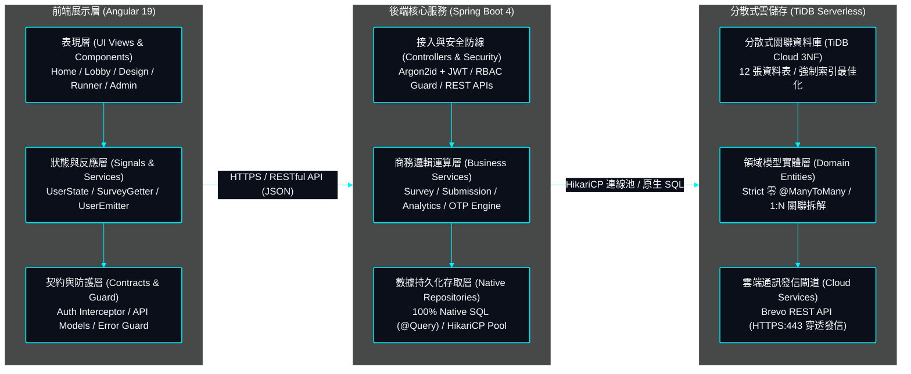

# 04. 系統分層架構與全專案檔案物理索引字典 (Exhaustive Codebase Dictionary)

> **系統架構**: 現代化前端微元件與後端 Spring Boot 4.1.1 乾淨分層架構 (Clean Architecture)  
> **精確環境版號**: Node.js 24.18.0, Angular 19.0.0, Java 21.0.12, Spring Boot 4.1.1, MySQL 8.0.36 協定 (TiDB)  
> **文件定位**: 本文件為 SurveyFlow 系統全域檔案之「物理辭典與索引庫」。完整窮舉專案中每一個資料夾、程式碼腳本與設定檔之實體用途與聯動關係，讓新進工程師能依路徑快速找到每個檔案的責任。

---

## 1. 系統全域分層架構拓撲圖 (Mermaid Tech HUD)



### 1.1 分層架構與 4 大設計法則 (Controller-Service-Repo 4 Golden Rules)

系統嚴格貫徹以**「業務意圖（Use Case）」作為核心邊界**之架構拓撲：

```text
[ Client Request ]
       │
       ▼
[ Controller ]                  --> 嚴格 1 對 1（只負責 HTTP、DTO 驗證、轉發）
       │
       ▼
[ Business Service / Facade ]   --> 事務邊界（@Transactional），統籌單一業務流程
   ├── 專屬主表 Repo            --> 1 對多（依業務需求直接注入 1~3 個 Repo）
   ├── 相關附屬表 Repo
   └── 通用 Helper / Component  --> 抽離純邏輯計算（例如演算法、字串與郵件處理）
```

1. **Controller 保持「極度輕薄」（Thin Controller）**:
   - 1 個 Controller 嚴格只對應 1 個專屬入口 Service。
   - 職責僅限 3 件事：Request 參數驗證 (`@Valid`)、呼叫 Service、包裝 `ApiResponse<T>` 回傳。
   - 嚴禁在 Controller 出現 `if-else` 業務判斷、嚴禁跨多個 Service 自行組裝邏輯。
2. **Service 以「業務流程/意圖 (Use Case)」命名，而非以「資料表」命名**:
   - 杜絕單表對單 Service 的機械化 CRUD 壞味道；單一業務 Service 統籌完整流程，依業務意圖直接注入 1~多個關聯 Repositories。
   - 複雜跨模組流程建立專屬 Service 或 Facade 負責編排（例如 `AdminService`）。
3. **事務邊界 (`@Transactional`) 嚴格收斂在 Service 層**:
   - 跨多張表的寫入與更新全部關在同一個 Service 方法中，確保失敗整筆原子 Rollback，絕不產生半套髒資料。
   - Controller 與 Repository 嚴禁標註 `@Transactional`。
4. **Service 之間不互相注入（避免循環依賴）**:
   - 實體內部狀態判斷寫在 Entity，跨實體純計算抽成 `@Component` 工具類別供 Service 注入。
   - Service 永遠只「向下」調用 Repositories 或 Components，絕不平級互打。
5. **全域方法繁中註解 100% 必備（包含所有測試檔）**:
   - 杜絕「有的有寫、有的沒寫」現象；實體方法說明業務目的、參數與回傳值；所有測試檔 (`*Test.java`) 之測試方法 (`@Test`) 與初始化方法 (`@BeforeEach`) 上方，強制具備繁中說明測試業務情境與斷言預期。

---

## 2. 專案根目錄與全域配置字典 (Root Configuration Dictionary)

| 檔案 / 資料夾路徑 | 實體性質 | 架構責任與業務用途 | 關聯依賴與聯動模組 |
| :--- | :--- | :--- | :--- |
| **`.gitignore`** | 設定檔 | 定義 Git 排除追蹤清單，排除 `node_modules`、編譯產物 `target/` 、測試報告與環境變數檔 `.env`。 | Git 版控系統 |
| **`README.md`** | 說明文檔 | 專案高階技術概述、架構選型理由、實體環境精確版本與本機建置指引。 | 生產發布檢閱資產 |
| **`Dockerfile`** | 建置腳本 | 後端多階段建置：Maven 編譯 JAR → JRE 輕量映像檔，以非 root 使用者執行 (Render 依此建置)。 | Render Web Service |
| **`.dockerignore`** | 設定檔 | 排除建置映像檔時不需要的資料夾 (前端、文件、編譯產物)，縮短上傳與建置時間。 | `Dockerfile` |
| **`.github/workflows/ci.yml`** | CI 管線 | 每次推送執行後端測試、前端型別檢查與單元測試、瀏覽器 E2E；部署由平臺自動執行 (見 `10-deployment.md` §7)。 | GitHub Actions、Render API、Cloudflare Pages |
| **`frontend/`** | 根目錄 | Angular 19.0.0 前端客戶端應用程式完整原始碼目錄。 | 獨立前端工程 |
| **`backend/`** | 根目錄 | Java 21.0.12 與 Spring Boot 4.1.1 後端微服務完整原始碼與資料庫腳本目錄。 | 獨立後端工程 |
| **`docs/`** | 文檔矩陣 | 01~11 系統規格書 (扁平置於 `docs/` 根目錄)。 | 專案規格單一真理源 |

---

## 3. 前端工程檔案實體字典 (`frontend/`)

### 3.1 前端核心設定與進入點 (Configuration & Entry)

| 檔案路徑 | 類型 | 具體用途與責任描述 | 聯動關係 |
| :--- | :--- | :--- | :--- |
| `frontend/package.json` | 配置檔 | 定義專案相依套件版本（Angular 19.0.0, RxJS 7.8.0, TypeScript 5.6.2）與建置腳本。 | pnpm (`pnpm-lock.yaml`) |
| `frontend/angular.json` | 配置檔 | Angular CLI 建置管線配置，定義 SCSS 編譯路徑、靜態資產目錄與 AOT 最佳化參數。 | Angular CLI (`ng build`) |
| `frontend/tsconfig.json` | 配置檔 | TypeScript 基礎編譯器選項，定義嚴格型別檢查（Strict Mode）與模組解析方式。 | TS 編譯器 |
| `frontend/tsconfig.app.json` | 配置檔 | 專為應用程式原始碼指定的 TS 編譯設定，排除單元測試檔案。 | 前端生產打包 |
| `frontend/tsconfig.spec.json` | 配置檔 | 單元測試之 TS 編譯設定，載入 Jasmine 型別並涵蓋 `*.spec.ts`。 | `ng test` |
| `frontend/karma.conf.js` | 配置檔 | Karma 測試執行器設定：Jasmine、Chrome、覆蓋率報告與門檻 (敘述 / 函式 / 行 ≥ 95%、分支 ≥ 85%)。 | `ng test`、CI |
| `frontend/playwright.config.ts` | 配置檔 | E2E 設定：自動啟動容器、後端 (18080) 與前端 (4300)，Chromium 依序執行，結束時移除容器。 | `pnpm e2e`、CI |
| `frontend/tsconfig.e2e.json` | 配置檔 | E2E 程式之 TS 型別檢查設定 (僅供 `tsc --noEmit`)。 | CI 型別檢查 |
| `frontend/e2e/` | 測試 | 瀏覽器端到端測試：6 個 `*.spec.ts`；`support/` (網址常數、API 與 Mailpit 輔助、對話框與登入步驟、注入 API 位址的 fixture)；`scripts/start-e2e-backend.sh`；`global-teardown.ts`。 | 真實前後端 |
| `frontend/src/testing/test-doubles.ts` | 測試輔助 | 元件測試共用替身 (`ok()`、`createApiClientSpy()`、`createDialogSpy()`、`createRouterSpy()`、`lastDialog()`)；不在正式建置範圍內。 | `*.spec.ts` |
| `frontend/src/index.html` | 進入點 | 單頁應用 (SPA) 宿主 HTML，載入 Google Fonts 與根元件 `<app-root>`。 | 瀏覽器初次渲染 |
| `frontend/src/main.ts` | 進入點 | 前端 TypeScript 啟動點，以 `bootstrapApplication(AppComponent)` 啟動根模組。 | `app.config.ts` |
| `frontend/src/styles.scss` | 樣式庫 | 全域 Design Tokens 定義，宣告品牌色階、字體排印、陰影階梯與 Reset 規則。 | 全域所有 UI 元件 |
| `frontend/src/app/app.config.ts` | 配置檔 | 應用程式級注入配置，提供路由、Fetch HTTP 客戶端與 Material 動畫引擎支援。 | 全域 DI 容器 |
| `frontend/src/app/app.routes.ts` | 路由表 | 定義 SPA 路由拓撲（`/`, `/lobby`, `/survey-design`, `/survey-management` 等）並內含 `authGuard`、`canDeactivateGuard`。 | 各頁面元件 |
| `frontend/src/app/app.component.ts` | 根元件 | 根級宿主元件，承載頂部導航 `<app-header>`、內容區 `<router-outlet>` 與 `<app-footer>`。 | 全域 Shell |

### 3.2 抽象服務層與狀態管理 (`frontend/src/app/@services/`)

| 檔案路徑 | 具體用途與責任描述 | 聯動關係 |
| :--- | :--- | :--- |
| `api-client.service.ts` | 封裝 HTTP 請求，自動注入 Bearer Token；收到 401 時以 Refresh Cookie 換發並重送一次 (共用單一換發請求)；`resolveErrorMessage` 為全站唯一錯誤訊息來源 (優先顯示後端訊息，沒有時依狀態碼對照表)。 | 後端所有 REST 端點、`UserStateService` |
| `user-state.service.ts` | 基於 Angular Signals 之身分狀態 (訪客 / 會員 / 管理員) 與 SessionStorage 同步；集中處理認證回應 (`applyAuthResponse`) 與 Access Token 存取。 | `Header`, `AuthAction`, `ApiClientService` |
| `survey-getter.service.ts`| 問卷資料存取服務，向後端取得大廳問卷、個人問卷、全站問卷清單 (含樂觀鎖 `version`) 與單一問卷完整結構 (題型、量表、跳題鎖定摘要轉換)。 | `/api/public/surveys/*`、`/api/user/surveys`、`/api/admin/surveys` |
| `auth-action.service.ts` | 會員認證與帳號行為專職服務，落實 SRP 單一責任，處理登入、登出、個人資料更新與密碼變更 (需目前密碼)。 | `ApiClientService`, `UserStateService` |
| `survey-action.service.ts` | 問卷生命週期專職服務，處理問卷儲存、刪除、開放設定整體覆蓋 (帶回 `version`，409 時顯示衝突訊息) 與填答提交；題型與量表範圍以對照表轉換。 | `ApiClientService`, `SurveyGetterService` |
| `user-emitter.service.ts` | 輕量化門面服務 (Facade Pattern)，元件只注入這一個服務，呼叫再轉交給 `AuthAction` 與 `SurveyAction`。 | 各 UI 元件 |
| `survey-analytics.service.ts`| 前端數據分析核心服務，專職報表資料讀取、題型指標聚合與權限驗證，消滅上帝類別。 | `SurveyManagementComponent` |
| `survey-export.service.ts` | 報表檔案匯出專職服務，落實 SRP 單一責任，處理 CSV (UTF-8 BOM)、Excel、SPSS、JSON 格式化與下載。 | `SurveyAnalyticsService` |
| `dialog.service.ts` | 全域確認對話框排程服務，基於 RxJS Subject 支援 noticeMode、checkMode 與倒數自動關閉。 | `DialogComponent` |
| `validation.service.ts` | 集中式表單驗證服務，實作身分證字號雙向權重校驗（Modulo 10）、臺灣手機號與密碼強度。 | 前端所有輸入表單 |
| `utility.service.ts` | 每次換頁完成後自動平滑捲動到頂端；靜態方法 `scrollToTopSmooth` 供回到頂端按鈕使用。 | `AppComponent`、`ScrollToTopButtonComponent` |
| `survey-state.service.ts` | 問卷填答與設計執行期狀態快取，支援草稿暫存與模式切換。 | `SurveyRunner` |

### 3.3 型別契約與路由守衛 (`frontend/src/app/@interfaces/` & `app.routes.ts`)

| 檔案路徑 | 具體用途與責任描述 | 聯動關係 |
| :--- | :--- | :--- |
| `@interfaces/survey-model.ts` | 問卷設計 / 填答 / 摘要之前端型別 (`SurveyPayload`、`SurveySubmissionPayload`、`SurveySummaryItem`) 與分類常數。 | 問卷相關 Service 與元件 |
| `@interfaces/account-model.ts` | 會員資料 (`UserProfileData`)、登入 / 註冊 / 個人資料修改載荷 (含 `currentPassword`) 與後端認證回應 (`AuthResponseData`)。 | 認證與個人資料模組 |
| `@interfaces/survey-analytics-model.ts` | 統計報表前端型別 (`SurveyAnalyticsReport`)，由 `SurveyAnalyticsService` 自後端回應轉換。 | 數據分析頁 |
| `@interfaces/audit-log-model.ts` | 稽核紀錄、事件類型選項、雜湊鏈驗證結果之前端型別 (與後端 `dto/audit/` 一致)。 | 稽核日誌面板 |
| `app.routes.ts` 內 `authGuard` | 未登入者存取 `/survey-design`、`/survey-management`、`/user-management`、`/user-profile` 時導向 `/log-in`。 | 路由表 |
| `app.routes.ts` 內 `canDeactivateGuard` | 離開前呼叫元件 `canDeactivate()`，有未儲存變更時跳出確認對話框。 | 設計器、填答器、個人資料頁 |

> 每個服務、守衛與元件旁都有同名 `*.spec.ts` 單元測試 (共 33 個測試檔、291 項)，執行方式與慣例見 `11-local-testing.md` §4.5。

> 管理員頁 (`/user-management`) 無獨立守衛：除 `authGuard` 外，由 `UserManagementComponent.ngOnInit` 檢查身分，非管理員導回 `/survey-management`；後端 `/api/admin/**` 另以 `ROLE_ADMIN` 把關。

### 3.4 表現層元件庫 (`frontend/src/app/components/`)

| 檔案路徑 | 具體用途與責任描述 | 聯動關係 |
| :--- | :--- | :--- |
| `header/` | 頂部全域導航列，依身分切換選單，行動版提供漢堡抽屜。 | 全站 Shell |
| `footer/` | 頁尾品牌資訊、動態年份與快速連結。 | 全站 Shell |
| `dialog/` | 全域對話框，訂閱 `DialogService`，支援 notice / check / error 模式與 Esc 關閉。 | `DialogService` |
| `scroll-to-top-button/` | 捲動超過門檻後顯示之置頂按鈕。 | `UtilityService` |
| `main/` | 主內容 `<router-outlet>` 容器。 | 路由表 |
| `main/home/`、`main/home/hero/` | 產品首頁與 Hero 互動預覽。 | 公開頁 |
| `main/lobby/` | 公開問卷大廳：分類篩選、關鍵字搜尋、Material Table 分頁排序。 | `SurveyGetterService` |
| `main/survey-design/` | 問卷設計器：題目增刪、7 種題型、條件跳題、基本資料收集開關。 | `UserEmitterService` |
| `main/survey-design/survey-reorder-dialog/` | 題目排序彈窗 (CDK Drag & Drop)。 | `SurveyDesignComponent` |
| `main/survey-runner/` | 受訪者填答器：預覽 / 正式模式、必填檢核、跳題解鎖、送出填答。 | `UserEmitterService` |
| `main/survey-management/` | 問卷管理與統計報表：開放設定、刪除、報表圖表與匯出。 | `SurveyAnalyticsService` |
| `main/user-management/` | 管理員專區：會員名冊 (手機為後端遮罩值；依正常 / 待開通 / 已凍結篩選與搜尋、凍結 / 恢復、刪除) 與「稽核日誌」分頁切換。 | `/api/admin/users` |
| `main/user-management/audit-log-panel/` | 稽核日誌面板：依操作者與事件類型查詢 (後端分頁)、來源 IP 與追蹤碼、雜湊鏈「驗證完整性」。 | `/api/admin/audit-logs*` |
| `main/user-profile/` | 個人資料維護與密碼變更 (需輸入目前密碼)。 | `UserEmitterService` |
| `main/log-in/`、`main/register/`、`main/verify-email/` | 登入、註冊與信箱驗證碼開通。 | `AuthActionService` / `ApiClientService` |
| `main/forget-password/`、`main/reset-password/` | 申請重設驗證碼與以驗證碼重設密碼。 | `ApiClientService` |
| `main/not-found/` | 404 頁面。 | 路由 `**` |

---

## 4. 後端工程檔案實體字典 (`backend/`)

> Java 根套件：`org.jasonproduction.surveyflow`

### 4.1 後端核心進入點與設定檔

| 檔案路徑 | 類型 | 具體用途與責任描述 |
| :--- | :--- | :--- |
| `backend/pom.xml` | 配置檔 | Maven 建置檔：Java 21、Spring Boot 4.1.1、JJWT、Bouncy Castle、MySQL Connector。 |
| `backend/.env.example` | 範本 | 列出啟動所需環境變數鍵名與說明 (不含真實值)。 |
| `backend/src/main/resources/application.properties` | 配置檔 | 連線池、JPA、JWT、CORS、Argon2id、郵件與日誌層級；機敏值一律由環境變數注入。 |
| `config/HttpClientConfig.java` | 設定 | 提供共用 `HttpClient` Bean (連線逾時由設定注入)，讓 MailService 可在測試中以 Mock 取代。 |
| `SurveyFlowApplication.java` | 進入點 | `@SpringBootApplication`、`@EnableJpaAuditing`、`@EnableScheduling`；啟動時設定預設時區 `Asia/Taipei`。 |

### 4.2 REST 控制器層 (`controller/`)

| 檔案 | 具體用途與責任描述 | 存取權限 | 入口 Service |
| :--- | :--- | :--- | :--- |
| `AuthController.java` | 註冊、信箱驗證、補發驗證碼、登入、換發、忘記 / 重設密碼、登出；下發 HttpOnly Refresh Cookie。 | 公開 (登出需登入) | `AuthService` |
| `SurveyController.java` | 大廳清單、公開填答結構、會員問卷 CRUD 與開放設定 (PUT 覆蓋 / PATCH 局部)。 | 公開 / 會員 | `SurveyService` |
| `SubmissionController.java` | 受訪者填答提交。 | 公開 | `SubmissionService` |
| `AnalyticsController.java` | 單一問卷統計報表。 | 擁有者或管理員 | `AnalyticsService` |
| `UserController.java` | 個人資料查詢 / 更新、密碼變更。 | 會員 | `UserService` |
| `AdminController.java` | 會員名冊與狀態、全站問卷、營運總覽與報表。 | `ROLE_ADMIN` | `AdminService` |
| `AuditLogController.java` | 稽核日誌分頁查詢、事件類型清單、雜湊鏈完整性驗證 (只有讀取)。 | `ROLE_ADMIN` | `AuditLogService` |

### 4.3 業務服務層 (`service/`)

| 檔案 | 具體用途與責任描述 | 依賴 |
| :--- | :--- | :--- |
| `AuthService.java` | 註冊 (含待驗證覆寫)、OTP 簽發與核對、登入 (含失敗鎖定)、RTR 換發與重放攔截、登出吊銷雙 Token、忘記 / 重設密碼。 | `UserRepository`、`VerificationTokenRepository`、`MailService`、`TokenProvider`、`TokenRevocationService`、`LoginAttemptLimiter` |
| `SurveyService.java` | 問卷建立 / 更新 / 開放設定 (樂觀鎖版本比對後 `saveAndFlush`) / 軟刪除、大廳檢索、瀏覽數原子遞增、個人序號、DTO 轉換。 | `SurveyRepository`、`UserRepository`、`SubmissionRepository` |
| `SubmissionService.java` | 填答時窗檢核、作答對應題目三段容錯、各題型作答明細建立。 | `SubmissionRepository`、`SurveyRepository` |
| `AnalyticsService.java` | KPI、趨勢、受訪者輪廓與各題型統計聚合；全站營運總覽。 | `SurveyRepository`、`SubmissionRepository`、`SubmissionAnswerRepository`、`UserRepository` |
| `UserService.java` | 個人資料、密碼變更、管理員會員名冊 (手機與身分證遮罩) / 狀態 / 軟刪除。 | `UserRepository`、`PasswordEncoder` |
| `AuditLogService.java` | 接收 `AuditEvent` 寫入 HMAC 雜湊鏈 (成功事件提交後、失敗事件交易結束後，`REQUIRES_NEW`)；管理員查詢與整條鏈驗證。 | `AuditLogRepository`、`AuditChainHeadRepository`、`AuditHasher` |
| `AdminService.java` | 管理員入口 Facade，委派 `UserService`、`SurveyService`、`AnalyticsService`。 | 上述三個 Service |
| `MailService.java` | 驗證信寄送：依 `MAIL_PROVIDER` 決定管道順序 (Brevo / Resend REST API → SMTP 備援)，全部失敗拋出 `MailSendException` (503)；姓名 HTML 跳脫、連結信箱 URL 編碼。 | `JavaMailSender`、`HttpClient` |

### 4.4 資料存取層 (`repository/`，100% 原生 SQL)

| 檔案 | 用途 | 實體 |
| :--- | :--- | :--- |
| `UserRepository.java` | 依帳號 / 信箱 / ID 查詢、管理員會員分頁、啟用會員數、寫入整批作廢時間點 (`updateTokensRevokedBeforeNative`)。 | `User` |
| `SurveyRepository.java` | 大廳條件分頁、會員問卷分頁、全站分頁、個人序號用 ID 清單、啟用問卷數、瀏覽數原子遞增 (`incrementViewCountNative`)。 | `Survey` |
| `SubmissionRepository.java` | 回收數、填答清單、平均作答秒數、全站填答數。 | `Submission` |
| `SubmissionAnswerRepository.java` | 選項票數、評分統計與分佈、簡答文字抽取。 | `SubmissionAnswer` |
| `VerificationTokenRepository.java` | 依信箱 + 驗證碼 + 類型以 `SELECT … FOR UPDATE` 鎖定最新未使用驗證碼 (悲觀鎖，防止同一組驗證碼被重複核銷)。 | `VerificationToken` |
| `RevokedTokenRepository.java` | JWT 黑名單：`INSERT IGNORE` 原子寫入 (輪替重放偵測)、一次查詢比對黑名單與整批作廢時間點、刪除過期列。 | `RevokedToken` |
| `AuditLogRepository.java` | 稽核紀錄新增、管理員條件分頁 (`countQuery`)、依 ID 遞增分批讀取 (驗證用)；沒有 UPDATE / DELETE。 | `AuditLog` |
| `AuditChainHeadRepository.java` | 以 `SELECT … FOR UPDATE` 鎖定稽核鏈頂端 (寫入用)、不加鎖讀取 (驗證用)。 | `AuditChainHead` |

### 4.5 領域實體層 (`entity/`，不開放 Setter)

| 實體 | 資料表 | 業務方法 |
| :--- | :--- | :--- |
| `User.java` | `users` | `activate()`、`updateProfile()`、`changePasswordHash()`、`changeStatus()`、`softDelete()`、`overwritePendingRegistration()` |
| `Survey.java` | `surveys` | `ensureAcceptingSubmissions()`、`updateContent()`、`replaceSettings()`、`patchSettings()`、`ensureVersionMatches()` (樂觀鎖版本比對)、`softDelete()`、`isOwnedBy()` |
| `SurveyQuestion.java` / `SurveyOption.java` | `survey_questions` / `survey_options` | `replaceOptions()` |
| `SurveyBasicInfoConfig.java` | `survey_basic_info_configs` | 由 `Survey.assignBasicInfoConfig()` 綁定 |
| `Submission.java` / `SubmissionAnswer.java` / `SubmissionBasicInfo.java` | `submissions` / `submission_answers` / `submission_basic_infos` | `assignBasicInfo()`、`replaceAnswers()` |
| `VerificationToken.java` | `verification_tokens` | `isValid()`、`markUsed()` |
| `RevokedToken.java` | `revoked_tokens` | 無 (只作為 Repository 型別，寫入一律走原生 SQL) |
| `AuditLog.java` | `audit_logs` | `hashFields()` (參與 HMAC 之欄位與順序)；`@Immutable`，只能新增 |
| `AuditChainHead.java` | `audit_chain_head` | `advance()` (鏈頂端前進到新紀錄) |

### 4.6 安全與通用層 (`security/`、`common/`、`dto/`)

| 檔案 | 具體用途與責任描述 |
| :--- | :--- |
| `security/SecurityConfig.java` | 無狀態過濾鏈、URL 授權規則、401 / 403 轉交 `GlobalExceptionHandler`、Argon2id 密碼雜湊器、CORS (開放 `X-Trace-Id`、`Retry-After`)。 |
| `security/RateLimitFilter.java` | 依端點等級 (AUTH / SUBMISSION / GENERAL) 與用戶端 IP 之固定時間窗限流，超量回 429。 |
| `security/JwtAuthenticationFilter.java` | 驗簽、黑名單、Token 類型與帳號啟用狀態檢核後寫入 SecurityContext。 |
| `security/TokenProvider.java` | JWT 簽發與解析 (HS256，含 `jti`、`role`、`token_type`)。 |
| `security/TokenRevocationService.java` | Token 吊銷：登出寫入黑名單、Refresh Token 輪替與重放偵測、整批作廢；狀態存於資料庫 (`revoked_tokens`、`users.tokens_revoked_before`)，重啟不遺失。 |
| `security/LoginAttemptLimiter.java` | 登入連續失敗計數與暫時鎖定 (預設 5 次 / 15 分鐘)。 |
| `security/CustomUserDetailsService.java` | 載入會員權限；非 `ACTIVE` 帳號標記 disabled。 |
| `common/ApiResponse.java` | 成功回應封裝。 |
| `common/web/RequestTraceFilter.java`、`ClientIpResolver.java` | 每個請求產生 traceId 與解析用戶端 IP (依可信任代理層數) 寫入 MDC，回應 `X-Trace-Id`。 |
| `common/audit/AuditAction.java`、`AuditEvent.java`、`AuditHasher.java` | 稽核事件類型 (含是否為失敗事件)、事件酬載、HMAC-SHA256 雜湊計算 (金鑰 `AUDIT_HMAC_SECRET`)。 |
| `common/util/PiiMasker.java` | 手機與身分證遮罩。 |
| `common/exception/GlobalExceptionHandler.java`、`ProblemType.java`、`AccountNotVerifiedException.java`、`RateLimitExceededException.java` | 全系統唯一錯誤出口，產生 RFC 9457 Problem Details (見 `06-specs-api.md` §0.3)；錯誤類型定義；未驗證帳號與超量例外。 |
| `common/enums/RoleType.java`、`QuestionType.java`、`UserStatus.java`、`VerificationTokenType.java` | 角色、題型、帳號狀態、驗證碼用途列舉。 |
| `common/converter/GenderConverter.java`、`RatingScoreParser.java` | 性別文字 ↔ TINYINT 轉換；評分文字解析。 |
| `dto/{auth,user,survey,submission,analytics,audit}/` | 請求 / 回應 DTO；Response DTO 為不可變 (`@Getter @Builder @AllArgsConstructor @ToString`)。 |

### 4.6.1 測試 (`backend/src/test/`)

測試目錄與生產程式套件一一對應：單元測試 33 個類別、360 項；整合測試 10 個類別、57 項。分層、執行方式與慣例詳見 `11-local-testing.md` §3。

| 目錄 | 內容 |
| :--- | :--- |
| `controller/` | 6 個 Controller 單元測試 + `ControllerTestSupport` (建立 MockMvc、模擬登入者、建立分頁資料) |
| `service/` | 8 個 Service 單元測試 (Repository 與外部依賴皆以 Mockito Mock) |
| `security/` | TokenProvider、TokenRevocationService、JwtAuthenticationFilter、CustomUserDetailsService、LoginAttemptLimiter、RateLimitFilter、SecurityConfig 單元測試；`RateLimitIT` (429 與 CORS 標頭)；`SecurityFilterChainIT` 整合測試 (完整過濾鏈) |
| `entity/` | User、Survey、Submission / VerificationToken 之領域方法 |
| `common/`、`config/` | ApiResponse、轉換器 (參數化測試)、GlobalExceptionHandler (Problem Details)、ClientIpResolver、RequestTraceFilter、PiiMasker、AuditHasher、HttpClientConfig |
| `audit/` | `AuditLogIT`：稽核寫入時機 (提交 / 回滾)、IP 與 traceId、竄改偵測、管理員端點權限 |
| `repository/` | 5 個 `*RepositoryIT`：在真實 MySQL 容器上執行原生 SQL |
| `concurrency/` | `ConcurrencyIT`：樂觀鎖、悲觀鎖、原子遞增、唯一索引之多執行緒測試 |
| `integration/` | `IntegrationTestSupport` (MySQL 容器、MockMvc、攔截寄信)、`TestUserFactory` (建立帳號與問卷)、`SurveyLifecycleIT` (端到端業務流程) |
| `resources/application-integration.properties` | 整合測試設定：測試用 JWT 與稽核金鑰、啟動時執行 `schema.sql` + `seed/01~05`、寄信改走 SMTP (被 Mock)、調高速率限制 |
| `resources/junit-platform.properties` | `spring.test.constructor.autowire.mode=all`，測試類別以建構子注入 |

### 4.7 資料庫結構與種子腳本 (`backend/src/main/resources/database/`)

> **唯一真實來源 (SSOT) 鐵律**: 全系統關聯式資料庫結構與種子資料永遠且僅能存放於此目錄（`schema.sql` 與 `seed/`），現在是、未來也是！嚴格禁止在專案根目錄散落額外 SQL 檔案。

| 檔案路徑 | 具體用途與責任描述 |
| :--- | :--- |
| `schema.sql` | 12 張資料表結構之 DDL 腳本 (含 Token 黑名單、稽核日誌與鏈頂端；鏈頂端起點列於建表時寫入)，嚴格遵循第三正規化 (3NF)、CHAR(10) 定長唯一索引、TINYINT 狀態與級聯約束；⚠️ 開頭為 `DROP DATABASE`，只可用於本機或全新環境，每張表與每個欄位皆有 `COMMENT`。 |
| `seed/01_reset_and_users.sql` ~ `seed/05_status_demo_25_27.sql` | 示範種子資料，依編號順序執行：14 位會員 (管理員、正常、待開通、已凍結)、27 份問卷 (7 種題型、條件跳題、開放 / 關閉 / 排程中 / 已截止 / 僅限連結)、102 份回收。01 清空全部資料表，02~05 開頭各自刪除負責之 ID 範圍，可單獨重跑；全部為單筆 `INSERT`，網頁版 SQL Editor 可直接執行。性別以 TINYINT 1/2/0 儲存。各檔內容見 `11-local-testing.md` §2。 |

---

## 5. 文檔矩陣目錄字典 (`docs/`)

| 檔案路徑 | 具體用途與責任描述 |
| :--- | :--- |
| `docs/01-overview.md` | 系統願景、商業價值目標與六大模組全貌導航。 |
| `docs/02-role-type.md` | 使用者身分型別與 20 項真實功能權限純符號矩陣。 |
| `docs/03-tech-stack.md` | 核心技術選型矩陣與 ADR 架構決策（Java 21, Spring Boot 4.1.1, Angular 19）。 |
| `docs/04-architecture.md` | 【當前文件】分層架構拓撲與全專案所有資料夾、程式碼腳本與設定檔之實體用途字典。 |
| `docs/05-flowcharts.md` | 核心業務流程圖（問卷生命週期、填答進入方式與條件跳題、未存檔離開守衛、雙 Token 刷新、請求處理管線與稽核寫入時序）。 |
| `docs/06-specs-api.md` | RESTful API 通訊協定規格書、端點路徑、請求酬載與回應結構定義。 |
| `docs/07-specs-database.md` | TiDB / MySQL 8.0 分散式關聯式資料庫 ERD 模型與資料字典 (100% 原生 SQL)。 |
| `docs/08-ui-ux-standards.md` | 中性素雅設計語言、純原生 SCSS/CSS 規範、零橫向拖曳自適應與 WCAG 標準。 |
| `docs/09-security.md` | 認證授權、Argon2id、雙 Token 輪替與吊銷、專屬填答連結、速率限制、個資遮罩、不可竄改之稽核日誌、結構化日誌、機敏設定外部化。 |
| `docs/10-deployment.md` | Cloudflare Pages + Render + TiDB 雲端部署拓撲、CI 與平臺自動部署、環境變數、資料庫結構升級與維運保活。 |
| `docs/11-local-testing.md` | 本地測試與建置指南：資料庫初始化、後端 360 項單元測試與 57 項整合測試、前端 291 項單元測試與 20 項 E2E 之執行方式 / 慣例 / 覆蓋率、冒煙測試 SOP。 |
