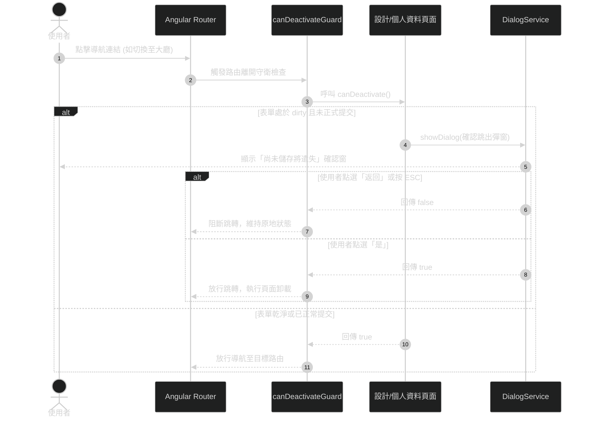
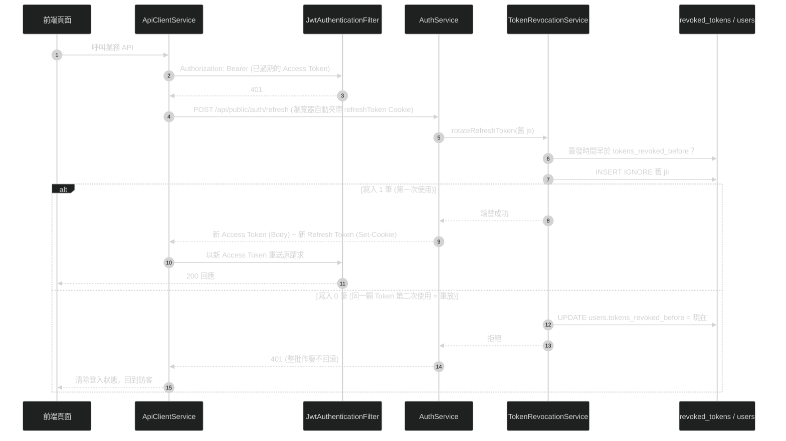
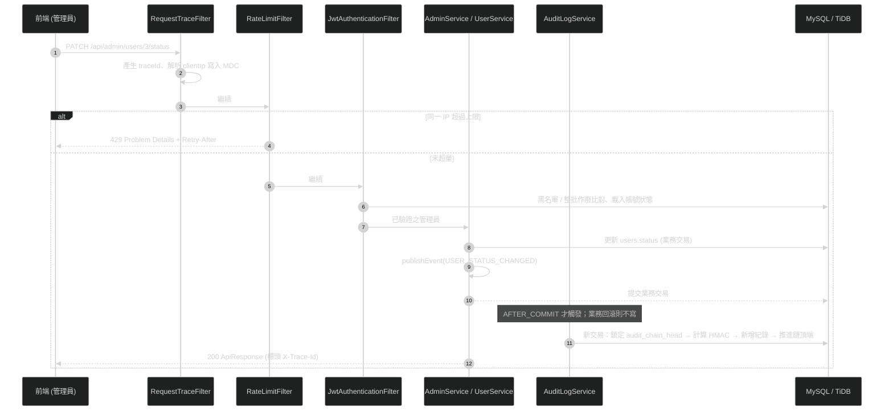

# 05. 核心業務流程與狀態機圖表 (Business Flowcharts & State Machines)

> **圖表風格**: Sci-Fi HUD 霓虹科技風 (`flowchart LR`、純白無背景連線文字)  

---

## 1. 問卷設計發布生命週期流程 (Survey Design & Publishing)

```mermaid
%%{init: {'theme': 'dark', 'themeVariables': { 'darkMode': true, 'background': '#030712', 'primaryColor': '#0b0f19', 'primaryTextColor': '#f8fafc', 'primaryBorderColor': '#00f0ff', 'lineColor': '#00f0ff', 'textColor': '#f8fafc', 'edgeLabelBackground': 'transparent' }, 'themeCSS': '.edgeLabel, .edgeLabel rect, .edgeLabel span, .labelBkg { background: transparent !important; background-color: transparent !important; fill: transparent !important; border: none !important; } .edgeLabel, .edgeLabel span { color: #ffffff !important; fill: #ffffff !important; font-weight: 500 !important; } rect, .node rect, polygon { rx: 0px !important; ry: 0px !important; }', 'flowchart': { 'curve': 'linear' } }}%%
flowchart LR
    classDef hudCard fill:#0b0f19,stroke:#00f0ff,stroke-width:1.5px,color:#f8fafc,rx:0px,ry:0px;

    Start(["進入設計工作臺"]):::hudCard
    ConfigMeta["設定基本資訊<br/>(標題/分類/時限)"]:::hudCard
    AddQuestions["編排題型與選項<br/>(單選/多選/量表)"]:::hudCard
    SetUnlockLogic["配置條件跳題<br/>(UID 連動解鎖)"]:::hudCard
    ValidateForm{"表單完整性核驗"}:::hudCard
    ConfirmDialog["彈出二次確認視窗"]:::hudCard
    PublishSuccess(["發布成功至大廳"]):::hudCard

    Start --> ConfigMeta
    ConfigMeta --> AddQuestions
    AddQuestions --> SetUnlockLogic
    SetUnlockLogic --> ValidateForm
    ValidateForm -->|"有缺漏項目"| AddQuestions
    ValidateForm -->|"通過"| ConfirmDialog
    ConfirmDialog -->|"確認發布"| PublishSuccess
```

---

## 2. 受訪者填答與動態條件跳題流程 (Survey Runner & Dynamic Branching)

進入方式有兩種：由大廳點選 (`?surveyId=`) 或專屬填答連結 (`?share=<分享代碼>`)。未公開於大廳之問卷只能走分享連結，存取規則見 `09-security.md` §3.1。

```mermaid
%%{init: {
  'theme': 'dark',
  'themeVariables': {
    'darkMode': true,
    'background': '#030712',
    'primaryColor': '#0b0f19',
    'primaryTextColor': '#f8fafc',
    'primaryBorderColor': '#00f0ff',
    'lineColor': '#00f0ff',
    'textColor': '#f8fafc',
    'edgeLabelBackground': '#0b0f19',
    'tertiaryColor': '#0b0f19'
  },
  'themeCSS': '.edgeLabel, .edgeLabel rect, .edgeLabel span, .labelBkg { background: #0b0f19 !important; background-color: #0b0f19 !important; fill: #0b0f19 !important; border: 1px solid #1e293b !important; } .edgeLabel, .edgeLabel span { color: #38bdf8 !important; fill: #38bdf8 !important; font-weight: 600 !important; font-size: 11px !important; } .cluster rect { stroke: #00f0ff !important; stroke-width: 1.5px !important; stroke-dasharray: 4 2 !important; fill: #060a14 !important; rx: 4px !important; ry: 4px !important; } .cluster text, .cluster span.nodeLabel { fill: #00f0ff !important; color: #00f0ff !important; font-weight: 700 !important; font-size: 13px !important; } rect, .node rect, rect.actor { rx: 2px !important; ry: 2px !important; }',
  'flowchart': { 'curve': 'linear' }
}}%%
flowchart LR
    classDef hudCard fill:#0b0f19,stroke:#00f0ff,stroke-width:1.5px,color:#f8fafc,rx:2px,ry:2px;

    EnterRunner["開啟 /survey-runner"]:::hudCard
    ByShare["GET /api/public/surveys/shared/{代碼}"]:::hudCard
    ById["GET /api/public/surveys/{id}"]:::hudCard
    CheckOpen{"可存取且開放中？"}:::hudCard
    Unavailable["顯示不可填答原因<br/>(不存在 / 已關閉 / 未開始 / 已截止)"]:::hudCard
    FillBasicInfo["填寫背景資料"]:::hudCard
    AnswerQuestions["回答主體題目"]:::hudCard
    TriggerCondition{"選項命中解鎖條件？"}:::hudCard
    UnlockBranch["即時顯示隱藏題目"]:::hudCard
    KeepLocked["維持隱藏且免填"]:::hudCard
    CheckRequired{"必填完整性檢查"}:::hudCard
    SubmitFinish["POST /api/public/submissions<br/>(分享連結進入者帶 shareToken)"]:::hudCard
    ToLobby["提交成功並導向大廳"]:::hudCard

    EnterRunner -->|"?share="| ByShare
    EnterRunner -->|"?surveyId="| ById
    ByShare --> CheckOpen
    ById --> CheckOpen
    CheckOpen -->|"否"| Unavailable
    CheckOpen -->|"是"| FillBasicInfo
    FillBasicInfo --> AnswerQuestions
    AnswerQuestions --> TriggerCondition
    TriggerCondition -->|"命中"| UnlockBranch
    TriggerCondition -->|"未命中"| KeepLocked
    UnlockBranch --> CheckRequired
    KeepLocked --> CheckRequired
    CheckRequired -->|"缺漏"| AnswerQuestions
    CheckRequired -->|"通過"| SubmitFinish
    SubmitFinish --> ToLobby
```

---

## 3. 路由跳轉未儲存防呆守衛時序 (CanDeactivate Guard Sequence)

---

## 4. Access Token 過期自動換發與重放偵測時序 (Token Refresh Rotation)

Access Token 15 分鐘、Refresh Token 7 天；黑名單與整批作廢存於資料庫，後端重啟不遺失 (細節見 `09-security.md` §2.2、§2.3)。

---

## 5. 請求處理管線與稽核寫入時序 (Request Pipeline & Audit Trail)

以「管理員凍結會員」為例，說明一個請求經過的元件、錯誤回應產生的位置，以及稽核紀錄何時寫入 (細節見 `09-security.md` §5~§7)。

