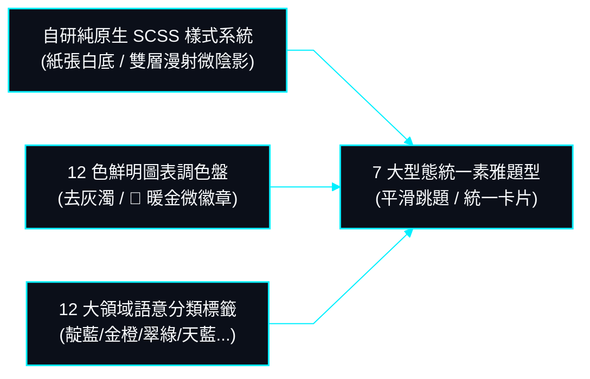

# 08. 前端 UI/UX 視覺設計風格與介面美學標準書 (Visual Design & Aesthetic Standards)

> **更新日期**: 2026-10-23  
> **文件定位**: 專職規範 SurveyFlow 系統全域之真實介面設計風格、視覺基調、純原生 SCSS/CSS 系統、12 色數據圖表調色盤、9 大領域語意分類標籤、👑 皇冠微徽章及題型外觀統一標準。

---

## 1. 核心視覺風格基調：學術調研期刊級「純淨紙張」美學

SurveyFlow 的介面視覺風格摒棄浮誇、俗豔且失真的現代套版反模式，回歸現代實證研究與頂級學術出版品的高權威、高信賴感閱讀視野：

1. **極簡純淨紙張白底色 (`#fbfbfa` / `#ffffff`)**: 全站以溫潤的暖白色與純白為畫布基底，模擬高階出版紙張的視覺觸感，提供長時間閱讀與填答時的高度舒適性。
2. **洗鍊俐落的 1px 板岩邊框與雙層漫射微陰影**: 所有資訊卡片、題目框與輸入容器均採用精準的 `1px solid #e2e8f0` 板岩描邊，搭配細緻的雙層漫射微陰影（`0 1px 2px rgba(0,0,0,0.03), 0 4px 12px -2px rgba(0,0,0,0.02)`），確保空間主從分明且富有呼吸感。
3. **100% 自研純原生 SCSS/CSS 樣式系統**: 全站所有視覺樣式 100% 採用純原生 SCSS 模組化撰寫，完全不依賴任何外部 CSS 套件（如 Bootstrap、Tailwind CSS 等），確保樣式絕對乾淨、載入零負擔且 100% 完全自主掌控。
4. **全站 TypeScript 零硬編碼色票原則**: 介面組件的色彩嚴格透過全域 CSS 自訂變數與 SCSS Token 統籌，代碼中不出現散落的十六進位色票，維持全站風格的一致性。

---

## 2. 工藝級字體排印與資訊層級風格 (Typography & Layering)

系統字體選用現代高清晰度無襯線字型族群（`Inter, -apple-system, BlinkMacSystemFont, "Segoe UI", sans-serif`），針對數字、作答編號與時間戳則採用等寬字體（`"JetBrains Mono", monospace`），確保數據排列對齊嚴整：

| 排版層級 | 字型尺寸 | 字重規格 | 字距控制 | 視覺風格呈現與應用位置 |
| :--- | :--- | :--- | :--- | :--- |
| **首頁標題 (Display Hero)** | `3.6rem` (36px) | `850` (Heavy) | `-0.03em` | 緊湊大氣，呈現系統核心定位與價值主張 |
| **區塊大標 (Section H1)** | `2.4rem` (24px) | `800` (Bold) | `-0.02em` | 俐落沈穩，標誌各大業務模組與分析面板 |
| **卡片主標 (Card H2)** | `1.8rem` (18px) | `750` (SemiBold) | `-0.01em` | 清晰明確，呈現問卷名稱、彈窗標題與題目主旨 |
| **主文與題目 (Body Primary)** | `1.4rem` (14px) | `500` (Regular) | `0em` | 舒適易讀，負責問卷題目詳細說明與指標描述 |
| **標籤與編號 (Badge & Label)** | `1.15rem` (11.5px) | `700` (Bold) | `+0.04em` | 微寬挺拔，用於狀態膠囊、題目編號 `#1` 與圖例藥丸 |

---

## 3. 自適應無橫向捲動之垂直卡片流風格 (Responsive Key-Value Card Flow)

在行動裝置與緊湊螢幕視窗中，系統不採用截斷或強制橫向捲動的生硬表格，而是自然平滑轉譯為垂直卡片流：

- **桌面寬螢幕視窗**: 呈現橫向跨欄之結構化資訊清單，各欄位邊界分明、支援快速點選與排序。
- **行動裝置與平板視窗**: 自動轉譯為獨立的資訊卡片流，每筆項目均具備彩色編號膠囊、完整問卷標題、領域分類標籤以及觸控友善之操作按鈕群，手指滑動順暢自如。
- **排版防破版機制**: 所有長文本容器均內建 `min-w-0` 與 `overflow-wrap: break-word`，杜絕英文無空格長字串或超長標題撐破容器。

---

## 4. 數據視覺化鮮明調色盤：去灰濁之 12 色高對比體系 (Chart Palette)

數據儀表板徹底摒棄死灰、過度降飽和或灰濁泥色，採用純度明亮、色盲友善且對比鮮明的 12 色階體系：

| 序號 | 色票名稱 | 十六進位色票 | 視覺色彩特色與代表意涵 |
| :---: | :--- | :--- | :--- |
| **01** | **鮮明寶藍** | `#2563eb` | 穩健冷靜，作為首選第一維度主色 |
| **02** | **翡翠純綠** | `#059669` | 鮮明生動，代表正面、通過與成功 |
| **03** | **琥珀金橙** | `#d97706` | 溫暖醒目，作為強調維度與次高票 |
| **04** | **豔麗亮紫** | `#7c3aed` | 典雅高貴，提供強烈的色相差異化 |
| **05** | **珊瑚玫瑰** | `#e11d48` | 清晰奪目，高能量維度標記 |
| **06** | **澄澈天青** | `#0891b2` | 現代數位科技感，具備優異白底對比度 |
| **07** | **晨曦活力橘** | `#ea580c` | 晨曦熱情，高辨識度熱點色 |
| **08** | **電氣亮靛** | `#4f46e5` | 深邃專業科技感 |
| **09** | **孔雀藍綠** | `#0d9488` | 沉著知性之藍綠調 |
| **10** | **炫彩桃粉** | `#db2777` | 現代活力跳色維度 |
| **11** | **活力草綠** | `#16a34a` | 清新自然，豐富次階對比 |
| **12** | **霓虹紫紅** | `#d946ef` | 高辨識度末段對比點綴色 |

> **底槽層次**: 進度條底槽與 0 票柱體統一採用清爽高雅的淡灰藍（`#f1f5f9` / `#e2e8f0`），突顯數據長條之飽滿立體感。

---

## 5. 冠軍最高票 👑 皇冠立體微徽章視覺標準 (Crown Badging System)

為使各題型中獲得最高得票（或最高評分）之項目在視覺上第一時間脫穎而出，系統建立立體暖金微徽章系統：

- **立體微徽章外觀 (`.crown-badge-pill`, `.scale-crown-badge-prominent`)**:
  - 底色：`linear-gradient(135deg, #fef3c7 0%, #fde68a 100%)` 暖金漸層；
  - 描邊：`1.5px solid #f59e0b` 琥珀金精密描邊；
  - 微光陰影：`0 2px 6px rgba(245, 158, 11, 0.25)` 漫射微金光；
  - 圖標與字型：醒目 👑 皇冠符號搭配深金棕色粗體文字（`最高票` / `最高分`）。
- **題型卡片與圖表聯動樣式**:
  - **是非題**: 最高票卡片呈現琥珀金邊框（`#f59e0b`）、暖金微光暈與 `#fffdf5` 漸層底色。
  - **單選/多選排行榜**: 第一名選項左側增設 4px 琥珀金高光標記線，底色轉為暖金高光漸層。
  - **多選柱狀圖**: 最高票柱體頂端即時渲染金色 👑 與百分比數字。
  - **評分量表直方圖**: 最高分柱頂標註立體微徽章，柱體票數與分數加粗高亮顯示。

---

## 6. 全域 9 大主題領域分類膠囊標籤語意調色標準 (Semantic Badges)

問卷大廳與專案列表之分類膠囊標籤，採用具備高度語意識別之 9 大柔和質感調色系統：

| 領域分類名稱 | 色系家族 | 標籤背景色 | 標籤文字色 | 標籤邊框色 | 代表主題範例 |
| :--- | :--- | :--- | :--- | :--- | :--- |
| **學術專題研究** | 沉穩靛藍 (Indigo) | `#eef2ff` | `#4338ca` | `#c7d2fe` | 學術專題研究、論文評測、教育調研 |
| **教育與培訓評鑑** | 沉穩靛藍 (Indigo) | `#eef2ff` | `#4338ca` | `#c7d2fe` | 教育與培訓評鑑、教學研究 |
| **市場商業調研** | 琥珀金橙 (Amber) | `#fef3c7` | `#b45309` | `#fde68a` | 市場商業調研、行銷趨勢、消費購物 |
| **顧客滿意度** | 翡翠翠綠 (Emerald) | `#ecfdf5` | `#047857` | `#a7f3d0` | 顧客滿意度、服務品質、反饋調研 |
| **產品體驗研究** | 科技天藍 (Sky Blue) | `#f0f9ff` | `#0369a1` | `#bae6fd` | 產品體驗研究、科技軟體評測、SaaS |
| **社群互動與綜合** | 洋紅紫粉 (Fuchsia) | `#fdf4ff` | `#a21caf` | `#f5d0fe` | 社群互動與綜合、綜合調查、社交網絡 |
| **生活休閒娛樂** | 珊瑚玫瑰 (Rose) | `#fff1f2` | `#be123c` | `#fecdd3` | 生活日常、休閒娛樂、心理情感 |
| **健康醫療照護** | 薄荷青綠 (Teal) | `#f0fdfa` | `#0f766e` | `#99f6e4` | 醫療健康與心理諮詢、運動健康 |
| **人資行政職場** | 典雅紫 (Violet) | `#f5f3ff` | `#6d28d9` | `#ddd6fe` | 人資行政、組織職場福利 |

---

## 7. 7 大型態題型統一素雅排版與條件跳題反饋

全站 7 大題型（是非題、單選題、多選題、評分量表題、簡答題、時間題、日期題）維持高度一致之卡片風格：

1. **統一題型卡片框架**: 每一道題目皆封裝於獨立的白底卡片容器中，左上角標註高對比題目編號膠囊（如 `#1`），右上角以醒目紅色星號標註必填狀態。
2. **條件邏輯跳題平滑過渡**: 當選取特定選項觸發隱藏題解鎖時，被解鎖之題目容器具備平滑淡入動畫，邊框呈現聚焦高光，給予受訪者最直覺之作答引導。
3. **量表刻度素雅排列**: 1-5 分、1-10 分與 0-10 分 NPS 量表採用圓形按鈕階梯式排列，選取時帶有柔和品牌藍外環與反白效果，呈現優雅的評分體驗。

---

## 8. 深黑 HUD 直角線條架構圖風格 (Deep Dark HUD Mermaid Style)

系統所有架構圖與狀態流程圖，均遵循深黑背景 `#030712`、霓虹青邊框 `#00f0ff`、白字與非圓角直角卡片（`rx:0px, ry:0px`）之 HUD 科技儀表板風格：

