# 09. 全端資安防護、認證授權與資料保護規格書 (Security & Data Protection Specifications)

> **文件定位**: 規範 SurveyFlow 之認證授權、Argon2id 密碼雜湊、雙 Token 機制、速率限制、個資遮罩、不可竄改之稽核日誌、錯誤回應格式、結構化日誌與機敏設定外部化。僅記載實體代碼已實作之機制。

---

## 1. 縱深防禦架構總覽 (Defense-in-Depth)

```mermaid
%%{init: {
  'theme': 'dark',
  'themeVariables': {
    'darkMode': true,
    'background': '#030712',
    'primaryColor': '#0b0f19',
    'primaryTextColor': '#f8fafc',
    'primaryBorderColor': '#00f0ff',
    'lineColor': '#00f0ff',
    'textColor': '#f8fafc',
    'edgeLabelBackground': '#0b0f19',
    'tertiaryColor': '#0b0f19'
  },
  'themeCSS': '.edgeLabel, .edgeLabel rect, .edgeLabel span, .labelBkg { background: #0b0f19 !important; background-color: #0b0f19 !important; fill: #0b0f19 !important; border: 1px solid #1e293b !important; } .edgeLabel, .edgeLabel span { color: #38bdf8 !important; fill: #38bdf8 !important; font-weight: 600 !important; font-size: 11px !important; } .cluster rect { stroke: #00f0ff !important; stroke-width: 1.5px !important; stroke-dasharray: 4 2 !important; fill: #060a14 !important; rx: 4px !important; ry: 4px !important; } .cluster text, .cluster span.nodeLabel { fill: #00f0ff !important; color: #00f0ff !important; font-weight: 700 !important; font-size: 13px !important; } rect, .node rect, rect.actor { rx: 2px !important; ry: 2px !important; }',
  'flowchart': { 'curve': 'linear' }
}}%%
flowchart LR
    classDef hudCard fill:#0b0f19,stroke:#00f0ff,stroke-width:1.5px,color:#f8fafc,rx:2px,ry:2px;
    Client["前端客戶端<br/>Bearer Token + HttpOnly Cookie"]:::hudCard -->|"traceId + 來源 IP"| Trace["RequestTraceFilter<br/>追蹤碼寫入日誌上下文"]:::hudCard
    Trace -->|"CORS 白名單"| Limit["RateLimitFilter<br/>依 IP 分級限流"]:::hudCard
    Limit -->|"未超量"| Filter["JwtAuthenticationFilter<br/>驗簽 + 黑名單 + 帳號狀態"]:::hudCard
    Filter -->|"URL 規則 + @PreAuthorize"| Controller["Controller / Service<br/>擁有者權限核對"]:::hudCard
    Controller -->|"命名參數原生 SQL"| DB["MySQL / TiDB<br/>Argon2id 密碼雜湊"]:::hudCard
    Controller -->|"交易提交後"| Audit["AuditLogService<br/>HMAC 雜湊鏈稽核"]:::hudCard
```



---

## 2. 身分認證

### 2.1 密碼雜湊 (Argon2id)

- 實作：`SecurityConfig.passwordEncoder()` 使用 Spring Security `Argon2PasswordEncoder` (Bouncy Castle)。
- 參數 (皆由 `application.properties` 注入，可由環境變數覆寫)：`ARGON2_SALT_LENGTH`=16、`ARGON2_HASH_LENGTH`=32、`ARGON2_PARALLELISM`=1、`ARGON2_MEMORY`=4096 KB、`ARGON2_ITERATIONS`=3。
- 變更密碼 (`PUT /api/user/password`) 必須提供正確之目前密碼；前端個人資料頁提供「目前密碼」欄位與顯示 / 隱藏切換。

### 2.2 雙 Token 機制

| 項目 | Access Token | Refresh Token |
| :--- | :--- | :--- |
| 簽章 | HS256，金鑰 `JWT_SECRET` (必填環境變數，無預設值，需 ≥ 256 bits) | 同左 |
| 效期 | `JWT_ACCESS_EXPIRATION_MS` (預設 900000 ms = 15 分鐘) | `JWT_REFRESH_EXPIRATION_MS` (預設 604800000 ms = 7 天) |
| 宣告 | `sub` 帳號、`role`、`jti` (UUID)、類型標記 | `sub`、`jti`、類型標記 |
| 傳遞 | `Authorization: Bearer <token>` | 僅 `refreshToken` Cookie (`HttpOnly`、`Path=/`；`Secure` 預設 `true`、`SameSite` 預設 `None`，分別由 `REFRESH_COOKIE_SECURE` / `REFRESH_COOKIE_SAME_SITE` 控制)；回應 Body 不含 Refresh Token |
| 前端存放 | `sessionStorage` (`SURVEY_ACCESS_TOKEN`，分頁關閉即清除) | 前端不存放 (僅瀏覽器 Cookie) |

- **類型隔離**：`JwtAuthenticationFilter` 拒絕以 Refresh Token 存取業務 API。
- **帳號狀態即時生效**：`CustomUserDetailsService` 將非 `ACTIVE` 帳號標記為 disabled，Filter 對 disabled 帳號不建立認證；管理員停權後該帳號之 Access Token 於下一次請求即失效。
- **輪替 (RTR)**：`POST /api/public/auth/refresh` 每次換發即將舊 Refresh Token 之 `jti` 加入黑名單並簽發新雙 Token。
- **重放攔截**：已作廢之 Refresh Token 再次換發時回傳 401 並拒絕簽發，同時**作廢該使用者此前簽發之全部 Token** (攻擊者與受害者手上的都失效，受害者需重新登入)。
- **整批作廢**：`TokenRevocationService.revokeAllTokensOf` 記錄「作廢時間點」，簽發時間 (`iat`) 早於該時間點之 Token 一律拒絕；觸發時機為 Refresh Token 重放與透過忘記密碼重設密碼。
- **登出吊銷**：`POST /api/user/auth/logout` 將當前 Access Token 與 Cookie 中 Refresh Token 之 `jti` 皆加入黑名單 (TTL = 各自剩餘效期，僅驗簽通過者寫入) 並清除 Cookie。
- **未認證回應**：`SecurityConfig` 之 authentication entry point 對未認證請求回傳 401 Problem Details (`code=UNAUTHENTICATED`)；已認證但權限不足由 accessDeniedHandler 回 403 (`code=ACCESS_DENIED`)。兩者皆轉交 `GlobalExceptionHandler`，與其他錯誤格式相同。
- **前端自動換發**：`ApiClientService` 於已登入請求收到 401 時，以 Refresh Cookie 呼叫換發端點後重送原請求一次；同時多個請求 401 時共用同一次換發 (避免輪替互相作廢)；換發失敗即清除登入狀態回到訪客。
- **跨站 Cookie**：正式環境前端 (`pages.dev`) 與後端 (`onrender.com`) 為不同站點，Refresh Cookie 須為 `SameSite=None; Secure` 瀏覽器才會在換發請求夾帶；非白名單網站即使觸發請求也因 CORS 讀不到回應。

### 2.3 Token 黑名單儲存

- 實作：`TokenRevocationService` 把狀態存在資料庫，後端重啟或多實例部署都不會遺失：
  - 單一 Token 黑名單：`revoked_tokens` 資料表 (`jti` 為主鍵、`expires_at` 為 Token 原到期時間)。
  - 整批作廢時間點：`users.tokens_revoked_before`。
- 判定：`JwtAuthenticationFilter` 每個請求以一次查詢 (`RevokedTokenRepository.countRevocationMatches`) 同時比對兩者。
- 輪替原子性：舊 Refresh Token 以 `INSERT IGNORE` 寫入黑名單，寫入 0 筆即代表已被用過，判定為重放；兩個請求同時拿同一顆 Token 換發也只有一個成功。
- 重放的整批作廢不可被回滾：`AuthService.refreshToken` 對 `BadCredentialsException` 設定 `noRollbackFor`，拒絕換發 (401) 時作廢紀錄仍會提交。
- 清理：`@Scheduled` 每 30 分鐘刪除已過期之黑名單列 (`@EnableScheduling` 已於 `SurveyFlowApplication` 啟用)。
- 為什麼不放記憶體：Render 免費方案閒置約 15 分鐘即休眠，喚醒等於重啟。若存在記憶體，重啟後已登出或已輪替之 Refresh Token (效期 7 天) 會重新可用，重放偵測也會失效。
- 為什麼不用 Redis：資料庫已足以應付本專案流量，不必多一項基礎設施。`RevokedTokenRepositoryIT` 以「另建一個服務實例」模擬重啟，驗證作廢狀態仍然有效。

### 2.4 信箱驗證碼 (OTP)

- 6 碼數字，`SecureRandom` 產生，效期 15 分鐘，核對成功即標記已使用 (`verification_tokens.is_used`)。
- 用途以 `VerificationTokenType` 列舉區分 (`REGISTRATION` / `FORGOT_PASSWORD`)。
- 驗證碼明碼僅寄送至使用者信箱，**不寫入任何應用日誌**。

### 2.5 登入失敗鎖定

- 實作：`LoginAttemptLimiter` (`@Component`，由 `AuthService.login` 呼叫)。
- 規則：同一帳號 (去空白、轉小寫) 連續失敗 `LOGIN_MAX_FAILURES` 次 (預設 5) 即鎖定 `LOGIN_LOCK_MINUTES` 分鐘 (預設 15)，鎖定期間回傳 429 與剩餘分鐘數；帳號不存在亦計數且回應相同訊息，避免洩漏帳號是否存在；成功登入清除計數。
- 儲存：JVM 記憶體，每 30 分鐘清除過期紀錄。重啟後計數歸零只會讓鎖定提早解除，不會讓已作廢的憑證復活，因此採用單機記憶體設計；多實例部署時須改用共享儲存。
- 取捨：以帳號為鍵可能被他人刻意輸錯導致合法使用者暫時無法登入，鎖定期限短 (15 分鐘) 以降低影響。

---

## 3. 授權 (RBAC)

| 端點前綴 | 角色 | 補充邊界 |
| :--- | :--- | :--- |
| `/api/public/**` | 匿名 | 認證、大廳、公開填答與提交；`/api/public/surveys/{id}?preview=true` 另於 Service 限建立者或管理員；未公開於大廳之問卷另需分享代碼 (見 §3.1) |
| `/api/user/**`、`/api/analytics/**` | 已登入且 `ACTIVE` | 問卷修改 / 刪除 / 設定與統計報表另於 Service 核對「建立者或管理員」，否則 403 |
| `/api/admin/**` | `ROLE_ADMIN` | URL 規則 + `AdminController`、`AuditLogController` 類別層級 `@PreAuthorize("hasRole('ADMIN')")`；管理員帳號不可被刪除；會員清單之手機與身分證為遮罩值 (§5.2) |
| `/actuator/**` | 匿名 | 僅開放 `health`，`show-details=never` |

完整角色功能矩陣見 `02-role-type.md`。

### 3.1 專屬填答連結 (分享代碼)

連結格式為 `/survey-runner?share=<分享代碼>`，不使用流水號 ID，避免受訪者改網址數字窺看或填寫其他未公開問卷。

| 項目 | 規則 |
| :--- | :--- |
| 代碼產生 | `Survey` 實體 `@PrePersist` 以 `SecureRandom` 取 16 bytes (128 bits)，Base64URL 編碼為 22 字元；建立後不變更 |
| 儲存 | `surveys.share_token` `CHAR(22)`、`ascii_bin` (區分大小寫)、`UNIQUE` |
| 公開於大廳之問卷 | 以 ID (`GET /api/public/surveys/{id}`) 或分享代碼皆可讀取與送出 |
| 未公開於大廳之問卷 | 以 ID 讀取一律回 400「問卷不存在或已下架」；送出填答必須帶正確 `shareToken`，否則同樣回 400。訊息與「問卷不存在」完全相同，不透露該 ID 是否存在 |
| 比對方式 | `Survey.ensureReachableBy` 以 `MessageDigest.isEqual` 固定時間比對，避免從回應時間差逐字猜出代碼 |
| 代碼曝光範圍 | 只回應給建立者與管理員；大廳清單與受訪者回應一律不帶代碼 |
| 預覽 | `?preview=true` 仍以 ID 讀取，維持僅限建立者或管理員 |

整合測試 `SurveyLifecycleIT.linkOnlySurvey_RequiresShareToken` 與 E2E `runner-rules.spec.ts` 驗證以 ID 被擋、大小寫不符被擋、憑代碼可讀取並送出。

---

## 4. 機敏設定外部化

| 環境變數 | 必填 | 說明 |
| :--- | :---: | :--- |
| `SPRING_DATASOURCE_URL` / `SPRING_DATASOURCE_USERNAME` / `SPRING_DATASOURCE_PASSWORD` | ✅ | 無預設值，缺少時應用啟動即失敗 |
| `JWT_SECRET` | ✅ | 無預設值，缺少時應用啟動即失敗 |
| `AUDIT_HMAC_SECRET` | ✅ | 稽核雜湊鏈 HMAC 金鑰；無預設值、至少 32 bytes，缺少或過短時應用啟動即失敗；設定後不可更換 (§6) |
| `TRUSTED_PROXY_COUNT` | 選填 | 可信任反向代理層數，預設 `1` (Render)；本機直連設 `0` (§5.1) |
| `BREVO_API_KEY` / `RESEND_API_KEY` / `MAIL_USERNAME` / `MAIL_PASSWORD` | 選填 | 郵件服務憑證 |
| `REFRESH_COOKIE_SECURE` | 選填 | 預設 `true`，僅本機 HTTP 開發設 `false` |

鍵名清單見 `backend/.env.example`；`.env` 由 `.gitignore` 排除。

---

## 5. OWASP 防護

- **SQL Injection**：所有 Repository 查詢為 `nativeQuery = true` 並以命名參數 (`:userId`) 綁定，無字串拼接。
- **XSS**：Angular 插值自動轉義；Refresh Token 與密碼皆不存放於任何可被 JavaScript 讀取之儲存區 (註冊暫存資料已排除密碼)。
- **CSRF**：業務 API 為無狀態 Bearer 認證 (`csrf` 關閉、`SessionCreationPolicy.STATELESS`)，Cookie 不參與業務 API 授權；唯一讀取 Cookie 之換發端點僅回傳新 Token，跨站來源因 CORS 無法讀取回應。
- **CORS**：允許來源僅 `FRONTEND_BASE_URL` + `CORS_ALLOWED_ORIGINS` (程式內不寫死任何來源)，`allowCredentials=true`。本機開發預設 `FRONTEND_BASE_URL=http://localhost:4200`；其他埠或區網 IP 以 `CORS_ALLOWED_ORIGINS` 追加。
- **錯誤回應**：全部錯誤 (含過濾鏈內之 401、403、429) 由 `GlobalExceptionHandler` 產生 RFC 9457 Problem Details (`application/problem+json`)，`detail` 只有繁中原因，不外洩堆疊；資料庫唯一索引衝突回固定訊息 (409)，不回傳 SQL 錯誤內容；500 之 `detail` 固定，僅能以 `traceId` 回查日誌。格式定義見 `06-specs-api.md` §0.3。前端一律經 `ApiClientService.resolveErrorMessage` 顯示 `detail` 或狀態碼預設說明 (5xx 附追蹤碼)，不顯示 Angular 原始英文錯誤。
- **驗證碼重複使用 (競態條件)**：核銷開通碼與重設密碼碼時以 `SELECT … FOR UPDATE` 鎖住該筆驗證碼，同一組驗證碼即使被同時送出多次也只會成功一次 (`ConcurrencyIT` 以 8 條執行緒驗證)。
- **帳號停權即時生效**：`JwtAuthenticationFilter` 每次請求都重新載入帳號狀態，管理員凍結後，該會員手上未過期之 Access Token 下一個請求即得到 401，換發也會失敗。

### 5.1 全端點速率限制 (`RateLimitFilter`)

依「端點等級 + 用戶端 IP」計數，固定時間窗 (預設 60 秒)，超過上限回 429 Problem Details (`code=RATE_LIMITED`)、`Retry-After` 標頭 (秒) 與 `retryAfterSeconds` 欄位。

| 等級 | 範圍 | 預設上限 / 60 秒 | 環境變數 |
| :--- | :--- | :---: | :--- |
| AUTH | `/api/public/auth/**` (登入、註冊、驗證碼、換發、忘記密碼) | 20 | `RATE_LIMIT_AUTH_MAX_REQUESTS` |
| SUBMISSION | `POST /api/public/submissions` | 60 | `RATE_LIMIT_SUBMISSION_MAX_REQUESTS` |
| GENERAL | 其餘 API | 300 | `RATE_LIMIT_GENERAL_MAX_REQUESTS` |

- 不計數：`/actuator/**` 與 CORS 預檢 (`OPTIONS`)。
- 位置：Spring Security 過濾鏈中 `CorsFilter` 之後、`JwtAuthenticationFilter` 之前。429 也帶 CORS 標頭，前端讀得到原因；超量請求不必驗證 Token 或查資料庫。
- 用戶端 IP：`ClientIpResolver` 由 `X-Forwarded-For` 右邊數來第 `TRUSTED_PROXY_COUNT` 筆。最左邊的值可由用戶端任意偽造，只有可信任代理附加在右邊的值可信。部署後應比對結構化日誌之 `clientIp` 是否為真實來源，再調整層數。
- 與登入鎖定互補：本過濾器擋同一 IP 的大量請求；`LoginAttemptLimiter` (§2.5) 擋同一帳號連續猜密碼。
- 儲存：JVM 記憶體 (單一實例)，過期時間窗每 5 分鐘清除。重啟只會讓計數歸零、提早解除限制，不會讓任何憑證或資料失效，故不引入共享儲存；多實例部署時須改為共享計數。

### 5.2 管理端個資遮罩 (`PiiMasker`)

| 欄位 | 遮罩規則 | 範例 |
| :--- | :--- | :--- |
| 手機號碼 | 保留前 4 碼與後 3 碼 | `0912***678` |
| 身分證字號 | 保留第 1 碼與後 3 碼 | `A******789` |

- 範圍：`GET /api/admin/users` (管理員會員清單)。遮罩在後端完成，完整值不會出現在網路回應、瀏覽器開發者工具或前端快取中。
- 不遮罩：會員本人之個人資料頁 (`GET /api/user/profile`)；管理員清單之信箱 (帳號聯繫用途)。
- 長度不足頭尾保留位數時全部遮罩，不洩漏任何字元。
- 日誌：`UserProfileResponse.toString()` 排除信箱、手機與身分證，個資不寫入日誌。
- 受訪者填答之個人資料只寫入資料庫，任何 API 都不回傳；統計報表只提供彙總後之分布。

### 5.3 以整合測試驗證的防護

- `SecurityFilterChainIT`：啟動完整 Spring 容器與真實 MySQL，逐項驗證：
  - 未登入 401 Problem Details，`traceId` 與回應標頭一致；
  - 公開端點免 Token；
  - 角色不足 403 (URL 規則與方法級皆為 Problem Details)；
  - 竄改 Token 視同未登入；
  - 預覽權限；
  - Refresh Cookie 換發、重放偵測整批作廢；
  - 登出後 Token 失效並清除 Cookie；
  - 停權即時生效；
  - 連續 5 次失敗鎖定 429；
  - CORS 白名單預檢。
- `RateLimitIT`：超量 429 帶 `Retry-After` 與 CORS 標頭。
- `AuditLogIT`：稽核寫入時機、竄改偵測 (§6)。

執行方式見 `11-local-testing.md` §3.2。

---

## 6. 不可竄改之稽核日誌 (`AuditLogService`)

### 6.1 記錄哪些事件

| 類別 | 事件 (`AuditAction`) |
| :--- | :--- |
| 帳號與登入 | 註冊、開通帳號、登入成功、**登入失敗**、登出、以驗證碼重設密碼、變更密碼、修改個人資料 |
| Token 安全 | **偵測到 Refresh Token 重放** |
| 管理員操作 | 變更會員狀態、刪除會員 |
| 問卷 | 建立問卷、修改問卷內容、修改問卷開放設定、刪除問卷 (含管理員強制刪除) |

每筆欄位：發生時間 (毫秒)、操作者、事件、對象類型與 ID、說明、來源 IP、`traceId`、`prev_hash`、`hash`。說明欄不含密碼、Token、驗證碼等機敏值。

### 6.2 寫入時機

- 業務 Service 以 Spring 事件發布 `AuditEvent`，不直接呼叫稽核服務 (遵守「Service 不平級互呼」)。
- 成功事件：`@TransactionalEventListener(AFTER_COMMIT)`。業務交易提交後才寫入，回滾的操作不留紀錄。
- 失敗事件 (粗體)：`AFTER_COMPLETION`。登入失敗會伴隨交易回滾，仍然寫入。
- 交易已結束，故以 `REQUIRES_NEW` 開新交易寫入。
- 寫入失敗時只記錄 ERROR 日誌而不拋出，避免已提交的業務操作在回應時變成錯誤。

### 6.3 為什麼改不了

```text
hash(n) = HMAC-SHA256( AUDIT_HMAC_SECRET,  hash(n-1) | 時間 | 操作者 | 事件 | 對象類型 | 對象 ID | 說明 | IP | traceId )
hash(0) = 64 個 0
```

| 竄改方式 | 如何被發現 |
| :--- | :--- |
| 修改某筆內容 | 重算該筆 HMAC 與 `hash` 不符 |
| 刪除或插入中間某筆 | 下一筆之 `prev_hash` 與前一筆 `hash` 不符 |
| 刪除尾端紀錄 | 最後一筆與 `audit_chain_head` (鏈頂端) 不一致 |
| 改內容後自行重算整條鏈 | 沒有 `AUDIT_HMAC_SECRET` 算不出正確 HMAC |

- 程式層：`AuditLog` 實體標註 `@Immutable`，Repository 沒有任何 UPDATE / DELETE；管理員 API 只有讀取端點。
- 寫入順序：先以 `SELECT … FOR UPDATE` 鎖住 `audit_chain_head`，併發寫入因此排隊，鏈不會分岔。
- 驗證：`GET /api/admin/audit-logs/verification` 依 ID 遞增每 500 筆一批重算整條鏈，回報第一個斷點。管理員在會員管理頁「稽核日誌」分頁按「驗證完整性」即可執行。
- 資料庫外副本：每筆稽核同時以 INFO 寫入結構化日誌 (含 `hash`)，日誌平臺保存之副本可作為對照。這能補足「同時改資料庫與鏈頂端並持有金鑰」等極端情境，由日誌平臺之保存期限決定可回溯範圍。

---

## 7. 結構化 JSON 日誌與請求追蹤

- 格式：Spring Boot 內建 `logstash` 結構化格式，每行一筆 JSON，必含 `timestamp`、`level`、`traceId`、`service` (`survey-flow-backend`)、`message`，另有 `logger_name`、`thread_name`、`clientIp`。
- traceId：`RequestTraceFilter` 為每個請求產生 (或沿用 8~64 字元英數之 `X-Request-Id`)，寫入 MDC 並以 `X-Trace-Id` 回應標頭回傳。
  - 同一請求的所有日誌、錯誤回應之 `traceId`、稽核紀錄之 `trace_id` 皆為同一個值。
  - 使用者回報錯誤時提供追蹤碼，即可在日誌平臺搜尋該請求的完整經過。
- 不記錄：密碼、Token、驗證碼明碼、完整個資 (DTO `toString` 已排除)。

---

## 8. 與業界常見建議之刻意偏離 (Design Deviations)

| 常見建議做法 | 本專案做法 | 理由 |
| :--- | :--- | :--- |
| Refresh Cookie `SameSite=Strict` | 預設 `SameSite=None; Secure` (可由 `REFRESH_COOKIE_SAME_SITE` 調整) | 前端 `pages.dev` 與後端 `onrender.com` 不同站點，Strict / Lax 時瀏覽器不會在換發請求夾帶 Cookie；跨站濫用由 CORS 白名單阻擋 (見 §5) |
| 登入失敗計數存於 Redis 或資料庫 | JVM 記憶體 | 單一實例部署；重啟只會提早解除鎖定 (見 §2.5) |
| 速率限制計數存於共享儲存 | JVM 記憶體 | 單一實例部署；重啟只會提早解除限制 (見 §5.1) |

