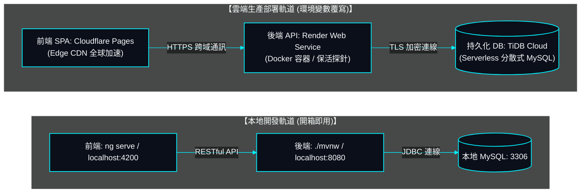
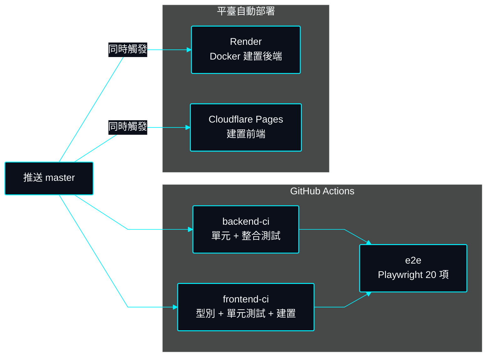

# 10. 系統雲端部署拓撲與維運規範書 (System Cloud Deployment Specifications)

> **所屬系統**: SurveyFlow 線上問卷設計系統  
> **文檔定位**: 全系統雲端生產環境、雙軌部署拓撲、容器建置、環境變數與保活維運之唯一真實規格標準。

---

## 1. 雲端雙軌部署拓撲架構 (Cloud Deployment Topology)

系統採用前後端完全分離之現代化雲端拓撲，各層級部署於專屬最適雲端平臺，兼顧本地開發開箱即用與雲端高可用性：



---

## 2. 雲端平臺具體規格明細

| 架構層級 | 部署託管平臺 | 運行網址 / 通訊端點 | 核心技術規格與維運機制 |
| :--- | :--- | :--- | :--- |
| **前端 SPA** | **Cloudflare Pages** | `https://survey-flow.pages.dev` | Angular 19 獨立組件架構；樣式 100% 採用純原生 SCSS/CSS（嚴禁引用 Bootstrap、Tailwind 等任何外部樣式表）；靜態資源由全球 Edge CDN 快取分發。 |
| **後端 Web API** | **Render Web Service** | `https://survey-flow-9gt6.onrender.com` | Docker 容器化執行 Java 21 / Spring Boot 4.1 服務；配置 `/actuator/health` 探針；無狀態 Stateless JWT 認證架構。 |
| **持久化資料庫** | **TiDB Cloud (Serverless)** | 雲端分散式 MySQL 端點 | MySQL 8.0 協定相容之分散式關聯式資料庫；外鍵完整約束、utf8mb4 編碼、ACID 交易隔離；HikariCP 連線池安全存取。 |
| **持續整合** | **GitHub Actions** | CI 自動化工作流 | 推送時自動執行後端單元測試 (360 項，JaCoCo 門檻行 ≥ 95%、分支 ≥ 90%) 與 Testcontainers 整合測試 (57 項)、前端嚴格型別檢查、單元測試 (291 項) 與生產打包、Playwright E2E (20 項)。部署由 Render 與 Cloudflare Pages 於 master 推送時自動執行 (見 §7)。 |

---

## 3. 後端 Docker 容器化建置規格 (`Dockerfile`)

後端採用**多階段建置 (Multi-stage Build)**，兼顧構建效率與最小化生產映像檔體積：

```dockerfile
# ---------- Stage 1: Build Backend JAR ----------
# [Why]: 使用官方 Maven 映像 (Maven 3.9.9，與 mvnw 鎖定版本相同)，建置時不必再下載 Maven Wrapper；
#        Render 共用出口 IP 偶爾被 Maven Central 限流 (HTTP 429)，少一次下載就少一個失敗點
FROM maven:3.9.9-eclipse-temurin-21-alpine AS builder

WORKDIR /build

# [Why]: Render 共用建置 IP 會被 Maven Central 持續限流 (HTTP 429)，改由 Google 維護之 Maven Central 鏡像下載
#        (內容與 Maven Central 相同；Render 建置機位於 Google Cloud)。只影響容器建置，本機與 CI 仍直接使用 Maven Central
RUN mkdir -p /root/.m2 && printf '%s\n' \
      '<settings>' \
      '  <mirrors>' \
      '    <mirror>' \
      '      <id>google-maven-central</id>' \
      '      <name>Google Maven Central mirror</name>' \
      '      <url>https://maven-central.storage-download.googleapis.com/maven2/</url>' \
      '      <mirrorOf>central</mirrorOf>' \
      '    </mirror>' \
      '  </mirrors>' \
      '</settings>' > /root/.m2/settings.xml

# 先只複製 pom.xml 下載相依套件，原始碼變動時可沿用此層快取
COPY backend/pom.xml ./

# [Why]: 不加「|| true」：下載失敗必須讓建置失敗，否則不完整的結果會被快取，之後每次建置都重複失敗；
#        遇到 429 等暫時性錯誤時自動重試 (每次間隔加長)
RUN for attempt in 1 2 3 4 5; do \
      mvn -B -q dependency:go-offline \
        -Daether.connector.http.retryHandler.count=5 \
        -Daether.connector.http.retryHandler.interval=5000 && exit 0; \
      echo "相依套件下載失敗，第 ${attempt} 次，$((attempt * 20)) 秒後重試"; \
      sleep $((attempt * 20)); \
    done; exit 1

# 複製後端原始碼並打包 (測試已由 CI 執行，此處略過)
COPY backend/src src
RUN mvn -B -q package -DskipTests \
      -Daether.connector.http.retryHandler.count=5 \
      -Daether.connector.http.retryHandler.interval=5000

# ---------- Stage 2: Runtime Image ----------
FROM eclipse-temurin:21-jre-alpine AS runner

WORKDIR /app

# 建立非 root 安全使用者
RUN addgroup -S appgroup && adduser -S appuser -G appgroup

# 複製產出的 JAR
COPY --from=builder /build/target/survey-flow-backend-*.jar /app/app.jar

RUN chown -R appuser:appgroup /app

USER appuser

ENV PORT=8080
ENV TZ=Asia/Taipei
EXPOSE ${PORT}

ENTRYPOINT ["sh", "-c", "exec java -XX:+UseContainerSupport -XX:MaxRAMPercentage=75.0 -Dserver.port=${PORT} -Djava.security.egd=file:/dev/./urandom -jar /app/app.jar"]
```

- **建置不依賴 Maven Wrapper 下載**：建置階段使用官方 `maven:3.9.9-eclipse-temurin-21-alpine` 映像 (與 `mvnw` 鎖定之 Maven 版本相同)。相依套件改由 Google 維護之 Maven Central 鏡像下載，失敗時會重試並讓建置失敗，不會把不完整的結果存進快取。
  [Why]: Render 共用建置 IP 會被 Maven Central 持續限流 (HTTP 429)；本機與 CI 仍直接使用 Maven Central。
- **Build Context 為 repo 根目錄**：Dockerfile 放在根目錄並以 `COPY backend/...` 取用後端，因此 Render 的 Docker Build Context 必須是 `.`，不能設成 `backend/`。
- **映像由 Render 建置**：master 推送後，Render 從 GitHub 拉取該版本、依此 Dockerfile 建置並啟動容器 (§7)，不經過外部映像倉庫。
- **`TZ=Asia/Taipei`**：`SurveyFlowApplication` 啟動時也會設定 JVM 預設時區；兩者一致，確保 `LocalDateTime.now()` 與 Token 作廢時間比對都以臺灣時間計算。

---

## 4. 前端 Cloudflare Pages 配置與 SPA 路由重定向

### 4.1 構建設定
Cloudflare Pages 偵測到 master 推送後自行建置 (見 §7.2)：
- **根目錄**: `frontend`
- **建置指令**: `pnpm run build` (Angular 打包後把 `dist/survey-flow/browser` 複製到 `dist/cloudflare`)
- **輸出目錄**: `dist/cloudflare`
- **正式分支**: `master` (此分支的部署才會更新 `https://survey-flow.pages.dev`)

### 4.2 SPA 404 回退規則 (`frontend/public/_redirects`)
為防止使用者在 Cloudflare Pages 重新整理深層子路由（如 `/lobby`、`/verify-email`）時遭遇 404 錯誤，配置 `_redirects`：
```text
/*    /index.html   200
```

---

## 5. 環境變數對照表

所有連線資訊與金鑰都由環境變數注入，程式與設定檔不含任何真實值。本機開發的完整鍵名清單見 `backend/.env.example`。

### 5.1 後端正式環境必設變數 (Render → Environment)

以下 8 個變數未設定時，後端會啟動失敗或寄不出信：

| 環境變數名稱 | 範例 / 推薦設定值 | 用途與注意事項 |
| :--- | :--- | :--- |
| **`SPRING_DATASOURCE_URL`** | `jdbc:mysql://<TiDB_HOST>:4000/survey_flow...` | TiDB Cloud JDBC 連線字串 (含 TLS 與時區)。無預設值，未設定時啟動失敗 |
| **`SPRING_DATASOURCE_USERNAME`** | `<TIDB_USER>.root` | 資料庫帳號。無預設值 |
| **`SPRING_DATASOURCE_PASSWORD`** | `********` | 資料庫密碼。無預設值 |
| **`JWT_SECRET`** | `openssl rand -base64 48` 產生的字串 | HMAC-SHA256 簽章金鑰，至少 32 字元。無預設值；更換後所有使用者需重新登入 |
| **`AUDIT_HMAC_SECRET`** | `openssl rand -base64 48` 產生的字串 (與 `JWT_SECRET` 不同) | 稽核日誌雜湊鏈金鑰，至少 32 bytes。無預設值，缺少時啟動失敗；**設定後不可更換**，否則既有稽核紀錄無法通過完整性驗證 |
| **`FRONTEND_BASE_URL`** | `https://survey-flow.pages.dev` | 前端網址：用於組裝信件中的開通與重設密碼連結，同時自動加入 CORS 允許來源 |
| **`BREVO_API_KEY`** | `xkeysib-********` | 主要寄信管道。Brevo 走 HTTPS 443，不受 Render 免費方案封鎖 SMTP 影響；每日免費 300 封 |
| **`MAIL_FROM`** | `service@surveyflow.tw` | 寄件者信箱，需先在 Brevo 完成寄件者驗證 |

### 5.2 選填變數 (未設定時使用右欄預設值)

| 環境變數名稱 | 預設降級值 (本地開發) | 說明 |
| :--- | :--- | :--- |
| `PORT` / `SERVER_PORT` | `8080` | Render 容器動態指派之 HTTP 通訊埠 (平臺自動注入) |
| `CORS_ALLOWED_ORIGINS` | *(留空)* | 額外允許之來源樣式 (逗號分隔)，`FRONTEND_BASE_URL` 之外的來源才需要設定；本機以 4200 以外之埠或區網 IP 開發時使用，例：`http://localhost:*`。 |
| `RESEND_API_KEY` | *(選填/備用)* | Resend HTTP API 金鑰 (走 HTTPS 443 備用外寄管道) |
| `MAIL_PROVIDER` | `AUTO` | 寄送策略 `AUTO` / `BREVO` / `RESEND` / `SMTP` (不分大小寫，其他值啟動即失敗)。AUTO 依序嘗試已設定金鑰之 Brevo → Resend，最後 SMTP；全部失敗時 API 回 503 |
| `HTTP_CONNECT_TIMEOUT_SECONDS` / `MAIL_REQUEST_TIMEOUT_SECONDS` | `10` / `15` | 呼叫郵件 REST API 之連線與請求逾時秒數 |
| `JWT_ACCESS_EXPIRATION_MS` | `900000` (15 分鐘) | 短效 Access Token 存活毫秒數 |
| `JWT_REFRESH_EXPIRATION_MS` | `604800000` (7 天) | 長效 Refresh Token 存活毫秒數 |
| `MAIL_HOST` / `MAIL_PORT` | `smtp.gmail.com` / `587` | SMTP 主機與通訊埠，僅本機開發使用 (正式環境以 Brevo 寄信) |
| `MAIL_USERNAME` / `MAIL_PASSWORD`| *(無預設值)* | 本地離線開發用 Gmail 帳號與 16 碼應用程式密碼 |
| `REFRESH_COOKIE_SECURE` | `true` | Refresh Token Cookie 之 Secure 旗標；僅本機 HTTP 開發設為 `false` |
| `REFRESH_COOKIE_SAME_SITE` | `None` | 正式環境前後端跨站必須為 `None` (搭配 Secure)；本機 HTTP 開發設 `Lax` |
| `LOGIN_MAX_FAILURES` / `LOGIN_LOCK_MINUTES` | `5` / `15` | 登入連續失敗鎖定門檻與鎖定分鐘數 |
| `RATE_LIMIT_WINDOW_SECONDS` | `60` | 速率限制時間窗秒數 |
| `RATE_LIMIT_AUTH_MAX_REQUESTS` / `RATE_LIMIT_SUBMISSION_MAX_REQUESTS` / `RATE_LIMIT_GENERAL_MAX_REQUESTS` | `20` / `60` / `300` | 每個時間窗、每個 IP 之上限：登入註冊類、送出問卷、其餘 API (見 `09-security.md` §5.1) |
| `TRUSTED_PROXY_COUNT` | `1` | 可信任反向代理層數，決定從 `X-Forwarded-For` 哪一筆取用戶端 IP。Render 為 1；上線後於 Render Logs 檢查 `clientIp` 是否為真實來源，不是時再調整 |
| `LOG_LEVEL_APP` / `LOG_LEVEL_SQL` | `INFO` / `INFO` | 應用與 Hibernate SQL 日誌層級；除錯 SQL 時設 `LOG_LEVEL_SQL=DEBUG` |

> 本機開發之完整鍵名清單見 `backend/.env.example`。

---

## 6. 維運保活與冷啟動防護

1. **Render 免費容器保活 (UptimeRobot 外部探針)**:
   - Render 免費容器在 15 分鐘無外部流量時會休眠，下一個請求需等待約 50 秒冷啟動。
   - 後端提供輕量探針 `GET /actuator/health`（只檢查 Web 容器存活，不含資料庫與郵件，避免外部服務暫時不穩導致探針失敗），回傳 HTTP 200。
   - 以 UptimeRobot 每 5~10 分鐘請求 `https://survey-flow-9gt6.onrender.com/actuator/health`，讓容器保持喚醒。
2. **TiDB Cloud 連線池**:
   - HikariCP `connection-timeout: 20000ms`、`idle-timeout: 300000ms`，自動回收失效連線。
3. **查日誌與追蹤問題 (Render → Logs)**:
   - 後端日誌為每行一筆 JSON，欄位 `timestamp`、`level`、`traceId`、`clientIp`、`service`、`message`。
   - 使用者回報錯誤時，前端訊息會附「追蹤碼」。在 Render Logs 搜尋該字串，即可看到同一請求的所有日誌；同一追蹤碼也記錄在稽核日誌的 `trace_id`。
   - 稽核紀錄同時以 `稽核紀錄: id=…, hash=…` 寫入日誌，作為資料庫外之對照副本 (見 `09-security.md` §6.3)。
4. **稽核日誌完整性**:
   - 管理員於會員管理頁「稽核日誌」分頁按「驗證完整性」；顯示「偵測到稽核日誌遭竄改」時，依回報之紀錄 ID 比對 Render Logs 中之副本。

---

## 7. 持續整合與部署 (CI + 平臺自動部署)

測試由 GitHub Actions (`.github/workflows/ci.yml`) 負責；部署由 Render 與 Cloudflare Pages 偵測到 master 推送後各自自動執行。GitHub 不存放任何部署金鑰。

### 7.1 整體流程



| 任務 | 觸發條件 | 內容 | 失敗時 |
| :--- | :--- | :--- | :--- |
| `backend-ci` | 所有分支推送與 PR | `./mvnw clean verify`：360 項單元測試 (JaCoCo 行 ≥ 95%、分支 ≥ 90%) + 57 項 Testcontainers 整合測試 | 後續任務不執行，README 徽章顯示失敗 |
| `frontend-ci` | 同上 | 三份 tsconfig 嚴格型別檢查、291 項 Karma 單元測試 (覆蓋率門檻)、生產建置 | 同上 |
| `e2e` | 前兩者通過 | Playwright 以真實瀏覽器跑 20 項完整流程 | 上傳截圖與追蹤檔 (保留 7 天) |
| Render 部署 | master 推送 | 依根目錄 `Dockerfile` 建置並啟動後端 | Render 保留上一版，於 Render → Events 查看原因 |
| Pages 部署 | master 推送 | 執行 `pnpm run build` 並發布 `dist/cloudflare` | Pages 保留上一版，於 Pages → Deployments 查看原因 |

設計取捨：
- **部署不等待測試**：推送後平臺立即部署，與 CI 同時進行。因此推送 master 前必須先在本機跑過測試 (見 `11-local-testing.md`)，推送後再看 Actions 結果確認。
- **前後端各自上線**：兩個平臺建置時間不同，可能有幾分鐘前端已更新而後端仍是舊版；API 有不相容的變更時，應先推送後端相容的版本。
- **部署後檢查由人工執行** (§7.3)。

### 7.2 平臺端設定

| 平臺 | 設定位置 | 設定值 | 說明 |
| :--- | :--- | :--- | :--- |
| Render | Service → Settings：Runtime、Dockerfile Path、Docker Build Context | `Docker`、`./Dockerfile`、`.` (repo 根目錄) | 以根目錄之多階段 Dockerfile 建置 (§3) |
| Render | Service → Settings → Build & Deploy → Auto-Deploy | `On Commit` (若有「等待 CI 檢查通過」之選項可改選，測試未過就不部署) | master 推送即部署 |
| Cloudflare Pages | 專案 → Settings → Builds | 根目錄 `frontend`、建置指令 `pnpm run build`、輸出目錄 `dist/cloudflare`、環境變數 `NODE_VERSION=22`；正式分支 `master` 開啟自動部署 | 以 Pages 後臺實際設定為準 |

### 7.3 部署後檢查與重新部署

推送 master 並等兩個平臺顯示部署完成後：

```bash
curl -s https://survey-flow-9gt6.onrender.com/actuator/health                     # 應回 {"status":"UP"}
curl -s "https://survey-flow-9gt6.onrender.com/api/public/surveys/lobby?size=1"   # 應回 "success":true (會讀資料庫，可發現資料表欄位不一致)
curl -s https://survey-flow.pages.dev/lobby | grep -c '<app-root'                # 應為 1 (SPA 深層路由回退正常)
```

需要重新部署同一版時：Render → Manual Deploy → Deploy latest commit；Pages → Deployments → 最新一筆 → Retry deployment。

### 7.4 正式資料庫結構異動流程

正式資料庫不由程式自動改表 (`ddl-auto=none`)，CI 也不連線正式資料庫。資料表結構有異動時：

1. 依 `schema.sql` 的差異撰寫 `ALTER TABLE` 語句，先在本機 Docker MySQL 驗證。
2. 推送 master **之前**，於 TiDB Cloud SQL Editor 對正式資料庫執行。
3. 推送並部署完成後，以 §7.3 的問卷大廳 API 檢查確認：該查詢以 `SELECT *` 對應實體，欄位不一致時會回 500。

> `seed/01_reset_and_users.sql` 會清空所有業務資料表，種子資料只能用於本機與測試環境，或刻意重建示範資料時使用。

若正式資料庫不需保留任何資料 (例如示範環境)，也可改為整個重建：推送 master 之前，依序執行 `schema.sql` (會刪除並重建 `survey_flow` 資料庫) 與 `seed/01` ~ `seed/05`。種子檔全部為單筆 `INSERT`，可在 TiDB Cloud SQL Editor 逐份貼上執行 (每份只按一次 Run，等跑完再貼下一份)；某份失敗時只需重跑該份。新增 NOT NULL 且需逐列產生值的欄位 (如 `surveys.share_token`) 時，只寫 `ALTER TABLE` 不足以補齊既有資料，需另寫回填腳本或採整個重建。
