# 11. 本地測試、建置與快速啟動指南 (Local Testing & Build Guide)

> **文件定位**: 規範 SurveyFlow 系統在本地開發環境（Local Development）之前置依賴、資料庫初始化、後端全套測試運行、前端編譯除錯與端對端冒煙測試驗證程序。

---

## 1. 本地環境前置需求 (Prerequisites)

在本地執行與測試 SurveyFlow 之前，請確認工作環境已具備以下軟體工具：

| 軟體工具 | 最低版本需求 | 建議發行版本 / 驗證指令 | 用途說明 |
| :--- | :--- | :--- | :--- |
| **Node.js** | `v22.13` 或以上 | `node -v` (推薦 Node.js 24.x LTS) | 前端 Angular 19 開發與建置環境 |
| **pnpm** | `11.x` | `pnpm -v` | 前端唯一套件管理工具 (專案僅保留 `pnpm-lock.yaml`) |
| **Java JDK** | `21` | `java -version` (推薦 Eclipse Temurin 21) | 後端 Spring Boot 4.1.1 執行環境 |
| **MySQL / TiDB** | `8.0+` | `mysql --version` (或 TiDB Serverless) | 本地或遠端關聯式資料庫 |
| **Git** | `2.40+` | `git --version` | 本地版本控制 |

---

## 2. 資料庫本地初始化標準作業 (Database Initialization SOP)

所有資料庫 DDL 結構與種子資料之唯一真實來源 (SSOT) 位於後端資源目錄：
- **結構定義**: [`backend/src/main/resources/database/schema.sql`](../backend/src/main/resources/database/schema.sql)
- **示範種子資料**: [`backend/src/main/resources/database/seed/`](../backend/src/main/resources/database/seed/) 內 5 份編號檔，依編號順序執行

### 初始化步驟 (MySQL Workbench / CLI)

> ⚠️ **`schema.sql` 第一行是 `DROP DATABASE IF EXISTS survey_flow`**，執行後該資料庫內所有資料會被清空並重建。只能用於本機、全新環境，或已確定不保留任何資料、要整個重建示範環境時。需要保留資料的正式資料庫，結構異動必須另寫 `ALTER TABLE` 腳本手動執行 (流程見 `10-deployment.md` §7.4)。

1. 執行 `schema.sql`：自動刪除並重建 `survey_flow` 資料庫 (utf8mb4) 與 12 張資料表 (每張表與每個欄位皆有 `COMMENT` 說明)。
2. 依序執行 `seed/01` ~ `seed/05`（選用）：寫入種子帳號 (密碼已為 Argon2id 雜湊) 與示範問卷、填答資料。

| 檔案 | 內容 | 開頭的清理方式 |
| :--- | :--- | :--- |
| `seed/01_reset_and_users.sql` | 14 位會員 (管理員、正常、待開通、已凍結)；重置稽核鏈起點 | `TRUNCATE` 全部業務資料表 |
| `seed/02_surveys_01_04.sql` | testuser 之問卷 1~4 (7 種題型、條件跳題、4 種基本資料收集設定) 與 40 份回收 | 刪除問卷 1~4 相關之 ID 範圍 |
| `seed/03_surveys_05_24.sql` | 其他 10 位會員之大廳問卷 5~24 的問卷、題目與選項 | 刪除問卷 5~24、題目 41~180、選項 66~265 |
| `seed/04_submissions_05_24.sql` | 問卷 5~24 之 60 份回收與逐題作答 | 刪除回收 41~100 與對應作答 |
| `seed/05_status_demo_25_27.sql` | 狀態示範：25 排程中、26 已截止 (2 份回收)、27 僅限連結 | 刪除問卷 25~27 相關之 ID 範圍 |

   - **完整重置** = `schema.sql` → `seed/01` → `02` → `03` → `04` → `05`。
   - 全部為一句一筆的 `INSERT`，TiDB Cloud 網頁版 SQL Editor 也能整份貼上執行。
   - 02~05 開頭會先刪除自己負責的 ID 範圍，某一份中途失敗時，修正後只需重跑那一份。
     重跑後只有 `survey_basic_info_configs` 的內部自動編號會換新，內容相同，且沒有其他資料表引用它。
3. `.env` 中之 `SPRING_DATASOURCE_URL` 指向 `jdbc:mysql://localhost:3306/survey_flow?...`。

---

## 3. 後端 Spring Boot 測試與本機啟動 (Backend Testing & Startup)

進入後端目錄：
```bash
cd backend
```

### 3.1 執行單元測試 (360 項)

```bash
# 只跑單元測試，並產生覆蓋率報告與門檻檢查 (不需資料庫、不需 Docker、不寄信、不連外網)
./mvnw clean test
```

預期結果：`Tests run: 360, Failures: 0, Errors: 0, Skipped: 0`、`All coverage checks have been met.`、`BUILD SUCCESS`。

- **覆蓋率報告**：`backend/target/site/jacoco/index.html` (以瀏覽器開啟，可逐行查看哪些程式碼被測到)。
- **覆蓋率門檻**：`pom.xml` 之 JaCoCo `check` 規定整體行覆蓋 ≥ 95%、分支覆蓋 ≥ 90%，未達標時 `mvnw test` 失敗 (CI 同樣把關)。統計時排除 DTO (Lombok 產生之存取方法) 與啟動類別。
- **只跑單一類別**：`./mvnw test -Dtest=AuthServiceTest`；只跑單一方法：`./mvnw test -Dtest=AuthServiceTest#methodName`。

### 3.2 執行整合測試 (57 項，需 Docker)

```bash
# 單元測試 + 整合測試 (*IT.java)，CI 執行的就是這一行
./mvnw clean verify
```

- **前置需求**：本機 Docker 必須在執行中 (Docker Desktop / OrbStack 皆可)。Testcontainers 會自動下載並啟動 `mysql:8.0.36` 容器，測試結束後自動移除，不會動到本機或雲端資料庫。
- **資料來源**：容器啟動後由 Spring 執行 `schema.sql` + `seed/01~05` (`application.properties` 之 `spring.sql.init.data-locations` 依序列出；`application-integration.properties` 設定 `spring.sql.init.mode=always`)，因此整合測試看到的就是種子資料 (管理員 `admin`、會員 `testuser` 與其 7 份種子問卷，全站 27 份問卷、102 筆種子填答)。
- **合併覆蓋率報告**：`backend/target/site/jacoco-all/index.html` (單元 + 整合合計：行 99.8% / 分支 95.1%)。
- **只跑單一整合測試類別**：`./mvnw verify -Dit.test=ConcurrencyIT -Dtest=NoSuchTest -Dsurefire.failIfNoSpecifiedTests=false`。

| 測試類別 (`backend/src/test/java/.../surveyflow/`) | 項數 | 驗證重點 |
| :--- | :--- | :--- |
| `repository/SurveyRepositoryIT` | 13 | 原生 SQL：大廳查詢 (公開、開放、期間內、2027 年底截止與不設截止、排程中與僅限連結排除、分類與關鍵字、分頁 countQuery)、分享代碼查詢區分大小寫、個人清單、軟刪除排除、`view_count` 原子遞增不改 `updated_at` 與版本號、`@Version` 自動遞增 |
| `repository/UserRepositoryIT` | 6 | 帳號 / 信箱 / ID 查詢、管理員清單分頁、軟刪除排除、有效會員計數、UNIQUE KEY 擋下重複帳號 |
| `repository/SubmissionRepositoryIT` | 5 | 統計彙總 SQL (回收數與填答清單、平均作答秒數、選項計數、評分分佈、文字回覆清單) |
| `repository/VerificationTokenRepositoryIT` | 2 | `SELECT … FOR UPDATE` 取同信箱同驗證碼中最新一筆、已核銷或用途不同者排除 |
| `repository/RevokedTokenRepositoryIT` | 5 | JWT 黑名單：`INSERT IGNORE` 第二次寫入回 0 (重放偵測依據)、過期列不命中、整批作廢時間點比對、清除過期列、以新服務實例模擬重啟後作廢狀態仍有效 |
| `security/SecurityFilterChainIT` | 12 | 完整過濾鏈：未登入 401 Problem Details (traceId 與回應標頭一致)、公開端點、角色 403 (URL 規則與方法級皆為 Problem Details)、竄改 Token、預覽權限、Refresh Cookie 換發、重放偵測整批作廢、登出、停權、登入鎖定 429、CORS 預檢 |
| `security/RateLimitIT` | 1 | 獨立 Spring 內容將登入上限調為 2：第 3 次回 429 `RATE_LIMITED`、`Retry-After`，且帶 CORS 標頭 |
| `audit/AuditLogIT` | 5 | 登入成功與失敗 (交易回滾) 皆寫入稽核且 trace_id 與回應標頭一致；成功事件所在交易回滾時不寫入；直接改資料庫後驗證失敗並指出 ID；管理員端點權限 |
| `concurrency/ConcurrencyIT` | 4 | 5 條執行緒同時改設定只有 1 條成功 (樂觀鎖)、8 條執行緒搶同一組重設碼只有 1 條成功 (悲觀鎖)、50 次同時瀏覽計數為 50、同時註冊同帳號只建立 1 筆 |
| `integration/SurveyLifecycleIT` | 4 | 註冊 → 開通 → 建立問卷 (自動產生分享代碼) → 填答 → 報表 → 修改設定 (舊版本號得到 409) → 刪除；他人問卷 403；已關閉之種子問卷 4 憑代碼讀取與送出皆 400；僅限連結之問卷 27 以 ID 被擋、憑代碼可填答 |

讀取類測試加上 `@Transactional`，每個測試結束自動回滾；併發與流程測試會真正提交，因此一律用 `uniqueName()` 建立自己的帳號與問卷，不依賴也不修改種子資料。

### 3.3 單元測試分層與涵蓋範圍

| 層級 | 測試類別 (位於 `backend/src/test/java/.../surveyflow/`) | 測試方式 | 驗證重點 |
| :--- | :--- | :--- | :--- |
| Controller | `controller/*ControllerTest` (6 個) | MockMvc standalone + Service Mock | 路由與 HTTP 動詞、`@Valid` 參數驗證 → 400、例外 → 狀態碼、Refresh Cookie 屬性、登入者帳號傳遞 |
| Service | `service/*ServiceTest` (8 個) | Mockito Mock Repository / 外部依賴 | 業務規則、權限核對、樂觀鎖版本比對、狀態轉換、統計公式、寄信管道備援、稽核事件發布、稽核雜湊鏈寫入與驗證 (修改 / 刪除 / 尾端截斷) |
| Security | `security/*Test` (7 個) | 真實物件 (JWT、鎖定) 或 Mock (黑名單 Repository、例外解析器) | 簽章 / 過期 / 偽造、黑名單與整批作廢、重放偵測、過濾器每個分支、限流分級與時間窗、Argon2id、CORS 白名單 |
| Entity | `entity/*Test` (3 個) | 純 Java 物件 | 領域方法 (時窗檢核、PUT / PATCH 設定、版本比對、軟刪除、雙向關聯) |
| Common / Config | `common/**/*Test`、`config/*Test` | 純 Java / `@ParameterizedTest` | 評分文字解析、性別轉換、例外 → Problem Details 對照 (含 409 / 429 / 503、type / code / traceId)、IP 解析、traceId 產生、個資遮罩、HMAC 雜湊、統一回應格式 |

各類別測試數以 `./mvnw test` 後之 `backend/target/surefire-reports/` 為準 (參數化測試每組輸入各算 1 項)；項數最多的是 AnalyticsService、SurveyService、AuthService、SubmissionService 與 GlobalExceptionHandler。

### 3.4 測試撰寫慣例 (逆向學習時可依此閱讀)

1. **一個生產類別對應一個測試類別**，套件路徑與生產程式相同 (例：`security/TokenProvider` ↔ `security/TokenProviderTest`)；整合測試以 `IT` 結尾，由 Failsafe 在 `verify` 階段執行。
2. **以 `@Nested` 依被測方法分組**，`@DisplayName` 以繁中寫出「情境：預期結果」，測試報告即為規格清單。
3. **每個測試分 `// Given`、`// When`、`// Then` 三段**：準備資料與 Mock → 呼叫被測方法 → 驗證結果。
4. **受測物件在 `@BeforeEach` 以建構子建立** (`new AuthService(...)`)，不使用 `@InjectMocks`，與 Spring 正式注入方式一致；整合測試以 `junit-platform.properties` 的 `spring.test.constructor.autowire.mode=all` 做建構子注入，不使用 `@Autowired` 欄位。
5. **以 `ArgumentCaptor` 檢查實際寫入資料庫之物件**；以 `ReflectionTestUtils` 模擬資料庫配發主鍵 (Entity 無 Setter)。
6. **Controller 測試共用 `ControllerTestSupport`**：建立 MockMvc、以 `loginAs()` 模擬已通過 JWT 驗證之登入者、`pageOf()` 建立分頁資料。整合測試共用 `IntegrationTestSupport` (MySQL 容器、MockMvc、以 Mock 攔截寄信並取出驗證碼) 與 `TestUserFactory` (建立帳號與問卷)。
7. `@MockitoSettings(strictness = LENIENT)` 只用於共用 Stub 較多之 `SurveyServiceTest`、`AnalyticsServiceTest`，並於類別上方以 `[Why]` 註明理由；其餘維持 Mockito 預設之嚴格模式 (未使用之 Stub 視為錯誤)。

### 3.4.1 刻意不測的範圍

| 項目 | 說明 |
| :--- | :--- |
| 呼叫 Brevo、Resend 雲端寄信 API | 單元測試以 Mock 驗證管道選擇與備援；整合測試以 Mock `JavaMailSender` 攔截信件；E2E 改走 SMTP 寄到本機 Mailpit 容器。三者皆不連外網、不寄出真實信件 |

### 3.5 本地啟動 Spring Boot Web API
資料庫連線、JWT 金鑰與稽核金鑰皆無程式內預設值，啟動前須先載入環境變數：
```bash
# 首次：依範本建立 .env 並填入本機資料庫帳密、JWT_SECRET 與 AUDIT_HMAC_SECRET (兩者以 openssl rand -base64 48 各自產生)；
# 本機 HTTP 開發另設 REFRESH_COOKIE_SECURE=false 與 REFRESH_COOKIE_SAME_SITE=Lax (否則瀏覽器不保存 Refresh Cookie，Token 無法自動換發)
cp .env.example .env

# 載入 .env 後啟動後端應用程式 (預設監聽埠號: 8080)
set -a && source .env && set +a && ./mvnw spring-boot:run
```

- **本機 API 端點**: `http://localhost:8080/api`
- **本機健康檢查探針**: `http://localhost:8080/actuator/health` (回傳 `{"status":"UP"}`)

---

## 4. 前端 Angular 啟動與建置驗證 (Frontend Startup & Build)

進入前端目錄：
```bash
cd frontend
```

### 4.1 安裝相依套件 (全域統一使用 pnpm)
```bash
pnpm install
```

### 4.2 啟動本機開發伺服器 (支援熱重載)
```bash
pnpm start
```
- 開啟瀏覽器存取：`http://localhost:4200`
- 前端會自動動態解析後端網址（偵測為 localhost 即自動連線至 `http://localhost:8080`）。

### 4.3 驗證生產環境編譯打包 (Production Build)
```bash
pnpm build
```
預期結果：零錯誤構建，於 `dist/survey-flow/browser` 產出靜態網站資源 (並複製一份至 `dist/cloudflare`)。

### 4.4 前端型別嚴格檢查
```bash
pnpm exec tsc -p tsconfig.app.json --noEmit --noUnusedLocals --noUnusedParameters
pnpm exec tsc -p tsconfig.spec.json --noEmit --noUnusedLocals --noUnusedParameters
pnpm exec tsc -p tsconfig.e2e.json --noEmit --noUnusedLocals --noUnusedParameters
```
預期結果：無任何輸出 (零錯誤)。第二、三行分別檢查單元測試與 E2E 測試程式。

### 4.5 前端單元測試 (291 項，Karma + Jasmine)

```bash
# 一次性執行 (無視窗 Chrome) 並檢查覆蓋率門檻；CI 執行的就是這一行
pnpm exec ng test --watch=false --browsers=ChromeHeadless --code-coverage

# 開發時：開啟 Chrome 視窗並監看檔案變更自動重跑
pnpm test
```

- **前置需求**：本機安裝 Chrome (不需要後端與資料庫，所有 HTTP 請求都被攔截)。
- **覆蓋率**：敘述 98.6% / 分支 92.5% / 函式 98.9% / 行 99.1%；報告在 `frontend/coverage/survey-flow/index.html`。
- **覆蓋率門檻**：`karma.conf.js` 規定敘述 ≥ 95%、分支 ≥ 85%、函式 ≥ 95%、行 ≥ 95%，未達標時結束碼為 1。

| 範圍 | 測試檔 | 驗證重點 |
| :--- | :--- | :--- |
| 通訊與認證 | `api-client.service.spec.ts`、`user-state.service.spec.ts`、`auth-action.service.spec.ts` | Bearer 標頭、401 自動換發並重送、多個請求共用一次換發、換發失敗轉訪客、錯誤訊息優先顯示後端訊息、帳號未開通導向開通頁 |
| 資料轉換 | `survey-getter`、`survey-action`、`survey-analytics`、`survey-export` 之 spec | 前後端欄位與題型對應、跳題設定、樂觀鎖版本號傳遞與 409、統計報表組裝、CSV / SPSS 匯出內容與 BOM |
| 路由守衛 | `app.routes.spec.ts` | 未登入導向 `/log-in`、有編輯內容的頁面掛離開確認、每個頁面能延遲載入 |
| 頁面元件 | `components/**/*.spec.ts` (共 19 個) | 表單檢核訊息、送出內容、倒數計時、跳題解鎖、必填檢核、凍結會員前確認、開放設定與版本號 |

撰寫慣例：
1. 依賴的服務用 `jasmine.createSpyObj` 取代，共用替身集中在 `src/testing/test-doubles.ts` (`ok()`、`createApiClientSpy()`、`createDialogSpy()`、`createRouterSpy()`、`lastDialog()`)；此檔不在正式建置範圍內。
2. HTTP 層 (`ApiClientService`) 用 `HttpTestingController` 攔截真實請求；其他服務只 Mock `ApiClientService`。
3. 範本使用 `routerLink` 的元件提供 `provideRouter([])`，再以 `spyOn(router, 'navigate')` 監看換頁。
4. 計時器 (倒數、自動關閉對話框) 用 `fakeAsync` + `tick()` 快轉時間。
5. `it()` 名稱以繁中寫出「情境：預期結果」。

### 4.6 瀏覽器端到端測試 (20 項，Playwright，需 Docker)

```bash
# 一行完成：啟動 MySQL / Mailpit 容器 → 打包並啟動後端 → 啟動前端 → Chromium 執行 → 移除容器
pnpm e2e

# 開啟 Playwright 介面逐步觀看 (可看到每一步的畫面)
pnpm exec playwright test --ui

# 只跑單一檔案
pnpm exec playwright test e2e/concurrency.spec.ts
```

- **前置需求**：Docker 在執行中、JDK 21、`pnpm exec playwright install chromium` (首次安裝瀏覽器)。
- **測試環境完全隔離**：

  | 元件 | 位址 | 說明 |
  | :--- | :--- | :--- |
  | MySQL 8 容器 | `localhost:13306` | 每次重建，載入 `schema.sql` + `seed/01~05` 種子資料 |
  | Mailpit 容器 | SMTP `11025`、API `http://localhost:18025` | 接收後端寄出的驗證信，測試從 API 讀出真正的 6 碼驗證碼；也可用瀏覽器開這個網址看信 |
  | 後端 | `http://localhost:18080` | `e2e/scripts/start-e2e-backend.sh` 打包並啟動；資料庫密碼與 JWT 金鑰每次隨機產生；Access Token 有效期縮短為 20 秒 |
  | 前端 | `http://localhost:4300` | `ng serve`；每個分頁載入前注入 `window.__API_URL__` 指向 18080 |

  連接埠刻意避開 3306 / 8080 / 4200，可與日常開發環境同時執行；結束時 `e2e/global-teardown.ts` 移除兩個容器。
- **測試資料**：需要的會員與問卷由測試自己透過 API 建立 (`e2e/support/api.ts`)，不依賴種子問卷的開放日期；只有登入相關測試使用種子帳號 `testuser` / `admin`。

| 測試檔 (`frontend/e2e/`) | 驗證的使用者流程 |
| :--- | :--- |
| `auth.spec.ts` (7) | 訪客被導向登入頁、密碼錯誤顯示原因、登入 / 登出、一般會員進不了會員管理、管理員看得到會員清單、會員清單手機為遮罩值、稽核日誌依事件篩選查到登入紀錄且驗證為完整 |
| `registration.spec.ts` (4) | 註冊 → 收驗證信 → 輸入 6 碼開通並自動登入、表單錯誤列表、未開通登入導向開通頁、信件直達連結自動開通 |
| `survey-lifecycle.spec.ts` (2) | 設計頁建立問卷 → 管理清單出現 → 訪客從大廳搜尋並填答 → 擁有者分析頁看到 1 份回收與文字回覆 → 上一頁回清單；必填題未答不送出 |
| `runner-rules.spec.ts` (4) | 條件跳題顯示 / 隱藏與必填豁免、關閉的問卷不可填答、僅限連結的問卷以 ID 被擋且憑分享連結可填答、不存在的問卷顯示後端繁中訊息 |
| `concurrency.spec.ts` (1) | 樂觀鎖：兩個瀏覽器同時修改同一份問卷設定，後送出者看到「已被其他人修改」，重新整理後可儲存 |
| `session.spec.ts` (2) | Refresh Token 只存在 HttpOnly Cookie、Access Token 過期後自動換發不需重新登入、管理員凍結後該會員無法登入且恢復後可登入 |

撰寫慣例：
1. 只用使用者看得到的東西定位元素 (按鈕文字、`placeholder`、`aria-label`、`formControlName`)，不依賴樣式類別細節。
2. 所有 spec 從 `e2e/support/fixtures.ts` 匯入 `test`；需要第二位使用者時用 `newContextWithApi(browser)` 另開瀏覽器。
3. 對話框操作統一用 `e2e/support/ui.ts` 的 `expectDialog()`、`clickDialogButton()`、`loginViaUi()`。
4. 失敗時自動保存截圖與追蹤檔 (`test-results/`)，以 `pnpm exec playwright show-trace <trace.zip>` 重播每一步。

---

## 5. 本地測試預設帳號與驗證種子清單 (Testing Seed Accounts)

系統預載之測試帳號均採用國際標準 **Argon2id** 演算法雜湊：

| 身分角色 | 帳號 (Username) | 預設密碼 (Password) | 角色權限 (`Role`) | 帳號狀態 | 測試重點能力 |
| :--- | :--- | :--- | :--- | :--- | :--- |
| **系統最高管理員** | `admin` | `Admin123!` | `ROLE_ADMIN` | `ACTIVE` | 全站會員治理、即時凍結/啟用、帳號刪除 |
| **測試一般會員** | `testuser` | `User1234!` | `ROLE_USER` | `ACTIVE` | 問卷設計、條件跳題、開放時限管理、數據分析報表 (擁有下表 7 份問卷) |
| **其他問卷擁有者** | `academic_chen` 等 10 位 | `User1234!` | `ROLE_USER` | `ACTIVE` | 各自擁有 2 份大廳問卷，讓大廳呈現多位作者與 9 種分類 |
| **待開通會員** | `pending_chiu` | `User1234!` | `ROLE_USER` | `PENDING_VERIFICATION` | 登入時跳出「帳號尚未開通」並導向開通頁 |
| **已凍結會員** | `suspended_kuo` | `User1234!` | `ROLE_USER` | `SUSPENDED` | 登入被拒；管理員可在會員管理頁恢復 |

`testuser` 的問卷涵蓋每一種狀態，登入後在「問卷管理」即可逐一檢視：

| 問卷 ID | 狀態 | 大廳可見 | 分享連結 (`/survey-runner?share=…`) | 回收數 |
| :--- | :--- | :---: | :--- | :---: |
| 1 | 開放中、永久開放 (不設截止) | ✅ | `kPL6FRh2idiOuIO-tF3naA` 可填答 | 10 |
| 2、3 | 開放中、2027-12-31 23:59:59 截止 | ✅ | 可填答 | 各 10 |
| 4 | 已關閉且不公開 (封測專案) | ❌ | `F13AaTxNStY76jtM2sUK5w` 顯示已關閉 | 10 |
| 25 | 排程中 (開始時間為資料載入後 14 天) | ❌ | 顯示尚未開始 | 0 |
| 26 | 已截止 (2026-06-30 結束) | ❌ | 顯示已截止 | 2 |
| 27 | 僅限連結 (開放但不公開於大廳) | ❌ | `LPOQP2Z38hvCM9OFiMM84Q` 可填答；`?surveyId=27` 顯示問卷不存在 | 0 |

其他會員的 20 份大廳問卷 (5~24)：奇數號永久開放，偶數號於 2027-12-31 23:59:59 截止，跨年後大廳仍有完整內容。各問卷的分享代碼見 `seed/` 內對應檔案，或登入擁有者帳號後在問卷管理按「複製連結」取得。

每份種子問卷都包含 7 種題型 (是非、單選、複選、評分、日期、時間、簡答) 與至少一組條件跳題 (25~27 為精簡示範問卷，各 3 題)。

---

## 6. 本地端全功能冒煙測試 SOP (Smoke Testing Procedures)

本機啟動後，可循以下路徑快速驗證全站核心業務流程：

```mermaid
%%{init: {'theme': 'dark', 'themeVariables': { 'darkMode': true, 'background': '#030712', 'primaryColor': '#0b0f19', 'primaryTextColor': '#f8fafc', 'primaryBorderColor': '#00f0ff', 'lineColor': '#00f0ff', 'textColor': '#f8fafc', 'edgeLabelBackground': 'transparent' }, 'themeCSS': '.edgeLabel, .edgeLabel rect, .edgeLabel span, .labelBkg { background: transparent !important; background-color: transparent !important; fill: transparent !important; border: none !important; } .edgeLabel, .edgeLabel span { color: #ffffff !important; fill: #ffffff !important; font-weight: 500 !important; } rect, .node rect, polygon { rx: 0px !important; ry: 0px !important; }', 'flowchart': { 'curve': 'linear' } }}%%
flowchart LR
    classDef hudCard fill:#0b0f19,stroke:#00f0ff,stroke-width:1.5px,color:#f8fafc,rx:0px,ry:0px;

    Step1["1. 訪客大廳瀏覽<br/>關鍵字搜尋 / 12大分類"]:::hudCard
    Step2["2. 問卷填答運行<br/>身分防呆 / 條件跳題"]:::hudCard
    Step3["3. 會員登入認證<br/>雙Token簽發"]:::hudCard
    Step4["4. 視覺化問卷設計<br/>7大型態 / 擬真預覽"]:::hudCard
    Step5["5. 問卷專案管理<br/>時限設置 / 複製連結"]:::hudCard
    Step6["6. 深度數據分析<br/>KPI指標 / 👑 皇冠徽章"]:::hudCard
    Step7["7. 管理員治理後臺<br/>凍結啟用 / 稽核日誌"]:::hudCard

    Step1 --> Step2 --> Step3 --> Step4 --> Step5 --> Step6 --> Step7
```



1. **訪客大廳瀏覽**: 存取 `http://localhost:4200/lobby`，點選主題分類下拉選單測試 12 大語意標籤篩選與關鍵字即時模糊搜尋。
2. **問卷填答運行**: 進入任一開放問卷，驗證身分證號（Modulo 10）與手機（09 開頭 10 碼）防呆；點選特定單選選項確認目標題目平滑解鎖展開。
3. **會員登入**: 以 `testuser / User1234!` 登入，確認右上角導航即時切換為會員選單。
4. **問卷設計**: 進入 `/survey-design`，新增是非、評分量表與單選題，設定跳題邏輯並點擊「即時擬真預覽」。
5. **問卷管理與時限**: 進入 `/survey-management`，切換大廳公開開關，複製專屬直達連結。
6. **數據分析儀表板**: 進入數據分析頁面，確認 5 大 KPI、12 色圖表、最高票 👑 皇冠微徽章正常渲染，點擊「匯出 SPSS (.sps)」與「匯出 CSV」。
7. **管理員治理**: 登出後以 `admin / Admin123!` 登入，進入 `/user-management`：
   - 確認手機欄為遮罩值。
   - 測試凍結指定帳號與解凍功能。
   - 切到「稽核日誌」分頁，確認剛才的登入與凍結 / 解凍都有紀錄，並按「驗證完整性」顯示「稽核日誌完整」。
