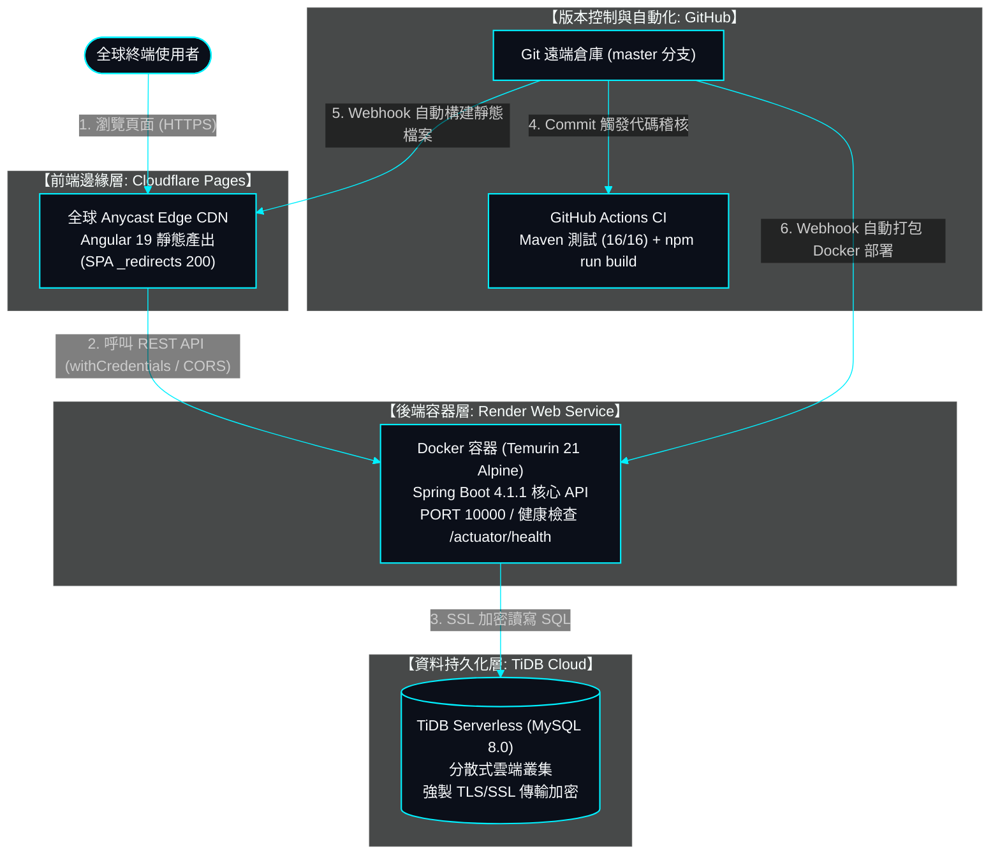

# SurveyFlow 全雲端無伺服器架構部署與維運手冊 (Cloud Deployment Guide)

> **專案版本**: v1.0.0 (Production Ready)  
> **技術棧**: Angular 19, Spring Boot 4.1.1, Java 21, TiDB Serverless, Render, Cloudflare Pages, GitHub Actions  
> **更新日期**: 2026-10-22  
> **手冊定位**: 針對本專案「前端邊緣託管 + 後端容器運算 + 雲端分散式資料庫」全自動化持續交付（GitOps CI/CD）之端到端實戰維運手冊。

---

## 1. 總體雲端拓撲架構 (Cloud Infrastructure Topology)

系統徹底落實**「本地端零聯網直跑」與「雲端生產環境自動覆寫」雙軌原則（SSOT）**。生產環境完全由各大主流雲端服務商之免費/彈性層無伺服器架構支撐：



---

## 2. 雲端服務元件規格清單

| 角色 | 服務提供商 | 服務類型 | 綁定倉庫/路徑 | 主要職責 |
| :--- | :--- | :--- | :--- | :--- |
| **資料庫** | **TiDB Cloud** | Serverless Cluster (MySQL 8.0) | `survey_flow` | 儲存使用者、問卷、答案、分析數據與 Base64 配圖 |
| **後端** | **Render** | Web Service (Docker) | 根目錄 [`Dockerfile`](file:///Users/hsuche-cheng/Documents/project/survey-flow/Dockerfile) | Spring Boot RESTful API、雙 Token 認證、郵件發送 |
| **前端** | **Cloudflare Pages** | Pages (Git Integration) | `frontend/` | Angular SPA 靜態託管、全球 CDN 邊緣加速、無伺服器分發 |
| **自動化** | **GitHub Actions** | CI Workflow | [`.github/workflows/ci.yml`](file:///Users/hsuche-cheng/Documents/project/survey-flow/.github/workflows/ci.yml) | 雙端自動編譯、單元測試防禦、品質控管 |

---

## 3. 三大雲端平台配置實戰指南

### 3.1 第一步：TiDB Cloud 資料庫建立與初始化

1. **建立叢集**：
   - 於 [TiDB Cloud Console](https://tidbcloud.com) 建立免費的 **Serverless Cluster**。
   - 區域（Region）建議選取 **AWS / ap-northeast-1 (Tokyo)** 或 **Google Cloud / asia-east1 (Taiwan)** 以取得最低網路延遲。
2. **匯入資料表結構**：
   - 點擊叢集內部的 **Chat2Query** 或透過 MySQL Workbench / DBeaver 連線。
   - 依序執行專案實體 SQL：
     1. [`backend/src/main/resources/database/schema.sql`](file:///Users/hsuche-cheng/Documents/project/survey-flow/backend/src/main/resources/database/schema.sql)（建立 7 大資料表與索引）
     2. [`backend/src/main/resources/database/data.sql`](file:///Users/hsuche-cheng/Documents/project/survey-flow/backend/src/main/resources/database/data.sql)（初始化管理員帳號與預設範本）
3. **取得 JDBC 連線參數**：
   - 點擊 **Connect** ➔ 選擇 **General** ➔ 取得 Host、Port (通常為 4000)、User 及 Password。

---

### 3.2 第二步：Render 後端 Web Service 配置

1. **建立 Web Service**：
   - 登入 [Render Dashboard](https://dashboard.render.com)。
   - 點擊 **New +** ➔ 選擇 **Web Service** ➔ 連接 GitHub 倉庫 `EricXJason/survey-flow`。
2. **基礎配置（重要：照抄以下內容）**：
   - **Name**: `survey-flow`（或自訂）
   - **Region**: 建議與 TiDB 相同（如 Singapore 或 Tokyo）
   - **Branch**: `master`
   - **Root Directory**: 留空（即專案根目錄）
   - **Runtime**: **Docker**（Render 將自動偵測專案根目錄之 [`Dockerfile`](file:///Users/hsuche-cheng/Documents/project/survey-flow/Dockerfile)）
   - **Instance Type**: `Free`
3. **健康檢查（Health Check Path）**：
   - 展開進階選項，填入：`/actuator/health`（Spring Boot 內建之健康檢查端點）。
4. **環境變數矩陣（Environment Variables）**：
   在 **Environment** 標籤中新增以下關鍵變數：

   | 變數名稱 (Key) | 建議填入值 (Value) | 作用說明 |
   | :--- | :--- | :--- |
   | `SPRING_DATASOURCE_URL` | `jdbc:mysql://{TIDB_HOST}:4000/survey_flow?useSSL=true&requireSSL=true&verifyServerCertificate=true` | TiDB 雲端 SSL JDBC 連線串 |
   | `SPRING_DATASOURCE_USERNAME` | `{TIDB_USERNAME}` | TiDB 帳號 (例如 `xxxx.root`) |
   | `SPRING_DATASOURCE_PASSWORD` | `{TIDB_PASSWORD}` | TiDB 密碼 |
   | `CORS_ALLOWED_ORIGINS` | `https://survey-flow.pages.dev` | 允許存取後端的 Cloudflare 前端網址（多網址以逗號分隔） |
   | `FRONTEND_BASE_URL` | `https://survey-flow.pages.dev` | 驗證信件一鍵點擊前往之目標前端網址 |
   | `JWT_SECRET` | 至少 32 字元（256 位元）隨機字串 | 生產環境專用 JWT 簽章密鑰 |
   | `MAIL_USERNAME` | `user46972@gmail.com` | 系統通知信 Gmail 帳號 |
   | `MAIL_PASSWORD` | Google 16 碼應用程式密碼 | Google 專用授權碼 |
   | `MAIL_FROM` | `user46972@gmail.com` | 寄件人顯示抬頭 |

---

### 3.3 第三步：Cloudflare Pages 前端靜態託管配置

1. **建立 Pages 專案**：
   - 登入 [Cloudflare Dashboard](https://dash.cloudflare.com)。
   - 左側進入 **Workers & Pages** ➔ 點擊 **Create application** ➔ 選擇 **Pages** 標籤 ➔ 點擊 **Connect to Git**。
   - 選取 GitHub 倉庫 `EricXJason/survey-flow` ➔ 點擊 **Begin setup**。
2. **建置參數設定（精確對齊）**：
   - **Project name**: `survey-flow`（預設將獲派 `survey-flow.pages.dev`）
   - **Production branch**: `master`
   - **Framework preset**: `Angular`
   - **Root directory (進階選單)**: **`frontend`**（⚠️ 務必設定，因為 Angular 位於子目錄）
   - **Build command**: `npm run build`
   - **Build output directory**: `dist/survey-flow/browser`
3. **環境變數（Environment variables）**：
   - 點擊 **Add variable**：
   - 變數名稱：**`NODE_VERSION`**
   - 變數值：**`20`**
4. **SPA 404 回退保障**：
   - 本專案已於 [`frontend/public/_redirects`](file:///Users/hsuche-cheng/Documents/project/survey-flow/frontend/public/_redirects) 配置 `/* /index.html 200`，Cloudflare 打包時會自動將其佈署至邊緣，保證重新整理深層網址（如 `/lobby`）不報 404。

---

## 4. 圖片儲存機制與演進架構 (Image Architecture)

本系統針對使用者上傳之問卷封面與題目配圖，採用無第三方儲存負擔之**「前端畫布等比壓縮 + Base64 編碼 + 資料庫長文字持久化」**方案：

```text
[ 本地使用者選取圖檔 (支援 PNG/JPG/WEBP) ]
                    │
                    ▼
【前端智慧壓縮層】 (survey-design.component.ts)
- 等比例邊界約束：最大寬高限制 1400px × 1400px
- HTML5 Canvas 重繪與縮放
- 輸出品質：0.85 質量因子 (體積減少 60% ~ 80%)
                    │
                    ▼
【RESTful API 傳輸層】
- 包裝為 Base64 DataURL (如 data:image/jpeg;base64,...)
- 隨問卷主體 JSON Payload 傳送
                    │
                    ▼
【資料庫儲存層】 (TiDB Serverless)
- surveys.cover_image_url ➔ LONGTEXT (支援高達 4GB 文字)
- survey_questions.image_url ➔ LONGTEXT
```

### 優勢與未來升級路徑：
- **目前優勢**：零 S3 / Cloudinary 配置開銷、具備強事務一致性（問卷刪除時圖片自動清理、無孤兒垃圾檔案）、資料庫 Dump 即可完整備份。
- **未來平滑遷移路徑**：資料庫欄位名稱定義為 `cover_image_url`，型別為字串。若未來專案擴大需要引進 Cloudflare R2 或 AWS S3 物件儲存，只需在後端加上 S3 上傳服務，**資料庫結構與前端介面 100% 無痛相容，無需更動任何 SQL Schema**。

---

## 5. 一鍵自動化維運閉環 (GitOps Workflow)

當日常開發在 `feature` 分支完成並驗證無誤後，只需依照協定下達發布指令：

```bash
# 1. 於本地 feature 分支完成驗證與 commit
git add . && git commit -m "feat: 業務功能更新"

# 2. 自動三層分支合併推進至 master
git checkout development && git merge feature --no-ff -m "chore: sync to development" && git push origin development
git checkout master && git merge development --no-ff -m "chore: release to master" && git push origin master
git checkout feature
```

### 推送後自動觸發之連鎖反應：
1. **GitHub Actions**：於 1~2 分鐘內完成 Ubuntu 虛擬機測試（後端 JUnit 16 測項全部 PASS、前端 TypeScript 0 錯誤打包）。
2. **Render Web Service**：自動拉取 `master` 分支，依 [`Dockerfile`](file:///Users/hsuche-cheng/Documents/project/survey-flow/Dockerfile) 執行多階段打包，零停機平滑重啟。
3. **Cloudflare Pages**：自動編譯靜態產物，在 1 分鐘內同步推送到全球數百個邊緣節點。

---

## 6. 維運常見排錯與應急指南 (Troubleshooting)

### Q1: Render 免費方案冷啟動（Cold Start）延遲？
- **原因**：Render 免費執行個體在無外部流量 15 分鐘後會自動休眠；下一次造訪需等待 30~50 秒進行容器喚醒。
- **解法（專案已內建）**：
  1. **GitHub Actions 雲端自動保活（已內建）**：專案已包含 [`.github/workflows/keep-alive.yml`](file:///Users/hsuche-cheng/Documents/project/survey-flow/.github/workflows/keep-alive.yml)，每 14 分鐘自動發送一次健康檢查探針至 `https://survey-flow-9gt6.onrender.com/actuator/health`，因本倉庫為 Public，享有全自動、無上限免費保活，Render 24 小時永遠在線秒開。
  2. **備用外部機器人**：亦可搭配免費外部工具（如 [Cron-Job.org](https://cron-job.org) 或 [UptimeRobot](https://uptimerobot.com)），設定每 14 分鐘 Ping 一次後端 `/actuator/health`。

### Q2: 登入時提示 CORS 跨域阻擋錯誤？
- **檢查點 1**：確認 Render 後台的 `CORS_ALLOWED_ORIGINS` 是否完整包含 Cloudflare Pages 網址（且末尾**不可有斜線**，例如 `https://survey-flow.pages.dev`）。
- **檢查點 2**：確認前端發送 API 請求時已配置 `withCredentials: true`，且後端 [`SecurityConfig.java`](file:///Users/hsuche-cheng/Documents/project/survey-flow/backend/src/main/java/com/surveyflow/security/SecurityConfig.java) 之 `setAllowCredentials(true)` 已生效。

### Q3: 重新整理 Angular 頁面出現 Cloudflare 404？
- **檢查點**：確認 Cloudflare Pages 的 Build output directory 為 `dist/survey-flow/browser`，且原始碼包含 `frontend/public/_redirects`（內容包含 `/* /index.html 200`）。
