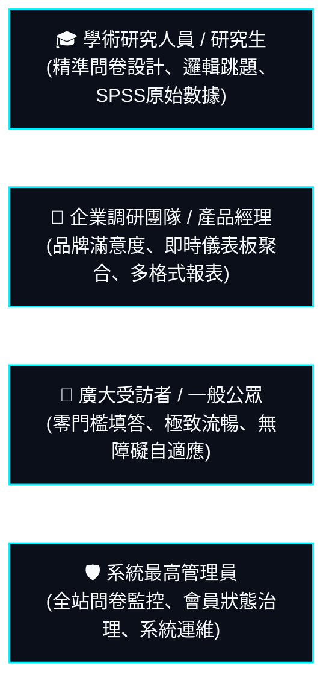
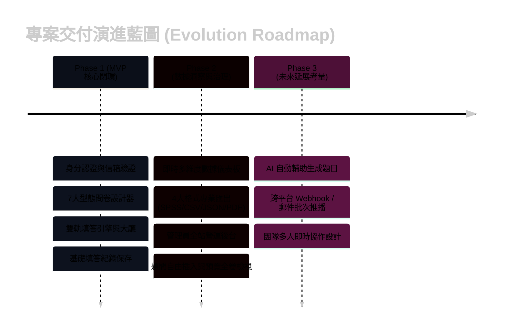

# 專案前期開發計劃書 (Project Development Plan)

> **協定定位**: 本檔案為**專案開發前之策略規劃書與構想藍圖**，記錄專案從 0 到 1 起步期的產品願景、痛點探索、需求收斂、功能範疇 (Scope) 與迭代里程碑。  
> **與系統設計書 (System Design) 之核心邊界區隔**:
> - **`docs/development-plan.md` (本文件 - 開發前)**: 專注於 **「Why」與「What」**。由需求發想、前期與 AI 聊天探討收斂得來，包含商業目標、使用者痛點、MVP 功能範疇、路線圖 (Roadmap) 與期程假設。
> - **`docs/system-design/` (規格設計庫 - 開發後)**: 專注於 **「How」與「As-Is」**。逆向掃描實體程式碼得出的工程規格、資料庫 Schema、API 路由契約、安全協議與實體部署架構。

---

## 01. 專案起步背景與問題探索 (Problem Discovery)

### 1.1 現行問卷工具之核心痛點
在學術實證調查與專業企業研究領域中，市面上常見之表單與問卷工具（如 Google 表單、Typeform、SurveyMonkey 等）常存在以下瓶頸：
1. **條件跳題邏輯死板或晦澀**：多數工具在複雜邏輯跳題（如「若選 A 則解鎖題目 Q5」）中缺乏清晰的可視化關聯，受訪者或設計者常因幽靈必填或題目突兀隱藏而產生作答中斷。
2. **學術級題型支援不足**：多維度量表評分（Rating）、多選限額、是非二元判斷與動態個資欄位缺乏統一標準資料結構，後續清洗成本極高。
3. **數據匯出格式單一**：僅提供簡易 CSV/Excel，缺乏對學術統計專用格式（如 SPSS 語法檔相容格式）、結構化 JSON 或視覺化 PDF 報表之直接支援。
4. **設計審查缺乏全卷結構透明度**：問卷設計者在發布前難以一眼掌握「全卷題目拓撲」，無法同時檢視哪些題目由哪些特定選項解鎖觸發。
5. **部署自主性與資料隱私疑慮**：第三方 SaaS 平台的資料主權受限，難以整合現代分散式資料庫與零信任身分驗證體系。

### 1.2 產品願景與核心定位
**SurveyFlow** 定位為一套專為個人研究者、學術系所與企業組織量身打造之**現代化動態線上問卷調研與多維數據採集系統**：
- **極致自研與低認知負擔**：全自研現代質感介面，純原生 SCSS/CSS，零外部厚重樣式依賴。
- **嚴謹資料結構與原生透明性**：以關聯式資料庫 SSOT 為唯一真理，堅持原生 SQL 查詢，消滅隱式 N+1 與黑箱操作。
- **高自由度題目動態解鎖引擎**：支援視覺化題目 UID 關聯，在填答與預覽模式下均具備清楚的跳題來源標示。

---

## 02. 目標受眾與使用者畫像 (Persona & Target Audience)



1. **學術研究人員 / 研究生 (`MEMBER`)**：
   - **核心目標**：設計嚴謹的多題型問卷、設定動態條件跳題，並在調查結束後快速下載相容 SPSS 之原始資料進行統計檢定。
   - **關鍵要求**：題目排序靈活、支援題間自由插入、答案資料結構嚴格無污染。
2. **企業調研團隊 / 品牌行銷 (`MEMBER`)**：
   - **核心目標**：發布產品滿意度調查、收集受訪者基本輪廓（姓名、信箱、手機、身分證字號），並即時查閱統計圖表與填答平均時長。
   - **關鍵要求**：介面美觀具現代科技質感、行動裝置自適應、問卷具備專屬分享連結。
3. **一般受訪者 / 訪客 (`GUEST`)**：
   - **核心目標**：無需繁瑣註冊登入即可流暢填答公開大廳或專屬連結中的問卷。
   - **關鍵要求**：載入速度極快、題目跳題自然、作答資料防誤觸、支援即時驗證。
4. **營運治理人員 / 管理員 (`ADMIN`)**：
   - **核心目標**：審查全站問卷合規性、即時掌握系統填答吞吐量、對異常帳號執行凍結或除名。

---

## 03. 功能範疇界定 (Scope Definition: MVP vs. Roadmap)



### 3.1 第一階段：MVP 最小可行性產品 (In-Scope)
- **會員與安全模組**：
  - 帳號密碼註冊、Argon2id 加密儲存。
  - Gmail SMTP 發送 6 碼驗證碼，信箱驗證通過開通帳號。
  - 無狀態 Access Token (15 分鐘) + Refresh Token (7 天) 雙權杖輪替 (RTR)。
  - 忘記密碼純信箱驗證碼重設。
- **視覺化問卷設計工作台**：
  - 基本設定：標題、說明、分類（9 大領域）、起訖時效、公開大廳切換、開放狀態切換。
  - 受訪者輪廓設定：姓名、電話、身分證字號等必填開關。
  - 7 大型態動態題型：單選題、多選題、簡答題、詳答題、評分題 (Rating 1~10)、是非題 (Boolean)、下拉選單題。
  - 條件邏輯跳題：單選/下拉選項綁定目標題目 UID，填答時動態解鎖。
- **填答運行器與公開大廳**：
  - 公開問卷大廳（分類篩選、關鍵字模糊搜尋、⌘K 快捷聚焦、分頁）。
  - 專屬作答直達連結（免大廳瀏覽，直接作答特定問卷）。
  - 作答有效性檢驗（必填檢核、評分範圍檢核、防誤觸提交確認）。
  - 訪客/會員作答通用儲存管線。

### 3.2 第二階段：進階分析、體驗深化與營運治理 (In-Scope)
- **多維度統計分析與儀表板**：
  - 關鍵指標 KPI（總填答數、平均作答秒數、完成率）。
  - 各題型資料視覺化聚合（單選/多選比例條形圖、評分題平均分與分佈、文字反饋列表）。
  - 4 大格式匯出模組：CSV、SPSS 相容語法/資料檔、結構化 JSON、高擬真列印 PDF。
- **問卷設計工作台體驗極致化**：
  - 支援題目下方即時插入、題間微動態分割條自由插入問題。
  - 前言說明海報與題目插圖本機選取轉 Base64 預覽上傳。
  - 問卷預覽模式全卷結構檢視與跳題來源徽章標示。
- **全站營運後台 (Admin Console)**：
  - 全站會員名冊檢視、分頁、搜尋。
  - 會員狀態治理（凍結、啟用、安全軟刪除）。
  - 全站問卷總覽（包含非公開專案）與穿透檢視。
- **極致品質與前端效能**：
  - Google Lighthouse 性能、無障礙、最佳實踐、SEO 滿分評級。
  - 補齊 `llms.txt`、`robots.txt`、`sitemap.xml` 與 Cloudflare Pages `_headers` 極速快取。

### 3.3 第三階段：未來延展考量 (Out-of-Scope，前期嚴格不納入)
- ❌ **付費訂閱與金流支付**：前期純粹聚焦於學術調研與產品易用性，不引入第三方支付金流 SDK。
- ❌ **多人即時協作編輯 (OT/CRDT)**：前期維持單一問卷擁有者編排，不引入複雜 WebSocket 協同鎖。
- ❌ **外部社群 OAuth 登入 (Google / Line / GitHub)**：前期先固化純原生帳號密碼與 Email 驗證碼安全閉環。

---

## 04. 技術選型前置評估 (Pre-development Tech Decisions)

在專案剛起步、進行技術棧評估時，經深入對比確立以下選型決策：

| 技術維度 | 候選方案評估 | 最終決策 | 關鍵決策理由 (ADR 摘要) |
| :--- | :--- | :--- | :--- |
| **前端框架** | React vs. Vue 3 vs. Angular 19 | **Angular 19** | 具備企業級強型別 DI、官方 Signals 反應式狀態管理，表單引擎與 CDK 拖曳排程高度內聚成熟。 |
| **介面樣式體系** | TailwindCSS vs. Bootstrap vs. 純原生 SCSS | **純原生 SCSS** | 徹底杜絕第三方龐大樣式表入侵；採用自研現代極簡美學（紙張白底色 `#fbfbfa` 與科技冷黑 `#00f0ff`），落實最少檔案與極限打包體積。 |
| **後端核心平台** | Node.js (NestJS) vs. Go (Gin) vs. Spring Boot (Java 21) | **Spring Boot + Java 21** | 享受 Java 21 虛擬執行緒 (Virtual Threads) 高併發非同步處理，Spring Security 與事務管理成熟嚴謹。 |
| **持久化資料庫** | PostgreSQL vs. MongoDB vs. TiDB Cloud (MySQL 8.0) | **TiDB Cloud Serverless** | MySQL 8.0 協定完全相容，分散式架構原生具備高擴展性，搭配 Serverless 方案免去維運硬體成本。 |
| **資料庫存取方針** | Hibernate 全自動 DDL vs. 原生 SQL 唯一準則 | **100% 原生 SQL (`nativeQuery = true`)** | 嚴格禁止 Hibernate 自動建立/修改資料表 (`ddl-auto=none`)；查詢全面使用原生 SQL，徹底掌控索引與執行計畫，消滅 ORM 隱式 N+1。 |
| **關聯式模型規範** | `@ManyToMany` 隱式中介 vs. 顯式一對多/多對一 | **嚴禁 `@ManyToMany`** | 強制拆解為獨立中介實體，保留建立時間、狀態等欄位擴充彈性，防止 ORM 全表重插效能雪崩。 |

---

## 05. 專案里程碑與實作節奏規劃 (Milestones & Schedule)

```mermaid
%%{init: {'theme': 'dark', 'themeVariables': { 'darkMode': true, 'background': '#030712', 'primaryColor': '#0b0f19', 'primaryTextColor': '#f8fafc', 'primaryBorderColor': '#00f0ff', 'lineColor': '#00f0ff', 'textColor': '#f8fafc', 'edgeLabelBackground': 'transparent' }, 'themeCSS': '.edgeLabel, .edgeLabel rect, .edgeLabel span, .labelBkg { background: transparent !important; background-color: transparent !important; fill: transparent !important; border: none !important; } .edgeLabel, .edgeLabel span { color: #ffffff !important; fill: #ffffff !important; font-weight: 500 !important; } rect, .node rect, polygon { rx: 0px !important; ry: 0px !important; }', 'flowchart': { 'curve': 'linear' } }}%%
flowchart LR
    classDef stepCard fill:#0b0f19,stroke:#00f0ff,stroke-width:1.5px,color:#f8fafc,rx:0px,ry:0px;

    MS0["Milestone 0<br/>概念發想與需求確立<br/>(AI諮詢 / 原型收斂)"]:::stepCard
    MS1["Milestone 1<br/>骨幹工程與資安防禦<br/>(Schema / 雙Token)"]:::stepCard
    MS2["Milestone 2<br/>核心問卷引擎<br/>(7大題型 / 邏輯跳題)"]:::stepCard
    MS3["Milestone 3<br/>多維分析與治理<br/>(KPI報表 / SPSS匯出)"]:::stepCard
    MS4["Milestone 4<br/>品質驗收與發布<br/>(Lighthouse滿分 / 雲端部署)"]:::stepCard

    MS0 --> MS1 --> MS2 --> MS3 --> MS4
```



- **Milestone 0: 概念成型與需求規格收斂 (Inception & Planning)**
  - 與 AI 深度對談收斂產品核心價值、繪製資訊架構樹與實體 ER 模型草圖。
  - 完成本《專案前期開發計劃書》，明確界定非目標 (Out-of-Scope)。
- **Milestone 1: 基礎架構與安全性骨幹 (Foundation & Security)**
  - 建立關聯式資料庫 `schema.sql` 作為唯一真理源 (SSOT)。
  - 建構 Spring Security + JJWT 雙權杖無狀態防禦與 Argon2id 雜湊機制。
  - 建立 Angular 19 獨立模組架構與全域 SCSS 設計系統變數。
- **Milestone 2: 動態問卷設計與填答引擎 (Core Survey Engine)**
  - 打造問卷設計器：題目增刪改、自由插題、題型切換、選項跳題 UID 綁定。
  - 打造問卷填答器：支援大廳公開檢索、專屬分享連結直達、動態跳題解鎖、防誤觸提交。
- **Milestone 3: 數據分析、專業匯出與營運治理 (Analytics & Administration)**
  - 統計儀表板：多維度圖表聚合、填答時長分析。
  - 4 大專業匯出：CSV, SPSS, JSON, PDF。
  - 系統管理員後台：全站問卷稽核、會員名冊治理。
- **Milestone 4: 品質驗收、極致效能與雲端發布 (Refinement & Production)**
  - 執行前後端單元測試（覆蓋率與 100% PASS 保障）。
  - Google Lighthouse 效能、無障礙滿分調校（消除非同步字型阻斷、補齊 ARIA 屬性與 `llms.txt`）。
  - Cloudflare Pages + Render 雙軌雲端自動化發布。

---

## 06. 前期風險評估與防禦策略 (Risk Management)

| 預期風險項目 | 潛在衝擊等級 | 前期擬定之防禦工程對策 |
| :--- | :---: | :--- |
| **條件跳題產生幽靈必填或死循環** | 🔴 高危 | 建立前端題目拓撲解析器，被隱藏題目不納入提交驗證；在預覽審查頁面提供「全卷題目結構檢視」與「跳題來源標記」，使設計者清楚掌握每一題的觸發源。 |
| **惡意訪客刷票或大量提交灌水** | 🟡 中度 | 後端記錄提交來源 IP 與作答秒數，提供起訖時間檢核與狀態關閉機制；前端表單建立送出前雙重確認機制，避免重複連擊。 |
| **資料庫更新產生 Schema Drift** | 🔴 高危 | 嚴格禁止 Hibernate 自動 DDL (`spring.jpa.hibernate.ddl-auto=none`)；以實體 SQL 腳本為主導，任何欄位異動強制更新 `schema.sql`。 |
| **長效 Token 遭竊與安全防護** | 🟡 中度 | 實施 Refresh Token 輪替機制 (RTR)，舊 Token 換發後立即於記憶體吊銷服務中註銷，防止重放攻擊 (Replay Attack)。 |
| **複雜樣式庫造成載入緩慢** | 🟢 輕度 | 堅守 100% 自研純原生 SCSS，杜絕外部厚重 CSS 函式庫，並在 Cloudflare Pages 配置一年靜態資源快取標頭。 |

---

## 07. 開發前 AI 提示工程範本 (Prompt Template for Kick-off)

> 💡 **使用指引**：在專案剛起步、於外部 AI 工具（如 ChatGPT, Claude, Gemini, DeepSeek）或在本地 IDE 開發探索時，可直接複製以下結構化提示詞，以快速引導 AI 生成高契合度之架構計劃：

```text
你現在是一位具備 10 年以上經驗的資深全端系統架構師與產品經理。
我們準備啟動一項全新專案：【專案名稱】。
專案核心定位：【一句話描述專案的核心價值與解決之痛點】。

請基於現代軟體工程最佳實踐 (SOLID、SSOT、Clean Code、Minimal Files 原則)，為我規劃一份嚴謹的「專案前期開發計劃書」：
1. 目標受眾與使用者畫像 (Persona & User Journey)
2. 核心功能範疇界定 (明確劃分 MVP In-Scope 與後續 Out-of-Scope)
3. 技術選型建議與架構權衡 (前端、後端、資料庫、資安防禦)
4. 關聯式資料模型設計概念 (請嚴格禁止 @ManyToMany，拆解為一對多與多對一)
5. 階段交付里程碑與工期假設 (Milestone 0 至 Milestone 4)
6. 潛在工程風險與前置對策 (包含幽靈資料、防刷、效能瓶頸)

請注意：
- 必須以純臺灣繁體中文輸出（「臺」無簡體與台）。
- 著重於「Why」與「What」，為後續實體代碼開發提供清晰之指導藍圖。
```

---

## 08. 總結

本《專案前期開發計劃書》奠定了 **SurveyFlow** 專案的核心願景與實踐界線。當專案進入具體實作與大規模架構重構階段後，實體程式碼的細節（包含真正的資料庫表格欄位、API 具體路由、Java 實體分層、前端組件樹結構）將全量收斂記錄於 [`docs/system-design/`](file:///Users/hsuche-cheng/Documents/project/survey-flow/docs/system-design/) 系列規格書中，達成「**前有清晰藍圖指引、後有真實規格印證**」的完整文檔雙軌工程體系。
