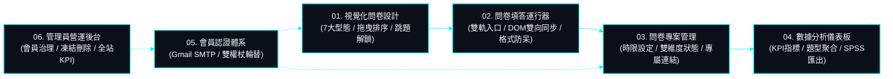

# 01. 系統願景、核心定位與模組總覽 (System Vision & Overview)

> **專案作者**: 許哲誠 (HSU, CHE-CHENG)  
> **系統名稱**: SurveyFlow 現代實證調研與學術結構化數據採集系統  
> **更新日期**: 2026-10-22  
> **文檔定位**: 專案全域第一級入門總覽。負責闡述系統願景、核心業務責任與六大功能模組，作為循序理解專案之總入口。

---

## 1. 系統是做什麼的 (System Purpose & Core Value)

**SurveyFlow** 是一套專為個人研究者、學術系所與企業組織量身打造之**現代化動態線上問卷調研與多維數據採集系統**。系統旨在解決傳統問卷表單在複雜邏輯跳題、資料格式驗證失誤、高擬真數據分析及多格式統計匯出等面向的痛點，建立高可靠、零誤判、深層在地化且具備學術嚴謹度之調查平台。

### 核心業務價值主張
1. **零誤判填答體驗**: 全題型（單選、複選、是非、量表、簡答、日期、時間）採用原生 DOM 雙向檢驗，徹底杜絕受訪者作答判定偏差。
2. **條件邏輯跳題 (選 A 開 B)**: 支援選項動態解鎖題目，未展開之題目自動豁免必填驗證，展開後嚴格檢核。
3. **臺灣在地化格式防呆**: 深度整合身分證字號雙向權重校驗（Modulo 10）、臺灣手機 09 開頭 10 碼檢核與繁體中文姓名防呆。
4. **真實數據與學術級分析**: 報表真實取自資料庫最新作答時間戳（絕無虛假時間），支援 CSV (UTF-8 BOM)、SPSS 語法檔 (`.sps`)、JSON 與原生列印。
5. **雲端現代雙軌部署**: 前端 SPA（Cloudflare Pages，純原生 SCSS/CSS）與後端 Web API（Render Web Service + TiDB Cloud Serverless）完全解耦，具備極致效能與全球加速。

---

## 2. 系統六大核心實體模組 (Functional Modules)

系統在職責單一 (SRP) 原則下，劃分為六大核心實體業務模組：

### 模組職責摘要
1. **視覺化問卷設計模組 (`/survey-design`)**: 支援 7 大題型配置、拖曳即時排序、單選動態跳題關聯配置、受訪者身分欄位自訂、封面附圖 Base64 上傳與即時擬真預覽。
2. **問卷填答運行模組 (`/survey-runner`)**: 支援公開大廳與專屬連結雙軌作答、原生 DOM 狀態深度掃描同步、條件跳題可見度豁免判斷與臺灣在地格式嚴格校驗。
3. **問卷專案管理模組 (`/survey-management`)**: 負責名下問卷預覽、專屬作答直達連結生成、大廳公開與填答開放雙維度開關控制、時程起訖設定與軟刪除管理。
4. **數據分析聚合模組 (`/survey-management` 分析面板)**: 負責 5 大營運 KPI、近 30 日走勢、受訪者人口輪廓、題型聚合分析、真實最後回覆時間及 4 大格式 (CSV / SPSS / JSON / PDF) 數據匯出。
5. **會員認證安全模組 (`/log-in`, `/register`, `/verify-email`)**: 負責 Argon2id 密碼雜湊、Gmail SMTP 註冊開通與密碼重設信寄發、無狀態短效 Access Token + 長效 Refresh Token 輪替防護。
6. **系統營運治理模組 (`/user-management`)**: 管理員專屬之全站會員名冊檢視、即時凍結/啟用與安全帳號刪除。

---

## 3. 系統架構規格書矩陣導航 (Design Specifications Index)

為實現敘述分則明確、單一真實來源 (SSOT) 且杜絕重複冗餘，本專案之深度規格書嚴格依工程邏輯編排如下，讀者可依序循序研讀：

| 序號與文檔檔名 | 專職負責領域 | 核心內容要點 |
| :--- | :--- | :--- |
| [01-overview.md](file:///Users/hsuche-cheng/Documents/project/survey-flow/docs/system-design/01-overview.md) | **系統願景與核心定位** | 業務背景、痛點解決、六大核心模組全貌與規格導航。 |
| [02-role-type.md](file:///Users/hsuche-cheng/Documents/project/survey-flow/docs/system-design/02-role-type.md) | **使用者身分與權限矩陣** | 訪客、會員、管理員三大身分之 18 項真實操作功能對照矩陣與路由守衛。 |
| [03-tech-stack.md](file:///Users/hsuche-cheng/Documents/project/survey-flow/docs/system-design/03-tech-stack.md) | **技術選型矩陣與 ADR** | Java 21, Spring Boot 4.1.1, Angular 19, 純原生 SCSS, TiDB MySQL 選型理由。 |
| [04-architecture.md](file:///Users/hsuche-cheng/Documents/project/survey-flow/docs/system-design/04-architecture.md) | **分層架構與目錄拓撲** | 前端 Standalone 結構、後端 Controller-Service-Repository 三層防線。 |
| [05-flowcharts.md](file:///Users/hsuche-cheng/Documents/project/survey-flow/docs/system-design/05-flowcharts.md) | **業務流程與狀態流轉圖** | 問卷生命週期、條件跳題動態解析、作答持久化與雙 Token 換發循序圖。 |
| [06-specs-api.md](file:///Users/hsuche-cheng/Documents/project/survey-flow/docs/system-design/06-specs-api.md) | **RESTful API 通訊協定規格** | 公開端點、會員專區、管理專用路由，嚴格四種 HTTP 動詞 (GET/POST/PUT/DELETE)。 |
| [07-specs-database.md](file:///Users/hsuche-cheng/Documents/project/survey-flow/docs/system-design/07-specs-database.md) | **TiDB 資料庫模型與 ERD** | 8 張關聯資料表、複合索引優化、外鍵級聯約束與聚合查詢規範。 |
| [08-ui-ux-standards.md](file:///Users/hsuche-cheng/Documents/project/survey-flow/docs/system-design/08-ui-ux-standards.md) | **前端 UI/UX 與原生樣式** | 100% 純原生 SCSS/CSS、去 AI 化中性設計語言、零橫向拖曳自適應。 |
| [09-security.md](file:///Users/hsuche-cheng/Documents/project/survey-flow/docs/system-design/09-security.md) | **資安防護與資料脫敏** | Argon2id 參數規格、身分證 Modulo 10 演算法、SQL 注入防禦。 |
| [10-deployment.md](file:///Users/hsuche-cheng/Documents/project/survey-flow/docs/system-design/10-deployment.md) | **雲端部署拓撲與維運規範** | Cloudflare Pages + Render + TiDB 拓撲、Docker 多階段建置、環境變數 OCP、Actuator 保活探針。 |
