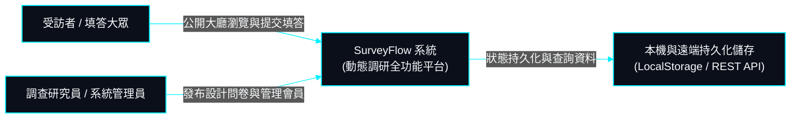

# 01. 系統願景與 C4 Model (System Overview & C4 Model)

> **專案作者**: 許哲誠 (HSU, CHE-CHENG)  
> **系統定位**: 次世代高擴充響應式線上動態問卷調研平台 (SurveyFlow Studio)  
> **更新日期**: 2026-10-06  

---

## 1. 系統願景與核心價值主張

**SurveyFlow** 旨在為現代企業組織、學術調研機構及大眾研究者提供極致流暢、精準且具備高客製彈性的動態問卷設計與作答生態系。系統徹底擺脫傳統表單工具死板固化的流程，透過強大條件跳題引擎、多維題型矩陣與零跳轉全響應式互動，賦予調研發起人極致敏捷的問卷構建體驗，同時提供受訪者沈浸式作答環境。

### 核心價值支柱
1. **零阻礙即時設計 (Real-time Survey Studio)**: 視覺化拖曳排序、12 大標準主題分類範本、多維度滿意度量表及自訂題型參數配置。
2. **動態條件邏輯樹 (Dynamic Conditional Branching)**: 支援題目間條件解鎖與即時跳題連動，即使題目動態重排，底層 UUID 機制依然確保邏輯鏈路 100% 穩定。
3. **高嚴格格式防呆與合規 (Robust Validation & Compliance)**: 深度整合中華民國國民身分證字號雙向權重校驗 (Modulo 10)、臺灣手機/市話正規驗證、複合高強度密碼與本地時區日期保護。
4. **流暢無障礙體驗 (Accessibility & Responsive HUD Aesthetics)**: 遵循 WCAG 規範，全站支援鍵盤快捷鍵（如 ⌘K 搜尋導航、ESC 關閉彈窗）、平滑滾動回頂與深色高對比賽博 HUD 科技美學。

---

## 2. C4 Model 架構層次圖 (HUD Neon Cyber Style)

### 2.1 C4 - Level 1: 系統脈絡圖 (System Context)

### 2.2 C4 - Level 2: 容器架構圖 (Container Diagram)

```mermaid
%%{init: {'theme': 'dark', 'themeVariables': { 'darkMode': true, 'background': '#030712', 'primaryColor': '#0b0f19', 'primaryTextColor': '#f8fafc', 'primaryBorderColor': '#00f0ff', 'lineColor': '#00f0ff', 'textColor': '#f8fafc' }, 'flowchart': { 'curve': 'linear' } }}%%
flowchart LR
    classDef hudCard fill:#0b0f19,stroke:#00f0ff,stroke-width:1.5px,color:#f8fafc,rx:0px,ry:0px;

    Browser["現代 Web 瀏覽器<br/>(Desktop / Mobile)"]:::hudCard
    SPA["Angular 19 獨立組件 SPA<br/>(Signals + CDK Drag & Drop)"]:::hudCard
    StateLayer["響應式狀態服務層<br/>(UserState + SurveyState)"]:::hudCard
    SessionStorageCache["瀏覽器 Session / Local Storage<br/>(會話與填答備份)"]:::hudCard

    Browser -->|"渲染 SPA 視圖"| SPA
    SPA -->|"調用狀態管理與事件廣播"| StateLayer
    StateLayer -->|"讀寫會話與暫存資料"| SessionStorageCache
```

