# 03. 分層結構與模組依賴 (Architecture Layers & Modules)

> **專案作者**: 許哲誠 (HSU, CHE-CHENG)  
> **系統架構**: 現代化前端乾淨分層架構 (Frontend Clean Architecture)  
> **更新日期**: 2026-10-06  

---

## 1. 系統分層架構拓撲圖

```mermaid
%%{init: {'theme': 'dark', 'themeVariables': { 'darkMode': true, 'background': '#030712', 'primaryColor': '#0b0f19', 'primaryTextColor': '#f8fafc', 'primaryBorderColor': '#00f0ff', 'lineColor': '#00f0ff', 'textColor': '#f8fafc' }, 'flowchart': { 'curve': 'linear' } }}%%
flowchart LR
    classDef hudCard fill:#0b0f19,stroke:#00f0ff,stroke-width:1.5px,color:#f8fafc,rx:0px,ry:0px;

    Presentation["表現層<br/>(Components / Views)"]:::hudCard
    ServiceCoordination["服務協同層<br/>(UserEmitter / Dialog)"]:::hudCard
    StateDomain["狀態與領域層<br/>(UserState / SurveyState)"]:::hudCard
    ContractsLayer["資料型別與合約層<br/>(@interfaces / Models)"]:::hudCard

    Presentation -->|"觸發使用者操作與訂閱"| ServiceCoordination
    ServiceCoordination -->|"更新狀態與調用檢索"| StateDomain
    StateDomain -->|"遵循實體資料模型契約"| ContractsLayer
```

---

## 2. 各層級職責規範

### 2.1 表現層 (Presentation Layer - `src/app/components/`)
- **頁面級組件 (Pages)**:
  - `home`: 平台官方首頁與 Hero 視覺。
  - `lobby`: 公開問卷大廳、多維分類過濾與分頁列表。
  - `survey-design`: 視覺化問卷設計編輯器與動態題型配置。
  - `survey-runner`: 受訪者實際問卷填答與即時互動器。
  - `survey-management`: 調研專案與問卷管理後台。
  - `user-management`: 系統管理員專屬之全站會員管理後台。
  - `log-in` / `register` / `forget-password` / `reset-password` / `user-profile`: 會員帳號驗證與個人資料維護。
- **全域共用微組件 (Shared Shell & Modals)**:
  - `header`: 響應式導航列、權限標籤、使用者頭像與手機抽屜。
  - `footer`: 品牌資訊與版權宣告。
  - `dialog`: 全域互動式對話框（Notice、Check、Error）。
  - `scroll-to-top-button`: 獨立浮動置頂微組件。

### 2.2 服務與操作協同層 (Service & Coordination Layer - `src/app/@services/`)
- `UserEmitterService`: 負責協同跨組件操作派發（登入、註冊、登出、問卷發布、作答提交），整合 `DialogService` 二次確認回呼。
- `DialogService`: 基於 RxJS Subject 集中管理彈窗開啟、結果派發與定時自動關閉。
- `ValidationService`: 集中封裝表單校驗邏輯（中華民國身分證字號雙向權重校驗、臺灣手機門號、密碼強度等）。
- `UtilityService`: 跨平台視窗滾動管理與嚴格正整數/無空格字串工具。

### 2.3 狀態與領域層 (State & Domain Layer)
- `UserStateService`: 管理當前使用者登入身分、角色權限（admin、member、guest）並進行 `SessionStorage` 雙向同步。
- `SurveyStateService`: 儲存當前選定問卷模型，並控制設計預覽 (Preview Mode) 與正式作答 (Run Mode) 之切換。
- `SurveyGetterService`: 提供問卷資料存取介面（大廳公開問卷、會員自訂問卷、單一問卷查詢）。

### 2.4 型別與合約層 (Contracts & Types Layer - `src/app/@interfaces/`)
- `account-model.ts`: 定義會員身分、註冊載荷、登入資料模型與個人資料格式。
- `survey-model.ts`: 定義 12 大主題分類清單、題目資料模型、條件解鎖關聯設定、問卷設計載荷與填答提交酬載。
