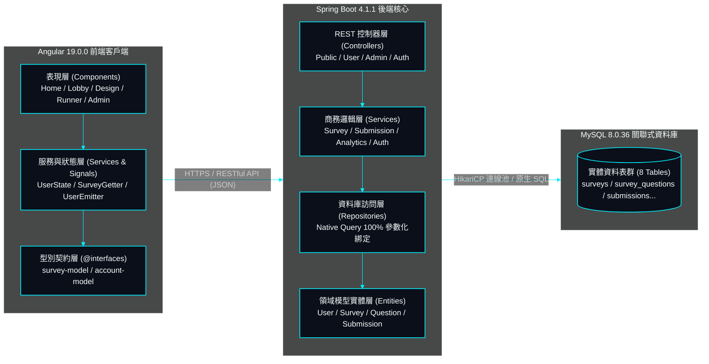

# 04. 系統分層架構與全專案檔案物理索引字典 (Exhaustive Codebase Dictionary)

> **系統架構**: 現代化前端微元件與後端 Spring Boot 4.1.1 乾淨分層架構 (Clean Architecture)  
> **更新日期**: 2026-10-22  
> **精確環境版號**: Node.js 24.18.0, Angular 19.0.0, Java 21.0.12, Spring Boot 4.1.1, MySQL 8.0.36 協定 (TiDB)  
> **文件定位**: 本文件為 SurveyFlow 系統全域檔案之「物理辭典與索引庫」。完整窮舉專案中每一個資料夾、程式碼腳本與設定檔之實體用途與聯動關係，供工程師與 AI Agent 於 3 秒內精準檢索。

---

## 1. 系統全域分層架構拓撲圖 (Mermaid Tech HUD)

---

## 2. 專案根目錄與全域配置字典 (Root Configuration Dictionary)

| 檔案 / 資料夾路徑 | 實體性質 | 架構責任與業務用途 | 關聯依賴與聯動模組 |
| :--- | :--- | :--- | :--- |
| **`.gitignore`** | 設定檔 | 定義 Git 排除追蹤清單，排除 `node_modules`、編譯產物 `target/` 與本地私有 `AGENTS*.md`。 | Git 版控系統 |
| **`README.md`** | 說明文檔 | 專案高階技術概述、架構選型理由、實體環境精確版本與本機建置指引。 | 生產發布檢閱資產 |
| **`AGENTS.md`** | 核心協定 | 【本地私有】全域 AI Agent 核心中樞協定，定義五大核心指令、SOLID 底線與文檔矩陣。 | 全域 AI Agent 與工程師 |
| **`AGENTS-GIT.md`** | 版控協定 | 【本地私有】三層沙盒版控法典，定義純 CLI 操作、純英文 Commit 鐵律與發布防撞 SOP。 | Git 沙盒版控執行 |
| **`AGENTS-FRONT.md`**| 前端協定 | 【本地私有】頂級 UI/UX 特化規範，定義去 AI 化美學、WCAG 2.2 與零拖曳 RWD 表格。 | 前端開發與設計審查 |
| **`AGENTS-BACK.md`** | 後端協定 | 【本地私有】後端與資料庫特化規範，定義 RESTful API、Argon2id/JWT 與原生 SQL 規範。 | 後端開發與資安審核 |
| **`frontend/`** | 根目錄 | Angular 19.0.0 前端客戶端應用程式完整原始碼目錄。 | 獨立前端工程 |
| **`backend/`** | 根目錄 | Java 21.0.12 與 Spring Boot 4.1.1 後端微服務完整原始碼與資料庫腳本目錄。 | 獨立後端工程 |
| **`docs/`** | 文檔矩陣 | 永遠常駐之修訂記錄庫 (`change-log.md`)、點收表與高階系統架構規格庫 (`system-design/`)。 | 專案規格單一真理源 |

---

## 3. 前端工程檔案實體字典 (`frontend/`)

### 3.1 前端核心設定與進入點 (Configuration & Entry)

| 檔案路徑 | 類型 | 具體用途與責任描述 | 聯動關係 |
| :--- | :--- | :--- | :--- |
| `frontend/package.json` | 配置檔 | 定義專案相依套件版本（Angular 19.0.0, RxJS 7.8.0, TypeScript 5.6.2）與建置腳本。 | pnpm / npm 工具鏈 |
| `frontend/angular.json` | 配置檔 | Angular CLI 建置管線配置，定義 SCSS 編譯路徑、靜態資產目錄與 AOT 最佳化參數。 | Angular CLI (`ng build`) |
| `frontend/tsconfig.json` | 配置檔 | TypeScript 基礎編譯器選項，定義嚴格型別檢查（Strict Mode）與模組解析方式。 | TS 編譯器 |
| `frontend/tsconfig.app.json` | 配置檔 | 專為應用程式原始碼指定的 TS 編譯設定，排除單元測試檔案。 | 前端生產打包 |
| `frontend/src/index.html` | 進入點 | 單頁應用 (SPA) 宿主 HTML，載入 Google Fonts 與根元件 `<app-root>`。 | 瀏覽器初次渲染 |
| `frontend/src/main.ts` | 進入點 | 前端 TypeScript 啟動點，以 `bootstrapApplication(AppComponent)` 啟動根模組。 | `app.config.ts` |
| `frontend/src/styles.scss` | 樣式庫 | 全域 Design Tokens 定義，宣告品牌色階、字體排印、陰影階梯與 Reset 規則。 | 全域所有 UI 元件 |
| `frontend/src/app/app.config.ts` | 配置檔 | 應用程式級注入配置，提供路由、Fetch HTTP 客戶端與 Material 動畫引擎支援。 | 全域 DI 容器 |
| `frontend/src/app/app.routes.ts` | 路由表 | 定義 SPA 路由拓撲（`/`, `/lobby`, `/survey-design`, `/survey-management` 等）與路由守衛。 | `auth.guard.ts` |
| `frontend/src/app/app.component.ts` | 根元件 | 根級宿主元件，承載頂部導航 `<app-header>`、內容區 `<router-outlet>` 與 `<app-footer>`。 | 全域 Shell |

### 3.2 抽象服務層與狀態管理 (`frontend/src/app/@services/`)

| 檔案路徑 | 具體用途與責任描述 | 聯動關係 |
| :--- | :--- | :--- |
| `api-client.service.ts` | 封裝 HTTP 請求管線，自動在 Header 注入 Bearer Token，並處理 401 攔截與 API 錯誤。 | 後端所有 REST 端點 |
| `user-state.service.ts` | 基於 Angular Signals 實現使用者身份狀態追蹤（訪客/會員/管理員），與 SessionStorage 雙向同步。 | `Header`, `AuthAction` |
| `survey-getter.service.ts`| 問卷資料存取服務，向後端取得大廳問卷、個人問卷與全站問卷清單，支援優雅降級回退。 | 後端 `/api/surveys` |
| `auth-action.service.ts` | 會員認證與帳號行為專職服務，落實 SRP 單一責任，處理登入、註冊、登出、忘記密碼與個人資料更新。 | `ApiClientService`, `UserStateService` |
| `survey-action.service.ts` | 問卷生命週期專職服務，落實 SRP 單一責任，處理問卷儲存、發布、刪除、公開時限切換與填答提交。 | `ApiClientService`, `SurveyGetterService` |
| `user-emitter.service.ts` | 輕量化門面服務 (Facade Pattern)，對齊舊有呼叫端契約，委派調用 `AuthAction` 與 `SurveyAction`。 | 各 UI 元件向後相容調用 |
| `survey-analytics.service.ts`| 前端數據分析核心服務，專職報表資料讀取、題型指標聚合與權限驗證，消滅上帝類別。 | `SurveyManagementComponent` |
| `survey-export.service.ts` | 報表檔案匯出專職服務，落實 SRP 單一責任，處理 CSV (UTF-8 BOM)、Excel、SPSS、JSON 格式化與下載。 | `SurveyAnalyticsService` |
| `survey-analytics-fallback.service.ts` | 離線/無後端降級報表生成專職服務，專職擬真題目統計、滿意度分數與受訪者輪廓生成。 | `SurveyAnalyticsService` |
| `dialog.service.ts` | 全域確認對話框排程服務，基於 RxJS Subject 支援 noticeMode、checkMode 與倒數自動關閉。 | `DialogComponent` |
| `validation.service.ts` | 集中式表單驗證服務，實作身分證字號雙向權重校驗（Modulo 10）、臺灣手機號與密碼強度。 | 前端所有輸入表單 |
| `utility.service.ts` | 通用輔助工具，提供平滑捲動 (`scrollToTopSmooth`)、隨機 ID 生成與文字安全過濾。 | 全域 UI 元件 |
| `survey-state.service.ts` | 問卷填答與設計執行期狀態快取，支援草稿暫存與模式切換。 | `SurveyRunner` |

### 3.3 型別契約與路由守衛 (`frontend/src/app/@interfaces/` & `@guards/`)

| 檔案路徑 | 具體用途與責任描述 | 聯動關係 |
| :--- | :--- | :--- |
| `@interfaces/survey-model.ts` | 定義 12 大主題分類、題目型態 (`QuestionDto`)、選項、跳題解鎖關聯與問卷摘要物件。 | 前後端資料傳輸 SSOT |
| `@interfaces/account-model.ts`| 定義使用者個人檔案資料結構 (`UserProfileData`)、登入請求載荷與身分枚舉。 | 會員與認證模組 |
| `@interfaces/survey-analytics-model.ts`| 定義數據分析報表模型，涵蓋 KPI、單複選百分比、評分量表分佈與受訪者輪廓。 | 數據分析視覺化 |
| `@guards/auth.guard.ts` | 路由守衛，防止未登入之訪客直接透過 URL 進入問卷設計工作台或個人管理專區。 | `app.routes.ts` |
| `@guards/can-deactivate.guard.ts` | 離開守衛，當問卷設計中存在未儲存變更時，攔截換頁並觸發二次確認提示。 | `SurveyDesign` |

### 3.4 表現層元件庫 (`frontend/src/app/components/`)

| 檔案路徑 | 具體用途與責任描述 | 聯動關係 |
| :--- | :--- | :--- |
| `header/` (`.ts`, `.html`, `.scss`) | 頂部全域導航列，具備會員頭像、身分標籤、登出按鈕與行動端無障礙漢堡滑動抽屜。 | 全站 Shell 導航 |
| `footer/` (`.ts`, `.html`, `.scss`) | 底部資訊列，展現品牌版權聲明、WCAG 2.2 無障礙合規標記與官方連結。 | 全站 Shell 底部 |
| `main/home/` (`.ts`, `.html`, `.scss`) | 平台官方首頁，整合去 AI 化視覺、產品功能核心價值主張與實體介面預覽。 | `HeroComponent` |
| `main/home/hero/` (`.ts`, `.html`, `.scss`) | 實體化 Hero 區塊，採用真實 macOS 擬真問卷編輯器預覽視窗取代虛幻口號。 | 官方首頁視覺中心 |
| `main/lobby/` (`.ts`, `.html`, `.scss`) | 公開問卷大廳，支援 12 大主題分類篩選、即時關鍵字過濾、⌘K 聚焦、等寬時效顯示（移除冗餘狀態欄位）與 Material Table 排序。 | 公開問卷探索 |
| `main/survey-design/` (`.ts`, `.html`, `.scss`) | 視覺化問卷設計工作台，支援題目增刪、7 大題型動態切換、條件跳題關聯與 19 項個資開關。 | 問卷發起人專案設計 |
| `survey-design/survey-reorder-dialog/` | 題目順序重排彈窗，支援單擊按鈕（↑ 上移、↓ 下移）操作，符合 WCAG 2.2 防拖曳依賴。 | `SurveyDesign` |
| `main/survey-runner/` (`.ts`, `.html`, `.scss`) | 受訪者填答器，支援預覽模式與正式填答模式，具備進度條、必填檢驗與個資表單輸入。 | 受訪者作答流 |
| `main/survey-management/` (`.ts`, `.html`, `.scss`)| 問卷管理與數據報表中心，整合 👑 皇冠微徽章、高飽和鮮明調色盤、純編號圖例與量表評分直方圖。 | 會員/管理員後台 |
| `main/user-management/` (`.ts`, `.html`, `.scss`) | 系統最高管理員專屬名冊，支援會員狀態凍結/啟用、安全刪除與電話/帳號檢索。 | `ROLE_ADMIN` 後台 |
| `main/user-profile/` (`.ts`, `.html`, `.scss`) | 個人資料維護中心，支援身分證號唯讀鎖定展示、姓名/電話更新與密碼重設。 | 會員帳號專區 |
| `main/log-in/` (`.ts`, `.html`, `.scss`) | 會員登入對話框/頁面，支援帳號密碼校驗與 JWT 雙權杖無縫寫入。 | 身份驗證模組 |
| `main/register/` (`.ts`, `.html`, `.scss`) | 新會員註冊頁面，實作身分證、電話、信箱格式即時反饋校驗。 | 身份驗證模組 |
| `main/forget-password/` & `reset-password/` | 密碼重置工作流，透過安全 Token 驗證並重設密碼。 | 帳號安全模組 |
| `shared/dialog/` (`.ts`, `.html`, `.scss`) | 全域通用對話框元件，支援 ESC 鍵退出與焦點捕捉（Focus Trap）。 | `DialogService` |
| `shared/scroll-to-top-button/` | 浮動置頂微元件，於 `scrollY > 200px` 自動平滑淡入，點擊無縫捲動至頂端。 | 全站操作體驗 |
| `pipes/question-type-count.pipe.ts` | 自訂 Angular Pipe，負責快速統計特定題型在問卷中的分佈數量。 | 問卷摘要展示 |

---

## 4. 後端工程檔案實體字典 (`backend/`)

### 4.1 後端核心進入點與設定檔 (Configuration & Entry)

| 檔案路徑 | 類型 | 具體用途與責任描述 | 聯動關係 |
| :--- | :--- | :--- | :--- |
| `backend/pom.xml` | 配置檔 | Maven 專案建置檔，宣告 Java 21、Spring Boot 4.1.1、JJWT 0.12.6 與 MySQL 依賴。 | Maven 建置管線 |
| `backend/src/main/resources/application.properties` | 配置檔 | 系統主設定檔，定義 MySQL 連線池、Argon2id 參數、JWT 密鑰與 SQL 日誌層級。 | Spring Boot 容器 |
| `com/surveyflow/SurveyFlowApplication.java` | 進入點 | Spring Boot 啟動類別，標註 `@SpringBootApplication` 與 `@EnableJpaAuditing`。 | JVM 啟動進入點 |

### 4.2 REST 控制器層 (`com.surveyflow.controller/`)

| 檔案路徑 | 具體用途與責任描述 | 存取權限等級 | 聯動 Service |
| :--- | :--- | :--- | :--- |
| `AuthController.java` | 處理會員登入、註冊、Token 換發與忘記/重設密碼請求。 | 公開 (`ANONYMOUS`) | `AuthService` |
| `PublicController.java` | 處理公開大廳分頁清單取得、單一問卷讀取與受訪者填答提交。 | 公開 (`ANONYMOUS`) | `SurveyService`, `SubmissionService` |
| `SurveyController.java` | 處理會員個人問卷建立、查詢、修改、刪除與雙狀態時程調整。 | 會員 (`ROLE_USER`/`ADMIN`) | `SurveyService` |
| `SubmissionController.java` | 處理問卷作答記錄調閱與個人提交歷史管理。 | 會員 (`ROLE_USER`/`ADMIN`) | `SubmissionService` |
| `AnalyticsController.java` | 提供特定問卷之深度數據分析報表（交叉統計、分佈圖表）。 | 擁有者或管理員 | `AnalyticsService` |
| `UserController.java` | 提供當前登入會員之個資調閱、姓名電話更新與密碼安全變更。 | 會員 (`ROLE_USER`/`ADMIN`) | `UserService` |
| `AdminController.java` | 提供系統管理員專屬之全站會員名冊、狀態切換、全站問卷稽核與營運 KPI。 | 管理員 (`ROLE_ADMIN`) | `UserService`, `AnalyticsService` |

### 4.3 商務邏輯服務層 (`com.surveyflow.service/`)

| 檔案路徑 | 具體用途與責任描述 | 依賴 Repository |
| :--- | :--- | :--- |
| `AuthService.java` | 執行 Argon2id 密碼雜湊比對、簽發單一高安全 JWT Token、登出審計與註冊驗證。 | `UserRepository` |
| `SurveyService.java` | 處理問卷專案生命週期，計算該使用者名下專屬編號 (`userSurveyNumber`)，執行發布檢查。 | `SurveyRepository`, `SubmissionRepository` |
| `SubmissionService.java`| 處理受訪者填答交易，原子寫入主表、基本資料與題目細項，執行防刷校驗。 | `SubmissionRepository`, `SubmissionAnswerRepository` |
| `AnalyticsService.java` | 執行多維度統計聚合計算（單複選百分比、量表平均分與直方圖分佈、簡答提取）。 | `SubmissionAnswerRepository`, `SurveyRepository` |
| `UserService.java` | 處理會員資料維護、身分證唯讀防護、帳號軟刪除與管理員會員名冊組裝。 | `UserRepository` |

### 4.4 資料庫訪問層 (`com.surveyflow.repository/`)

| 檔案路徑 | 具體用途與責任描述 (全原生 SQL 原則) | 實體模型 |
| :--- | :--- | :--- |
| `UserRepository.java` | 原生 SQL 查詢帳號/信箱唯一性、帳號載入與 Admin 會員分頁名冊。 | `User` |
| `SurveyRepository.java` | 原生 SQL 大廳模糊搜尋、使用者問卷列表、管理者全站清單與個人問卷 ID 升冪清單。 | `Survey` |
| `SubmissionRepository.java` | 原生 SQL 統計問卷回收總數、全站總填答次數與作答時間分佈。 | `Submission` |
| `SubmissionAnswerRepository.java`| 原生 SQL 聚合題目選項勾選票數、評分量表各級距人數與開放式簡答抽取。 | `SubmissionAnswer` |

### 4.5 領域模型實體層 (`com.surveyflow.entity/`)

| 實體檔案路徑 | 對應 MySQL 資料表 | 業務領域責任描述 |
| :--- | :--- | :--- |
| `User.java` | `users` | 儲存會員帳號、Argon2id 密碼雜湊、姓名、身分證字號、電話、角色與狀態（貫徹 Clean Architecture 乾淨架構，無展示層 Jackson 註解，純淨實體）。 |
| `Survey.java` | `surveys` | 儲存問卷標題、分類、封面、大廳公開與開放填答雙狀態、起訖時間與瀏覽次數。 |
| `SurveyQuestion.java` | `survey_questions` | 儲存問卷題目、7 大題型枚舉、排序權重、必填標記與評分上下限。 |
| `SurveyOption.java` | `survey_options` | 儲存單複選選項文字、排序與跳題解鎖觸發題號 (`trigger_question_uid`)。 |
| `SurveyBasicInfoConfig.java` | `survey_basic_info_configs` | 儲存問卷 19 項受訪者基本資料欄位動態收集開關設定。 |
| `Submission.java` | `submissions` | 儲存每一次問卷填答之主記錄（提交時間、耗時、填答來源 IP）。 |
| `SubmissionAnswer.java` | `submission_answers` | 儲存受訪者對單一題目之具體回答（選項值、量表分數、簡答文字）。 |
| `SubmissionBasicInfo.java` | `submission_basic_infos` | 儲存受訪者填寫之姓名、身分證、電話等個人基本資料。 |

### 4.6 安全與通用工具層 (`com.surveyflow.security/` & `common/`)

| 檔案路徑 | 具體用途與責任描述 |
| :--- | :--- |
| `SecurityConfig.java` | Spring Security 核心配置，配置無狀態過濾鏈、Argon2id 密碼雜湊器 Bean、端點白名單與 CORS 規則。 |
| `JwtAuthenticationFilter.java` | 請求過濾器，攔截 Authorization Header 並驗證 Access Token 有效性，注入上下文。 |
| `TokenProvider.java` | JJWT 工具類，負責金鑰簽名、單一 Token 生成、時效校驗與 Claims 解析。 |
| `CustomUserDetailsService.java` | 實作 Spring Security 之 `UserDetailsService`，自 MySQL 載入會員權限物件。 |
| `ApiResponse.java` | 全域統一之 RESTful JSON 回應封裝物件（含 status, success, message, data）。 |
| `GlobalExceptionHandler.java` | 全域異常處理器，攔截參數驗證錯誤 (400)、未授權 (401/403) 與系統例外 (500)。 |
| `enums/RoleType.java` | 定義會員身分角色枚舉（`ROLE_GUEST`, `ROLE_USER`, `ROLE_ADMIN`）。 |
| `enums/QuestionType.java` | 定義問卷 7 大型態枚舉（`SINGLE`, `MULTI`, `RATING`, `TEXT`, `BOOLEAN`, `TIME`, `DATE`）。 |

### 4.7 資料庫結構與種子腳本 (`backend/src/main/resources/database/`)

> **唯一真實來源 (SSOT) 鐵律**: 全系統關聯式資料庫結構與種子資料永遠且僅能存放於此目錄（`schema.sql` 與 `data.sql`），現在是、未來也是！嚴格禁止在專案根目錄散落額外 SQL 檔案。

| 檔案路徑 | 具體用途與責任描述 |
| :--- | :--- |
| `schema.sql` | 9 大正規化資料表結構之 DDL 腳本，嚴格遵循第三正規化 (3NF)、CHAR(10) 定長唯一索引、TINYINT 狀態與級聯約束（含方案 A 全量覆蓋與方案 B 增量更新）。 |
| `data.sql` | 系統預設 12 位會員帳號（含管理員與 10 位領域專家）、4 筆高品質統計問卷專案與真實填答數據之 DML 種子重設腳本（性別全面標準化為 TINYINT UNSIGNED 1/2/0）。 |

---

## 5. 文檔矩陣目錄字典 (`docs/`)

| 檔案路徑 | 具體用途與責任描述 |
| :--- | :--- |
| `docs/change-log.md` | 【永遠常駐】輕量繁體中文修訂記錄庫，最新記錄置頂，永續追蹤所有架構異動。 |
| `docs/check-list.md` | 【永遠常駐】專案功能分類驗收點收表，嚴格記錄業務需求，永久留存點收成果。 |
| `docs/system-design/01-overview.md` | 系統願景、商業價值目標與 C4 Model 上下文圖。 |
| `docs/system-design/02-tech-stack.md` | 核心技術選型矩陣與絕對明確版本號理由（零模糊原則）。 |
| `docs/system-design/03-architecture.md` | 【當前文件】分層架構拓撲與全專案所有資料夾、程式碼腳本與設定檔之實體用途字典。 |
| `docs/system-design/04-specs-api.md` | RESTful API 通訊協定規格書、端點路徑、請求酬載與回應結構定義。 |
| `docs/system-design/05-specs-database.md` | MySQL 8.0.36 ERD 模型、實體資料字典、索引設計與快取架構。 |
| `docs/system-design/06-flowcharts.md` | 核心業務流程圖（問卷設計流、雙狀態發布流、填答校驗流、統計分析流）。 |
| `docs/system-design/07-ui-ux-standards.md` | 頂級去 AI 化美學、7 大國際設計標竿對齊、表格零拖曳 RWD 與 WCAG 2.2 標準。 |
| `docs/system-design/08-devops.md` | 容器建置規範、環境變數配置與系統監控指標。 |
| `docs/system-design/09-security.md` | 縱深防禦體系、Argon2id/JWT 雙權杖刷新、OWASP Top 10 防禦與個資動態脫敏。 |
| `docs/system-design/10-pitch-deck.md` | 商業路演與高階技術簡報 10 頁經典大綱，可直接轉譯為專業投影片。 |
