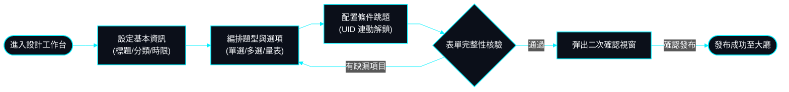
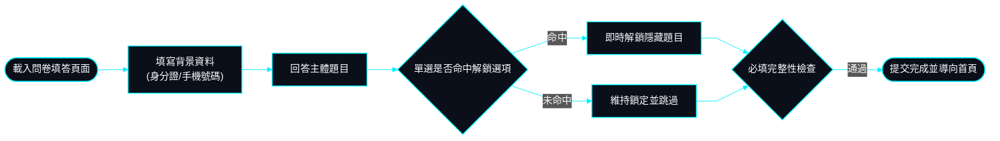
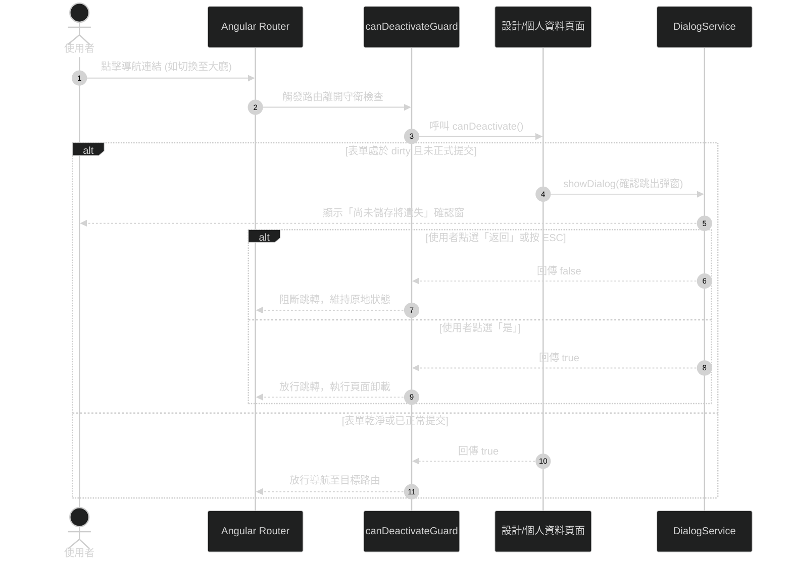

# 05. 核心業務流程與狀態機圖表 (Business Flowcharts & State Machines)

> **圖表風格**: Tech HUD 深黑風格 (直線直角、無灰塊)  
> **更新日期**: 2026-10-22  

---

## 1. 問卷設計發布生命週期流程 (Survey Design & Publishing)

---

## 2. 受訪者填答與動態條件跳題流程 (Survey Runner & Dynamic Branching)

---

## 3. 路由跳轉未儲存防呆守衛時序 (CanDeactivate Guard Sequence)

