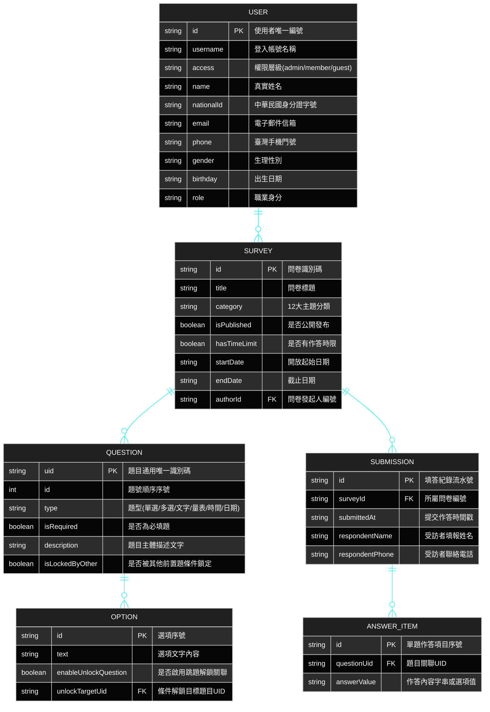

# 05. 實體資料模型與快取架構 (Database ERD & Storage Models)

> **專案作者**: 許哲誠 (HSU, CHE-CHENG)  
> **持久化架構**: SessionStorage (會話持久化) + LocalStorage (離線帳號快取) + JSON 資料模型  
> **更新日期**: 2026-10-06  

---

## 1. 系統實體關聯圖 (Database ERD - HUD Neon Style)



---

## 2. 瀏覽器端快取與雙軌儲存模型

### 2.1 會話儲存 (SessionStorage - `SURVEY_USER_STATE_SESSION`)
- **生命週期**: 當前瀏覽器分頁 (Browser Tab Session)。
- **作用目標**: 保持登入憑證與個人資料狀態，防止使用者重新整理分頁 (F5) 發生登出退回訪客。
- **資料格式**:
  ```json
  {
    "userProfile": {
      "id": "11111",
      "access": "admin",
      "userName": "User46972A",
      "name": "系統管理員",
      "nationalId": "B234567890",
      "email": "admin@survey.com",
      "phone": "0987654321",
      "gender": "male",
      "birthday": "1990-01-01",
      "role": "researcher"
    }
  }
  ```

### 2.2 本地離線註冊庫 (LocalStorage - `SURVEY_REGISTERED_USERS`)
- **生命週期**: 永久保存於用戶端瀏覽器。
- **作用目標**: 供本機展示註冊功能時，儲存新註冊之會員清單，允許使用者註冊後立即以新帳號登入進行全功能驗證。

---

## 3. MySQL 8.0.36 關聯式資料庫結構 (DDL) 與數據分析聚合

### 3.1 核心實體資料表結構 (DDL)
```sql
-- 1. 使用者會員表 (users)
CREATE TABLE users (
    id VARCHAR(64) PRIMARY KEY,
    username VARCHAR(32) NOT NULL UNIQUE,
    password_hash VARCHAR(255) NOT NULL,
    access VARCHAR(16) NOT NULL DEFAULT 'member', -- 'admin', 'member'
    name VARCHAR(64) NOT NULL,
    national_id VARCHAR(10),
    email VARCHAR(128) NOT NULL,
    phone VARCHAR(20),
    gender VARCHAR(10) DEFAULT 'male',
    birthday DATE,
    role VARCHAR(32),
    created_at TIMESTAMP DEFAULT CURRENT_TIMESTAMP
) ENGINE=InnoDB DEFAULT CHARSET=utf8mb4;

-- 2. 問卷主檔表 (surveys)
CREATE TABLE surveys (
    id VARCHAR(64) PRIMARY KEY,
    author_id VARCHAR(64) NOT NULL,
    title VARCHAR(255) NOT NULL,
    category VARCHAR(64) NOT NULL,
    is_published BOOLEAN DEFAULT TRUE,
    has_time_limit BOOLEAN DEFAULT FALSE,
    start_time DATETIME,
    end_time DATETIME,
    description TEXT,
    created_at TIMESTAMP DEFAULT CURRENT_TIMESTAMP,
    CONSTRAINT fk_survey_author FOREIGN KEY (author_id) REFERENCES users(id) ON DELETE CASCADE
) ENGINE=InnoDB DEFAULT CHARSET=utf8mb4;

-- 3. 問卷題目表 (survey_questions)
CREATE TABLE survey_questions (
    uid VARCHAR(64) PRIMARY KEY,
    survey_id VARCHAR(64) NOT NULL,
    sequence_order INT NOT NULL,
    question_type VARCHAR(32) NOT NULL, -- 'radio', 'checkbox', 'scale', 'text'
    is_required BOOLEAN DEFAULT TRUE,
    description TEXT NOT NULL,
    CONSTRAINT fk_question_survey FOREIGN KEY (survey_id) REFERENCES surveys(id) ON DELETE CASCADE
) ENGINE=InnoDB DEFAULT CHARSET=utf8mb4;

-- 4. 問卷填答紀錄主表 (survey_submissions)
CREATE TABLE survey_submissions (
    id VARCHAR(64) PRIMARY KEY,
    survey_id VARCHAR(64) NOT NULL,
    respondent_name VARCHAR(64),
    respondent_phone VARCHAR(20),
    duration_seconds INT DEFAULT 0,
    submitted_at TIMESTAMP DEFAULT CURRENT_TIMESTAMP,
    CONSTRAINT fk_submission_survey FOREIGN KEY (survey_id) REFERENCES surveys(id) ON DELETE CASCADE,
    INDEX idx_survey_time (survey_id, submitted_at)
) ENGINE=InnoDB DEFAULT CHARSET=utf8mb4;

-- 5. 問卷題目填答明細表 (survey_answers)
CREATE TABLE survey_answers (
    id BIGINT AUTO_INCREMENT PRIMARY KEY,
    submission_id VARCHAR(64) NOT NULL,
    question_uid VARCHAR(64) NOT NULL,
    answer_value TEXT,
    CONSTRAINT fk_answer_submission FOREIGN KEY (submission_id) REFERENCES survey_submissions(id) ON DELETE CASCADE,
    INDEX idx_question_answer (question_uid)
) ENGINE=InnoDB DEFAULT CHARSET=utf8mb4;
```

### 3.2 Java 後端 Spring Boot 數據分析聚合 SQL 範例
```sql
-- 取得單選/多選選項之填答人次與分佈百分比
SELECT 
    answer_value AS option_text,
    COUNT(*) AS vote_count,
    ROUND(COUNT(*) * 100.0 / (SELECT COUNT(*) FROM survey_answers WHERE question_uid = 'q-radio-1002'), 1) AS percentage
FROM survey_answers
WHERE question_uid = 'q-radio-1002'
GROUP BY answer_value
ORDER BY vote_count DESC;

-- 取得 10 點量表題平均得分與最高/最低分
SELECT 
    AVG(CAST(answer_value AS DECIMAL(4,2))) AS average_score,
    MAX(CAST(answer_value AS UNSIGNED)) AS max_score,
    MIN(CAST(answer_value AS UNSIGNED)) AS min_score,
    COUNT(*) AS total_ratings
FROM survey_answers
WHERE question_uid = 'q-scale-1004';
```

