# 07. 實體資料模型與資料庫架構 (Database ERD & Storage Models)

> **專案作者**: 許哲誠 (HSU, CHE-CHENG)  
> **持久化架構**: TiDB Cloud (Serverless) / MySQL 8.0 分散式關聯式資料庫 + Spring Data JPA  
> **更新日期**: 2026-10-22  
> **規格標準**: 嚴格貫徹 3NF 正規化無冗餘原則、定長物理欄位優化、TINYINT(1) 物理布林映射，100% 嚴格對齊後端 9 大實體資料表 (`users`, `verification_tokens`, `surveys`, `survey_basic_info_configs`, `survey_questions`, `survey_options`, `submissions`, `submission_basic_infos`, `submission_answers`)

---

## 1. 系統實體關聯圖 (Database ERD - Tech HUD Neon Style)

```mermaid
%%{init: {'theme': 'dark', 'themeVariables': { 'darkMode': true, 'background': '#030712', 'primaryColor': '#0b0f19', 'primaryTextColor': '#f8fafc', 'primaryBorderColor': '#00f0ff', 'lineColor': '#00f0ff', 'textColor': '#f8fafc', 'attributeBackgroundColorOdd': '#060a14', 'attributeBackgroundColorEven': '#0b0f19' }, 'themeCSS': '.er.relationshipLabelBox { fill: none !important; stroke: none !important; display: none !important; } rect, .node rect, rect.actor { rx: 0px !important; ry: 0px !important; }' }}%%
erDiagram
    USERS ||--o{ SURVEYS : "1對多發起問卷"
    USERS |o--o{ VERIFICATION_TOKENS : "1對多OTP權杖(選填關聯)"
    SURVEYS ||--|| SURVEY_BASIC_INFO_CONFIGS : "1對1收集配置"
    SURVEYS ||--o{ SURVEY_QUESTIONS : "1對多問卷題目"
    SURVEY_QUESTIONS ||--o{ SURVEY_OPTIONS : "1對多題目選項"
    SURVEYS ||--o{ SUBMISSIONS : "1對多填答主紀錄"
    SUBMISSIONS ||--|| SUBMISSION_BASIC_INFOS : "1對1受訪者輪廓"
    SUBMISSIONS ||--o{ SUBMISSION_ANSWERS : "1對多答案明細"
    SURVEY_QUESTIONS ||--o{ SUBMISSION_ANSWERS : "題目作答關聯"
    SURVEY_OPTIONS |o--o{ SUBMISSION_ANSWERS : "選項選取關聯(選擇題可選)"

    USERS {
        bigint id PK "會員唯一流水號"
        varchar username UK "帳號名稱(50)"
        varchar email UK "電子郵件(100)"
        varchar password_hash "Argon2id密碼雜湊(255)"
        varchar full_name "真實姓名(50)"
        char phone UK "定長聯絡手機(10)"
        char identity_card UK "定長身分證統一編號(10)"
        varchar role "預設ROLE_USER 權限(20)"
        varchar status "預設ACTIVE 狀態(20)"
        datetime created_at "建立時間"
        datetime updated_at "最後異動時間"
        datetime deleted_at "軟刪除時間"
    }

    VERIFICATION_TOKENS {
        bigint id PK "驗證碼流水號"
        bigint user_id FK "關聯會員流水號(可為NULL)"
        varchar email "驗證信箱(100)"
        varchar code "6至10位時效驗證碼(10)"
        varchar token_type "驗證類型(REGISTER/FORGOT_PASSWORD)"
        datetime expires_at "過期時效"
        tinyint is_used "預設0 TINYINT(1) 是否已核銷"
        datetime created_at "生成時間"
    }

    SURVEYS {
        bigint id PK "問卷專案流水號"
        bigint user_id FK "發起人會員編號"
        varchar title "問卷標題(150)"
        text description "問卷前言說明"
        varchar category "預設綜合調查 12大主題分類(50)"
        tinyint is_public_to_lobby "預設1 TINYINT(1) 是否公開大廳"
        tinyint is_open "預設1 TINYINT(1) 是否開放填答"
        longtext cover_image_url "封面宣傳圖URL或Base64"
        datetime start_date "開放填答起始日期"
        datetime end_date "填答截止日期"
        int view_count "預設0 瀏覽閱覽次數"
        datetime created_at "建立時間"
        datetime updated_at "最後更新時間"
        datetime deleted_at "軟刪除時間"
    }

    SURVEY_BASIC_INFO_CONFIGS {
        bigint id PK "配置設定流水號"
        bigint survey_id FK "所屬問卷編號(1對1唯一)"
        tinyint collect_basic_info "預設1 TINYINT(1) 啟用輪廓收集"
        tinyint require_name "預設1 TINYINT(1) 收集姓名"
        tinyint require_gender "預設1 TINYINT(1) 收集生理性別"
        tinyint require_age "預設1 TINYINT(1) 收集年齡層"
        tinyint require_birthday "預設0 TINYINT(1) 收集生日"
        tinyint require_national_id "預設0 TINYINT(1) 收集身分證號"
        tinyint require_phone "預設0 TINYINT(1) 收集行動電話"
        tinyint require_home_phone "預設0 TINYINT(1) 收集住家市話"
        tinyint require_email "預設0 TINYINT(1) 收集電子信箱"
        tinyint require_industry "預設0 TINYINT(1) 收集所屬產業"
        tinyint require_job_title "預設0 TINYINT(1) 收集職位職稱"
        tinyint require_department "預設0 TINYINT(1) 收集服務部門"
        tinyint require_employee_id "預設0 TINYINT(1) 收集員工工號"
        tinyint require_academic_major "預設0 TINYINT(1) 收集就讀科系"
        tinyint require_class_name "預設0 TINYINT(1) 收集就讀班級"
        tinyint require_student_id "預設0 TINYINT(1) 收集學生學號"
        tinyint require_height "預設0 TINYINT(1) 收集受訪者身高"
        tinyint require_weight "預設0 TINYINT(1) 收集受訪者體重"
        tinyint require_residence "預設0 TINYINT(1) 收集居住縣市"
        tinyint require_registered_address "預設0 TINYINT(1) 收集戶籍地址"
    }

    SURVEY_QUESTIONS {
        bigint id PK "題目唯一流水號"
        bigint survey_id FK "所屬問卷編號"
        varchar question_code "題目標識代碼(Q1/UUID)"
        varchar type "題型(SINGLE/MULTI/BOOLEAN/RATING/TEXT/TIME/DATE)"
        varchar question_text "題目主體敘述(500)"
        longtext image_url "題目附加附圖"
        tinyint is_required "預設1 TINYINT(1) 是否必填"
        int sort_order "預設1 題目排列順序"
        int min_rating "預設1 評分量表最小值(0或1)"
        int max_rating "預設5 評分量表最大值(5或10)"
        datetime created_at "建立時間"
        datetime updated_at "最後更新時間"
    }

    SURVEY_OPTIONS {
        bigint id PK "選項唯一流水號"
        bigint question_id FK "所屬題目編號"
        varchar option_text "選項文字內容(255)"
        int sort_order "預設1 選項排列順序"
        varchar trigger_question_uid "條件跳題解鎖目標題目UID(50)"
    }

    SUBMISSIONS {
        bigint id PK "填答主紀錄流水號"
        bigint survey_id FK "作答之問卷編號"
        varchar ip_address "受訪者IP位址(45)"
        int duration_seconds "作答耗時秒數"
        datetime submitted_at "提交作答時間戳"
    }

    SUBMISSION_BASIC_INFOS {
        bigint id PK "基本輪廓流水號"
        bigint submission_id FK "關聯填答主紀錄(1對1唯一)"
        varchar name "填報真實姓名(50)"
        tinyint gender "預設0 生理性別(0:未指定,1:男,2:女,3:其他)"
        varchar age_group "年齡級距(30)"
        varchar birthday "出生年月日(20)"
        char national_id "定長身分證統一編號(10)"
        char phone "定長聯絡手機(10)"
        varchar home_phone "住家市話(20)"
        varchar email "聯絡電子信箱(100)"
        varchar industry "所屬產業(50)"
        varchar job_title "擔任職稱(50)"
        varchar department "任職部門(50)"
        varchar employee_id "公司員工代號(50)"
        varchar academic_major "修讀系所(50)"
        varchar class_name "班別班級(50)"
        varchar student_id "在校學號(50)"
        double height "身高數據cm"
        double weight "體重數據kg"
        varchar residence "居住縣市(50)"
        varchar registered_address "戶籍地址(200)"
    }

    SUBMISSION_ANSWERS {
        bigint id PK "作答明細流水號"
        bigint submission_id FK "所屬填答主紀錄"
        bigint question_id FK "作答之題目編號"
        bigint option_id FK "選取之選項編號(可選0..1)"
        text text_answer "簡答題文字或日期時間字串"
        int rating_value "量表評分分值(1至10)"
    }
```



---

## 2. 嚴格 3NF 正規化與物理儲存最佳化評估

1. **定長字串優化 (CHAR vs VARCHAR)**:
   - **身分證字號 (`identity_card`, `national_id`)**: 臺灣身分證統一定長為 10 碼（1 碼大寫英文字母 + 9 碼數字）。採用 `CHAR(10)` 比 `VARCHAR(20)` 省去長度前綴字節開銷，在 B-Tree 索引建置與等值比較時均具備連續記憶體區塊定址優勢，並能自資料庫物理層杜絕長度溢出。
   - **手機號碼 (`phone`)**: 臺灣行動電話為 10 碼純數字格式（如 `0912345678`），採用 `CHAR(10)` 並在會員表設定 `UNIQUE` 唯一性約束，保障帳號通訊與安全憑證之唯一性。
2. **極致緊湊數值型別 (TINYINT)**:
   - **性別 (`gender`)**: 由 `VARCHAR(10)` 最佳化為 `TINYINT UNSIGNED DEFAULT 0`（1 Byte），遵循 ISO/IEC 5218 國際標準（0=未指定, 1=男性, 2=女性, 3=其他/多元），節省字串開銷並消弭拼寫歧義。
   - **物理布林值 (`TINYINT(1)`)**: MySQL 與 TiDB 引擎無專屬 1-bit boolean 實體，`BOOLEAN` 實質為 `TINYINT(1)`。所有開關旗標明確宣告為 `TINYINT(1)` 並明訂 `DEFAULT 0` 或 `DEFAULT 1`，杜絕空值模糊。
3. **消除冗餘相依 (Strict 3NF Guarantee)**:
   - `submission_answers` 僅保留 `submission_id`, `question_id`, `option_id`, `text_answer`, `rating_value`，不贅存 `survey_id` 或 `user_id`，所有非主鍵屬性直接相依於主鍵，消除傳遞相依。
   - `verification_tokens` 正式引入 `user_id BIGINT DEFAULT NULL` 外鍵並保留 `email` 索引，讓註冊前（無 user_id）與註冊後密碼重設（有 user_id）皆具備嚴格實體參照完整性。

---

## 3. TiDB / MySQL 8.0 實體資料表完整建表 DDL (具備繁中註解與預設值)

```sql
-- ============================================================================
-- 專案名稱: SurveyFlow 實體關聯資料庫綱要 (DDL)
-- 相容版本: TiDB Cloud (Serverless) / MySQL 8.0+
-- 規格原則: 3NF 正規化、定長 CHAR(10) 優化、TINYINT 狀態碼與物理布林
-- ============================================================================

-- 1. 會員核心資料表 (users)
CREATE TABLE IF NOT EXISTS users (
    id BIGINT AUTO_INCREMENT PRIMARY KEY COMMENT '會員唯一流水號',
    username VARCHAR(50) NOT NULL UNIQUE COMMENT '登入帳號名稱',
    email VARCHAR(100) NOT NULL UNIQUE COMMENT '會員電子郵件',
    password_hash VARCHAR(255) NOT NULL COMMENT 'Argon2id 密碼雜湊值',
    full_name VARCHAR(50) NOT NULL COMMENT '真實姓名',
    phone CHAR(10) DEFAULT NULL UNIQUE COMMENT '定長聯絡手機 (10碼純數字)',
    identity_card CHAR(10) DEFAULT NULL UNIQUE COMMENT '定長身分證統一編號 (10碼)',
    role VARCHAR(20) NOT NULL DEFAULT 'ROLE_USER' COMMENT '系統權限角色 (ROLE_ADMIN, ROLE_USER, ROLE_GUEST)',
    status VARCHAR(20) NOT NULL DEFAULT 'ACTIVE' COMMENT '帳號狀態 (ACTIVE, DISABLED)',
    created_at DATETIME NOT NULL DEFAULT CURRENT_TIMESTAMP COMMENT '建立時間',
    updated_at DATETIME NOT NULL DEFAULT CURRENT_TIMESTAMP ON UPDATE CURRENT_TIMESTAMP COMMENT '最後異動時間',
    deleted_at DATETIME DEFAULT NULL COMMENT '軟刪除時間戳'
) ENGINE=InnoDB DEFAULT CHARSET=utf8mb4 COLLATE=utf8mb4_unicode_ci COMMENT='系統會員核心資料表';

-- 2. 帳號時效性驗證碼表記錄 (verification_tokens)
CREATE TABLE IF NOT EXISTS verification_tokens (
    id BIGINT AUTO_INCREMENT PRIMARY KEY COMMENT '驗證碼流水號',
    user_id BIGINT DEFAULT NULL COMMENT '關聯會員流水號 (若為未註冊前驗證則為 NULL)',
    email VARCHAR(100) NOT NULL COMMENT '驗證目標電子郵件',
    code VARCHAR(10) NOT NULL COMMENT '6至10位時效驗證碼',
    token_type VARCHAR(30) NOT NULL COMMENT '權杖業務類型 (REGISTER, FORGOT_PASSWORD)',
    expires_at DATETIME NOT NULL COMMENT '過期時限戳記',
    is_used TINYINT(1) NOT NULL DEFAULT 0 COMMENT '是否已核銷使用 (0:未使用, 1:已使用)',
    created_at DATETIME NOT NULL DEFAULT CURRENT_TIMESTAMP COMMENT '生成時間',
    INDEX idx_vt_email_type (email, token_type),
    CONSTRAINT fk_vt_user FOREIGN KEY (user_id) REFERENCES users(id) ON DELETE CASCADE
) ENGINE=InnoDB DEFAULT CHARSET=utf8mb4 COLLATE=utf8mb4_unicode_ci COMMENT='時效性 OTP 驗證碼記錄表';

-- 3. 問卷專案主檔表 (surveys)
CREATE TABLE IF NOT EXISTS surveys (
    id BIGINT AUTO_INCREMENT PRIMARY KEY COMMENT '問卷唯一流水號',
    user_id BIGINT NOT NULL COMMENT '發起人會員 ID (關聯 users.id)',
    title VARCHAR(150) NOT NULL COMMENT '問卷標題',
    description TEXT DEFAULT NULL COMMENT '問卷前言介紹與作答說明',
    category VARCHAR(50) NOT NULL DEFAULT '綜合調查' COMMENT '問卷 12 大領域分類',
    is_public_to_lobby TINYINT(1) NOT NULL DEFAULT 1 COMMENT '是否公開呈現於大廳廣場 (0:私有, 1:公開)',
    is_open TINYINT(1) NOT NULL DEFAULT 1 COMMENT '是否處於開放填答狀態 (0:關閉, 1:開放)',
    cover_image_url LONGTEXT DEFAULT NULL COMMENT '封面宣傳圖片 (Base64 或 CDN 連結)',
    start_date DATETIME DEFAULT NULL COMMENT '開放填答起始日期',
    end_date DATETIME DEFAULT NULL COMMENT '開放填答截止日期',
    view_count INT NOT NULL DEFAULT 0 COMMENT '問卷大廳點閱次數',
    created_at DATETIME NOT NULL DEFAULT CURRENT_TIMESTAMP COMMENT '建立時間',
    updated_at DATETIME NOT NULL DEFAULT CURRENT_TIMESTAMP ON UPDATE CURRENT_TIMESTAMP COMMENT '更新時間',
    deleted_at DATETIME DEFAULT NULL COMMENT '軟刪除時間',
    CONSTRAINT fk_surveys_creator FOREIGN KEY (user_id) REFERENCES users(id) ON DELETE CASCADE
) ENGINE=InnoDB DEFAULT CHARSET=utf8mb4 COLLATE=utf8mb4_unicode_ci COMMENT='問卷專案主檔資料表';

-- 4. 問卷受訪者個人輪廓收集欄位配置表 (survey_basic_info_configs)
CREATE TABLE IF NOT EXISTS survey_basic_info_configs (
    id BIGINT AUTO_INCREMENT PRIMARY KEY COMMENT '配置記錄編號',
    survey_id BIGINT NOT NULL UNIQUE COMMENT '所屬問卷 ID (一對一強制唯一)',
    collect_basic_info TINYINT(1) NOT NULL DEFAULT 1 COMMENT '是否啟用受訪者資料收集 (0:關閉, 1:啟用)',
    require_name TINYINT(1) NOT NULL DEFAULT 1 COMMENT '是否收集受訪者姓名',
    require_gender TINYINT(1) NOT NULL DEFAULT 1 COMMENT '是否收集生理性別',
    require_age TINYINT(1) NOT NULL DEFAULT 1 COMMENT '是否收集年齡層',
    require_birthday TINYINT(1) NOT NULL DEFAULT 0 COMMENT '是否收集生日',
    require_national_id TINYINT(1) NOT NULL DEFAULT 0 COMMENT '是否收集身分證字號',
    require_phone TINYINT(1) NOT NULL DEFAULT 0 COMMENT '是否收集行動電話',
    require_home_phone TINYINT(1) NOT NULL DEFAULT 0 COMMENT '是否收集市話',
    require_email TINYINT(1) NOT NULL DEFAULT 0 COMMENT '是否收集電子信箱',
    require_industry TINYINT(1) NOT NULL DEFAULT 0 COMMENT '是否收集所屬產業',
    require_job_title TINYINT(1) NOT NULL DEFAULT 0 COMMENT '是否收集職位稱謂',
    require_department TINYINT(1) NOT NULL DEFAULT 0 COMMENT '是否收集服務部門',
    require_employee_id TINYINT(1) NOT NULL DEFAULT 0 COMMENT '是否收集員工編號',
    require_academic_major TINYINT(1) NOT NULL DEFAULT 0 COMMENT '是否收集就讀科系',
    require_class_name TINYINT(1) NOT NULL DEFAULT 0 COMMENT '是否收集班級編號',
    require_student_id TINYINT(1) NOT NULL DEFAULT 0 COMMENT '是否收集學生學號',
    require_height TINYINT(1) NOT NULL DEFAULT 0 COMMENT '是否收集身高',
    require_weight TINYINT(1) NOT NULL DEFAULT 0 COMMENT '是否收集體重',
    require_residence TINYINT(1) NOT NULL DEFAULT 0 COMMENT '是否收集居住縣市',
    require_registered_address TINYINT(1) NOT NULL DEFAULT 0 COMMENT '是否收集戶籍地址',
    CONSTRAINT fk_basic_info_survey FOREIGN KEY (survey_id) REFERENCES surveys(id) ON DELETE CASCADE
) ENGINE=InnoDB DEFAULT CHARSET=utf8mb4 COLLATE=utf8mb4_unicode_ci COMMENT='問卷受訪者個人輪廓收集欄位配置表';

-- 5. 問卷題目清單資料表 (survey_questions)
CREATE TABLE IF NOT EXISTS survey_questions (
    id BIGINT AUTO_INCREMENT PRIMARY KEY COMMENT '題目流水號',
    survey_id BIGINT NOT NULL COMMENT '所屬問卷 ID',
    question_code VARCHAR(50) DEFAULT NULL COMMENT '前端題號識別代碼 (如 Q1, Q2)',
    type VARCHAR(20) NOT NULL COMMENT '題目類型 (SINGLE, MULTI, BOOLEAN, RATING, TEXT, TIME, DATE)',
    question_text VARCHAR(500) NOT NULL COMMENT '題目主體敘述文字',
    image_url LONGTEXT DEFAULT NULL COMMENT '題目附加圖片',
    is_required TINYINT(1) NOT NULL DEFAULT 1 COMMENT '是否為必填題目 (0:非必填, 1:必填)',
    sort_order INT NOT NULL DEFAULT 1 COMMENT '題目呈現順序',
    min_rating INT DEFAULT 1 COMMENT '評分題最小值 (預設 1 或 0)',
    max_rating INT DEFAULT 5 COMMENT '評分題最大值 (預設 5 或 10)',
    created_at DATETIME NOT NULL DEFAULT CURRENT_TIMESTAMP COMMENT '建立時間',
    updated_at DATETIME NOT NULL DEFAULT CURRENT_TIMESTAMP ON UPDATE CURRENT_TIMESTAMP COMMENT '更新時間',
    CONSTRAINT fk_questions_survey FOREIGN KEY (survey_id) REFERENCES surveys(id) ON DELETE CASCADE
) ENGINE=InnoDB DEFAULT CHARSET=utf8mb4 COLLATE=utf8mb4_unicode_ci COMMENT='問卷題目清單資料表';

-- 6. 單選/多選/是非題目選項資料表 (survey_options)
CREATE TABLE IF NOT EXISTS survey_options (
    id BIGINT AUTO_INCREMENT PRIMARY KEY COMMENT '選項唯一流水號',
    question_id BIGINT NOT NULL COMMENT '所屬題目 ID',
    option_text VARCHAR(255) NOT NULL COMMENT '選項文字標籤',
    sort_order INT NOT NULL DEFAULT 1 COMMENT '選項排列順序',
    trigger_question_uid VARCHAR(50) DEFAULT NULL COMMENT '條件跳題解鎖之目標題目 UID',
    CONSTRAINT fk_options_question FOREIGN KEY (question_id) REFERENCES survey_questions(id) ON DELETE CASCADE
) ENGINE=InnoDB DEFAULT CHARSET=utf8mb4 COLLATE=utf8mb4_unicode_ci COMMENT='題目選項資料表';

-- 7. 問卷填答主檔紀錄表 (submissions)
CREATE TABLE IF NOT EXISTS submissions (
    id BIGINT AUTO_INCREMENT PRIMARY KEY COMMENT '填答事件流水號',
    survey_id BIGINT NOT NULL COMMENT '作答之問卷 ID',
    ip_address VARCHAR(45) DEFAULT NULL COMMENT '受訪者 IPv4 / IPv6 位址',
    duration_seconds INT DEFAULT NULL COMMENT '填答作答總耗時 (秒)',
    submitted_at DATETIME NOT NULL DEFAULT CURRENT_TIMESTAMP COMMENT '提交作答時間戳',
    CONSTRAINT fk_submissions_survey FOREIGN KEY (survey_id) REFERENCES surveys(id) ON DELETE CASCADE
) ENGINE=InnoDB DEFAULT CHARSET=utf8mb4 COLLATE=utf8mb4_unicode_ci COMMENT='問卷填答主檔紀錄表';

-- 8. 受訪者個資輪廓真實填報明細表 (submission_basic_infos)
CREATE TABLE IF NOT EXISTS submission_basic_infos (
    id BIGINT AUTO_INCREMENT PRIMARY KEY COMMENT '受訪者基本資料流水號',
    submission_id BIGINT NOT NULL UNIQUE COMMENT '關聯之填答紀錄 ID (一對一唯一定位)',
    name VARCHAR(50) DEFAULT NULL COMMENT '填報姓名',
    gender TINYINT UNSIGNED NOT NULL DEFAULT 0 COMMENT '生理性別 (0:未指定, 1:男性, 2:女性, 3:其他)',
    age_group VARCHAR(30) DEFAULT NULL COMMENT '年齡區間',
    birthday VARCHAR(20) DEFAULT NULL COMMENT '出生年月日',
    national_id CHAR(10) DEFAULT NULL COMMENT '定長身分證統一編號 (10碼)',
    phone CHAR(10) DEFAULT NULL COMMENT '定長聯絡電話 (10碼純數字)',
    home_phone VARCHAR(20) DEFAULT NULL COMMENT '住家市話',
    email VARCHAR(100) DEFAULT NULL COMMENT '電子信箱',
    industry VARCHAR(50) DEFAULT NULL COMMENT '就業產業',
    job_title VARCHAR(50) DEFAULT NULL COMMENT '擔任職位',
    department VARCHAR(50) DEFAULT NULL COMMENT '所屬部門',
    employee_id VARCHAR(50) DEFAULT NULL COMMENT '公司工號',
    academic_major VARCHAR(50) DEFAULT NULL COMMENT '修讀系所',
    class_name VARCHAR(50) DEFAULT NULL COMMENT '所屬班級',
    student_id VARCHAR(50) DEFAULT NULL COMMENT '在校學號',
    height DOUBLE DEFAULT NULL COMMENT '身高數據 cm',
    weight DOUBLE DEFAULT NULL COMMENT '體重數據 kg',
    residence VARCHAR(50) DEFAULT NULL COMMENT '居住城市',
    registered_address VARCHAR(200) DEFAULT NULL COMMENT '戶籍完整地址',
    CONSTRAINT fk_sub_info_submission FOREIGN KEY (submission_id) REFERENCES submissions(id) ON DELETE CASCADE
) ENGINE=InnoDB DEFAULT CHARSET=utf8mb4 COLLATE=utf8mb4_unicode_ci COMMENT='受訪者個資輪廓真實填報明細表';

-- 9. 受訪者各題詳細作答答案表 (submission_answers)
CREATE TABLE IF NOT EXISTS submission_answers (
    id BIGINT AUTO_INCREMENT PRIMARY KEY COMMENT '單題作答流水號',
    submission_id BIGINT NOT NULL COMMENT '所屬填答紀錄 ID',
    question_id BIGINT NOT NULL COMMENT '作答之題目 ID',
    option_id BIGINT DEFAULT NULL COMMENT '選取之選項 ID (單選、多選、是非題填入，文字與量表為 NULL)',
    text_answer TEXT DEFAULT NULL COMMENT '簡答題文字內容或日期/時間字串',
    rating_value INT DEFAULT NULL COMMENT '評分題數值 (1 至 10)',
    CONSTRAINT fk_answers_submission FOREIGN KEY (submission_id) REFERENCES submissions(id) ON DELETE CASCADE,
    CONSTRAINT fk_answers_question FOREIGN KEY (question_id) REFERENCES survey_questions(id) ON DELETE CASCADE,
    CONSTRAINT fk_answers_option FOREIGN KEY (option_id) REFERENCES survey_options(id) ON DELETE SET NULL
) ENGINE=InnoDB DEFAULT CHARSET=utf8mb4 COLLATE=utf8mb4_unicode_ci COMMENT='受訪者各題詳細作答答案表';
```

---

## 4. 全系統資料庫檔案唯一存放路徑規範 (SSOT)

> **最高底線鐵律**:  
> 全系統所有關聯式資料庫結構 DDL 與種子資料 DML，**唯一真實存放位置永遠在：**  
> `backend/src/main/resources/database/`  
> - `schema.sql`: 9 大正規化資料表結構定義檔（含全量重建方案 A 與增量更新方案 B）。  
> - `data.sql`: 系統預設管理員、專家帳號、多元問卷專案與真實填答數據種子檔。  
> 
> **現在是、未來也是！** 嚴格禁止在專案根目錄、docs/ 或任何其他位置建立、散落重複或暫存之 SQL 檔案，確保版本控制單一真實來源 (SSOT) 與代碼庫純淨整潔。

