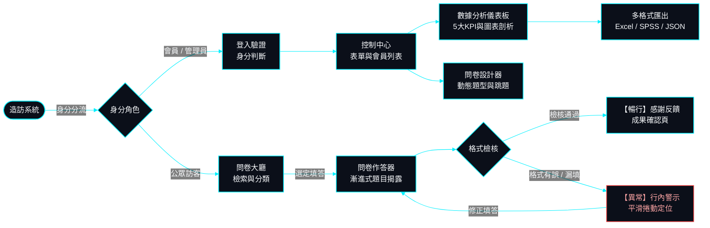

# 07. UI/UX 產品設計與 Figma 元件系統規範 (UI/UX Design System)

> **專案作者**: 許哲誠 (HSU, CHE-CHENG)  
> **核心標準**: 全域遵守 `AGENTS-UIUX.md`，以 Figma 為唯一真實設計源頭 (Figma as SSOT)  
> **更新日期**: 2026-10-07  
> **開發模式**: 逆向 UI/UX 開發（100% 完整逆向還原當前既有 Angular 前端程式碼實體存在之設計、佈局與元件）

---

## 0. Figma 專案主檔與 Page 架構 (Figma File Architecture)

> ⚠️ **核心開發底線**: **本專案所有前端畫面、表單流程與視覺樣式，永遠必須以 Figma 設計稿為唯一依歸 (Figma as SSOT)！**  
> 遵循「單一 Figma 檔案 + 三大 Page 分層」架構，元件零成本繼承，嚴格杜絕跨檔案維護摩擦力。  
> 程式碼有任何視覺或欄位異動時，必須執行「`UIUX逆向更新`」指令反向同步回寫 Figma。

### 0.1 Figma 官方存取連結 (Verified Real Links)

| 資源項目 | Figma Page 名稱 | 存取連結 | 說明 |
| :--- | :--- | :--- | :--- |
| **Figma 主設計稿** | `All Pages` | [Figma Canvas: survey-flow](https://www.figma.com/design/DQm4B3T1eI5ZHBqZszHUCq/survey-flow) | 單一核心設計主檔 (File Key: `DQm4B3T1eI5ZHBqZszHUCq`) |
| **一、Wireframe & UX 說明** | `01-Wireframe & Flow` | [Figma: 01-Wireframe & Flow](https://www.figma.com/design/DQm4B3T1eI5ZHBqZszHUCq/survey-flow) | 100% 逆向還原既有代碼 5 大核心頁面線稿與原生可播放 Prototype 連線 |
| **二、Component Design** | `02-Tokens & Components` | [Figma: 02-Tokens & Components](https://www.figma.com/design/DQm4B3T1eI5ZHBqZszHUCq/survey-flow) | Design Tokens 變數與 UI 元件庫 (Button, Input, Chips, Cards) |
| **三、Prototype Design** | `03-Prototype (RWD)` | [Figma: 03-Prototype (RWD)](https://www.figma.com/proto/DQm4B3T1eI5ZHBqZszHUCq/survey-flow) | Desktop 1440px / Mobile 375px RWD 原型、微互動與 Dev Notes |

---

## 1. 一、Wireframe & UI/UX 說明（低保真架構與體驗邏輯）

### 1.1 使用者流程圖 (User Flow - Happy Path & Edge Cases)

### 1.2 低保真線框圖 (Wireframes) 5 大核心頁面佈局架構
專注於純粹黑白灰骨架排版，不帶裝飾性干擾，確立資訊層級 (Visual Hierarchy) 與人體工學點擊動線，全數由 Figma 官方原生 Remote MCP 在畫布 `01-Wireframe & Flow` 建構：

| 畫面編號 | 頁面名稱 | 畫布歸屬 (Figma Canvas) | 核心佈局與主要組件 |
| :--- | :--- | :--- | :--- |
| **01** | **訪客問卷大廳** | `01-Wireframe & Flow` (1440x900) | TopBar 導航 (64px)、Hero 搜尋列、12 大主題分類 Pills、3x2 問卷卡片矩陣、分頁器 |
| **02** | **問卷作答器** | `01-Wireframe & Flow` (1440x900) | 頂部進度條 (3/8 題 38%)、單選題 Radio 卡、0-10 NPS 評分量表卡、上一題/下一題浮動列 |
| **03** | **提交完成感謝頁** | `01-Wireframe & Flow` (1440x900) | 居中感謝卡 (600x520)、成功綠色打勾 Icon、流水序號憑證卡、瀏覽更多/返回大廳雙按鈕 |
| **04** | **問卷管理控制台** | `01-Wireframe & Flow` (1440x900) | 左側 240px 導航欄、狀態篩選 Tags (全部/進行中/已截止)、「+ 建立新問卷」CTA、問卷資料表格 |
| **05** | **數據分析儀表板** | `01-Wireframe & Flow` (1440x900) | 頂部 Excel/SPSS/列印操作列、5 大 KPI 指標卡、30 日時序長條走勢圖、年齡輪廓條、題型選項剖析 |
| **註解** | **UX 決策便利貼** | `01-Wireframe & Flow` (Stickies) | 3 則黃色 UX 決策便利貼（漸進式揭露、一級全頁分析視圖、Excel/SPSS 物理分流） |

#### 畫面詳細規範：
1. **頂部導航骨架 (Top Bar, 高度 64px)**:
   - 左側：品牌 Logo + 產品名稱。
   - 中間：核心導航群（問卷大廳、表單管理、個人專案）。
   - 右側：⌘K 快速搜尋快捷鍵指示、登入/個人頭像抽屜。
2. **問卷大廳骨架 (01. Lobby Layout, 1440x900)**:
   - Hero 區域：簡潔標題、即時搜尋列、12 大主題 Pills 分類切換按鈕。
   - 內容主網格：卡片式問卷矩陣（發布者、題目數、截至今、開始填答 CTA）。
3. **問卷作答器骨架 (02. Survey Runner Layout, 1440x900)**:
   - 居中 820px 閱讀視線限制，防範認知分散。
   - 單選題與 NPS 量表卡片採用高對比藍色反饋高亮。
4. **提交完成感謝頁骨架 (03. Submission Success Layout, 1440x900)**:
   - 居中憑證卡片，展示回答時間與流水序號。
5. **問卷管理控制台骨架 (04. Management Dashboard Layout, 1440x900)**:
   - 經典側邊欄 (240px) 搭配寬幅資料表格，支援狀態篩選與快速操作。
6. **後台數據分析骨架 (05. Analytics Dashboard Layout, 1440x900)**:
   - 面板頂部：問卷標題、即時狀態 Tag、返回列表按鈕、右上角「Excel / SPSS / 列印」整合按鈕群。
   - 核心指標列：5 欄並列 KPI 卡片（回覆數、平均時長、完成率、NPS、今日新增）。
   - 視覺化圖表列：全寬 30 日填答直方走勢圖 + 受訪者輪廓（年齡階層分佈）。
   - 題型剖析列：選項百分比進度條與開放式問答情緒標籤列表。

### 1.3 UX 設計決策備忘錄 (UX Annotations & Design Rationale)
- **決策一：為什麼問卷填答採用動態漸進揭露（Progressive Disclosure）？**  
  避免受訪者在打開問卷時面臨十幾題龐大資訊量產生認知負荷（Cognitive Overload）而跳出。跳題邏輯依據前置單選題選項動態淡入子題目，降低棄填率。
- **決策二：為什麼後台數據分析採用一級全頁視圖而非彈窗（Modal）？**  
  分析報表包含 5 大 KPI、時序圖表、交叉分析與開放式反饋，資訊維度龐大。採用全頁視圖利於桌機橫向展開對照，且原生適配 `@media print` 列印另存 PDF 報表模式。
- **決策三：為什麼匯出選單將 Excel 與 SPSS 明確物理分離？**  
  一般行政人員僅需以微軟 Excel 開啟查看名單（需 UTF-8 BOM 防亂碼）；而民意調查與學術研究員則需要標準數值編碼與 SPSS `.sps` 標籤定義檔。分離設計能避免一般使用者困惑，同時滿足高階計量需求。

---

## 2. 二、Component Design（元件庫與設計規範）

### 2.1 基礎原子規範 (Design Tokens)

#### 1. 語意化色票與雙向映射表 (Semantic Color Tokens Mapping)
對標 [supahero.io](https://supahero.io/) 清新現代科技美學，兼顧高對比度與視覺舒適感：

| Token 名稱 | CSS 變數 | SCSS 變數 | Light Mode | Dark Mode | 語意說明與應用場景 |
| :--- | :--- | :--- | :--- | :--- | :--- |
| **`primary`** | `--sf-color-primary` | `$sf-primary` | `#2563eb` | `#3b82f6` | 品牌科技主色、主要按鈕、焦點邊框 |
| **`primary-hover`** | `--sf-color-primary-hover` | `$sf-primary-hover` | `#1d4ed8` | `#60a5fa` | 按鈕游標懸停反饋 |
| **`primary-active`**| `--sf-color-primary-active` | `$sf-primary-active` | `#1e40af` | `#2563eb` | 按鈕點擊按下狀態 |
| **`background-base`**| `--sf-color-bg-base` | `$sf-bg-base` | `#f8fafc` | `#030712` | 底層視窗基底畫布 |
| **`background-surface`**| `--sf-color-bg-surface` | `$sf-bg-surface` | `#ffffff` | `#0b0f19` | 卡片容器、資料表格面板、對話框背景 |
| **`text-primary`** | `--sf-color-text-primary` | `$sf-text-primary` | `#0f172a` | `#f8fafc` | 一級高對比標題文字、關鍵 KPI 數值 |
| **`text-secondary`**| `--sf-color-text-secondary` | `$sf-text-secondary` | `#475569` | `#94a3b8` | 次級說明文案、欄位標籤、表頭文字 |
| **`text-muted`** | `--sf-color-text-muted` | `$sf-text-muted` | `#94a3b8` | `#64748b` | 輸入框佔位提示、停用狀態文字 |
| **`border-subtle`** | `--sf-color-border-subtle` | `$sf-border-subtle` | `#e2e8f0` | `#1e293b` | 容器分割線、未聚焦表單外框 |
| **`status-success`** | `--sf-color-status-success` | `$sf-status-success` | `#16a34a` | `#22c55e` | 成功反饋、進行中問卷、NPS 推薦者 (9-10分) |
| **`status-warning`** | `--sf-color-status-warning` | `$sf-status-warning` | `#d97706` | `#f59e0b` | 待處理通知、NPS 被動者 (7-8分) |
| **`status-danger`** | `--sf-color-status-danger` | `$sf-status-danger` | `#dc2626` | `#ef4444` | 格式錯誤提示、必填警示、NPS 貶損者 (1-6分) |

#### 2. 排版層級 (Typography Scale)
- **Display (大廳巨幅標題)**: `font-size: 36px; line-height: 1.2; font-weight: 800;`
- **H1 (頁面主標題)**: `font-size: 28px; line-height: 1.3; font-weight: 700;`
- **H2 (章節/卡片標題)**: `font-size: 20px; line-height: 1.35; font-weight: 600;`
- **H3 (小分組與列表頭)**: `font-size: 16px; line-height: 1.4; font-weight: 600;`
- **Body (標準內文)**: `font-size: 14px; line-height: 1.6; font-weight: 400;`
- **Caption (微型標註與標籤)**: `font-size: 12px; line-height: 1.5; font-weight: 500;`

#### 3. 間距與格線系統 (4px / 8px Spacing Grid)
`4px` (xxs) / `8px` (xs) / `12px` (sm) / `16px` (md) / `24px` (lg) / `32px` (xl) / `48px` (2xl)。

---

### 2.2 UI 元件庫完整狀態變體 (Component States Matrix)

#### 1. 按鈕元件 (Button - 4 種變體 $\times$ 5 種狀態)
- **變體種類**: `Primary` (填滿主色), `Secondary` (細邊框), `Ghost` (透明幽靈), `Danger` (警示紅)。
- **5 大互動狀態**:
  1. `Default`: 標準狀態，精緻微陰影與 1px 細外框。
  2. `Hover`: 垂直微浮 1px，色彩深階過渡。
  3. `Active / Pressed`: 縮小 0.98 倍，深邃壓下反饋。
  4. `Disabled`: 不透明度 40%，禁止游標指示（`cursor: not-allowed`）。
  5. `Loading`: 呈現旋轉 Spinner 指示器，文字隱藏並鎖定防止重複提交。

#### 2. 輸入控制項 (Input - 4 種檢驗狀態)
- **4 大狀態**:
  1. `Default`: 淺灰外框 (`#e2e8f0`)，純白底色。
  2. `Focus`: 品牌藍外框 (`#2563eb`) + 3px 半透明聚焦光環（WCAG 認證焦點）。
  3. `Error`: 紅色邊框 (`#dc2626`) + 輸入框下方立即附帶紅色錯誤訊息小字。
  4. `Disabled`: 淺灰背景，文字弱化，無法點選輸入。

#### 3. 系統反饋元件 (Feedback Suite)
- **Modal 彈窗**: 居中浮現對話框，帶深黑半透明 Backdrop (40% opacity) 遮罩，支援點擊遮罩或按 `ESC` 鍵關閉。
- **Toast 通知條**: 右上角或底部浮現通知（成功綠、警告黃、錯誤紅），附帶 3 秒自動倒數進度條與手動叉叉。
- **Skeleton 骨架屏**: 灰階漸層波紋掃過之佔位區塊，模擬資料載入過程，防止介面 CLS 跳動。
- **Empty State 空狀態**: 包含精緻幾何圖示、說明文字與主要行動按鈕（如「尚未有填答回覆，立即分享問卷連結」）。

---

## 3. 三、Prototype Design（高保真互動原型）

### 3.1 跨端 RWD 響應式佈局規格與斷點 (Responsive Breakpoints)

| 裝置類型 | 斷點範圍 (Breakpoint) | 佈局規則與排版特性 | 點擊熱區要求 |
| :--- | :--- | :--- | :--- |
| **Mobile (行動端)** | `< 768px` (基準 375px) | 單欄流式排列、頂部漢堡選單/底部導航、走勢圖水平滑動 | $\ge 44\text{px} \times 44\text{px}$ |
| **Tablet (平板端)** | `768px ~ 1024px` | 雙欄自適應網格、側邊選單可折疊、KPI 卡片 2+3 分流 | $\ge 40\text{px} \times 40\text{px}$ |
| **Desktop (桌面端)** | `> 1024px` (基準 1440px) | 完整 5 欄 KPI 並列、全寬趨勢走勢圖、3 欄受訪者輪廓、居中 `max-width: 1280px` | $\ge 36\text{px} \times 36\text{px}$ |

### 3.2 互動動態轉場 (Micro-Interactions)
- **彈窗出現**: `150ms ease-out` 縮放淡入 (`transform: scale(0.96) -> scale(1)`)。
- **行動抽屜**: `250ms cubic-bezier(0.16, 1, 0.3, 1)` 自右側平滑滑出。
- **圖表數據 Hover**: `150ms ease` 柱體加亮並彈出精確數值 Tooltip。

### 3.3 工程交付標記 (Dev Notes for Engineering Alignment)
- **資料模型對齊 (DTO)**:
  - 儀表板數據模型直接對齊 `SurveyAnalyticsReport`：
    `{ surveyId, title, totalResponses, completionRate, averageDurationSeconds, npsScore, dailyTimeline, demographics, questionStats }`
- **API 觸發機制**:
  - 進入數據分析頁面：觸發 `GET /api/surveys/{surveyId}/analytics`。
  - 大廳關鍵字搜尋：觸發 `GET /api/surveys?q={keyword}`（搭配 `debounceTime(300)` 防抖）。
  - 匯出報表：前端直出 Blob 下載，無須冗餘輪詢後端。

---

## 4. 雙向同步閉環守衛 (Two-way Synchronization Guard)

當工程師在程式碼層面進行任何介面微調（新增欄位、調整顏色、重排版面）時，必須立即執行：
> **`UIUX逆向更新`**  
Agent 將比對代碼實體變更，調用 Figma MCP 將最新版面與組件反向同步回寫至 Figma 檔案，確保設計稿與實體代碼永遠維持 100% 閉環同步！
