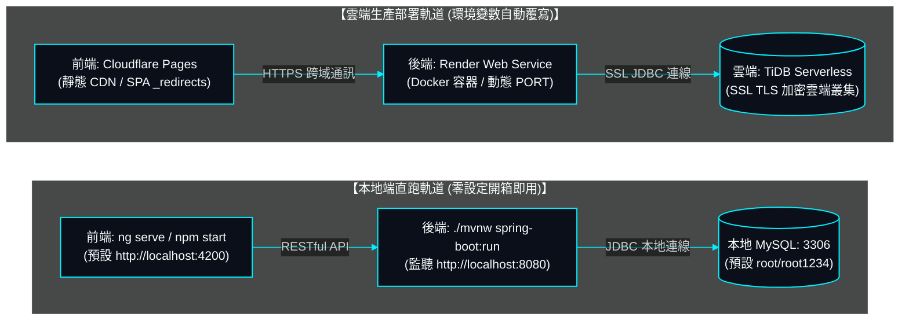

# 08. 容器建置與維運指標 (DevOps & Build Pipeline)

> **專案作者**: 許哲誠 (HSU, CHE-CHENG)  
> **運行環境**: Node.js 20.x, Angular CLI 19.0.5, Java 21, Spring Boot 4.1.1, TiDB Serverless / MySQL 8.0  
> **更新日期**: 2026-10-22  

---

## 1. 本地開發與雲端雙軌架構原則 (Dual-Track Invariants)

為確保**本地端隨時直接運行不受雲端影響**，系統採嚴格之雙軌組態設計：



### 1.1 核心不變性保證 (Invariants)
1. **本地預設零污染**: 代碼庫內所有設定檔（`application.properties`、`environment.ts`）默認值永遠鎖定本地本機參數，無需聯網或設定雲端密鑰即可直接執行 `./mvnw test` 與 `ng serve`。
2. **生產外部化覆寫 (SSOT)**: 雲端環境（Render）僅透過執行時期之環境變數（Environment Variables）覆寫資料庫與密鑰，絕不在原始碼中硬編碼任何生產連線資訊。
3. **前端環境置換機制**: 透過 Angular `angular.json` 之 `fileReplacements`，在執行 `npm run build` 時自動以 `environment.prod.ts` 取代 `environment.ts`，達成後端網址自動動態切換。

---

## 2. 雲端服務選型與職責矩陣

| 服務節點 | 服務提供商 | 職責與配置模式 | 本地對應元件 |
| :--- | :--- | :--- | :--- |
| **資料庫 (DB)** | **TiDB Serverless** | 雲端分散式 MySQL 相容關聯式資料庫，支援自動擴縮容與強製 TLS/SSL 傳輸加密 | 本地 MySQL 8.x (`localhost:3306`) |
| **後端 (Backend)** | **Render** | Web Service 運行 Docker 容器，自動偵測 `PORT` 動態綁定，支援健康檢查 | 本地 Spring Boot (`localhost:8080`) |
| **前端 (Frontend)** | **Cloudflare Pages** | 全球邊緣 Anycast CDN 託管 Angular 靜態資源，內建 `_redirects` 支援 SPA 路由回退 | 本地 Angular Dev Server (`localhost:4200`) |
| **持續整合 (CI/CD)** | **GitHub Actions** | 推送時自動執行 Maven 測試 (16/16 PASS) 與 Angular 生產打包驗證 | 本地 `./mvnw test` 與 `npm run build` |

---

## 3. 後端 Docker 容器化規格 (`backend/Dockerfile`)

後端採用**多階段建置 (Multi-stage Build)**，兼顧構建效率與最小化生產映像檔體積：

```dockerfile
# 階段 1: 建置環境 (Maven + JDK 21)
FROM eclipse-temurin:21-jdk-alpine AS builder
WORKDIR /build
COPY .mvn .mvn
COPY mvnw pom.xml ./
RUN chmod +x ./mvnw && ./mvnw dependency:go-offline -B || true
COPY src src
RUN ./mvnw clean package -DskipTests

# 階段 2: 運行環境 (Temurin 21 JRE Alpine 輕量容器)
FROM eclipse-temurin:21-jre-alpine AS runner
WORKDIR /app
RUN addgroup -S appgroup && adduser -S appuser -G appgroup
COPY --from=builder /build/target/survey-flow-backend-*.jar /app/app.jar
RUN chown -R appuser:appgroup /app
USER appuser
ENV PORT=8080
EXPOSE ${PORT}
ENTRYPOINT ["sh", "-c", "exec java -XX:+UseContainerSupport -XX:MaxRAMPercentage=75.0 -Dserver.port=${PORT} -Djava.security.egd=file:/dev/./urandom -jar /app/app.jar"]
```

---

## 4. 前端 Cloudflare Pages 配置與 SPA 路由重定向

### 4.1 構建命令與輸出目錄
- **Framework Preset**: `None` 或 `Angular`
- **Build command**: `npm run build`
- **Build output directory**: `dist/survey-flow/browser`
- **Node.js Version**: `20.x`

### 4.2 SPA 404 回退規則 (`frontend/public/_redirects`)
為防止使用者在 Cloudflare Pages 重新整理深層子路由（如 `/lobby`、`/verify-email`）時遭遇 404 錯誤，配置 `_redirects`：
```text
/*    /index.html   200
```

---

## 5. 雲端環境變數配置矩陣 (Render Environment Variables)

於 Render 控制台之 **Environment Variables** 填入以下參數，系統即自動無縫切換至雲端模式：

| 變數名稱 | 雲端生產設定值 (範例) | 說明 |
| :--- | :--- | :--- |
| `SPRING_DATASOURCE_URL` | `jdbc:mysql://{TIDB_HOST}:4000/survey_flow?useSSL=true&requireSSL=true&verifyServerCertificate=true` | TiDB Serverless 雲端 JDBC 連線字串 |
| `SPRING_DATASOURCE_USERNAME` | `{TIDB_USER}.root` | TiDB 叢集分配之連線帳號 |
| `SPRING_DATASOURCE_PASSWORD` | `{TIDB_PASSWORD}` | TiDB 叢集密碼 |
| `CORS_ALLOWED_ORIGINS` | `https://surveyflow.pages.dev` | 允許存取後端 API 之 Cloudflare Pages 前端網址 |
| `FRONTEND_BASE_URL` | `https://surveyflow.pages.dev` | 郵件一鍵直達按鈕與開通信之目標前端網址 |
| `JWT_SECRET` | 至少 256 位元 (32 字元) 之強隨機金鑰字串 | 生產專屬 JWT 簽章密鑰 |
| `MAIL_USERNAME` | `user46972@gmail.com` | Gmail 發信帳號 |
| `MAIL_PASSWORD` | Google 16 碼應用程式密碼 | Gmail 應用程式密碼 |
| `MAIL_FROM` | `user46972@gmail.com` | 寄件人顯示信箱 |
