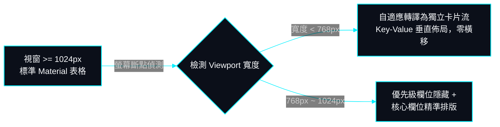
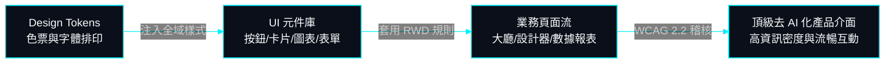

# 08. 前端 UI/UX 設計規範、純原生樣式與無障礙工程標準書

> **更新日期**: 2026-10-22  
> **文件定位**: 規範 SurveyFlow 系統全域介面視覺美學、純原生 SCSS/CSS 設計系統、WCAG 2.2 無障礙標準、零橫向拖曳之頂級 RWD 與深色 HUD Mermaid 圖表工程標準。

---

## 1. 核心視覺哲學：頂級設計師工藝與「去 AI 化」美學體系

### 1.1 徹底清除「AI 模板病」（AI Slop Anti-Patterns）
SurveyFlow 嚴格拒絕廉價、千篇一律且缺乏真實資訊密度的 AI 自動生成模板套版，全面杜絕以下設計反模式：
1. **禁止油膩的紫藍漸層發光球**: 嚴禁在頁面背景任意堆疊模糊光暈（Glow Orbs）與無節制的毛玻璃（Backdrop Blur），回歸高精準度實體線條與細膩中性階梯。
2. **禁止假大空「居中三欄圖示卡片」**: 嚴禁採用「一個抽象小圓圈圖示 + 一句空話標題 + 兩句通用描述」的無腦三欄堆疊套版。
3. **禁止漂浮 3D 幾何塊與裝飾性假圖表**: 嚴禁使用無實質決策價值的漂浮裝飾物或隨機生成的虛浮折線圖。
4. **禁止平鋪直敘無節奏的居中堆積**: 頁面必須具備明快的工作流節奏、主從分明之階梯排版與空間呼吸感。
5. **100% 純原生 SCSS/CSS 實現 (嚴禁外部樣式表)**: 全站所有樣式 100% 自研原生 SCSS/CSS 模組化撰寫，嚴格禁止引用 Bootstrap、Tailwind CSS、Bulma 等任何第三方外部樣式表，確保極致效能與樣式 100% 自主可控。

### 1.2 國際 7 大頂尖設計標竿思維深度對齊
本系統視覺體系汲取自全球領先設計平台之核心精髓：
- **Supahero (https://supahero.io/)**: 以真實產品互動 Controls、數據卡片與真實 UI 預覽直接展示軟體能力。
- **Land-book (https://land-book.com/)**: 學習獲獎級網站之白平衡控制、極度克制的留白與高級品牌性格。
- **Pageflows (https://pageflows.com/)**: 貫徹現代商業軟體（Linear, Stripe, Notion）之流暢多步驟表單、即時錯誤反饋與狀態流轉。
- **One Page Love (https://onepagelove.com/)**: 模組段落色彩交替、節奏緊湊明快且轉換導航直觀。
- **Awwwards (如 Huy Phan Vol. 2)**: 頂級工藝級字體排印（Editorial Typography）、非對稱網格與微互動。
- **Behance**: 嚴謹的 Design Token 色票體系、元件變體庫與高度一致性。
- **Pinterest**: 潮流卡片流、狀態藥丸標籤與資訊可視化細節。

---

## 2. 工藝級排版系統 (Editorial Typography & Materials)

### 2.1 模組化字階與字距微調 (Modular Scale)
字體嚴格鎖定無襯線現代字型群 `Inter, -apple-system, BlinkMacSystemFont, "Segoe UI", "PingFang TC", "Microsoft JhengHei", sans-serif`；等寬數字與編號鎖定 `"JetBrains Mono", "SF Mono", monospace`。

| 層級名稱 | 尺寸 (rem/px) | 字重 (Font Weight) | 字距 (Letter Spacing) | 行高 (Line Height) | 業務應用情境 |
| :--- | :--- | :--- | :--- | :--- | :--- |
| **Display Hero** | `3.6rem` (36px) | `850` (Heavy) | `-0.03em` (緊縮) | `1.15` | 首頁核心價值主張主標題 |
| **Section H1** | `2.4rem` (24px) | `800` (Bold) | `-0.02em` (緊縮) | `1.25` | 功能大模組、數據儀表板主標題 |
| **Card H2** | `1.8rem` (18px) | `750` (SemiBold) | `-0.01em` | `1.3` | 問卷卡片標題、彈窗 Modal 標題 |
| **Body Primary**| `1.4rem` (14px) | `500` (Regular) | `0em` | `1.55` | 問卷題目說明、報表指標解說 |
| **Badge / Label**| `1.15rem` (11.5px)| `700` (Bold) | `+0.04em` (微寬) | `1.2` | 狀態膠囊、題目編號 `#1`、圖例藥丸 |

### 2.2 材質與微陰影階梯 (Crafted Surfaces & Layered Shadows)
摒棄黑乎乎的單層生硬投影，全域採用雙層漫射微陰影（Layered Diffused Shadows）：
- **Card Base**: `box-shadow: 0 1px 2px rgba(0, 0, 0, 0.03), 0 4px 12px -2px rgba(0, 0, 0, 0.02);`
- **Elevated Hover**: `box-shadow: 0 4px 6px -1px rgba(0, 0, 0, 0.04), 0 20px 25px -5px rgba(0, 0, 0, 0.03);`
- **Floating Modal**: `box-shadow: 0 25px 50px -12px rgba(0, 0, 0, 0.15);`
- **1px 高精度邊界**: 所有卡片外框均配置 `1px solid var(--c-border)`（`#e2e8f0`），線條洗鍊銳利。

---

## 3. 頂級 RWD 響應式體系：徹底根除表格橫向拖曳

### 3.1 表格自適應轉譯標準 (Zero-Horizontal-Scroll Grid Protocol)
**在任何行動裝置或平板視窗下，嚴格禁止出現任何橫向拖動滾動條**。

1. **響應式卡片流 (Responsive Card List)**: 小螢幕（< 768px）時，表格強制自動轉譯為垂直卡片流。每一行轉換為獨立卡片，包含彩色編號、問卷名稱、發布標籤與操作按鈕群，手指滑動直觀順暢。
2. **防排版崩潰底線**: 所有文字容器宣告 `min-w-0` 與 `overflow-wrap: break-word`，杜絕英文無空格字串或過長標題撐破螢幕邊界。

---

## 4. WCAG 2.2 最新無障礙工程標準全量實踐

### 4.1 對比度與視覺獨立
- **一般文字對比度**: 強制 $\ge 4.5:1$（正文深色 `#0f172a` 於白底 `#ffffff` 達 $16.0:1$）。
- **非文字 UI 元素**: 輸入框邊框、按鈕外框、圖表柱體與相鄰背景對比度強制 $\ge 3:1$。
- **顏色語意獨立**: 紅色（錯誤）、綠色（成功）、藍色（進行中）必須同時搭配文字標籤或具體圖示，確保色弱者零障礙辨識。

### 4.2 鍵盤焦點與無障礙互動 (WCAG 2.2 SC 2.4.13 & SC 2.5.8)
- **高對比焦點外環**: 嚴禁使用 `outline: none`，凡由鍵盤 `Tab` 獲得焦點之控制項，強制渲染 `outline: 2px solid var(--c-primary-600); outline-offset: 2px;`。
- **觸控目標尺寸**: 所有按鈕與連結最小尺寸強制 $\ge 24\times 24\text{px}$，行動端核心操作強制 $\ge 44\times 44\text{px}$。
- **防拖曳依賴 (SC 2.5.7)**: 所有拖曳操作（如題目重排）均提供單擊按鈕（「↑ 上移」、「↓ 下移」）或數字直接設定之替代方案。

---

## 5. 深色 HUD 霓虹科技風 Mermaid 圖表規範 (全域通用標準)

說明文檔與架構圖強制依循深黑底色 `#030712`、霓虹青邊框 `#00f0ff`、文字純淨無灰底與非圓角 HUD 直角美學：

---

## 6. 數據視覺化鮮明調色盤與冠軍 👑 皇冠微徽章視覺標準

### 6.1 去灰濁！高對比且和諧之現代調色盤 (Vibrant Chart Palette)
拒絕死灰、過度降飽和與泥濁色彩，圖表與進度條強制採用高飽和度、清爽鮮明且具備色盲友善區隔性之 12 色階體系：
1. **鮮明寶藍 (`#2563eb`)**: 穩健冷靜，作為首選第一維度主色；
2. **翡翠純綠 (`#059669`)**: 高對比成功色與自然正面標記；
3. **琥珀金橙 (`#d97706`)**: 溫暖醒目，作為次高票與強調標籤；
4. **豔麗亮紫 (`#7c3aed`)**: 典雅高貴，提供強烈的色相差異化；
5. **珊瑚玫瑰紅 (`#e11d48`)**: 清晰警示與高能量維度標記；
6. **澄澈天青 (`#0891b2`)**: 現代數位科技感，具備優異白底對比度；
7. **晨曦活力橘 (`#ea580c`)**: 晨曦活力，高辨識度熱點色；
8. **電氣亮靛 (`#4f46e5`)**: 深邃科技色階；
9. **孔雀藍綠 (`#0d9488`)**: 沉著專業之藍綠色調；
10. **炫彩桃粉 (`#db2777`)**: 時尚活力之跳色維度；
11. **活力草綠 (`#16a34a`)**: 清新自然，豐富次階對比；
12. **霓虹紫紅 (`#d946ef`)**: 極具辨識度之末段對比點綴色。

進度條底槽與 0 票柱體統一採用清爽高雅的淡灰藍（`#f1f5f9` / `#e2e8f0`），徹底告別死灰濁色，突顯填答數據之層次美感。

### 6.2 冠軍最高票 👑 皇冠立體微徽章標準 (Crown Badging System)
為使受訪者投票結果之第一名（含同票並列第一）在所有題型中具備壓倒性的第一視覺辨識度，全系統強制落實微徽章膠囊化標準：
- **微徽章結構 (`.crown-badge-pill`, `.scale-crown-badge-prominent`)**:
  - 底色：`linear-gradient(135deg, #fef3c7 0%, #fde68a 100%)` 暖金質感漸層；
  - 邊框：`1.5px solid #f59e0b` 琥珀金精密描邊；
  - 陰影：`0 2px 6px rgba(245, 158, 11, 0.25)` 漫射微金光；
  - 圖標與字體：醒目 👑 皇冠搭配深金棕色 `#92400e` 粗體文字（`最高票` / `最高分`）。
- **條目卡片聯動**:
  - 是非題最高票卡片：賦予 `border-color: #f59e0b`、琥珀金光暈陰影與 `#fffdf5` 漸層底色；
  - 單選/多選排行榜第一名：賦予左側 4px 琥珀金標記線、暖金高光漸層（`#fffdf2` 至純白）與深色粗體加強；
  - 多選題柱狀圖頂部：最高票柱頂即時渲染金色 👑 與百分比；
  - 評分量表直方圖柱頂：最高票分數頂部渲染立體微徽章，柱體票數與分數加粗高亮。

---

## 7. 全域主題分類標籤語意調色標準 (Semantic Attribute Badges)

為提升問卷大廳與問卷管理列表之主題視覺辨識度，在保持全站中性素雅底色基調下，針對不同領域之分類膠囊標籤 (`.cat-chip`, `.cat-badge-chip`) 建立 9 大專屬高質感柔和調色系統：

| 領域分類名稱 | 色系家族 | 標籤背景色 | 標籤文字色 | 標籤邊框色 | 代表分類範例 |
| :--- | :--- | :--- | :--- | :--- | :--- |
| **學術專題研究** | 沉穩靛藍 (Indigo) | `#eef2ff` | `#4338ca` | `#c7d2fe` | 學術專題研究、論文評測、教育調研 |
| **教育與培訓評鑑** | 沉穩靛藍 (Indigo) | `#eef2ff` | `#4338ca` | `#c7d2fe` | 教育與培訓評鑑、教學研究 |
| **市場商業調研** | 琥珀金橙 (Amber) | `#fef3c7` | `#b45309` | `#fde68a` | 市場商業調研、行銷趨勢、消費購物 |
| **顧客滿意度** | 翡翠翠綠 (Emerald) | `#ecfdf5` | `#047857` | `#a7f3d0` | 顧客滿意度、服務品質、反饋調研 |
| **產品體驗研究** | 科技天藍 (Sky Blue) | `#f0f9ff` | `#0369a1` | `#bae6fd` | 產品體驗研究、科技軟體評測、SaaS |
| **社群互動與綜合** | 洋紅紫粉 (Fuchsia) | `#fdf4ff` | `#a21caf` | `#f5d0fe` | 社群互動與綜合、綜合調查、社交網絡 |
| **生活休閒娛樂** | 珊瑚玫瑰 (Rose) | `#fff1f2` | `#be123c` | `#fecdd3` | 生活日常、休閒娛樂、心理情感 |
| **健康醫療照護** | 薄荷青綠 (Teal) | `#f0fdfa` | `#0f766e` | `#99f6e4` | 醫療健康與心理諮詢、運動健康 |
| **人資行政職場** | 典雅紫 (Violet) | `#f5f3ff` | `#6d28d9` | `#ddd6fe` | 人資行政、組織職場福利 |

> **降級規範**: 未匹配之自訂主題分類，一律自動平滑降級為系統標準中性質感板岩灰（`#f1f5f9` 底、`#334155` 字、`#cbd5e1` 框）。

