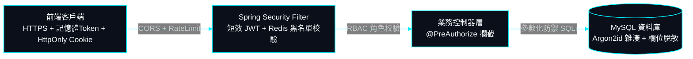
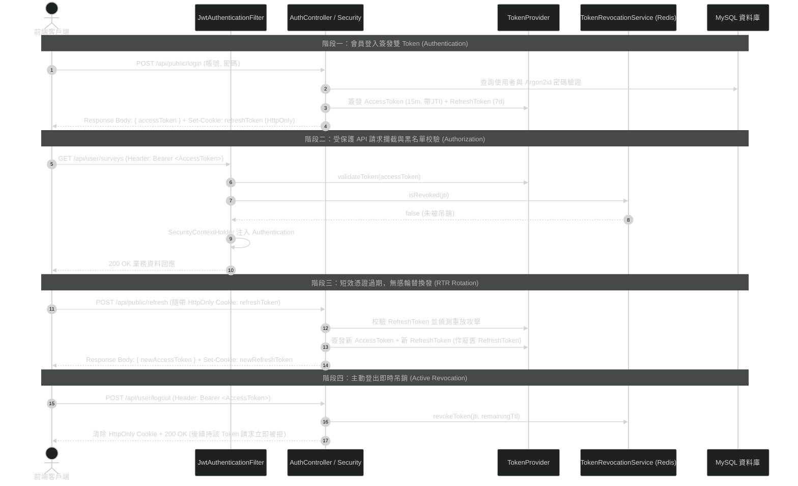

# 09. 全端資安防護、認證授權、加密與資料脫敏規格書 (Security & Data Protection Specifications)

> **專案作者**: 許哲誠 (HSU, CHE-CHENG)  
> **更新日期**: 2026-10-22  
> **文件定位**: 規範 SurveyFlow 系統全域之認證授權架構、Argon2id 密碼雜湊、零信任雙權杖、機敏資料脫敏加密與 API 防護機制。

---

## 1. 深度縱深防禦架構總覽 (Defense-in-Depth Security)

SurveyFlow 實施多層縱深防禦，確保受訪者資料、問卷設定與後台維運均受到嚴密保護：



---

## 2. 身份認證與零信任雙 Token 架構 (Zero-Trust Dual-Token Architecture)

### 2.1 現代高強度密碼雜湊 (Argon2id)
系統全面採用密碼學界抗 GPU/ASIC 暴力破解之最高標準 **Argon2id** 演算法：
- **雜湊規格**: `type: argon2id`, `memory: 4096 KB (4MB)`, `iterations: 3`, `parallelism: 1`。
- **儲存格式**: 包含密碼學隨機 Salt 與微秒級時鐘延展，徹底防禦彩虹表與離線碰撞。
- **配置外部化 (OCP)**: 演算法記憶體、迭代次數與鹽值長度均自 `application.properties` 注入，支援未來依伺服器算力無痛調校。

### 2.2 零信任雙 Token 輪替與主動吊銷體系 (Dual-Token Pattern & RTR)
貫徹**零信任架構（Zero Trust - Never Trust, Always Verify）**，徹底消除單一長效 Token 外洩無法吊銷之嚴重資安破口：

- **雙 Token 職責分離**:
  - **短效 Access Token (15 分鐘)**:
    - 簽署規格：**HMAC-SHA256 (`HS256`)**，密鑰長度 >= 256 bits。
    - 傳輸與存儲：前端存於記憶體，隨 API 請求 Header 帶入：`Authorization: Bearer <ACCESS_TOKEN>`。
    - 最小威脅窗口：即使遭遇中間人監聽或客戶端暫態外洩，憑證亦於極短時間內失效。
  - **長效 Refresh Token (7 天)**:
    - 存儲保護：**強制注入 `HttpOnly`, `Secure`, `SameSite=Strict` Cookie**，JavaScript 程式碼完全無法讀取，徹底免疫 XSS 憑證竊取攻擊。
    - 專用端點：僅限 `/api/auth/refresh` 與 `/api/auth/logout` 讀取校驗。
- **單次輪替防重放 (Refresh Token Rotation, RTR)**:
  - 客戶端每次調用 `/api/auth/refresh` 換發時，伺服端**即刻廢除當前 Refresh Token**，並同步簽發「新 Access Token + 新 Refresh Token」。
  - **重放攻擊偵測 (Replay Attack Detection)**: 若系統偵測到已被作廢的舊 Refresh Token 再次嘗試換發，判定憑證已遭竊取，系統立即啟動阻斷，**強制吊銷該使用者名下全數活躍 Token**，要求重新密碼認證。
- **主動吊銷與 Redis 黑名單 (Active Revocation via Redis JTI Blacklist)**:
  - 每個 Access Token 注入唯一識別碼（`jti: UUID`）。
  - 當使用者主動登出、變更密碼或管理員強制凍結帳號時，後端將該 `jti` 寫入 Redis 黑名單，TTL 設定為該 Token 剩餘有效秒數。
  - 過濾器驗證簽名有效後，以 O(1) 時間比對 Redis 黑名單，若存在則直接拒絕（401 Unauthorized），達成**無狀態高效驗證與即時吊銷之完美兼備**。

### 2.3 外部化組態管理與開放封閉原則 (OCP Configuration Center)
全系統所有資安與網路環境參數強制**100% 外部化**至 `application.properties`，支援系統環境變數覆寫：
- **JWT 密鑰與時效**: `${JWT_SECRET:...}`, `${JWT_ACCESS_EXPIRATION_MS:900000}` (15分鐘), `${JWT_REFRESH_EXPIRATION_MS:604800000}` (7天)。
- **CORS 跨來源來源與標頭**: `${CORS_ALLOWED_ORIGINS:...}`, `${CORS_ALLOWED_METHODS:...}`, `${CORS_MAX_AGE_SECONDS:3600}`。
- **Argon2id 加密參數**: `${ARGON2_MEMORY:4096}`, `${ARGON2_ITERATIONS:3}`, `${ARGON2_SALT_LENGTH:16}`。
- **Redis 快取與黑名單**: `${SPRING_DATA_REDIS_HOST:localhost}`, `${SPRING_DATA_REDIS_PORT:6379}`。

### 2.4 Security 模組核心架構與零信任認證時序

| 核心類別 / 模組 | 責任與架構角色 | 核心方法與關鍵邏輯 | 學習與實作要點 |
| :--- | :--- | :--- | :--- |
| **`SecurityConfig.java`** | **安全配置唯一真實來源 (SSOT)**<br/>過濾鏈、密碼雜湊器與 CORS 規則 | `securityFilterChain()`<br/>`passwordEncoder()` (Argon2id)<br/>`corsConfigurationSource()` | 配置短效 Access Token 攔截與公開/私有路由分流。 |
| **`JwtAuthenticationFilter.java`** | **HTTP 請求攔截器 (OncePerRequest)**<br/>解析 Bearer Token 並檢驗 Redis 吊銷黑名單 | `doFilterInternal()`<br/>`isTokenBlacklisted(jti)` | 提取標頭 Token，校驗簽章與 Redis 黑名單，通過後注入 `SecurityContextHolder`。 |
| **`TokenProvider.java`** | **JWT 簽發、RTR 輪替與校驗工具**<br/>基於 JJWT 實現雙 Token 簽章與 Claims 解構 | `generateAccessToken()`<br/>`generateRefreshToken()`<br/>`validateToken()` | 簽發包含 JTI 之短效 Access Token 與 HttpOnly Cookie 之 Refresh Token。 |
| **`TokenRevocationService.java`** | **憑證主動吊銷服務 (Redis 整合)**<br/>管理登出與異常事件黑名單 | `revokeToken(jti, remainingTtl)`<br/>`isRevoked(jti)` | 透過 Redis 高速 Key-Value 存儲 JTI 黑名單，實現微秒級主動吊銷。 |
| **`CustomUserDetailsService.java`** | **使用者資料庫權限橋接配接器**<br/>實作 Spring Security 原生載入介面 | `loadUserByUsername()` | 依據 `username` 查詢 MySQL `users` 表，轉換為帶有 RBAC 角色之 `UserDetails`。 |

#### 認證授權與雙 Token 輪替全生命週期時序圖 (Zero-Trust Lifecycle)



---

## 3. 角色存取控制矩陣 (RBAC Matrix)

系統嚴格落實最小權限原則（Least Privilege），透過 `@PreAuthorize` 於方法層級強制攔截：

| API 端點前綴 | 存取權限角色等級 | 業務範圍與安全防禦邊界 |
| :--- | :--- | :--- |
| **`/api/public/**`** | `ANONYMOUS` (公開存取) | 訪客大廳瀏覽、受訪者填答提交、會員登入與註冊。配置嚴格速率限制防刷票。 |
| **`/api/user/**`** | `ROLE_USER` / `ROLE_ADMIN` | 個人問卷設計、發布時限調整、個人問卷數據分析報表調閱。僅能存取本人名下問卷。 |
| **`/api/admin/**`**| `ROLE_ADMIN` (最高管理員) | 全站會員列表、強制凍結/啟用帳號、全站所有問卷強制刪除、全平台營運 KPI 總覽。 |

---

## 4. OWASP Top 10 全面防禦矩陣

### 4.1 SQL Injection (SQL 注入防禦)
- 全系統所有 Repository 之原生 SQL 查詢強制採用 **命名參數化綁定（Named Parameter Binding）**：
  ```java
  @Query(value = "SELECT * FROM surveys WHERE user_id = :userId AND deleted_at IS NULL", nativeQuery = true)
  Page<Survey> findByUserIdAndDeletedAtIsNullNative(@Param("userId") Long userId, Pageable pageable);
  ```
- 嚴格禁止任何字串拼接 SQL，底層資料庫驅動自動逸出特殊字元。

### 4.2 XSS (跨站腳本攻擊防禦)
- 前端採用 Angular 內建上下文無害化處理引擎（Contextual Sanitization），對所有透過插值綁定（`{{ ... }}`）渲染的文字自動進行 HTML 實體轉義。
- 問卷題目內容與受訪者填答簡答文字，存入資料庫前嚴禁解析為生 HTML，杜絕惡意 `<script>` 或外連資源注入。

### 4.3 CSRF & CORS (跨站請求防禦)
- 由於 API 採用純無狀態（Stateless）JWT 認證機制，不受傳統 Session Cookie 劫持影響。
- 後端 `SecurityConfig` 明確配置 CORS 嚴格來源白名單，僅允許授權的前端域名（如 `http://localhost:4200` 等），其餘未授權來源跨域存取直接於預檢（OPTIONS）階段阻斷。

---

## 5. 個人敏感資料脫敏與隱私合規 (Data Masking)

為符合 GDPR、臺灣個人資料保護法與商業稽核規範，受訪者個人資料在管理端呈現時實施動態脫敏：

| 欄位名稱 | 原始資料範例 | 脫敏遮罩規則 | 脫敏後展示範例 |
| :--- | :--- | :--- | :--- |
| **身分證字號** | `A123456789` | 保留首 1 碼與末 3 碼，中間 6 碼以 `*` 遮蔽 | `A******789` |
| **手機號碼** | `0912345678` | 保留前 4 碼與後 3 碼，中間 3 碼遮蔽 | `0912***678` |
| **電子郵件** | `xiaoming@gmail.com` | 帳號第 3 碼至 `@` 前以 `***` 遮蔽 | `xi***@gmail.com` |
| **姓名** | `陳小明` | 3 字姓名遮蔽中間字；2 字姓名遮蔽後者 | `陳*明` |

---

## 6. 防暴力破解與安全審計 (Brute-force Defense & Audit)

1. **登入頻率限制**: 連續輸入密碼錯誤達到 5 次即時觸發帳號鎖定冷卻機制（15 分鐘），防禦字典暴力破解。
2. **審計日誌 (Audit Logging)**: 關鍵敏感操作（會員狀態變更、問卷強制刪除、數據報表批次匯出）強制記錄操作者帳號、操作時間與客戶端 IP，不可竄改。
