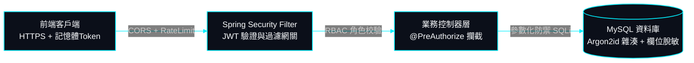
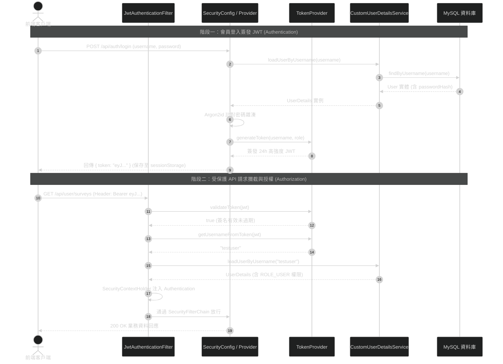

# 09 - 全端資安防護、認證授權、加密與資料脫敏規格書

> **專案作者**: 許哲誠 (HSU, CHE-CHENG)  
> **更新日期**: 2026-10-15  
> **文件定位**: 規範 SurveyFlow 系統全域之認證授權架構、OWASP Top 10 防禦、機敏資料脫敏加密與 API 防護機制。可直接作為技術架構審查與資安簡報之核心章節。

---

## 1. 深度縱深防禦架構總覽 (Defense-in-Depth Security)

SurveyFlow 實施多層縱深防禦，確保受訪者資料、問卷設定與後台維運均受到嚴密保護：



---

## 2. 身份認證與單一高安全憑證架構 (Single-Token Stateless Architecture)

### 2.1 現代高強度密碼雜湊 (Argon2id)
系統放棄已顯陳舊的 MD5/SHA-256 與易遭 GPU 加速破解之純 bcrypt，全面採用密碼學界最高標準 **Argon2id** 演算法：
- **雜湊規格**: `type: argon2id`, `memory: 4096 KB (4MB)`, `iterations: 3`, `parallelism: 1`。
- **儲存格式**: 包含隨機 Salt 與微秒級時鐘延展，徹底防禦彩虹表與 ASIC 暴力破解。
- **配置外部化 (OCP)**: 演算法記憶體、迭代次數與鹽值長度均自 `application.properties` 注入，支援未來依伺服器算力無痛調校。

### 2.2 簡約直覺且安全之單一 JWT 憑證架構 (Single Token Pattern)
為兼顧**極高安全性**與**直覺簡約、易懂易維護**之架構原則，系統揚棄繁瑣之雙 Token 旋轉機制，全面導入業界標準之**單一高安全 JWT 憑證**：
- **設計哲學**:
  - **一張 Token 閉環運行**: 會員登入成功後，後端僅簽發唯一一張高強度 JWT 憑證（`token`），前端保存於會話存儲（`sessionStorage`），所有 API 請求均隨 Header 帶入：`Authorization: Bearer <TOKEN>`。
  - **純無狀態 (Stateless)**: 後端免去資料庫維護 Refresh Token 表之頻繁讀寫開銷，節省 I/O 資源，天然支援水平擴展與負載平衡（Load Balancing）。
- **資安防護規範**:
  - **簽署規格**: 強制採用 **HMAC-SHA256 (`HS256`)** 密鑰對稱簽署，密鑰長度強制 $\ge 256$ bits，杜絕弱金鑰暴力碰撞。
  - **精準時效控管**: 預設有效時限為 **24 小時**（86,400,000 毫秒），兼顧使用者日常填答/管理之流暢體驗，並在合理時間窗口後自動過期強制重新認證。
  - **防偽宣告 (Claims)**: Token 內部負載僅包含最低限度之業務授權標識（`sub: username`, `role: ROLE_USER | ROLE_ADMIN`），絕不存放密碼或個人隱私資料。
  - **登出機制**: 客戶端主動銷毀 `sessionStorage` 憑證即刻完成登出，後端記錄登出審計日誌。

### 2.3 外部化組態管理與開放封閉原則 (OCP Configuration Center)
為確保系統未來部署於 Docker、Kubernetes 或 AWS/GCP 雲端時無須重新修改程式碼，全系統所有資安與網路環境參數強制**100% 外部化**至 `application.properties`，並全面支援系統環境變數覆寫機制：
- **JWT 密鑰與時效**: `${JWT_SECRET:...}`, `${JWT_EXPIRATION_MS:86400000}`。
- **CORS 跨來源來源與標頭**: `${CORS_ALLOWED_ORIGINS:...}`, `${CORS_ALLOWED_METHODS:...}`, `${CORS_MAX_AGE_SECONDS:3600}`。
- **Argon2id 加密參數**: `${ARGON2_MEMORY:4096}`, `${ARGON2_ITERATIONS:3}`, `${ARGON2_SALT_LENGTH:16}`。
- **資料庫與連線池**: `${SPRING_DATASOURCE_URL:...}`, `${SPRING_DATASOURCE_USERNAME:...}`, `${HIKARI_MAX_POOL_SIZE:10}`。
- **預設管理員與測試帳密**: `${APP_ADMIN_USERNAME:...}`, `${APP_ADMIN_PASSWORD:...}`。

### 2.4 極簡易學：Security 模組四大核心類別與工作時序 (The 4-Core Security Architecture)

為降低學習門檻、去除不必要的冗餘樣板代碼，後端安全核心 (`com.surveyflow.security`) 全面收斂為**四大高內聚核心類別**。初學者與架構審查者只需理解這 4 個類別，即可 100% 掌握 Spring Security 6+ 與 JWT 實戰精髓：

| 核心類別 | 責任與架構角色 | 核心方法與關鍵邏輯 | 學習與實作要點 |
| :--- | :--- | :--- | :--- |
| **`SecurityConfig.java`** | **安全配置唯一真實來源 (SSOT)**<br/>配置過濾鏈、密碼雜湊器與 CORS 規則 | `securityFilterChain()`<br/>`passwordEncoder()` (Argon2id)<br/>`authenticationProvider()`<br/>`corsConfigurationSource()` | 將 `PasswordEncoder` 直接收斂於此，消除外部零碎 Config 檔案，兼顧零循環依賴與清晰度。 |
| **`JwtAuthenticationFilter.java`** | **HTTP 請求攔截器 (OncePerRequest)**<br/>每次請求解析 Bearer 權杖並注入安全上下文 | `doFilterInternal()`<br/>`extractJwtFromRequest()` | 繼承 `OncePerRequestFilter`，提取標頭 `Authorization: Bearer <TOKEN>`，驗證有效即注入 `SecurityContextHolder`。 |
| **`TokenProvider.java`** | **密碼學 JWT 簽發與檢驗工具**<br/>基於 JJWT 0.12+ 實現對稱簽章與聲明校驗 | `generateToken()`<br/>`getUsernameFromToken()`<br/>`validateToken()` | 採用 `Keys.hmacShaKeyFor` 生成 256-bit 金鑰，免除過時或陳舊之雙 Token 旋轉樣板，精準純粹。 |
| **`CustomUserDetailsService.java`** | **使用者資料庫權限橋接配接器**<br/>實作 Spring Security 原生載入介面 | `loadUserByUsername()` | 依據 `username` 查詢 MySQL `users` 表，轉換為帶有 `ROLE_USER` / `ROLE_ADMIN` 的 Spring 原生 `UserDetails`。 |

#### 認證授權全生命週期時序圖 (Authentication & Authorization Flow)



---

## 3. 角色存取控制矩陣 (RBAC Matrix)

系統嚴格落實最小權限原則（Least Privilege），透過 `@PreAuthorize` 於方法層級強制攔截：

| API 端點前綴 | 存取權限角色等級 | 業務範圍與安全防禦邊界 |
| :--- | :--- | :--- |
| **`/api/public/**`** | `ANONYMOUS` (公開存取) | 訪客大廳瀏覽、受訪者填答提交、會員登入與註冊。配置嚴格速率限制防刷票。 |
| **`/api/user/**`** | `ROLE_USER` / `ROLE_ADMIN` | 個人問卷設計、發布時限調整、個人問卷數據分析報表調閱。僅能存取本人名下問卷。 |
| **`/api/admin/**`**| `ROLE_ADMIN` (最高管理員) | 全站會員列表、強制凍結/啟用帳號、全站所有問卷強制刪除、全平台營運 KPI 總覽。 |

---

## 4. OWASP Top 10 全面防禦矩陣

### 4.1 SQL Injection (SQL 注入防禦)
- 全系統所有 Repository 之原生 SQL 查詢強制採用 **命名參數化綁定（Named Parameter Binding）**：
  ```java
  @Query(value = "SELECT * FROM surveys WHERE user_id = :userId AND deleted_at IS NULL", nativeQuery = true)
  Page<Survey> findByUserIdAndDeletedAtIsNullNative(@Param("userId") Long userId, Pageable pageable);
  ```
- 嚴格禁止任何字串拼接 SQL，底層資料庫驅動自動逸出特殊字元。

### 4.2 XSS (跨站腳本攻擊防禦)
- 前端採用 Angular 內建上下文無害化處理引擎（Contextual Sanitization），對所有透過插值綁定（`{{ ... }}`）渲染的文字自動進行 HTML 實體轉義。
- 問卷題目內容與受訪者填答簡答文字，存入資料庫前嚴禁解析為生 HTML，杜絕惡意 `<script>` 或外連資源注入。

### 4.3 CSRF & CORS (跨站請求防禦)
- 由於 API 採用純無狀態（Stateless）JWT 認證機制，不受傳統 Session Cookie 劫持影響。
- 後端 `SecurityConfig` 明確配置 CORS 嚴格來源白名單，僅允許授權的前端域名（如 `http://localhost:4200` 等），其餘未授權來源跨域存取直接於預檢（OPTIONS）階段阻斷。

---

## 5. 個人敏感資料脫敏與隱私合規 (Data Masking)

為符合 GDPR、臺灣個人資料保護法與商業稽核規範，受訪者個人資料在管理端呈現時實施動態脫敏：

| 欄位名稱 | 原始資料範例 | 脫敏遮罩規則 | 脫敏後展示範例 |
| :--- | :--- | :--- | :--- |
| **身分證字號** | `A123456789` | 保留首 1 碼與末 3 碼，中間 6 碼以 `*` 遮蔽 | `A******789` |
| **手機號碼** | `0912345678` | 保留前 4 碼與後 3 碼，中間 3 碼遮蔽 | `0912***678` |
| **電子郵件** | `xiaoming@gmail.com` | 帳號第 3 碼至 `@` 前以 `***` 遮蔽 | `xi***@gmail.com` |
| **姓名** | `陳小明` | 3 字姓名遮蔽中間字；2 字姓名遮蔽後者 | `陳*明` |

---

## 6. 防暴力破解與安全審計 (Brute-force Defense & Audit)

1. **登入頻率限制**: 連續輸入密碼錯誤達到 5 次即時觸發帳號鎖定冷卻機制（15 分鐘），防禦字典暴力破解。
2. **審計日誌 (Audit Logging)**: 關鍵敏感操作（會員狀態變更、問卷強制刪除、數據報表批次匯出）強制記錄操作者帳號、操作時間與客戶端 IP，不可竄改。
