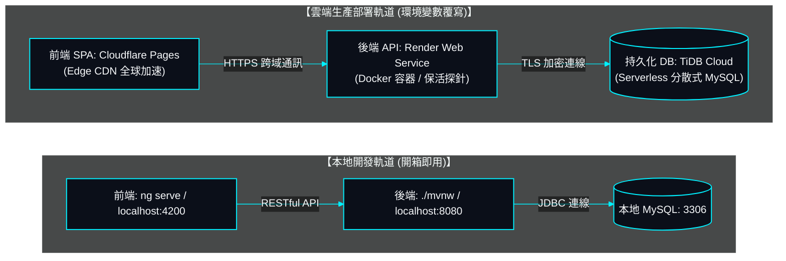

# 10. 系統雲端部署拓撲與維運規範書 (System Cloud Deployment Specifications)

> **所屬系統**: SurveyFlow 現代實證調研與學術結構化數據採集系統  
> **更新日期**: 2026-10-27  
> **文檔定位**: 全系統雲端生產環境、雙軌部署拓撲、容器建置、環境變數與保活維運之唯一真實規格標準。

---

## 1. 雲端雙軌部署拓撲架構 (Cloud Deployment Topology)

系統採用前後端完全分離之現代化雲端拓撲，各層級部署於專屬最適雲端平台，兼顧本地開發開箱即用與雲端高可用性：



---

## 2. 雲端平台具體規格明細

| 架構層級 | 部署託管平台 | 運行網址 / 通訊端點 | 核心技術規格與維運機制 |
| :--- | :--- | :--- | :--- |
| **前端 SPA** | **Cloudflare Pages** | `https://survey-flow.pages.dev` | Angular 19 獨立組件架構；樣式 100% 採用純原生 SCSS/CSS（嚴禁引用 Bootstrap、Tailwind 等任何外部樣式表）；靜態資源由全球 Edge CDN 快取分發。 |
| **後端 Web API** | **Render Web Service** | `https://survey-flow-9gt6.onrender.com` | Docker 容器化執行 Java 21 / Spring Boot 3.4 服務；配置 `/actuator/health` 探針；無狀態 Stateless JWT 認證架構。 |
| **持久化資料庫** | **TiDB Cloud (Serverless)** | 雲端分散式 MySQL 端點 | MySQL 8.0 協定相容之分散式關聯式資料庫；外鍵完整約束、utf8mb4 編碼、ACID 交易隔離；HikariCP 連線池安全存取。 |
| **持續整合與交付** | **GitHub Actions** | CI/CD 自動化工作流 | 推送時自動執行 Maven 單元測試 (38/38 PASS) 與前端生產打包驗證。 |

---

## 3. 後端 Docker 容器化建置規格 (`Dockerfile`)

後端採用**多階段建置 (Multi-stage Build)**，兼顧構建效率與最小化生產映像檔體積：

```dockerfile
# 階段 1: 建置環境 (Maven + JDK 21)
FROM eclipse-temurin:21-jdk-alpine AS builder
WORKDIR /build
COPY backend/.mvn .mvn
COPY backend/mvnw backend/pom.xml ./
RUN chmod +x ./mvnw && ./mvnw dependency:go-offline -B || true
COPY backend/src src
RUN ./mvnw clean package -DskipTests

# 階段 2: 運行環境 (Temurin 21 JRE Alpine 輕量容器)
FROM eclipse-temurin:21-jre-alpine AS runner
WORKDIR /app
RUN addgroup -S appgroup && adduser -S appuser -G appgroup
COPY --from=builder /build/target/survey-flow-backend-*.jar /app/app.jar
RUN chown -R appuser:appgroup /app
USER appuser
ENV PORT=8080
EXPOSE ${PORT}
ENTRYPOINT ["sh", "-c", "exec java -XX:+UseContainerSupport -XX:MaxRAMPercentage=75.0 -Dserver.port=${PORT} -Djava.security.egd=file:/dev/./urandom -jar /app/app.jar"]
```

---

## 4. 前端 Cloudflare Pages 配置與 SPA 路由重定向

### 4.1 構建設定
- **Build command**: `npm run build`
- **Build output directory**: `dist/survey-flow/browser`
- **Node.js Version**: `20.x` 或以上

### 4.2 SPA 404 回退規則 (`frontend/public/_redirects`)
為防止使用者在 Cloudflare Pages 重新整理深層子路由（如 `/lobby`、`/verify-email`）時遭遇 404 錯誤，配置 `_redirects`：
```text
/*    /index.html   200
```

---

## 5. 全域環境變數外部化對照表 (OCP Externalized Configurations)

依據 OCP 開放封閉原則，所有系統參數與連線端點一律透過環境變數注入，嚴禁於代碼或設定檔中硬編碼業務預設值：

### 5.1 雲端生產環境 (Render 控制台配置) 8 大核心變數 (100% 精準對齊)

| 環境變數名稱 | 範例 / 推薦設定值 | 生產環境用途與安全性說明 |
| :--- | :--- | :--- |
| **`SPRING_DATASOURCE_URL`** | `jdbc:mysql://<TiDB_HOST>:4000/survey_flow...` | TiDB Cloud 雲端資料庫 JDBC 連線字串 (含 TLS 證書授權與時區) |
| **`SPRING_DATASOURCE_USERNAME`** | `<TIDB_USER>.root` | TiDB Cloud 分散式資料庫連線帳號 |
| **`SPRING_DATASOURCE_PASSWORD`** | `********` | TiDB Cloud 分散式資料庫連線密碼 |
| **`JWT_SECRET`** | `SurveyFlowSecretKey...2026!` (>=256 bits) | HMAC-SHA256 簽署短效 Token 與雙權杖之防偽金鑰 |
| **`CORS_ALLOWED_ORIGINS`** | `https://survey-flow.pages.dev` | 允許跨域請求之前端 Cloudflare Pages 生產網址 |
| **`FRONTEND_BASE_URL`** | `https://survey-flow.pages.dev` | 前端 SPA 根網址 (用於組裝驗證信中之一鍵開通與密碼重設直達連結) |
| **`BREVO_API_KEY`** | `xkeysib-********` | **主力郵件服務商**：Brevo HTTP REST API 金鑰 (走 HTTPS Port 443 突破 Render 免費方案 SMTP 阻斷，每日免費 300 封，**全面取代傳統 Gmail SMTP**) |
| **`MAIL_FROM`** | `service@surveyflow.tw` | 系統外發信件之寄件者顯示信箱 (需於 Brevo 完成寄件者網域或信箱驗證) |

### 5.2 雲端環境查整：確認為多餘且可安全移除之無效變數

以下 3 個變數在專案代碼中 **0 引用**（系統管理員帳號由關聯式資料庫 `schema.sql` / `data.sql` 種子資料管理，而非啟動時讀取環境變數），於 Render 控制台屬於多餘殘留，**可安全直接刪除 (Delete)**：

| 變數名稱 | 查整狀態 | 說明與建議處置 |
| :--- | :---: | :--- |
| `APP_ADMIN_USERNAME` | ❌ **多餘殘留** | 專案代碼無引用。管理員由資料庫種子管轄 (`admin / Admin123!`)，可於 Render 控制台直接刪除。 |
| `APP_ADMIN_PASSWORD` | ❌ **多餘殘留** | 專案代碼無引用。密碼以 Argon2id 儲存於資料庫，可於 Render 控制台直接刪除。 |
| `APP_ADMIN_EMAIL` | ❌ **多餘殘留** | 專案代碼無引用。管理員 Email 儲存於 `users` 表，可於 Render 控制台直接刪除。 |

### 5.3 本地開發與備用降級變數 (Local & Fallback)

| 環境變數名稱 | 預設降級值 (本地開發) | 說明 |
| :--- | :--- | :--- |
| `PORT` / `SERVER_PORT` | `8080` | Render 容器動態指派之 HTTP 通訊埠 (平台自動注入) |
| `RESEND_API_KEY` | *(選填/備用)* | Resend HTTP API 金鑰 (走 HTTPS 443 備用外寄管道) |
| `MAIL_PROVIDER` | `AUTO` | 郵件提供商調度模式 (`AUTO`: 自動偵測 Brevo -> Resend -> SMTP) |
| `JWT_ACCESS_EXPIRATION_MS` | `900000` (15 分鐘) | 短效 Access Token 存活毫秒數 |
| `JWT_REFRESH_EXPIRATION_MS` | `604800000` (7 天) | 長效 Refresh Token 存活毫秒數 |
| `MAIL_HOST` / `MAIL_PORT` | `smtp.gmail.com` / `587` | 本地離線開發用 Gmail SMTP 主機與通訊埠 (生產環境已被 Brevo 100% 取代) |
| `MAIL_USERNAME` / `MAIL_PASSWORD`| *(無預設值)* | 本地離線開發用 Gmail 帳號與 16 碼應用程式密碼 |

---

## 6. 維運保活與冷啟動防護規範

1. **Render 免費容器保活機制 (UptimeRobot 外部探針)**:
   - Render 免費容器在 15 分鐘無外部流量時會進入休眠 (Spin-down)。
   - 後端暴露專屬輕量探針端點 `GET /actuator/health`（僅檢查 Web 容器存活，排除 DB/Mail 暫態相依），回傳 HTTP 200 OK。
   - **全面採用外部專業服務 UptimeRobot 執行 24/7 全天候探針監控**（每 5~10 分鐘自動對 `https://survey-flow-9gt6.onrender.com/actuator/health` 發送 HTTP GET 請求），杜絕受訪者遭遇 50 秒冷啟動延遲；同時淘汰非必要之 GitHub Actions 定時工作流，落實乾淨維運與最少實體檔案原則。
2. **TiDB Cloud 連線池防禦**:
   - HikariCP 連線池配置 `connection-timeout: 20000ms` 與 `idle-timeout: 300000ms`，自動回收無效連線並保證查詢連線可用性。
