# 11. 本地測試、建置與快速啟動指南 (Local Testing & Build Guide)

> **更新日期**: 2026-10-23  
> **文件定位**: 規範 SurveyFlow 系統在本地開發環境（Local Development）之前置依賴、資料庫初始化、後端全套測試運行、前端編譯除錯與端對端冒煙測試驗證程序。

---

## 1. 本地環境前置需求 (Prerequisites)

在本地執行與測試 SurveyFlow 之前，請確認工作環境已具備以下軟體工具：

| 軟體工具 | 最低版本需求 | 建議發行版本 / 驗證指令 | 用途說明 |
| :--- | :--- | :--- | :--- |
| **Node.js** | `v20.x` 或以上 | `node -v` (推薦 Node.js 24.x LTS) | 前端 Angular 19 開發與建置環境 |
| **npm** | `v10.x` 或以上 | `npm -v` | 前端相依套件管理工具 |
| **Java JDK** | `21` | `java -version` (推薦 Eclipse Temurin 21) | 後端 Spring Boot 4.1.1 執行環境 |
| **MySQL / TiDB** | `8.0+` | `mysql --version` (或 TiDB Serverless) | 本地或遠端關聯式資料庫 |
| **Git** | `2.40+` | `git --version` | 本地版本控制 |

---

## 2. 資料庫本地初始化標準作業 (Database Initialization SOP)

所有資料庫 DDL 結構與種子資料之唯一真實來源 (SSOT) 位於後端資源目錄：
- **結構定義**: [`backend/src/main/resources/database/schema.sql`](file:///Users/hsuche-cheng/Documents/project/survey-flow/backend/src/main/resources/database/schema.sql)
- **測試種子**: [`backend/src/main/resources/database/data.sql`](file:///Users/hsuche-cheng/Documents/project/survey-flow/backend/src/main/resources/database/data.sql)

### 初始化步驟 (MySQL Workbench / CLI)
1. 建立空資料庫：
   ```sql
   CREATE DATABASE IF NOT EXISTS surveyflow CHARACTER SET utf8mb4 COLLATE utf8mb4_unicode_ci;
   USE surveyflow;
   ```
2. 執行 `schema.sql`：
   - **方案 A（全新本機安裝）**: 執行上半部【方案 A】，依外鍵依賴倒序安全抹除並重建 9 大實體資料表。
   - **方案 B（生產/既有資料庫）**: 執行下半部【方案 B】，透過 `CREATE TABLE IF NOT EXISTS` 保留既有資料。
3. 執行 `data.sql`（可選）：
   - 注入內建測試帳號（含 Argon2id 密碼雜湊）與 6 大真實領域示範問卷。

---

## 3. 後端 Spring Boot 測試與本機啟動 (Backend Testing & Startup)

進入後端目錄：
```bash
cd backend
```

### 3.1 執行全套單元與整合測試 (38/38 PASS)
系統內建涵蓋 Controller、Service、Security、原生 SQL 與資料驗證的 38 項 JUnit 5 / Mockito 測試套件：
```bash
# 執行全套測試並輸出測試報表
./mvnw clean test
```
預期結果：**Tests run: 38, Failures: 0, Errors: 0, Skipped: 0**，構建成功（BUILD SUCCESS）。

### 3.2 本地啟動 Spring Boot Web API
```bash
# 啟動後端應用程式 (預設監聽埠號: 8080)
./mvnw spring-boot:run
```

- **本機 API 端點**: `http://localhost:8080/api`
- **本機健康檢查探針**: `http://localhost:8080/actuator/health` (回傳 `{"status":"UP"}`)

---

## 4. 前端 Angular 啟動與建置驗證 (Frontend Startup & Build)

進入前端目錄：
```bash
cd frontend
```

### 4.1 安裝相依套件
```bash
npm install
```

### 4.2 啟動本機開發伺服器 (支援熱重載)
```bash
npm start
```
- 開啟瀏覽器存取：`http://localhost:4200`
- 前端會自動動態解析後端網址（偵測為 localhost 即自動連線至 `http://localhost:8080`）。

### 4.3 驗證生產環境編譯打包 (Production Build)
```bash
npm run build
```
預期結果：零錯誤構建，於 `dist/survey-flow-frontend/browser` 產出靜態網站資源。

---

## 5. 本地測試預設帳號與驗證種子清單 (Testing Seed Accounts)

系統預載之測試帳號均採用國際標準 **Argon2id** 演算法雜湊：

| 身分角色 | 帳號 (Username) | 預設密碼 (Password) | 角色權限 (`Role`) | 帳號狀態 | 測試重點能力 |
| :--- | :--- | :--- | :--- | :--- | :--- |
| **系統最高管理員** | `admin` | `Admin123!` | `ROLE_ADMIN` | `ACTIVE` | 全站會員治理、即時凍結/啟用、帳號刪除 |
| **測試一般會員** | `testuser` | `User1234!` | `ROLE_USER` | `ACTIVE` | 問卷設計、條件跳題、開放時限管理、數據分析報表 |

---

## 6. 本地端全功能冒煙測試 SOP (Smoke Testing Procedures)

本機啟動後，可循以下路徑快速驗證全站核心業務流程：

```mermaid
%%{init: {'theme': 'dark', 'themeVariables': { 'darkMode': true, 'background': '#030712', 'primaryColor': '#0b0f19', 'primaryTextColor': '#f8fafc', 'primaryBorderColor': '#00f0ff', 'lineColor': '#00f0ff', 'textColor': '#f8fafc', 'edgeLabelBackground': 'transparent' }, 'themeCSS': '.edgeLabel, .edgeLabel rect, .edgeLabel span, .labelBkg { background: transparent !important; background-color: transparent !important; fill: transparent !important; border: none !important; } .edgeLabel, .edgeLabel span { color: #ffffff !important; fill: #ffffff !important; font-weight: 500 !important; } rect, .node rect, polygon { rx: 0px !important; ry: 0px !important; }', 'flowchart': { 'curve': 'linear' } }}%%
flowchart LR
    classDef hudCard fill:#0b0f19,stroke:#00f0ff,stroke-width:1.5px,color:#f8fafc,rx:0px,ry:0px;

    Step1["1. 訪客大廳瀏覽<br/>關鍵字搜尋 / 12大分類"]:::hudCard
    Step2["2. 問卷填答運行<br/>身分防呆 / 條件跳題"]:::hudCard
    Step3["3. 會員登入認證<br/>雙Token簽發"]:::hudCard
    Step4["4. 視覺化問卷設計<br/>7大型態 / 擬真預覽"]:::hudCard
    Step5["5. 問卷專案管理<br/>時限設置 / 複製連結"]:::hudCard
    Step6["6. 深度數據分析<br/>KPI指標 / 👑 皇冠徽章"]:::hudCard
    Step7["7. 管理員治理後台<br/>會員狀態凍結啟用"]:::hudCard

    Step1 --> Step2 --> Step3 --> Step4 --> Step5 --> Step6 --> Step7
```



1. **訪客大廳瀏覽**: 存取 `http://localhost:4200/lobby`，點選主題分類下拉選單測試 12 大語意標籤篩選與關鍵字即時模糊搜尋。
2. **問卷填答運行**: 進入任一開放問卷，驗證身分證號（Modulo 10）與手機（09 開頭 10 碼）防呆；點選特定單選選項確認目標題目平滑解鎖展開。
3. **會員登入**: 以 `testuser / User1234!` 登入，確認右上角導航即時切換為會員選單。
4. **問卷設計**: 進入 `/survey-design`，新增是非、評分量表與單選題，設定跳題邏輯並點擊「即時擬真預覽」。
5. **問卷管理與時限**: 進入 `/survey-management`，切換大廳公開開關，複製專屬直達連結。
6. **數據分析儀表板**: 進入數據分析頁面，確認 5 大 KPI、12 色圖表、最高票 👑 皇冠微徽章正常渲染，點擊「匯出 SPSS (.sps)」與「匯出 CSV」。
7. **管理員治理**: 登出後以 `admin / Admin123!` 登入，進入 `/user-management`，測試凍結指定帳號與解凍功能。
